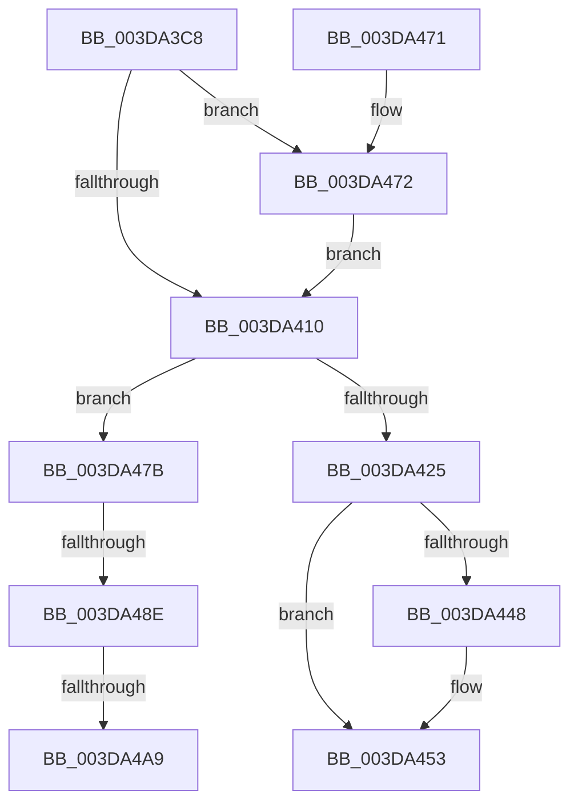

# HalpAllocateDmaChannels

- RVA: `0x003DA3C8`–`0x003DA4B0` (길이 `232` bytes)
- VA: `0x00000001403DA3C8`
- 실행 섹션: `.text`
- PDB 이름 있음: `예`; PDB Function 태그: `예`
- unwind 정보 RVA: `0x00093ED4`
- 디코드: `55`개 명령, `232/232` bytes 표시
- 미해석 바이트: `0` (있으면 어셈블리에 `.byte`로 보존)

> 이 문서는 커널 이미지의 기계어와 PDB 기호를 분석해 생성했습니다. 4번과 5번은 함수 원형과 자료형을 바이너리 사용 방식에서 추정한 C 해석이며 원본 소스 복구 결과는 아닙니다.

## 1. Dependencies

- 직접 호출 지점: **4**; 고유 호출 대상: **4**
- 직접 호출자로 확인된 함수: **1**
- RIP 상대 이미지 참조: **1**

### Outgoing calls
- `0x003DA41A` → [KeAcquireSpinLockAtDpcLevel](../20/KeAcquireSpinLockAtDpcLevel_function_00208430.md) (function, `0x00208430`)
- `0x003DA43A` → [KxReleaseSpinLock](../20/KxReleaseSpinLock_function_00206670.md) (function, `0x00206670`)
- `0x003DA44E` → [KiLowerIrqlProcessIrqlFlags](../4F/KiLowerIrqlProcessIrqlFlags_function_004F5698.md) (function, `0x004F5698`)
- `0x003DA474` → [KiRaiseIrqlProcessIrqlFlags](../4F/KiRaiseIrqlProcessIrqlFlags_function_004F56FC.md) (function, `0x004F56FC`)

### Direct callers
- [HalpAllocateDmaResourcesInternal](HalpAllocateDmaResourcesInternal_function_003DA7C4.md) at `0x003DA946`

### Static image references
- `0x003DA407` → RVA `0x00FC6D20` (`ALMOSTRO`; read)

## 2. Other-region calls and transfers

- 다른 실행 섹션으로 향하는 call: **0**
- call이 아닌 외부 분기/꼬리 이동: **2**
  - `0x003DA488` → [sub_006E9AF0 + 0xE](../6E/Unknown_function_006E9AF0.md) (`tail-transfer`)
  - `0x003DA4A3` → [sub_006E9AF0](../6E/Unknown_function_006E9AF0.md) (`tail-transfer`)

## 3. Assembly (complete function range)

```asm
003DA3C8  48 89 5C 24 08                  mov qword ptr [rsp + 8], rbx
003DA3CD  48 89 6C 24 10                  mov qword ptr [rsp + 0x10], rbp
003DA3D2  48 89 74 24 18                  mov qword ptr [rsp + 0x18], rsi
003DA3D7  57                              push rdi
003DA3D8  48 83 EC 20                     sub rsp, 0x20
003DA3DC  48 8B A9 70 01 00 00            mov rbp, qword ptr [rcx + 0x170]
003DA3E3  48 8B F1                        mov rsi, rcx
003DA3E6  8B 81 7C 01 00 00               mov eax, dword ptr [rcx + 0x17c]
003DA3EC  0F B6 95 B0 00 00 00            movzx edx, byte ptr [rbp + 0xb0]
003DA3F3  48 8D 3C 80                     lea rdi, [rax + rax*4]
003DA3F7  48 C1 E7 05                     shl rdi, 5
003DA3FB  48 03 7D 38                     add rdi, qword ptr [rbp + 0x38]
003DA3FF  44 0F 20 C3                     mov rbx, cr8
003DA403  44 0F 22 C2                     mov cr8, rdx
003DA407  83 3D 12 C9 BE 00 00            cmp dword ptr [rip + 0xbec912], 0
003DA40E  75 62                           jne 0x1403da472
003DA410  48 81 C5 A8 00 00 00            add rbp, 0xa8
003DA417  48 8B CD                        mov rcx, rbp
003DA41A  E8 11 E0 E2 FF                  call 0x140208430
003DA41F  80 7F 05 00                     cmp byte ptr [rdi + 5], 0
003DA423  75 56                           jne 0x1403da47b
003DA425  C6 47 05 01                     mov byte ptr [rdi + 5], 1
003DA429  48 8B CD                        mov rcx, rbp
003DA42C  C7 86 88 01 00 00 01 00 00 00   mov dword ptr [rsi + 0x188], 1
003DA436  48 89 77 18                     mov qword ptr [rdi + 0x18], rsi
003DA43A  E8 31 C2 E2 FF                  call 0x140206670
003DA43F  83 3D DA C8 BE 00 00            cmp dword ptr [rip + 0xbec8da], 0
003DA446  74 0B                           je 0x1403da453
003DA448  44 0F 20 C1                     mov rcx, cr8
003DA44C  8A D3                           mov dl, bl
003DA44E  E8 45 B2 11 00                  call 0x1404f5698
003DA453  0F B6 CB                        movzx ecx, bl
003DA456  44 0F 22 C1                     mov cr8, rcx
003DA45A  B0 01                           mov al, 1
003DA45C  48 8B 5C 24 30                  mov rbx, qword ptr [rsp + 0x30]
003DA461  48 8B 6C 24 38                  mov rbp, qword ptr [rsp + 0x38]
003DA466  48 8B 74 24 40                  mov rsi, qword ptr [rsp + 0x40]
003DA46B  48 83 C4 20                     add rsp, 0x20
003DA46F  5F                              pop rdi
003DA470  C3                              ret
003DA471  CC                              int3
003DA472  8A CB                           mov cl, bl
003DA474  E8 83 B2 11 00                  call 0x1404f56fc
003DA479  EB 95                           jmp 0x1403da410
003DA47B  48 8B 86 60 01 00 00            mov rax, qword ptr [rsi + 0x160]
003DA482  8B 48 14                        mov ecx, dword ptr [rax + 0x14]
003DA485  F6 C1 01                        test cl, 1
003DA488  0F 85 70 F6 30 00               jne 0x1406e9afe
003DA48E  48 81 C7 90 00 00 00            add rdi, 0x90
003DA495  48 8D 86 D0 00 00 00            lea rax, [rsi + 0xd0]
003DA49C  48 8B 4F 08                     mov rcx, qword ptr [rdi + 8]
003DA4A0  48 39 39                        cmp qword ptr [rcx], rdi
003DA4A3  0F 84 47 F6 30 00               je 0x1406e9af0
003DA4A9  B9 03 00 00 00                  mov ecx, 3
003DA4AE  CD 29                           int 0x29
```

## 4. C-style interpretation (structured pseudocode)

```c
__int64 __fastcall HalpAllocateDmaChannels(__int64 a1)
{
    __int64 result;
    __int64 v_rbp;
    __int64 v_rdi;
    __int64 v_rsp;
    unsigned __int64 v_stack_p10;
    unsigned __int64 v_stack_p18;
    unsigned __int64 v_stack_p8;

    v_stack_p8 = v_rbx;
    v_stack_p10 = v_rbp;
    v_stack_p18 = v_rsi;
    v_rsp = (v_rsp) - (32);
    v_rdi = ((unsigned int)(*(unsigned int *)(a1 + 380)) + (unsigned int)(*(unsigned int *)(a1 + 380)) * 4) << (5);
    v_rdi = (v_rdi) + (*(unsigned __int64 *)(*(unsigned __int64 *)(a1 + 368) + 56));
    if ((*(unsigned int *)(v_rip + 12503314)) != 0) goto loc_003DA472;
loc_003DA410:
    v_rbp = (*(unsigned __int64 *)(a1 + 368)) + (168);
    result = KeAcquireSpinLockAtDpcLevel(v_rbp, *(unsigned __int8 *)(*(unsigned __int64 *)(a1 + 368) + 176), a3, a4);
    if ((*(unsigned __int8 *)(v_rdi + 5)) != 0) goto loc_003DA47B;
    *(unsigned __int8 *)(v_rdi + 5) = 1;
    *(unsigned int *)(a1 + 392) = 1;
    *(unsigned __int64 *)(v_rdi + 24) = a1;
    result = KxReleaseSpinLock(v_rbp, *(unsigned __int8 *)(*(unsigned __int64 *)(a1 + 368) + 176), a3, a4);
    if ((*(unsigned int *)(v_rip + 12503258)) != 0) {
        a1 = *(unsigned __int8 *)(*(unsigned __int64 *)(a1 + 368) + 176);
        a2 = (unsigned __int8)(v_cr8);
        result = KiLowerIrqlProcessIrqlFlags(a1, a2, a3, a4);
    }
    v_rsp = (v_rsp) + (32);
    return 1;
loc_003DA472:
    result = KiRaiseIrqlProcessIrqlFlags((unsigned __int8)(v_stack_p8), a2, a3, a4);
    goto loc_003DA410;
loc_003DA47B:
    v_rdi = (v_rdi) + (144);
    return v_stack_p18 + 208;
}
```

## 5. (Beta) C Style

```c
int64_t HalpAllocateDmaChannels(void *Arg1)
{
    uint8_t *arg1 = (uint8_t *)Arg1;

    int64_t result;
    int64_t local_rbp;
    int64_t local_rdi;
    int64_t local_rsp;
    uint64_t v_stack_p10;
    uint64_t v_stack_p18;
    uint64_t v_stack_p8;

    v_stack_p8 = local_rbx;
    v_stack_p10 = local_rbp;
    v_stack_p18 = local_rsi;
    local_rsp = (local_rsp) - (32);
    local_rdi = ((uint32_t)(*(uint32_t *)(arg1 + 0x17C)) + (uint32_t)(*(uint32_t *)(arg1 + 0x17C)) * 4) << (5);
    local_rdi = (local_rdi) + (*(uint64_t *)(*(uint64_t *)(arg1 + 0x170) + 0x38));
    if ((*(uint32_t *)(v_rip + 0xBEC912)) != 0) goto loc_003DA472;
loc_003DA410:
    local_rbp = (*(uint64_t *)(arg1 + 0x170)) + (168);
    result = KeAcquireSpinLockAtDpcLevel(local_rbp, *(uint8_t *)(*(uint64_t *)(arg1 + 0x170) + 0xB0), a3, a4);
    if ((*(uint8_t *)(local_rdi + 0x5)) != 0) goto loc_003DA47B;
    *(uint8_t *)(local_rdi + 0x5) = 1;
    *(uint32_t *)(arg1 + 0x188) = 1;
    *(void **)(local_rdi + 0x18) = Arg1;
    result = KxReleaseSpinLock(local_rbp, *(uint8_t *)(*(uint64_t *)(arg1 + 0x170) + 0xB0), a3, a4);
    if ((*(uint32_t *)(v_rip + 0xBEC8DA)) != 0) {
        Arg1 = *(uint8_t *)(*(uint64_t *)(arg1 + 0x170) + 0xB0);
        a2 = (uint8_t)(v_cr8);
        result = KiLowerIrqlProcessIrqlFlags(Arg1, a2, a3, a4);
    }
    local_rsp = (local_rsp) + (32);
    return 1;
loc_003DA472:
    result = KiRaiseIrqlProcessIrqlFlags((uint8_t)(v_stack_p8), a2, a3, a4);
    goto loc_003DA410;
loc_003DA47B:
    local_rdi = (local_rdi) + (144);
    return v_stack_p18 + 208;
}
```

### 관측된 메모리 오프셋

구조체 형식이 확인되지 않은 접근은 인자 기준의 오프셋으로만 기록했습니다.

| 기준 인자 | 오프셋 표현 | 폭 (bit) | 접근 |
|---|---:|---:|---|
| `Arg1` | `+ 0xD0` | `64` | `R` |
| `Arg1` | `+ 0x160` | `64` | `R` |
| `Arg1` | `+ 0x170` | `64` | `R` |
| `Arg1` | `+ 0x17C` | `32` | `R` |
| `Arg1` | `+ 0x188` | `32` | `W` |

## 6. Execution-region graph

[열기: 2D/3D 그래프와 함수 탐색 컨트롤 패널](../../../control-panel.html?section=text&rva=0x003DA3C8&view=graph)

- 2D 그래프는 위에서 아래로 흐르고, 3D 그래프는 빈 공간을 드래그해 회전합니다. Shift+드래그는 이동, 휠은 확대·축소, 함수 노드 선택은 대상 보고서 이동입니다.

### Static fallback


