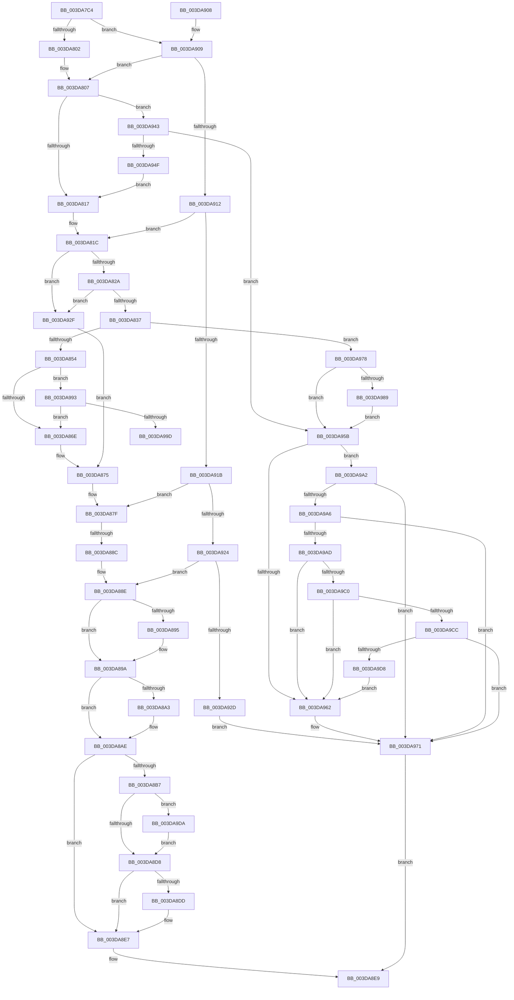

# HalpAllocateDmaResourcesInternal

- RVA: `0x003DA7C4`–`0x003DA9E2` (길이 `542` bytes)
- VA: `0x00000001403DA7C4`
- 실행 섹션: `.text`
- PDB 이름 있음: `예`; PDB Function 태그: `예`
- unwind 정보 RVA: `0x00093F1C`
- 디코드: `145`개 명령, `542/542` bytes 표시
- 미해석 바이트: `0` (있으면 어셈블리에 `.byte`로 보존)

> 이 문서는 커널 이미지의 기계어와 PDB 기호를 분석해 생성했습니다. 4번과 5번은 함수 원형과 자료형을 바이너리 사용 방식에서 추정한 C 해석이며 원본 소스 복구 결과는 아닙니다.

## 1. Dependencies

- 직접 호출 지점: **10**; 고유 호출 대상: **10**
- 직접 호출자로 확인된 함수: **5**
- RIP 상대 이미지 참조: **0**

### Outgoing calls
- `0x003DA83C` → [HalpDmaAllocateMapRegisters](HalpDmaAllocateMapRegisters_function_003DDA0C.md) (function, `0x003DDA0C`)
- `0x003DA8CA` → [guard_dispatch_icall](../6B/guard_dispatch_icall_function_006BAAD0.md) (function, `0x006BAAD0`)
- `0x003DA8E2` → [HalFreeAdapterObject](HalFreeAdapterObject_function_003DA9F0.md) (function, `0x003DA9F0`)
- `0x003DA946` → [HalpAllocateDmaChannels](HalpAllocateDmaChannels_function_003DA3C8.md) (function, `0x003DA3C8`)
- `0x003DA96C` → [IoFreeAdapterChannelV3](IoFreeAdapterChannelV3_function_003DAA20.md) (function, `0x003DAA20`)
- `0x003DA97D` → [HalpQueueMapBufferWorker](../4A/HalpQueueMapBufferWorker_function_004A7B38.md) (function, `0x004A7B38`)
- `0x003DA98C` → [HalpDmaQueueAdapter](../4E/HalpDmaQueueAdapter_function_004E2B3C.md) (function, `0x004E2B3C`)
- `0x003DA9B7` → [HalpDmaRemoveFromEmergencyLogicalAddressQueue](../53/HalpDmaRemoveFromEmergencyLogicalAddressQueue_function_0053E3B8.md) (function, `0x0053E3B8`)
- `0x003DA9C3` → [HalpDmaRemoveAdapterFromMasterQueue](../53/HalpDmaRemoveAdapterFromMasterQueue_function_0053E2FC.md) (function, `0x0053E2FC`)
- `0x003DA9CF` → [HalpDmaRemoveAdapterFromChannelQueue](../55/HalpDmaRemoveAdapterFromChannelQueue_function_00554374.md) (function, `0x00554374`)

### Direct callers
- [HalpFreeDmaChannels](HalpFreeDmaChannels_function_003D9F80.md) at `0x003DA058`
- [HalpAllocateAdapterChannel](HalpAllocateAdapterChannel_function_003DA544.md) at `0x003DA645`
- [HalpDmaProcessMapRegisterQueueV3](HalpDmaProcessMapRegisterQueueV3_function_003DA780.md) at `0x003DA7B2`
- [HalpDmaReturnEmergencyLogicalAddressResources](../53/HalpDmaReturnEmergencyLogicalAddressResources_function_0053E4E8.md) at `0x0053E5A5`
- [sub_006E9BFE](../6E/Unknown_function_006E9BFE.md) at `0x006E9C57`

### Static image references
- 디코드된 RIP-relative 메모리 참조가 없습니다.

## 2. Other-region calls and transfers

- 다른 실행 섹션으로 향하는 call: **0**
- call이 아닌 외부 분기/꼬리 이동: **2**
  - `0x003DA886` → [sub_006E9B50 + 0x1D](../6E/Unknown_function_006E9B50.md) (`tail-transfer`)
  - `0x003DA99D` → [sub_006E9B50](../6E/Unknown_function_006E9B50.md) (`tail-transfer`)

## 3. Assembly (complete function range)

```asm
003DA7C4  48 8B C4                        mov rax, rsp
003DA7C7  48 89 58 08                     mov qword ptr [rax + 8], rbx
003DA7CB  48 89 68 10                     mov qword ptr [rax + 0x10], rbp
003DA7CF  48 89 70 18                     mov qword ptr [rax + 0x18], rsi
003DA7D3  48 89 78 20                     mov qword ptr [rax + 0x20], rdi
003DA7D7  41 54                           push r12
003DA7D9  41 56                           push r14
003DA7DB  41 57                           push r15
003DA7DD  48 83 EC 40                     sub rsp, 0x40
003DA7E1  48 8B B1 60 01 00 00            mov rsi, qword ptr [rcx + 0x160]
003DA7E8  48 8D B9 70 02 00 00            lea rdi, [rcx + 0x270]
003DA7EF  48 8B D9                        mov rbx, rcx
003DA7F2  4D 8B F8                        mov r15, r8
003DA7F5  8B 0F                           mov ecx, dword ptr [rdi]
003DA7F7  44 8A E2                        mov r12b, dl
003DA7FA  85 C9                           test ecx, ecx
003DA7FC  0F 85 07 01 00 00               jne 0x1403da909
003DA802  8D 41 01                        lea eax, [rcx + 1]
003DA805  89 07                           mov dword ptr [rdi], eax
003DA807  80 BB B9 01 00 00 00            cmp byte ptr [rbx + 0x1b9], 0
003DA80E  48 8B C7                        mov rax, rdi
003DA811  0F 84 2C 01 00 00               je 0x1403da943
003DA817  FF 07                           inc dword ptr [rdi]
003DA819  48 8B F8                        mov rdi, rax
003DA81C  8B AB F8 00 00 00               mov ebp, dword ptr [rbx + 0xf8]
003DA822  85 ED                           test ebp, ebp
003DA824  0F 84 05 01 00 00               je 0x1403da92f
003DA82A  80 BB B8 01 00 00 00            cmp byte ptr [rbx + 0x1b8], 0
003DA831  0F 84 F8 00 00 00               je 0x1403da92f
003DA837  8B D5                           mov edx, ebp
003DA839  48 8B CB                        mov rcx, rbx
003DA83C  E8 CB 31 00 00                  call 0x1403dda0c
003DA841  48 89 83 F0 00 00 00            mov qword ptr [rbx + 0xf0], rax
003DA848  48 8B C8                        mov rcx, rax
003DA84B  48 85 C0                        test rax, rax
003DA84E  0F 84 24 01 00 00               je 0x1403da978
003DA854  48 83 60 18 00                  and qword ptr [rax + 0x18], 0
003DA859  48 83 60 20 00                  and qword ptr [rax + 0x20], 0
003DA85E  48 83 60 28 00                  and qword ptr [rax + 0x28], 0
003DA863  8B 46 14                        mov eax, dword ptr [rsi + 0x14]
003DA866  A8 04                           test al, 4
003DA868  0F 85 25 01 00 00               jne 0x1403da993
003DA86E  48 8D BB 70 02 00 00            lea rdi, [rbx + 0x270]
003DA875  8B 83 70 02 00 00               mov eax, dword ptr [rbx + 0x270]
003DA87B  FF C0                           inc eax
003DA87D  89 07                           mov dword ptr [rdi], eax
003DA87F  83 BB 08 02 00 00 03            cmp dword ptr [rbx + 0x208], 3
003DA886  0F 84 E1 F2 30 00               je 0x1406e9b6d
003DA88C  FF 07                           inc dword ptr [rdi]
003DA88E  8B 46 14                        mov eax, dword ptr [rsi + 0x14]
003DA891  A8 02                           test al, 2
003DA893  74 05                           je 0x1403da89a
003DA895  F0 83 4E F8 01                  lock or dword ptr [rsi - 8], 1
003DA89A  FF 07                           inc dword ptr [rdi]
003DA89C  8B 46 14                        mov eax, dword ptr [rsi + 0x14]
003DA89F  A8 02                           test al, 2
003DA8A1  74 0B                           je 0x1403da8ae
003DA8A3  48 8D 46 F0                     lea rax, [rsi - 0x10]
003DA8A7  48 89 83 68 01 00 00            mov qword ptr [rbx + 0x168], rax
003DA8AE  48 8B 46 18                     mov rax, qword ptr [rsi + 0x18]
003DA8B2  48 85 C0                        test rax, rax
003DA8B5  74 30                           je 0x1403da8e7
003DA8B7  4C 8B 4E 20                     mov r9, qword ptr [rsi + 0x20]
003DA8BB  4C 8B 83 F0 00 00 00            mov r8, qword ptr [rbx + 0xf0]
003DA8C2  48 8B 56 38                     mov rdx, qword ptr [rsi + 0x38]
003DA8C6  48 8B 4E 30                     mov rcx, qword ptr [rsi + 0x30]
003DA8CA  E8 01 02 2E 00                  call 0x1406baad0
003DA8CF  4D 85 FF                        test r15, r15
003DA8D2  0F 85 02 01 00 00               jne 0x1403da9da
003DA8D8  45 84 E4                        test r12b, r12b
003DA8DB  74 0A                           je 0x1403da8e7
003DA8DD  8B D0                           mov edx, eax
003DA8DF  48 8B CB                        mov rcx, rbx
003DA8E2  E8 09 01 00 00                  call 0x1403da9f0
003DA8E7  B0 01                           mov al, 1
003DA8E9  48 8B 5C 24 60                  mov rbx, qword ptr [rsp + 0x60]
003DA8EE  48 8B 6C 24 68                  mov rbp, qword ptr [rsp + 0x68]
003DA8F3  48 8B 74 24 70                  mov rsi, qword ptr [rsp + 0x70]
003DA8F8  48 8B 7C 24 78                  mov rdi, qword ptr [rsp + 0x78]
003DA8FD  48 83 C4 40                     add rsp, 0x40
003DA901  41 5F                           pop r15
003DA903  41 5E                           pop r14
003DA905  41 5C                           pop r12
003DA907  C3                              ret
003DA908  CC                              int3
003DA909  83 E9 01                        sub ecx, 1
003DA90C  0F 84 F5 FE FF FF               je 0x1403da807
003DA912  83 E9 01                        sub ecx, 1
003DA915  0F 84 01 FF FF FF               je 0x1403da81c
003DA91B  83 E9 01                        sub ecx, 1
003DA91E  0F 84 5B FF FF FF               je 0x1403da87f
003DA924  83 F9 01                        cmp ecx, 1
003DA927  0F 84 61 FF FF FF               je 0x1403da88e
003DA92D  EB 42                           jmp 0x1403da971
003DA92F  48 83 A3 F0 00 00 00 00         and qword ptr [rbx + 0xf0], 0
003DA937  83 A3 F8 00 00 00 00            and dword ptr [rbx + 0xf8], 0
003DA93E  E9 32 FF FF FF                  jmp 0x1403da875
003DA943  48 8B CB                        mov rcx, rbx
003DA946  E8 7D FA FF FF                  call 0x1403da3c8
003DA94B  84 C0                           test al, al
003DA94D  74 0C                           je 0x1403da95b
003DA94F  48 8D 83 70 02 00 00            lea rax, [rbx + 0x270]
003DA956  E9 BC FE FF FF                  jmp 0x1403da817
003DA95B  8B 46 14                        mov eax, dword ptr [rsi + 0x14]
003DA95E  A8 01                           test al, 1
003DA960  74 40                           je 0x1403da9a2
003DA962  83 A3 F8 00 00 00 00            and dword ptr [rbx + 0xf8], 0
003DA969  48 8B CB                        mov rcx, rbx
003DA96C  E8 AF 00 00 00                  call 0x1403daa20
003DA971  32 C0                           xor al, al
003DA973  E9 71 FF FF FF                  jmp 0x1403da8e9
003DA978  8B D5                           mov edx, ebp
003DA97A  48 8B CB                        mov rcx, rbx
003DA97D  E8 B6 D1 0C 00                  call 0x1404a7b38
003DA982  8B 46 14                        mov eax, dword ptr [rsi + 0x14]
003DA985  A8 01                           test al, 1
003DA987  75 D2                           jne 0x1403da95b
003DA989  48 8B CB                        mov rcx, rbx
003DA98C  E8 AB 81 10 00                  call 0x1404e2b3c
003DA991  EB C8                           jmp 0x1403da95b
003DA993  33 C0                           xor eax, eax
003DA995  85 ED                           test ebp, ebp
003DA997  0F 84 D1 FE FF FF               je 0x1403da86e
003DA99D  E9 AE F1 30 00                  jmp 0x1406e9b50
003DA9A2  A8 02                           test al, 2
003DA9A4  74 CB                           je 0x1403da971
003DA9A6  8B 46 F8                        mov eax, dword ptr [rsi - 8]
003DA9A9  A8 02                           test al, 2
003DA9AB  74 C4                           je 0x1403da971
003DA9AD  48 8D 93 58 02 00 00            lea rdx, [rbx + 0x258]
003DA9B4  48 8B CB                        mov rcx, rbx
003DA9B7  E8 FC 39 16 00                  call 0x14053e3b8
003DA9BC  84 C0                           test al, al
003DA9BE  75 A2                           jne 0x1403da962
003DA9C0  48 8B CB                        mov rcx, rbx
003DA9C3  E8 34 39 16 00                  call 0x14053e2fc
003DA9C8  84 C0                           test al, al
003DA9CA  75 96                           jne 0x1403da962
003DA9CC  48 8B CB                        mov rcx, rbx
003DA9CF  E8 A0 99 17 00                  call 0x140554374
003DA9D4  84 C0                           test al, al
003DA9D6  74 99                           je 0x1403da971
003DA9D8  EB 88                           jmp 0x1403da962
003DA9DA  41 89 07                        mov dword ptr [r15], eax
003DA9DD  E9 F6 FE FF FF                  jmp 0x1403da8d8
```

## 4. C-style interpretation (structured pseudocode)

```c
__int64 __fastcall HalpAllocateDmaResourcesInternal(__int64 a1, unsigned __int8 a2, __int64 a3)
{
    __int64 result;
    __int64 v_rsp;
    unsigned __int64 v_stack_p10;
    unsigned __int64 v_stack_p18;
    unsigned __int64 v_stack_p20;
    unsigned __int64 v_stack_p8;

    *(unsigned __int64 *)(v_rsp + 8) = v_rbx;
    *(unsigned __int64 *)(v_rsp + 16) = v_rbp;
    *(unsigned __int64 *)(v_rsp + 24) = v_rsi;
    *(unsigned __int64 *)(v_rsp + 32) = v_rdi;
    v_rsp = (v_rsp) - (64);
    if ((unsigned int)((unsigned int)(*(unsigned int *)(a1 + 624))) != 0) goto loc_003DA909;
    *(unsigned int *)(a1 + 624) = (unsigned int)((unsigned int)(*(unsigned int *)(a1 + 624)) + 1);
loc_003DA807:
    if ((*(unsigned __int8 *)(a1 + 441)) == 0) goto loc_003DA943;
loc_003DA817:
loc_003DA81C:
    if ((unsigned int)((unsigned int)(*(unsigned int *)(a1 + 248))) == 0) goto loc_003DA92F;
    if ((*(unsigned __int8 *)(a1 + 440)) == 0) goto loc_003DA92F;
    result = HalpDmaAllocateMapRegisters(a1, (unsigned int)((unsigned int)((unsigned int)(*(unsigned int *)(a1 + 248)))), a3, a4);
    *(unsigned __int64 *)(a1 + 240) = result;
    if (result == 0) goto loc_003DA978;
    if ((((unsigned __int8)((unsigned int)(*(unsigned int *)(*(unsigned __int64 *)(a1 + 352) + 20)))) & (4)) != 0) goto loc_003DA993;
loc_003DA86E:
loc_003DA875:
    result = (unsigned int)(((unsigned int)(*(unsigned int *)(a1 + 624))) + 1);
    *(unsigned int *)(a1 + 624) = (unsigned int)(result);
loc_003DA87F:
loc_003DA88E:
    if ((((unsigned __int8)((unsigned int)(*(unsigned int *)(*(unsigned __int64 *)(a1 + 352) + 20)))) & (2)) != 0) {
    }
    result = (unsigned int)(*(unsigned int *)(*(unsigned __int64 *)(a1 + 352) + 20));
    if ((((unsigned __int8)((unsigned int)(*(unsigned int *)(*(unsigned __int64 *)(a1 + 352) + 20)))) & (2)) != 0) {
        result = *(unsigned __int64 *)(a1 + 352) - 16;
        *(unsigned __int64 *)(a1 + 360) = result;
    }
    if (*(unsigned __int64 *)(*(unsigned __int64 *)(a1 + 352) + 24) == 0) goto loc_003DA8E7;
    result = guard_dispatch_icall(*(unsigned __int64 *)(*(unsigned __int64 *)(a1 + 352) + 48), *(unsigned __int64 *)(*(unsigned __int64 *)(a1 + 352) + 56), *(unsigned __int64 *)(a1 + 240), *(unsigned __int64 *)(*(unsigned __int64 *)(a1 + 352) + 32));
    if (a3 != 0) goto loc_003DA9DA;
loc_003DA8D8:
    if (a2 != 0) {
        a2 = (unsigned int)(result);
        a1 = a1;
        result = HalFreeAdapterObject(a1, a2, *(unsigned __int64 *)(a1 + 240), *(unsigned __int64 *)(*(unsigned __int64 *)(a1 + 352) + 32));
    }
loc_003DA8E9:
    v_rsp = (v_rsp) + (64);
    return 1;
loc_003DA909:
    a1 = (unsigned int)((a1) - (1));
    if (condition_is_equal) goto loc_003DA807;
    a1 = (unsigned int)((a1) - (1));
    if (condition_is_equal) goto loc_003DA81C;
    a1 = (unsigned int)((a1) - (1));
    if (condition_is_equal) goto loc_003DA87F;
    if (((unsigned int)(a1)) == 1) goto loc_003DA88E;
    goto loc_003DA971;
loc_003DA92F:
    goto loc_003DA875;
loc_003DA943:
    result = HalpAllocateDmaChannels(v_stack_p8, a2, *(unsigned __int64 *)(a1 + 240), *(unsigned __int64 *)(*(unsigned __int64 *)(a1 + 352) + 32));
    if ((unsigned __int8)(result) == 0) goto loc_003DA95B;
    goto loc_003DA817;
loc_003DA95B:
    if ((((unsigned __int8)((unsigned int)(*(unsigned int *)(v_stack_p18 + 20)))) & (1)) == 0) goto loc_003DA9A2;
loc_003DA962:
    result = IoFreeAdapterChannelV3(v_stack_p8, a2, *(unsigned __int64 *)(a1 + 240), *(unsigned __int64 *)(*(unsigned __int64 *)(a1 + 352) + 32));
loc_003DA971:
    result = 0;
    goto loc_003DA8E9;
loc_003DA978:
    result = HalpQueueMapBufferWorker(v_stack_p8, (unsigned int)((unsigned int)(v_stack_p10)), *(unsigned __int64 *)(a1 + 240), *(unsigned __int64 *)(*(unsigned __int64 *)(a1 + 352) + 32));
    if ((((unsigned __int8)((unsigned int)(*(unsigned int *)(v_stack_p18 + 20)))) & (1)) != 0) goto loc_003DA95B;
    result = HalpDmaQueueAdapter(v_stack_p8, (unsigned int)((unsigned int)(v_stack_p10)), *(unsigned __int64 *)(a1 + 240), *(unsigned __int64 *)(*(unsigned __int64 *)(a1 + 352) + 32));
    goto loc_003DA95B;
loc_003DA993:
    result = 0;
    if ((unsigned int)(v_stack_p10) == 0) goto loc_003DA86E;
loc_003DA9A2:
    if (((0) & (2)) == 0) goto loc_003DA971;
    if ((((unsigned __int8)((unsigned int)(*(unsigned int *)(v_stack_p18 - 8)))) & (2)) == 0) goto loc_003DA971;
    result = HalpDmaRemoveFromEmergencyLogicalAddressQueue(v_stack_p8, v_stack_p8 + 600, *(unsigned __int64 *)(a1 + 240), *(unsigned __int64 *)(*(unsigned __int64 *)(a1 + 352) + 32));
    if ((unsigned __int8)(result) != 0) goto loc_003DA962;
    result = HalpDmaRemoveAdapterFromMasterQueue(v_stack_p8, v_stack_p8 + 600, *(unsigned __int64 *)(a1 + 240), *(unsigned __int64 *)(*(unsigned __int64 *)(a1 + 352) + 32));
    if ((unsigned __int8)(result) != 0) goto loc_003DA962;
    result = HalpDmaRemoveAdapterFromChannelQueue(v_stack_p8, v_stack_p8 + 600, *(unsigned __int64 *)(a1 + 240), *(unsigned __int64 *)(*(unsigned __int64 *)(a1 + 352) + 32));
    if ((unsigned __int8)(result) == 0) goto loc_003DA971;
    goto loc_003DA962;
loc_003DA9DA:
    *(unsigned int *)(a3) = (unsigned int)(result);
    goto loc_003DA8D8;
}
```

## 5. (Beta) C Style

```c
int64_t HalpAllocateDmaResourcesInternal(void *Arg1, uint8_t Arg2, int64_t Arg3)
{
    uint8_t *arg1 = (uint8_t *)Arg1;

    int64_t result;
    int64_t local_rsp;
    uint64_t v_stack_p10;
    uint64_t v_stack_p18;
    uint64_t v_stack_p20;
    uint64_t v_stack_p8;

    *(uint64_t *)(local_rsp + 0x8) = local_rbx;
    *(uint64_t *)(local_rsp + 0x10) = local_rbp;
    *(uint64_t *)(local_rsp + 0x18) = local_rsi;
    *(uint64_t *)(local_rsp + 0x20) = local_rdi;
    local_rsp = (local_rsp) - (64);
    if ((uint32_t)((uint32_t)(*(uint32_t *)(arg1 + 0x270))) != 0) goto loc_003DA909;
    *(uint32_t *)(arg1 + 0x270) = (uint32_t)((uint32_t)(*(uint32_t *)(arg1 + 0x270)) + 1);
loc_003DA807:
    if ((*(uint8_t *)(arg1 + 0x1B9)) == 0) goto loc_003DA943;
loc_003DA817:
loc_003DA81C:
    if ((uint32_t)((uint32_t)(*(uint32_t *)(arg1 + 0xF8))) == 0) goto loc_003DA92F;
    if ((*(uint8_t *)(arg1 + 0x1B8)) == 0) goto loc_003DA92F;
    result = HalpDmaAllocateMapRegisters(Arg1, (uint32_t)((uint32_t)((uint32_t)(*(uint32_t *)(arg1 + 0xF8)))), Arg3, a4);
    *(uint64_t *)(arg1 + 0xF0) = result;
    if (result == 0) goto loc_003DA978;
    if ((((uint8_t)((uint32_t)(*(uint32_t *)(*(uint64_t *)(arg1 + 0x160) + 0x14)))) & (4)) != 0) goto loc_003DA993;
loc_003DA86E:
loc_003DA875:
    result = (uint32_t)(((uint32_t)(*(uint32_t *)(arg1 + 0x270))) + 1);
    *(uint32_t *)(arg1 + 0x270) = (uint32_t)(result);
loc_003DA87F:
loc_003DA88E:
    if ((((uint8_t)((uint32_t)(*(uint32_t *)(*(uint64_t *)(arg1 + 0x160) + 0x14)))) & (2)) != 0) {
    }
    result = (uint32_t)(*(uint32_t *)(*(uint64_t *)(arg1 + 0x160) + 0x14));
    if ((((uint8_t)((uint32_t)(*(uint32_t *)(*(uint64_t *)(arg1 + 0x160) + 0x14)))) & (2)) != 0) {
        result = *(uint64_t *)(arg1 + 0x160) - 16;
        *(uint64_t *)(arg1 + 0x168) = result;
    }
    if (*(uint64_t *)(*(uint64_t *)(arg1 + 0x160) + 0x18) == 0) goto loc_003DA8E7;
    result = guard_dispatch_icall(*(uint64_t *)(*(uint64_t *)(arg1 + 0x160) + 0x30), *(uint64_t *)(*(uint64_t *)(arg1 + 0x160) + 0x38), *(uint64_t *)(arg1 + 0xF0), *(uint64_t *)(*(uint64_t *)(arg1 + 0x160) + 0x20));
    if (Arg3 != 0) goto loc_003DA9DA;
loc_003DA8D8:
    if (Arg2 != 0) {
        Arg2 = (uint32_t)(result);
        Arg1 = Arg1;
        result = HalFreeAdapterObject(Arg1, Arg2, *(uint64_t *)(arg1 + 0xF0), *(uint64_t *)(*(uint64_t *)(arg1 + 0x160) + 0x20));
    }
loc_003DA8E9:
    local_rsp = (local_rsp) + (64);
    return 1;
loc_003DA909:
    Arg1 = (uint32_t)((Arg1) - (1));
    if (condition_is_equal) goto loc_003DA807;
    Arg1 = (uint32_t)((Arg1) - (1));
    if (condition_is_equal) goto loc_003DA81C;
    Arg1 = (uint32_t)((Arg1) - (1));
    if (condition_is_equal) goto loc_003DA87F;
    if (((uint32_t)(Arg1)) == 1) goto loc_003DA88E;
    goto loc_003DA971;
loc_003DA92F:
    goto loc_003DA875;
loc_003DA943:
    result = HalpAllocateDmaChannels(v_stack_p8, Arg2, *(uint64_t *)(arg1 + 0xF0), *(uint64_t *)(*(uint64_t *)(arg1 + 0x160) + 0x20));
    if ((uint8_t)(result) == 0) goto loc_003DA95B;
    goto loc_003DA817;
loc_003DA95B:
    if ((((uint8_t)((uint32_t)(*(uint32_t *)(v_stack_p18 + 0x14)))) & (1)) == 0) goto loc_003DA9A2;
loc_003DA962:
    result = IoFreeAdapterChannelV3(v_stack_p8, Arg2, *(uint64_t *)(arg1 + 0xF0), *(uint64_t *)(*(uint64_t *)(arg1 + 0x160) + 0x20));
loc_003DA971:
    result = 0;
    goto loc_003DA8E9;
loc_003DA978:
    result = HalpQueueMapBufferWorker(v_stack_p8, (uint32_t)((uint32_t)(v_stack_p10)), *(uint64_t *)(arg1 + 0xF0), *(uint64_t *)(*(uint64_t *)(arg1 + 0x160) + 0x20));
    if ((((uint8_t)((uint32_t)(*(uint32_t *)(v_stack_p18 + 0x14)))) & (1)) != 0) goto loc_003DA95B;
    result = HalpDmaQueueAdapter(v_stack_p8, (uint32_t)((uint32_t)(v_stack_p10)), *(uint64_t *)(arg1 + 0xF0), *(uint64_t *)(*(uint64_t *)(arg1 + 0x160) + 0x20));
    goto loc_003DA95B;
loc_003DA993:
    result = 0;
    if ((uint32_t)(v_stack_p10) == 0) goto loc_003DA86E;
loc_003DA9A2:
    if (((0) & (2)) == 0) goto loc_003DA971;
    if ((((uint8_t)((uint32_t)(*(uint32_t *)(v_stack_p18 - 0x8)))) & (2)) == 0) goto loc_003DA971;
    result = HalpDmaRemoveFromEmergencyLogicalAddressQueue(v_stack_p8, v_stack_p8 + 600, *(uint64_t *)(arg1 + 0xF0), *(uint64_t *)(*(uint64_t *)(arg1 + 0x160) + 0x20));
    if ((uint8_t)(result) != 0) goto loc_003DA962;
    result = HalpDmaRemoveAdapterFromMasterQueue(v_stack_p8, v_stack_p8 + 600, *(uint64_t *)(arg1 + 0xF0), *(uint64_t *)(*(uint64_t *)(arg1 + 0x160) + 0x20));
    if ((uint8_t)(result) != 0) goto loc_003DA962;
    result = HalpDmaRemoveAdapterFromChannelQueue(v_stack_p8, v_stack_p8 + 600, *(uint64_t *)(arg1 + 0xF0), *(uint64_t *)(*(uint64_t *)(arg1 + 0x160) + 0x20));
    if ((uint8_t)(result) == 0) goto loc_003DA971;
    goto loc_003DA962;
loc_003DA9DA:
    *(uint32_t *)(Arg3) = (uint32_t)(result);
    goto loc_003DA8D8;
}
```

### 관측된 메모리 오프셋

구조체 형식이 확인되지 않은 접근은 인자 기준의 오프셋으로만 기록했습니다.

| 기준 인자 | 오프셋 표현 | 폭 (bit) | 접근 |
|---|---:|---:|---|
| `Arg1` | `+ 0x0` | `32` | `R` |
| `Arg1` | `+ 0x0` | `32` | `R/W` |
| `Arg1` | `+ 0x0` | `32` | `W` |
| `Arg1` | `+ 0xF0` | `64` | `R` |
| `Arg1` | `+ 0xF0` | `64` | `R/W` |
| `Arg1` | `+ 0xF0` | `64` | `W` |
| `Arg1` | `+ 0xF8` | `32` | `R` |
| `Arg1` | `+ 0xF8` | `32` | `R/W` |
| `Arg1` | `+ 0x160` | `64` | `R` |
| `Arg1` | `+ 0x168` | `64` | `W` |
| `Arg1` | `+ 0x1B8` | `8` | `R` |
| `Arg1` | `+ 0x1B9` | `8` | `R` |
| `Arg1` | `+ 0x208` | `32` | `R` |
| `Arg1` | `+ 0x258` | `64` | `R` |
| `Arg1` | `+ 0x270` | `32` | `R` |
| `Arg1` | `+ 0x270` | `64` | `R` |

## 6. Execution-region graph

[열기: 2D/3D 그래프와 함수 탐색 컨트롤 패널](../../../control-panel.html?section=text&rva=0x003DA7C4&view=graph)

- 2D 그래프는 위에서 아래로 흐르고, 3D 그래프는 빈 공간을 드래그해 회전합니다. Shift+드래그는 이동, 휠은 확대·축소, 함수 노드 선택은 대상 보고서 이동입니다.

### Static fallback


