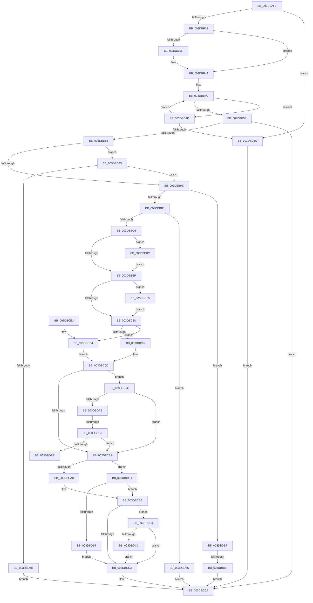

# HalpBuildScatterGatherList

- RVA: `0x003DBAF8`–`0x003DBDDF` (길이 `743` bytes)
- VA: `0x00000001403DBAF8`
- 실행 섹션: `.text`
- PDB 이름 있음: `예`; PDB Function 태그: `예`
- unwind 정보 RVA: `0x000940DC`
- 디코드: `172`개 명령, `743/743` bytes 표시
- 미해석 바이트: `0` (있으면 어셈블리에 `.byte`로 보존)

> 이 문서는 커널 이미지의 기계어와 PDB 기호를 분석해 생성했습니다. 4번과 5번은 함수 원형과 자료형을 바이너리 사용 방식에서 추정한 C 해석이며 원본 소스 복구 결과는 아닙니다.

## 1. Dependencies

- 직접 호출 지점: **6**; 고유 호출 대상: **5**
- 직접 호출자로 확인된 함수: **4**
- RIP 상대 이미지 참조: **1**

### Outgoing calls
- `0x003DBB78` → [HalGetDmaTransferInfoInternal](HalGetDmaTransferInfoInternal_function_003DBE60.md) (function, `0x003DBE60`)
- `0x003DBCB4` → [HalpAllocateAdapterChannel](HalpAllocateAdapterChannel_function_003DA544.md) (function, `0x003DA544`)
- `0x003DBD0A` → [HalpAllocateAdapterChannel](HalpAllocateAdapterChannel_function_003DA544.md) (function, `0x003DA544`)
- `0x003DBD26` → [HalpAllocateAdapterCallbackV3](HalpAllocateAdapterCallbackV3_function_003DB380.md) (function, `0x003DB380`)
- `0x003DBD6E` → [ExAllocatePool2](../../poolcode/B8/ExAllocatePool2_function_00B820F0.md) (function, `0x00B820F0`)
- `0x003DBDD5` → [ExFreePoolWithTag](../../poolcode/B8/ExFreePoolWithTag_function_00B82870.md) (function, `0x00B82870`)

### Direct callers
- [HalBuildScatterGatherListEx](HalBuildScatterGatherListEx_function_003DA1A0.md) at `0x003DA235`
- [HalBuildScatterGatherListV3](HalBuildScatterGatherListV3_function_003DA4C0.md) at `0x003DA52E`
- [HalGetScatterGatherList](HalGetScatterGatherList_function_003DFAC0.md) at `0x003DFB86`
- [HalGetScatterGatherListEx](../55/HalGetScatterGatherListEx_function_005503D0.md) at `0x0055045A`

### Static image references
- `0x003DBCA0` → RVA `0x003DB380` (`HalpAllocateAdapterCallbackV3`; read)

## 2. Other-region calls and transfers

- 다른 실행 섹션으로 향하는 call: **2**
  - `0x003DBD6E` → [ExAllocatePool2](../../poolcode/B8/ExAllocatePool2_function_00B820F0.md) (`.text` → `POOLCODE`)
  - `0x003DBDD5` → [ExFreePoolWithTag](../../poolcode/B8/ExFreePoolWithTag_function_00B82870.md) (`.text` → `POOLCODE`)
- call이 아닌 외부 분기/꼬리 이동: **3**
  - `0x003DBD7C` → [sub_006EA022](../6E/Unknown_function_006EA022.md) (`tail-transfer`)
  - `0x003DBDB0` → [sub_006EA022 + 0x3A](../6E/Unknown_function_006EA022.md) (`tail-transfer`)
  - `0x003DBDBE` → [sub_006EA022 + 0x3A](../6E/Unknown_function_006EA022.md) (`tail-transfer`)

## 3. Assembly (complete function range)

```asm
003DBAF8  48 8B C4                        mov rax, rsp
003DBAFB  48 89 58 08                     mov qword ptr [rax + 8], rbx
003DBAFF  48 89 68 10                     mov qword ptr [rax + 0x10], rbp
003DBB03  48 89 70 20                     mov qword ptr [rax + 0x20], rsi
003DBB07  4C 89 40 18                     mov qword ptr [rax + 0x18], r8
003DBB0B  57                              push rdi
003DBB0C  41 54                           push r12
003DBB0E  41 55                           push r13
003DBB10  41 56                           push r14
003DBB12  41 57                           push r15
003DBB14  48 83 EC 50                     sub rsp, 0x50
003DBB18  0F 57 C0                        xorps xmm0, xmm0
003DBB1B  49 8B F9                        mov rdi, r9
003DBB1E  4C 8B FA                        mov r15, rdx
003DBB21  48 8B F1                        mov rsi, rcx
003DBB24  F3 0F 7F 40 BC                  movdqu xmmword ptr [rax - 0x44], xmm0
003DBB29  4D 85 C9                        test r9, r9
003DBB2C  0F 84 0A 02 00 00               je 0x1403dbd3c
003DBB32  4C 8B A4 24 F0 00 00 00         mov r12, qword ptr [rsp + 0xf0]
003DBB3A  4D 85 E4                        test r12, r12
003DBB3D  74 05                           je 0x1403dbb44
003DBB3F  49 83 24 24 00                  and qword ptr [r12], 0
003DBB44  4C 8B B4 24 A0 00 00 00         mov r14, qword ptr [rsp + 0xa0]
003DBB4C  8B 47 28                        mov eax, dword ptr [rdi + 0x28]
003DBB4F  4C 3B F0                        cmp r14, rax
003DBB52  0F 83 D5 01 00 00               jae 0x1403dbd2d
003DBB58  44 8B 8C 24 A8 00 00 00         mov r9d, dword ptr [rsp + 0xa8]
003DBB60  48 8D 44 24 30                  lea rax, [rsp + 0x30]
003DBB65  4D 8B C6                        mov r8, r14
003DBB68  48 89 44 24 28                  mov qword ptr [rsp + 0x28], rax
003DBB6D  48 8B D7                        mov rdx, rdi
003DBB70  C7 44 24 30 02 00 00 00         mov dword ptr [rsp + 0x30], 2
003DBB78  E8 E3 02 00 00                  call 0x1403dbe60
003DBB7D  45 33 D2                        xor r10d, r10d
003DBB80  85 C0                           test eax, eax
003DBB82  0F 88 3D 01 00 00               js 0x1403dbcc5
003DBB88  44 8B 84 24 B0 00 00 00         mov r8d, dword ptr [rsp + 0xb0]
003DBB90  8B 6C 24 34                     mov ebp, dword ptr [rsp + 0x34]
003DBB94  41 F6 C0 04                     test r8b, 4
003DBB98  0F 85 A5 01 00 00               jne 0x1403dbd43
003DBB9E  4C 8B AC 24 D0 00 00 00         mov r13, qword ptr [rsp + 0xd0]
003DBBA6  41 BB 01 00 00 00               mov r11d, 1
003DBBAC  4D 85 ED                        test r13, r13
003DBBAF  0F 84 AA 01 00 00               je 0x1403dbd5f
003DBBB5  8B 94 24 D8 00 00 00            mov edx, dword ptr [rsp + 0xd8]
003DBBBC  3B 54 24 3C                     cmp edx, dword ptr [rsp + 0x3c]
003DBBC0  0F 82 8F 01 00 00               jb 0x1403dbd55
003DBBC6  8B 44 24 38                     mov eax, dword ptr [rsp + 0x38]
003DBBCA  49 8D 5D 28                     lea rbx, [r13 + 0x28]
003DBBCE  48 8D 0C 40                     lea rcx, [rax + rax*2]
003DBBD2  48 8D 1C CB                     lea rbx, [rbx + rcx*8]
003DBBD6  4C 89 AB A0 00 00 00            mov qword ptr [rbx + 0xa0], r13
003DBBDD  44 89 1B                        mov dword ptr [rbx], r11d
003DBBE0  89 93 9C 00 00 00               mov dword ptr [rbx + 0x9c], edx
003DBBE6  4D 85 E4                        test r12, r12
003DBBE9  0F 85 9D 01 00 00               jne 0x1403dbd8c
003DBBEF  81 83 9C 00 00 00 58 FF FF FF   add dword ptr [rbx + 0x9c], 0xffffff58
003DBBF9  4C 8B 8C 24 B8 00 00 00         mov r9, qword ptr [rsp + 0xb8]
003DBC01  8A 8C 24 C8 00 00 00            mov cl, byte ptr [rsp + 0xc8]
003DBC08  48 89 7B 08                     mov qword ptr [rbx + 8], rdi
003DBC0C  4C 89 53 10                     mov qword ptr [rbx + 0x10], r10
003DBC10  8B 47 2C                        mov eax, dword ptr [rdi + 0x2c]
003DBC13  48 03 47 20                     add rax, qword ptr [rdi + 0x20]
003DBC17  49 03 C6                        add rax, r14
003DBC1A  4C 89 4B 78                     mov qword ptr [rbx + 0x78], r9
003DBC1E  48 89 43 20                     mov qword ptr [rbx + 0x20], rax
003DBC22  8B 84 24 A8 00 00 00            mov eax, dword ptr [rsp + 0xa8]
003DBC29  89 43 28                        mov dword ptr [rbx + 0x28], eax
003DBC2C  48 8B 84 24 C0 00 00 00         mov rax, qword ptr [rsp + 0xc0]
003DBC34  48 89 83 80 00 00 00            mov qword ptr [rbx + 0x80], rax
003DBC3B  48 89 B3 90 00 00 00            mov qword ptr [rbx + 0x90], rsi
003DBC42  88 8B 98 00 00 00               mov byte ptr [rbx + 0x98], cl
003DBC48  89 6B 2C                        mov dword ptr [rbx + 0x2c], ebp
003DBC4B  4C 89 53 18                     mov qword ptr [rbx + 0x18], r10
003DBC4F  45 84 C3                        test r11b, r8b
003DBC52  0F 85 9D 00 00 00               jne 0x1403dbcf5
003DBC58  48 8B 84 24 90 00 00 00         mov rax, qword ptr [rsp + 0x90]
003DBC60  48 85 C0                        test rax, rax
003DBC63  75 7F                           jne 0x1403dbce4
003DBC65  48 8D 53 30                     lea rdx, [rbx + 0x30]
003DBC69  83 62 14 FD                     and dword ptr [rdx + 0x14], 0xfffffffd
003DBC6D  48 89 5A 20                     mov qword ptr [rdx + 0x20], rbx
003DBC71  4C 89 7A 30                     mov qword ptr [rdx + 0x30], r15
003DBC75  49 8B 47 20                     mov rax, qword ptr [r15 + 0x20]
003DBC79  48 89 42 38                     mov qword ptr [rdx + 0x38], rax
003DBC7D  44 38 96 B8 01 00 00            cmp byte ptr [rsi + 0x1b8], r10b
003DBC84  0F 84 12 01 00 00               je 0x1403dbd9c
003DBC8A  85 ED                           test ebp, ebp
003DBC8C  48 8B CE                        mov rcx, rsi
003DBC8F  41 0F 44 EB                     cmove ebp, r11d
003DBC93  4D 85 C9                        test r9, r9
003DBC96  44 8B 4C 24 40                  mov r9d, dword ptr [rsp + 0x40]
003DBC9B  89 6B 2C                        mov dword ptr [rbx + 0x2c], ebp
003DBC9E  74 5D                           je 0x1403dbcfd
003DBCA0  48 8D 05 D9 F6 FF FF            lea rax, [rip - 0x927]
003DBCA7  48 89 44 24 28                  mov qword ptr [rsp + 0x28], rax
003DBCAC  44 89 44 24 20                  mov dword ptr [rsp + 0x20], r8d
003DBCB1  44 8B C5                        mov r8d, ebp
003DBCB4  E8 8B E8 FF FF                  call 0x1403da544
003DBCB9  8B F8                           mov edi, eax
003DBCBB  85 FF                           test edi, edi
003DBCBD  0F 88 00 01 00 00               js 0x1403dbdc3
003DBCC3  8B C7                           mov eax, edi
003DBCC5  4C 8D 5C 24 50                  lea r11, [rsp + 0x50]
003DBCCA  49 8B 5B 30                     mov rbx, qword ptr [r11 + 0x30]
003DBCCE  49 8B 6B 38                     mov rbp, qword ptr [r11 + 0x38]
003DBCD2  49 8B 73 48                     mov rsi, qword ptr [r11 + 0x48]
003DBCD6  49 8B E3                        mov rsp, r11
003DBCD9  41 5F                           pop r15
003DBCDB  41 5E                           pop r14
003DBCDD  41 5D                           pop r13
003DBCDF  41 5C                           pop r12
003DBCE1  5F                              pop rdi
003DBCE2  C3                              ret
003DBCE3  CC                              int3
003DBCE4  48 8D 50 10                     lea rdx, [rax + 0x10]
003DBCE8  48 89 58 58                     mov qword ptr [rax + 0x58], rbx
003DBCEC  83 4A 14 02                     or dword ptr [rdx + 0x14], 2
003DBCF0  E9 78 FF FF FF                  jmp 0x1403dbc6d
003DBCF5  83 0B 02                        or dword ptr [rbx], 2
003DBCF8  E9 5B FF FF FF                  jmp 0x1403dbc58
003DBCFD  4C 89 54 24 28                  mov qword ptr [rsp + 0x28], r10
003DBD02  44 89 44 24 20                  mov dword ptr [rsp + 0x20], r8d
003DBD07  44 8B C5                        mov r8d, ebp
003DBD0A  E8 35 E8 FF FF                  call 0x1403da544
003DBD0F  8B F8                           mov edi, eax
003DBD11  85 C0                           test eax, eax
003DBD13  75 A6                           jne 0x1403dbcbb
003DBD15  4C 8B 86 F0 00 00 00            mov r8, qword ptr [rsi + 0xf0]
003DBD1C  4C 8B CB                        mov r9, rbx
003DBD1F  49 8B 57 20                     mov rdx, qword ptr [r15 + 0x20]
003DBD23  49 8B CF                        mov rcx, r15
003DBD26  E8 55 F6 FF FF                  call 0x1403db380
003DBD2B  EB 96                           jmp 0x1403dbcc3
003DBD2D  48 8B 3F                        mov rdi, qword ptr [rdi]
003DBD30  4C 2B F0                        sub r14, rax
003DBD33  48 85 FF                        test rdi, rdi
003DBD36  0F 85 10 FE FF FF               jne 0x1403dbb4c
003DBD3C  B8 0D 00 00 C0                  mov eax, 0xc000000d
003DBD41  EB 82                           jmp 0x1403dbcc5
003DBD43  85 ED                           test ebp, ebp
003DBD45  0F 84 53 FE FF FF               je 0x1403dbb9e
003DBD4B  B8 20 01 00 C0                  mov eax, 0xc0000120
003DBD50  E9 70 FF FF FF                  jmp 0x1403dbcc5
003DBD55  B8 23 00 00 C0                  mov eax, 0xc0000023
003DBD5A  E9 66 FF FF FF                  jmp 0x1403dbcc5
003DBD5F  8B 54 24 3C                     mov edx, dword ptr [rsp + 0x3c]
003DBD63  B9 42 00 00 00                  mov ecx, 0x42
003DBD68  41 B8 48 61 6C 44               mov r8d, 0x446c6148
003DBD6E  E8 7D 63 7A 00                  call 0x140b820f0
003DBD73  45 33 D2                        xor r10d, r10d
003DBD76  48 8B D0                        mov rdx, rax
003DBD79  48 85 C0                        test rax, rax
003DBD7C  0F 85 A0 E2 30 00               jne 0x1406ea022
003DBD82  B8 9A 00 00 C0                  mov eax, 0xc000009a
003DBD87  E9 39 FF FF FF                  jmp 0x1403dbcc5
003DBD8C  48 8B 83 A0 00 00 00            mov rax, qword ptr [rbx + 0xa0]
003DBD93  49 89 04 24                     mov qword ptr [r12], rax
003DBD97  E9 53 FE FF FF                  jmp 0x1403dbbef
003DBD9C  83 BE 08 02 00 00 03            cmp dword ptr [rsi + 0x208], 3
003DBDA3  0F 84 E1 FE FF FF               je 0x1403dbc8a
003DBDA9  44 38 96 BD 01 00 00            cmp byte ptr [rsi + 0x1bd], r10b
003DBDB0  0F 85 A6 E2 30 00               jne 0x1406ea05c
003DBDB6  84 C9                           test cl, cl
003DBDB8  0F 84 CC FE FF FF               je 0x1403dbc8a
003DBDBE  E9 99 E2 30 00                  jmp 0x1406ea05c
003DBDC3  4D 85 ED                        test r13, r13
003DBDC6  0F 85 F7 FE FF FF               jne 0x1403dbcc3
003DBDCC  48 8B 8B A0 00 00 00            mov rcx, qword ptr [rbx + 0xa0]
003DBDD3  33 D2                           xor edx, edx
003DBDD5  E8 96 6A 7A 00                  call 0x140b82870
003DBDDA  E9 E4 FE FF FF                  jmp 0x1403dbcc3
```

## 4. C-style interpretation (structured pseudocode)

```c
__int64 __fastcall HalpBuildScatterGatherList(__int64 a1, __int64 a2, __int64 a3, __int64 a4, __int64 a5, unsigned int a6, unsigned int a7, __int64 a8, __int64 a9, unsigned __int8 a10, __int64 a11, unsigned int a12, __int64 a13, __int64 a14, __int64 a15)
{
    __int64 result;
    __int64 v_r10;
    __int64 v_r14;
    __int64 v_rbp;
    __int64 v_rsp;
    unsigned int v_stack_m14;
    unsigned __int64 v_stack_m28;
    unsigned int v_stack_m30;
    unsigned int v_stack_m38;
    unsigned int v_stack_m3C;
    unsigned int v_stack_m40;
    unsigned int v_stack_m44;
    unsigned __int64 v_stack_m48;
    unsigned __int64 v_stack_m50;
    unsigned int v_stack_m58;
    unsigned __int64 v_stack_p18;

    *(unsigned __int64 *)(v_rsp + 8) = v_rbx;
    *(unsigned __int64 *)(v_rsp + 16) = v_rbp;
    *(unsigned __int64 *)(v_rsp + 32) = v_rsi;
    *(unsigned __int64 *)(v_rsp + 24) = a3;
    v_rsp = (v_rsp) - (80);
    *(unsigned __int64 *)(v_rsp - 68) = v_xmm0;
    if (a4 == 0) goto loc_003DBD3C;
    if (a15 != 0) {
    }
loc_003DBB4C:
    if (a5 >= ((unsigned int)(*(unsigned int *)(a4 + 40)))) goto loc_003DBD2D;
    v_stack_m50 = v_stack_m48;
    v_stack_m48 = 2;
    result = HalGetDmaTransferInfoInternal(a1, a4, a5, (unsigned int)(a6));
    v_r10 = 0;
    if (sign_flag) goto loc_003DBCC5;
    if ((((unsigned __int8)((unsigned int)(a7))) & (4)) != 0) goto loc_003DBD43;
loc_003DBB9E:
    if (a11 == 0) goto loc_003DBD5F;
    if (((unsigned int)((unsigned int)(a12))) < v_stack_m3C) goto loc_003DBD55;
    *(unsigned __int64 *)(a11 + 40 + (unsigned int)(v_stack_m40) + (unsigned int)(v_stack_m40) * 2 * 8 + 160) = a11;
    *(unsigned int *)(a11 + 40 + (unsigned int)(v_stack_m40) + (unsigned int)(v_stack_m40) * 2 * 8) = 1;
    *(unsigned int *)(a11 + 40 + (unsigned int)(v_stack_m40) + (unsigned int)(v_stack_m40) * 2 * 8 + 156) = (unsigned int)((unsigned int)(a12));
    if (a15 != 0) goto loc_003DBD8C;
loc_003DBBEF:
    *(unsigned __int64 *)(a11 + 40 + (unsigned int)(v_stack_m40) + (unsigned int)(v_stack_m40) * 2 * 8 + 8) = a4;
    *(unsigned __int64 *)(a11 + 40 + (unsigned int)(v_stack_m40) + (unsigned int)(v_stack_m40) * 2 * 8 + 16) = 0;
    result = ((unsigned int)(*(unsigned int *)(a4 + 44))) + (*(unsigned __int64 *)(a4 + 32));
    result = (result) + (a5);
    *(unsigned __int64 *)(a11 + 40 + (unsigned int)(v_stack_m40) + (unsigned int)(v_stack_m40) * 2 * 8 + 120) = a8;
    *(unsigned __int64 *)(a11 + 40 + (unsigned int)(v_stack_m40) + (unsigned int)(v_stack_m40) * 2 * 8 + 32) = result;
    *(unsigned int *)(a11 + 40 + (unsigned int)(v_stack_m40) + (unsigned int)(v_stack_m40) * 2 * 8 + 40) = (unsigned int)((unsigned int)(a6));
    *(unsigned __int64 *)(a11 + 40 + (unsigned int)(v_stack_m40) + (unsigned int)(v_stack_m40) * 2 * 8 + 128) = a9;
    *(unsigned __int64 *)(a11 + 40 + (unsigned int)(v_stack_m40) + (unsigned int)(v_stack_m40) * 2 * 8 + 144) = a1;
    *(unsigned __int8 *)(a11 + 40 + (unsigned int)(v_stack_m40) + (unsigned int)(v_stack_m40) * 2 * 8 + 152) = a10;
    *(unsigned int *)(a11 + 40 + (unsigned int)(v_stack_m40) + (unsigned int)(v_stack_m40) * 2 * 8 + 44) = (unsigned int)((unsigned int)(v_stack_m44));
    *(unsigned __int64 *)(a11 + 40 + (unsigned int)(v_stack_m40) + (unsigned int)(v_stack_m40) * 2 * 8 + 24) = 0;
    if (((1) & ((unsigned __int8)((unsigned int)(a7)))) != 0) goto loc_003DBCF5;
loc_003DBC58:
    if (v_stack_p18 != 0) goto loc_003DBCE4;
loc_003DBC6D:
    *(unsigned __int64 *)(a11 + 40 + (unsigned int)(v_stack_m40) + (unsigned int)(v_stack_m40) * 2 * 8 + 48 + 32) = a11 + 40 + (unsigned int)(v_stack_m40) + (unsigned int)(v_stack_m40) * 2 * 8;
    *(unsigned __int64 *)(a11 + 40 + (unsigned int)(v_stack_m40) + (unsigned int)(v_stack_m40) * 2 * 8 + 48 + 48) = a2;
    *(unsigned __int64 *)(a11 + 40 + (unsigned int)(v_stack_m40) + (unsigned int)(v_stack_m40) * 2 * 8 + 48 + 56) = *(unsigned __int64 *)(a2 + 32);
    if ((*(unsigned __int8 *)(a1 + 440)) == 0) goto loc_003DBD9C;
loc_003DBC8A:
    v_rbp = (unsigned int)(v_stack_m44);
    if ((unsigned int)((unsigned int)(v_stack_m44)) == 0) { v_rbp = 1; }
    *(unsigned int *)(a11 + 40 + (unsigned int)(v_stack_m40) + (unsigned int)(v_stack_m40) * 2 * 8 + 44) = (unsigned int)(v_rbp);
    if (a8 == 0) goto loc_003DBCFD;
    v_stack_m50 = v_rip - 2343;
    v_stack_m58 = (unsigned int)((unsigned int)(a7));
    result = HalpAllocateAdapterChannel(a1, a11 + 40 + (unsigned int)(v_stack_m40) + (unsigned int)(v_stack_m40) * 2 * 8 + 48, (unsigned int)((unsigned int)(v_rbp)), (unsigned int)(v_stack_m38));
loc_003DBCBB:
    if (sign_flag) goto loc_003DBDC3;
loc_003DBCC3:
loc_003DBCC5:
    return (unsigned int)((unsigned int)((unsigned int)((unsigned int)(result))));
loc_003DBCE4:
    *(unsigned __int64 *)((unsigned int)((unsigned int)((unsigned int)((unsigned int)(result)))) + 88) = *(unsigned __int64 *)(v_stack_m28 + 48);
    goto loc_003DBC6D;
loc_003DBCF5:
    goto loc_003DBC58;
loc_003DBCFD:
    v_stack_m28 = 0;
    v_stack_m30 = (unsigned int)((unsigned int)((unsigned int)(v_rbp)));
    result = HalpAllocateAdapterChannel(a1, (unsigned int)((unsigned int)((unsigned int)((unsigned int)(result)))) + 16, (unsigned int)((unsigned int)(*(unsigned __int64 *)(v_stack_m28 + 56))), (unsigned int)(v_stack_m38));
    if ((unsigned int)(result) != 0) goto loc_003DBCBB;
    result = HalpAllocateAdapterCallbackV3(a2, *(unsigned __int64 *)(a2 + 32), *(unsigned __int64 *)(*(unsigned __int64 *)(v_stack_m28 + 72) + 240), *(unsigned __int64 *)(v_stack_m28 + 48));
    goto loc_003DBCC3;
loc_003DBD2D:
    v_r14 = (a5) - (result);
    if (*(unsigned __int64 *)((unsigned int)((unsigned int)(result))) != 0) goto loc_003DBB4C;
loc_003DBD3C:
    goto loc_003DBCC5;
loc_003DBD43:
    if ((unsigned int)(*(unsigned __int64 *)(v_stack_m28 + 56)) == 0) goto loc_003DBB9E;
    goto loc_003DBCC5;
loc_003DBD55:
    goto loc_003DBCC5;
loc_003DBD5F:
    result = ExAllocatePool2(66, (unsigned int)(v_stack_m14), (unsigned int)(0x446C6148ULL), *(unsigned __int64 *)(v_stack_m28 + 48));
    v_r10 = 0;
    goto loc_003DBCC5;
loc_003DBD8C:
    *(unsigned __int64 *)(a15) = *(unsigned __int64 *)(*(unsigned __int64 *)(v_stack_m28 + 48) + 160);
    goto loc_003DBBEF;
loc_003DBD9C:
    if ((*(unsigned int *)(*(unsigned __int64 *)(v_stack_m28 + 72) + 520)) == 3) goto loc_003DBC8A;
    if (66 == 0) goto loc_003DBC8A;
loc_003DBDC3:
    if (a11 != 0) goto loc_003DBCC3;
    a2 = 0;
    result = ExFreePoolWithTag(*(unsigned __int64 *)(*(unsigned __int64 *)(v_stack_m28 + 48) + 160), a2, (unsigned int)(0x446C6148ULL), *(unsigned __int64 *)(v_stack_m28 + 48));
    goto loc_003DBCC3;
}
```

## 5. (Beta) C Style

```c
int64_t HalpBuildScatterGatherList(void *Arg1, void *Arg2, int64_t Arg3, int64_t Arg4, int64_t Arg5, uint32_t Arg6, uint32_t Arg7, int64_t Arg8, int64_t Arg9, uint8_t Arg10, int64_t Arg11, uint32_t Arg12, uint64_t Arg13, uint64_t Arg14, int64_t Arg15)
{
    uint8_t *arg1 = (uint8_t *)Arg1;
    uint8_t *arg2 = (uint8_t *)Arg2;

    int64_t result;
    int64_t local_r10;
    int64_t local_r14;
    int64_t local_rbp;
    int64_t local_rsp;
    uint32_t v_stack_m14;
    uint64_t v_stack_m28;
    uint32_t v_stack_m30;
    uint32_t v_stack_m38;
    uint32_t v_stack_m3C;
    uint32_t v_stack_m40;
    uint32_t v_stack_m44;
    uint64_t v_stack_m48;
    uint64_t v_stack_m50;
    uint32_t v_stack_m58;
    uint64_t v_stack_p18;

    *(uint64_t *)(local_rsp + 0x8) = local_rbx;
    *(uint64_t *)(local_rsp + 0x10) = local_rbp;
    *(uint64_t *)(local_rsp + 0x20) = local_rsi;
    *(uint64_t *)(local_rsp + 0x18) = Arg3;
    local_rsp = (local_rsp) - (80);
    *(uint64_t *)(local_rsp - 0x44) = v_xmm0;
    if (Arg4 == 0) goto loc_003DBD3C;
    if (Arg15 != 0) {
    }
loc_003DBB4C:
    if (Arg5 >= ((uint32_t)(*(uint32_t *)(Arg4 + 0x28)))) goto loc_003DBD2D;
    v_stack_m50 = v_stack_m48;
    v_stack_m48 = 2;
    result = HalGetDmaTransferInfoInternal(Arg1, Arg4, Arg5, (uint32_t)(Arg6));
    local_r10 = 0;
    if (sign_flag) goto loc_003DBCC5;
    if ((((uint8_t)((uint32_t)(Arg7))) & (4)) != 0) goto loc_003DBD43;
loc_003DBB9E:
    if (Arg11 == 0) goto loc_003DBD5F;
    if (((uint32_t)((uint32_t)(Arg12))) < v_stack_m3C) goto loc_003DBD55;
    *(uint64_t *)(Arg11 + 0x28 + (uint32_t)(v_stack_m40) + (uint32_t)(v_stack_m40) * 2 * 8 + 0xA0) = Arg11;
    *(uint32_t *)(Arg11 + 0x28 + (uint32_t)(v_stack_m40) + (uint32_t)(v_stack_m40) * 2 * 8) = 1;
    *(uint32_t *)(Arg11 + 0x28 + (uint32_t)(v_stack_m40) + (uint32_t)(v_stack_m40) * 2 * 8 + 0x9C) = (uint32_t)((uint32_t)(Arg12));
    if (Arg15 != 0) goto loc_003DBD8C;
loc_003DBBEF:
    *(uint64_t *)(Arg11 + 0x28 + (uint32_t)(v_stack_m40) + (uint32_t)(v_stack_m40) * 2 * 8 + 0x8) = Arg4;
    *(uint64_t *)(Arg11 + 0x28 + (uint32_t)(v_stack_m40) + (uint32_t)(v_stack_m40) * 2 * 8 + 0x10) = 0;
    result = ((uint32_t)(*(uint32_t *)(Arg4 + 0x2C))) + (*(uint64_t *)(Arg4 + 0x20));
    result = (result) + (Arg5);
    *(uint64_t *)(Arg11 + 0x28 + (uint32_t)(v_stack_m40) + (uint32_t)(v_stack_m40) * 2 * 8 + 0x78) = Arg8;
    *(uint64_t *)(Arg11 + 0x28 + (uint32_t)(v_stack_m40) + (uint32_t)(v_stack_m40) * 2 * 8 + 0x20) = result;
    *(uint32_t *)(Arg11 + 0x28 + (uint32_t)(v_stack_m40) + (uint32_t)(v_stack_m40) * 2 * 8 + 0x28) = (uint32_t)((uint32_t)(Arg6));
    *(uint64_t *)(Arg11 + 0x28 + (uint32_t)(v_stack_m40) + (uint32_t)(v_stack_m40) * 2 * 8 + 0x80) = Arg9;
    *(void **)(Arg11 + 0x28 + (uint32_t)(v_stack_m40) + (uint32_t)(v_stack_m40) * 2 * 8 + 0x90) = Arg1;
    *(uint8_t *)(Arg11 + 0x28 + (uint32_t)(v_stack_m40) + (uint32_t)(v_stack_m40) * 2 * 8 + 0x98) = Arg10;
    *(uint32_t *)(Arg11 + 0x28 + (uint32_t)(v_stack_m40) + (uint32_t)(v_stack_m40) * 2 * 8 + 0x2C) = (uint32_t)((uint32_t)(v_stack_m44));
    *(uint64_t *)(Arg11 + 0x28 + (uint32_t)(v_stack_m40) + (uint32_t)(v_stack_m40) * 2 * 8 + 0x18) = 0;
    if (((1) & ((uint8_t)((uint32_t)(Arg7)))) != 0) goto loc_003DBCF5;
loc_003DBC58:
    if (v_stack_p18 != 0) goto loc_003DBCE4;
loc_003DBC6D:
    *(uint64_t *)(Arg11 + 0x28 + (uint32_t)(v_stack_m40) + (uint32_t)(v_stack_m40) * 2 * 8 + 0x30 + 0x20) = Arg11 + 40 + (uint32_t)(v_stack_m40) + (uint32_t)(v_stack_m40) * 2 * 8;
    *(void **)(Arg11 + 0x28 + (uint32_t)(v_stack_m40) + (uint32_t)(v_stack_m40) * 2 * 8 + 0x30 + 0x30) = Arg2;
    *(uint64_t *)(Arg11 + 0x28 + (uint32_t)(v_stack_m40) + (uint32_t)(v_stack_m40) * 2 * 8 + 0x30 + 0x38) = *(uint64_t *)(arg2 + 0x20);
    if ((*(uint8_t *)(arg1 + 0x1B8)) == 0) goto loc_003DBD9C;
loc_003DBC8A:
    local_rbp = (uint32_t)(v_stack_m44);
    if ((uint32_t)((uint32_t)(v_stack_m44)) == 0) { local_rbp = 1; }
    *(uint32_t *)(Arg11 + 0x28 + (uint32_t)(v_stack_m40) + (uint32_t)(v_stack_m40) * 2 * 8 + 0x2C) = (uint32_t)(local_rbp);
    if (Arg8 == 0) goto loc_003DBCFD;
    v_stack_m50 = v_rip - 2343;
    v_stack_m58 = (uint32_t)((uint32_t)(Arg7));
    result = HalpAllocateAdapterChannel(Arg1, Arg11 + 40 + (uint32_t)(v_stack_m40) + (uint32_t)(v_stack_m40) * 2 * 8 + 48, (uint32_t)((uint32_t)(local_rbp)), (uint32_t)(v_stack_m38));
loc_003DBCBB:
    if (sign_flag) goto loc_003DBDC3;
loc_003DBCC3:
loc_003DBCC5:
    return (uint32_t)((uint32_t)((uint32_t)((uint32_t)(result))));
loc_003DBCE4:
    *(uint64_t *)((uint32_t)((uint32_t)((uint32_t)((uint32_t)(result)))) + 0x58) = *(uint64_t *)(v_stack_m28 + 0x30);
    goto loc_003DBC6D;
loc_003DBCF5:
    goto loc_003DBC58;
loc_003DBCFD:
    v_stack_m28 = 0;
    v_stack_m30 = (uint32_t)((uint32_t)((uint32_t)(local_rbp)));
    result = HalpAllocateAdapterChannel(Arg1, (uint32_t)((uint32_t)((uint32_t)((uint32_t)(result)))) + 16, (uint32_t)((uint32_t)(*(uint64_t *)(v_stack_m28 + 0x38))), (uint32_t)(v_stack_m38));
    if ((uint32_t)(result) != 0) goto loc_003DBCBB;
    result = HalpAllocateAdapterCallbackV3(Arg2, *(uint64_t *)(arg2 + 0x20), *(uint64_t *)(*(uint64_t *)(v_stack_m28 + 0x48) + 0xF0), *(uint64_t *)(v_stack_m28 + 0x30));
    goto loc_003DBCC3;
loc_003DBD2D:
    local_r14 = (Arg5) - (result);
    if (*(uint64_t *)((uint32_t)((uint32_t)(result))) != 0) goto loc_003DBB4C;
loc_003DBD3C:
    goto loc_003DBCC5;
loc_003DBD43:
    if ((uint32_t)(*(uint64_t *)(v_stack_m28 + 0x38)) == 0) goto loc_003DBB9E;
    goto loc_003DBCC5;
loc_003DBD55:
    goto loc_003DBCC5;
loc_003DBD5F:
    result = ExAllocatePool2(66, (uint32_t)(v_stack_m14), (uint32_t)(0x446C6148ULL), *(uint64_t *)(v_stack_m28 + 0x30));
    local_r10 = 0;
    goto loc_003DBCC5;
loc_003DBD8C:
    *(uint64_t *)(Arg15) = *(uint64_t *)(*(uint64_t *)(v_stack_m28 + 0x30) + 0xA0);
    goto loc_003DBBEF;
loc_003DBD9C:
    if ((*(uint32_t *)(*(uint64_t *)(v_stack_m28 + 0x48) + 0x208)) == 3) goto loc_003DBC8A;
    if (66 == 0) goto loc_003DBC8A;
loc_003DBDC3:
    if (Arg11 != 0) goto loc_003DBCC3;
    Arg2 = 0;
    result = ExFreePoolWithTag(*(uint64_t *)(*(uint64_t *)(v_stack_m28 + 0x30) + 0xA0), Arg2, (uint32_t)(0x446C6148ULL), *(uint64_t *)(v_stack_m28 + 0x30));
    goto loc_003DBCC3;
}
```

### 관측된 메모리 오프셋

구조체 형식이 확인되지 않은 접근은 인자 기준의 오프셋으로만 기록했습니다.

| 기준 인자 | 오프셋 표현 | 폭 (bit) | 접근 |
|---|---:|---:|---|
| `Arg1` | `+ 0xF0` | `64` | `R` |
| `Arg1` | `+ 0x1B8` | `8` | `R` |
| `Arg1` | `+ 0x1BD` | `8` | `R` |
| `Arg1` | `+ 0x208` | `32` | `R` |
| `Arg2` | `+ 0x20` | `64` | `R` |

## 6. Execution-region graph

[열기: 2D/3D 그래프와 함수 탐색 컨트롤 패널](../../../control-panel.html?section=text&rva=0x003DBAF8&view=graph)

- 2D 그래프는 위에서 아래로 흐르고, 3D 그래프는 빈 공간을 드래그해 회전합니다. Shift+드래그는 이동, 휠은 확대·축소, 함수 노드 선택은 대상 보고서 이동입니다.

### Static fallback


