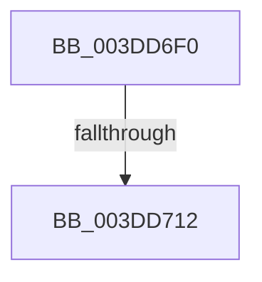

# HalpCalculateScatterGatherListSize

- RVA: `0x003DD6F0`–`0x003DD722` (길이 `50` bytes)
- VA: `0x00000001403DD6F0`
- 실행 섹션: `.text`
- PDB 이름 있음: `예`; PDB Function 태그: `아니요`
- unwind 정보 RVA: `0x00094384`
- 디코드: `12`개 명령, `50/50` bytes 표시
- 미해석 바이트: `0` (있으면 어셈블리에 `.byte`로 보존)

> 이 문서는 커널 이미지의 기계어와 PDB 기호를 분석해 생성했습니다. 4번과 5번은 함수 원형과 자료형을 바이너리 사용 방식에서 추정한 C 해석이며 원본 소스 복구 결과는 아닙니다.

## 1. Dependencies

- 직접 호출 지점: **0**; 고유 호출 대상: **0**
- 직접 호출자로 확인된 함수: **2**
- RIP 상대 이미지 참조: **1**

### Outgoing calls
- 직접 디코드된 call 명령이 없습니다.

### Direct callers
- [HalCalculateScatterGatherListSizeV2](HalCalculateScatterGatherListSizeV2_function_003DBDF0.md) at `0x003DBE0E`
- [sub_003DD15F](Unknown_function_003DD15F.md) at `0x003DD187`

### Static image references
- `0x003DD719` → RVA `0x00E0A778` (`.data`; read)

## 2. Other-region calls and transfers

- 다른 실행 섹션으로 향하는 call: **0**
- call이 아닌 외부 분기/꼬리 이동: **1**
  - `0x003DD70C` → [sub_003DD8F3](Unknown_function_003DD8F3.md) (`tail-transfer`)

## 3. Assembly (complete function range)

```asm
003DD6F0  48 89 5C 24 20                  mov qword ptr [rsp + 0x20], rbx
003DD6F5  56                              push rsi
003DD6F6  8B 81 9C 00 00 00               mov eax, dword ptr [rcx + 0x9c]
003DD6FC  45 33 DB                        xor r11d, r11d
003DD6FF  41 8B F1                        mov esi, r9d
003DD702  4C 8B D1                        mov r10, rcx
003DD705  41 8D 4B 01                     lea ecx, [r11 + 1]
003DD709  83 F8 02                        cmp eax, 2
003DD70C  0F 84 E1 01 00 00               je 0x1403dd8f3
003DD712  45 38 9A BD 01 00 00            cmp byte ptr [r10 + 0x1bd], r11b
003DD719  8B 1D 59 D0 A2 00               mov ebx, dword ptr [rip + 0xa2d059]
003DD71F  0F 45 D9                        cmovne ebx, ecx
```

## 4. C-style interpretation (structured pseudocode)

```c
__int64 __fastcall HalpCalculateScatterGatherListSize(__int64 a1, __int64 a2, __int64 a3, int a4)
{
    __int64 v_r11;
    __int64 v_rbx;
    unsigned __int64 v_stack_p20;

    v_stack_p20 = v_rbx;
    v_r11 = 0;
    v_rbx = (unsigned int)(*(unsigned int *)(v_rip + 10670169));
    if ((*(unsigned __int8 *)(a1 + 445)) != 0) { v_rbx = (unsigned int)(v_r11 + 1); }
    return (unsigned int)(*(unsigned int *)(a1 + 156));
}
```

## 5. (Beta) C Style

```c
int64_t HalpCalculateScatterGatherListSize(void *Arg1, int64_t Arg2, int64_t Arg3, int32_t Arg4)
{
    uint8_t *arg1 = (uint8_t *)Arg1;

    int64_t local_r11;
    int64_t local_rbx;
    uint64_t v_stack_p20;

    v_stack_p20 = local_rbx;
    local_r11 = 0;
    local_rbx = (uint32_t)(*(uint32_t *)(v_rip + 0xA2D059));
    if ((*(uint8_t *)(arg1 + 0x1BD)) != 0) { local_rbx = (uint32_t)(local_r11 + 1); }
    return (uint32_t)(*(uint32_t *)(arg1 + 0x9C));
}
```

### 관측된 메모리 오프셋

구조체 형식이 확인되지 않은 접근은 인자 기준의 오프셋으로만 기록했습니다.

| 기준 인자 | 오프셋 표현 | 폭 (bit) | 접근 |
|---|---:|---:|---|
| `Arg1` | `+ 0x9C` | `32` | `R` |
| `Arg1` | `+ 0x1BD` | `8` | `R` |

## 6. Execution-region graph

[열기: 2D/3D 그래프와 함수 탐색 컨트롤 패널](../../../control-panel.html?section=text&rva=0x003DD6F0&view=graph)

- 2D 그래프는 위에서 아래로 흐르고, 3D 그래프는 빈 공간을 드래그해 회전합니다. Shift+드래그는 이동, 휠은 확대·축소, 함수 노드 선택은 대상 보고서 이동입니다.

### Static fallback


