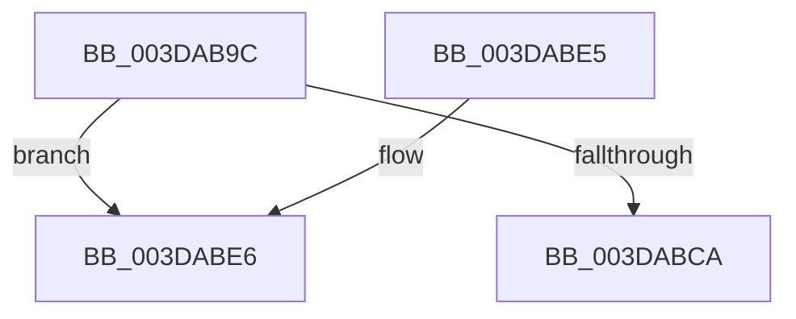

# HalpContinueProcessingWaitQueue

- RVA: `0x003DAB9C`–`0x003DABF1` (길이 `85` bytes)
- VA: `0x00000001403DAB9C`
- 실행 섹션: `.text`
- PDB 이름 있음: `예`; PDB Function 태그: `예`
- unwind 정보 RVA: `0x00093F78`
- 디코드: `26`개 명령, `85/85` bytes 표시
- 미해석 바이트: `0` (있으면 어셈블리에 `.byte`로 보존)

> 이 문서는 커널 이미지의 기계어와 PDB 기호를 분석해 생성했습니다. 4번과 5번은 함수 원형과 자료형을 바이너리 사용 방식에서 추정한 C 해석이며 원본 소스 복구 결과는 아닙니다.

## 1. Dependencies

- 직접 호출 지점: **1**; 고유 호출 대상: **1**
- 직접 호출자로 확인된 함수: **2**
- RIP 상대 이미지 참조: **0**

### Outgoing calls
- `0x003DABBD` → [HalpDmaGetNextWcb](HalpDmaGetNextWcb_function_003DABF8.md) (function, `0x003DABF8`)

### Direct callers
- [IoFreeAdapterChannelV3](IoFreeAdapterChannelV3_function_003DAA20.md) at `0x003DAA42`
- [HalPutScatterGatherListV3](HalPutScatterGatherListV3_function_003DACA8.md) at `0x003DADBA`

### Static image references
- 디코드된 RIP-relative 메모리 참조가 없습니다.

## 2. Other-region calls and transfers

- 다른 실행 섹션으로 향하는 call: **0**
- call이 아닌 외부 분기/꼬리 이동: **1**
  - `0x003DABEC` → [sub_006E9BFE](../6E/Unknown_function_006E9BFE.md) (`tail-transfer`)

## 3. Assembly (complete function range)

```asm
003DAB9C  48 89 5C 24 08                  mov qword ptr [rsp + 8], rbx
003DABA1  48 89 6C 24 18                  mov qword ptr [rsp + 0x18], rbp
003DABA6  48 89 74 24 20                  mov qword ptr [rsp + 0x20], rsi
003DABAB  57                              push rdi
003DABAC  41 54                           push r12
003DABAE  41 56                           push r14
003DABB0  48 83 EC 20                     sub rsp, 0x20
003DABB4  48 8B D9                        mov rbx, rcx
003DABB7  44 0F 20 C7                     mov rdi, cr8
003DABBB  33 F6                           xor esi, esi
003DABBD  E8 36 00 00 00                  call 0x1403dabf8
003DABC2  48 8B C8                        mov rcx, rax
003DABC5  48 85 C0                        test rax, rax
003DABC8  75 1C                           jne 0x1403dabe6
003DABCA  48 8B 5C 24 40                  mov rbx, qword ptr [rsp + 0x40]
003DABCF  8B C6                           mov eax, esi
003DABD1  48 8B 74 24 58                  mov rsi, qword ptr [rsp + 0x58]
003DABD6  48 8B 6C 24 50                  mov rbp, qword ptr [rsp + 0x50]
003DABDB  48 83 C4 20                     add rsp, 0x20
003DABDF  41 5E                           pop r14
003DABE1  41 5C                           pop r12
003DABE3  5F                              pop rdi
003DABE4  C3                              ret
003DABE5  CC                              int3
003DABE6  41 BC 02 00 00 00               mov r12d, 2
003DABEC  E9 0D F0 30 00                  jmp 0x1406e9bfe
```

## 4. C-style interpretation (structured pseudocode)

```c
__int64 __fastcall HalpContinueProcessingWaitQueue(__int64 a1)
{
    __int64 result;
    __int64 v_rsi;
    __int64 v_rsp;
    unsigned __int64 v_stack_p18;
    unsigned __int64 v_stack_p20;
    unsigned __int64 v_stack_p8;

    v_stack_p8 = v_rbx;
    v_stack_p18 = v_rbp;
    v_stack_p20 = v_rsi;
    v_rsp = (v_rsp) - (32);
    v_rsi = 0;
    result = HalpDmaGetNextWcb(a1, a2, a3, a4);
    if (result != 0) goto loc_003DABE6;
    v_rsp = (v_rsp) + (32);
    return 0;
loc_003DABE6:
}
```

## 5. (Beta) C Style

```c
int64_t HalpContinueProcessingWaitQueue(int64_t Arg1)
{
    int64_t result;
    int64_t local_rsi;
    int64_t local_rsp;
    uint64_t v_stack_p18;
    uint64_t v_stack_p20;
    uint64_t v_stack_p8;

    v_stack_p8 = local_rbx;
    v_stack_p18 = local_rbp;
    v_stack_p20 = local_rsi;
    local_rsp = (local_rsp) - (32);
    local_rsi = 0;
    result = HalpDmaGetNextWcb(Arg1, a2, a3, a4);
    if (result != 0) goto loc_003DABE6;
    local_rsp = (local_rsp) + (32);
    return 0;
loc_003DABE6:
}
```

## 6. Execution-region graph

[열기: 2D/3D 그래프와 함수 탐색 컨트롤 패널](../../../control-panel.html?section=text&rva=0x003DAB9C&view=graph)

- 2D 그래프는 위에서 아래로 흐르고, 3D 그래프는 빈 공간을 드래그해 회전합니다. Shift+드래그는 이동, 휠은 확대·축소, 함수 노드 선택은 대상 보고서 이동입니다.

### Static fallback


