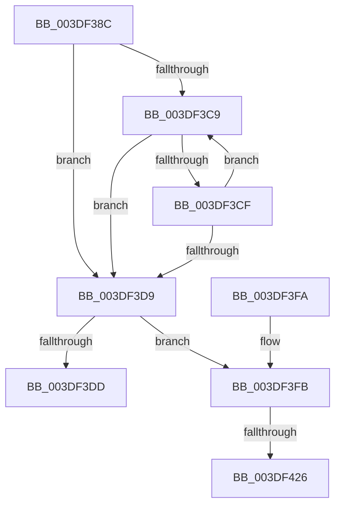

# HalpDmaAcquireBufferMappings

- RVA: `0x003DF38C`–`0x003DF42E` (길이 `162` bytes)
- VA: `0x00000001403DF38C`
- 실행 섹션: `.text`
- PDB 이름 있음: `예`; PDB Function 태그: `예`
- unwind 정보 RVA: `0x000947F0`
- 디코드: `50`개 명령, `162/162` bytes 표시
- 미해석 바이트: `0` (있으면 어셈블리에 `.byte`로 보존)

> 이 문서는 커널 이미지의 기계어와 PDB 기호를 분석해 생성했습니다. 4번과 5번은 함수 원형과 자료형을 바이너리 사용 방식에서 추정한 C 해석이며 원본 소스 복구 결과는 아닙니다.

## 1. Dependencies

- 직접 호출 지점: **0**; 고유 호출 대상: **0**
- 직접 호출자로 확인된 함수: **3**
- RIP 상대 이미지 참조: **1**

### Outgoing calls
- 직접 디코드된 call 명령이 없습니다.

### Direct callers
- [sub_003DF02A](Unknown_function_003DF02A.md) at `0x003DF07C`
- [HalpDmaFreeMapRegisters](HalpDmaFreeMapRegisters_function_003DF5F4.md) at `0x003DF7DC`
- [HalpDmaZeroMapBuffers](../55/HalpDmaZeroMapBuffers_function_005511EC.md) at `0x005512B3`

### Static image references
- `0x003DF40A` → RVA `0x00E3EC68` (`.data`; read)

## 2. Other-region calls and transfers

- 다른 실행 섹션으로 향하는 call: **0**
- call이 아닌 외부 분기/꼬리 이동: **2**
  - `0x003DF420` → [sub_006EA56C + 0x20](../6E/Unknown_function_006EA56C.md) (`tail-transfer`)
  - `0x003DF429` → [sub_006EA56C](../6E/Unknown_function_006EA56C.md) (`tail-transfer`)

## 3. Assembly (complete function range)

```asm
003DF38C  4C 8B DC                        mov r11, rsp
003DF38F  49 89 5B 10                     mov qword ptr [r11 + 0x10], rbx
003DF393  49 89 6B 18                     mov qword ptr [r11 + 0x18], rbp
003DF397  49 89 73 20                     mov qword ptr [r11 + 0x20], rsi
003DF39B  57                              push rdi
003DF39C  41 56                           push r14
003DF39E  41 57                           push r15
003DF3A0  48 83 EC 50                     sub rsp, 0x50
003DF3A4  33 C0                           xor eax, eax
003DF3A6  41 8B F0                        mov esi, r8d
003DF3A9  0F 57 C0                        xorps xmm0, xmm0
003DF3AC  33 C9                           xor ecx, ecx
003DF3AE  49 8B F9                        mov rdi, r9
003DF3B1  4C 8B F2                        mov r14, rdx
003DF3B4  0F 11 44 24 30                  movups xmmword ptr [rsp + 0x30], xmm0
003DF3B9  49 89 43 D8                     mov qword ptr [r11 - 0x28], rax
003DF3BD  49 C7 C3 00 F0 FF FF            mov r11, 0xfffffffffffff000
003DF3C4  45 85 C0                        test r8d, r8d
003DF3C7  74 10                           je 0x1403df3d9
003DF3C9  4C 85 5A 30                     test qword ptr [rdx + 0x30], r11
003DF3CD  74 0A                           je 0x1403df3d9
003DF3CF  48 8B 52 08                     mov rdx, qword ptr [rdx + 8]
003DF3D3  FF C1                           inc ecx
003DF3D5  3B CE                           cmp ecx, esi
003DF3D7  72 F0                           jb 0x1403df3c9
003DF3D9  3B CE                           cmp ecx, esi
003DF3DB  75 1E                           jne 0x1403df3fb
003DF3DD  49 21 01                        and qword ptr [r9], rax
003DF3E0  4C 8D 5C 24 50                  lea r11, [rsp + 0x50]
003DF3E5  49 8B 5B 28                     mov rbx, qword ptr [r11 + 0x28]
003DF3E9  49 8B 6B 30                     mov rbp, qword ptr [r11 + 0x30]
003DF3ED  49 8B 73 38                     mov rsi, qword ptr [r11 + 0x38]
003DF3F1  49 8B E3                        mov rsp, r11
003DF3F4  41 5F                           pop r15
003DF3F6  41 5E                           pop r14
003DF3F8  5F                              pop rdi
003DF3F9  C3                              ret
003DF3FA  CC                              int3
003DF3FB  65 48 8B 04 25 20 00 00 00      mov rax, qword ptr gs:[0x20]
003DF404  49 8B D6                        mov rdx, r14
003DF407  8B 48 24                        mov ecx, dword ptr [rax + 0x24]
003DF40A  48 8B 05 57 F8 A5 00            mov rax, qword ptr [rip + 0xa5f857]
003DF411  44 8B D1                        mov r10d, ecx
003DF414  48 8B 2C C8                     mov rbp, qword ptr [rax + rcx*8]
003DF418  33 C9                           xor ecx, ecx
003DF41A  4C 8D 45 30                     lea r8, [rbp + 0x30]
003DF41E  85 F6                           test esi, esi
003DF420  0F 84 66 B1 30 00               je 0x1406ea58c
003DF426  4C 8B CE                        mov r9, rsi
003DF429  E9 3E B1 30 00                  jmp 0x1406ea56c
```

## 4. C-style interpretation (structured pseudocode)

```c
__int64 __fastcall HalpDmaAcquireBufferMappings(int a1, __int64 a2, int a3, __int64 a4)
{
    __int64 result;
    __int64 v_rsp;
    unsigned __int64 v_stack_m18;
    unsigned __int64 v_stack_m38;

    *(unsigned __int64 *)(v_rsp + 16) = v_rbx;
    *(unsigned __int64 *)(v_rsp + 24) = v_rbp;
    *(unsigned __int64 *)(v_rsp + 32) = v_rsi;
    v_rsp = (v_rsp) - (80);
    result = 0;
    a1 = 0;
    v_stack_m38 = v_xmm0;
    *(unsigned __int64 *)(v_rsp - 40) = 0;
    if (a3 == 0) goto loc_003DF3D9;
loc_003DF3C9:
    if (((*(unsigned __int64 *)(a2 + 48)) & (0xFFFFFFFFFFFFF000ULL)) == 0) goto loc_003DF3D9;
    a1 = (unsigned int)((a1) + 1);
    if (a1 < ((unsigned int)((unsigned int)(a3)))) goto loc_003DF3C9;
loc_003DF3D9:
    if (a1 != ((unsigned int)((unsigned int)(a3)))) goto loc_003DF3FB;
    return result;
loc_003DF3FB:
    a1 = 0;
}
```

## 5. (Beta) C Style

```c
int64_t HalpDmaAcquireBufferMappings(int32_t Arg1, int64_t Arg2, int32_t Arg3, void *Arg4)
{
    uint8_t *arg4 = (uint8_t *)Arg4;

    int64_t result;
    int64_t local_rsp;
    uint64_t v_stack_m18;
    uint64_t v_stack_m38;

    *(uint64_t *)(local_rsp + 0x10) = local_rbx;
    *(uint64_t *)(local_rsp + 0x18) = local_rbp;
    *(uint64_t *)(local_rsp + 0x20) = local_rsi;
    local_rsp = (local_rsp) - (80);
    result = 0;
    Arg1 = 0;
    v_stack_m38 = v_xmm0;
    *(uint64_t *)(local_rsp - 0x28) = 0;
    if (Arg3 == 0) goto loc_003DF3D9;
loc_003DF3C9:
    if (((*(uint64_t *)(Arg2 + 0x30)) & (0xFFFFFFFFFFFFF000ULL)) == 0) goto loc_003DF3D9;
    Arg1 = (uint32_t)((Arg1) + 1);
    if (Arg1 < ((uint32_t)((uint32_t)(Arg3)))) goto loc_003DF3C9;
loc_003DF3D9:
    if (Arg1 != ((uint32_t)((uint32_t)(Arg3)))) goto loc_003DF3FB;
    return result;
loc_003DF3FB:
    Arg1 = 0;
}
```

### 관측된 메모리 오프셋

구조체 형식이 확인되지 않은 접근은 인자 기준의 오프셋으로만 기록했습니다.

| 기준 인자 | 오프셋 표현 | 폭 (bit) | 접근 |
|---|---:|---:|---|
| `Arg4` | `+ 0x0` | `64` | `R/W` |

## 6. Execution-region graph

[열기: 2D/3D 그래프와 함수 탐색 컨트롤 패널](../../../control-panel.html?section=text&rva=0x003DF38C&view=graph)

- 2D 그래프는 위에서 아래로 흐르고, 3D 그래프는 빈 공간을 드래그해 회전합니다. Shift+드래그는 이동, 휠은 확대·축소, 함수 노드 선택은 대상 보고서 이동입니다.

### Static fallback


