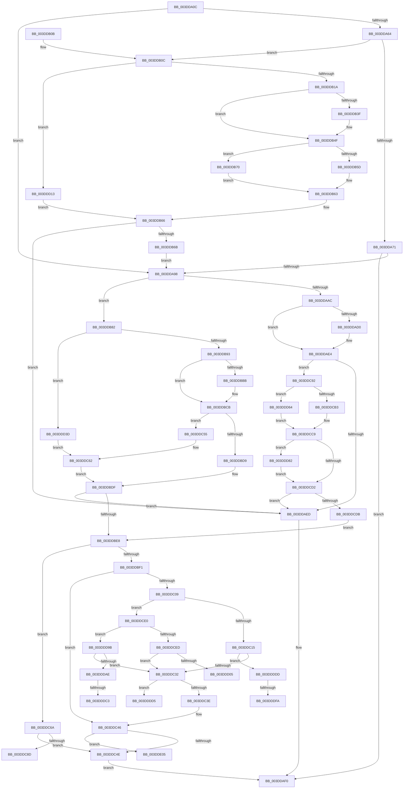

# HalpDmaAllocateMapRegisters

- RVA: `0x003DDA0C`–`0x003DDE0D` (길이 `1,025` bytes)
- VA: `0x00000001403DDA0C`
- 실행 섹션: `.text`
- PDB 이름 있음: `예`; PDB Function 태그: `예`
- unwind 정보 RVA: `0x00094414`
- 디코드: `269`개 명령, `1,025/1,025` bytes 표시
- 미해석 바이트: `0` (있으면 어셈블리에 `.byte`로 보존)

> 이 문서는 커널 이미지의 기계어와 PDB 기호를 분석해 생성했습니다. 4번과 5번은 함수 원형과 자료형을 바이너리 사용 방식에서 추정한 C 해석이며 원본 소스 복구 결과는 아닙니다.

## 1. Dependencies

- 직접 호출 지점: **28**; 고유 호출 대상: **17**
- 직접 호출자로 확인된 함수: **7**
- RIP 상대 이미지 참조: **2**

### Outgoing calls
- `0x003DDA88` → [HalpDmaAllocateScatterPagesFromScatterPool](HalpDmaAllocateScatterPagesFromScatterPool_function_003DC3EC.md) (function, `0x003DC3EC`)
- `0x003DDAC6` → [HalpDmaAllocateScatterPagesFromScatterPool](HalpDmaAllocateScatterPagesFromScatterPool_function_003DC3EC.md) (function, `0x003DC3EC`)
- `0x003DDAD9` → [HalpDmaPrependTranslations](HalpDmaPrependTranslations_function_003DC3C8.md) (function, `0x003DC3C8`)
- `0x003DDB0C` → [HalpDmaGetAdapterVersion](HalpDmaGetAdapterVersion_function_003DEC8C.md) (function, `0x003DEC8C`)
- `0x003DDB32` → [KeAcquireInStackQueuedSpinLock](../27/KeAcquireInStackQueuedSpinLock_function_002757A0.md) (function, `0x002757A0`)
- `0x003DDB48` → [RtlFindClearBitsAndSet](../3E/RtlFindClearBitsAndSet_function_003E0CD0.md) (function, `0x003E0CD0`)
- `0x003DDB53` → [KeReleaseInStackQueuedSpinLock](../34/KeReleaseInStackQueuedSpinLock_function_00342CE0.md) (function, `0x00342CE0`)
- `0x003DDB78` → [HalpDmaLinkContiguousTranslations](../3E/HalpDmaLinkContiguousTranslations_function_003E1CCC.md) (function, `0x003E1CCC`)
- `0x003DDB85` → [HalpDmaGetAdapterVersion](HalpDmaGetAdapterVersion_function_003DEC8C.md) (function, `0x003DEC8C`)
- `0x003DDBAE` → [KeAcquireInStackQueuedSpinLock](../27/KeAcquireInStackQueuedSpinLock_function_002757A0.md) (function, `0x002757A0`)
- `0x003DDBC4` → [RtlFindClearBitsAndSet](../3E/RtlFindClearBitsAndSet_function_003E0CD0.md) (function, `0x003E0CD0`)
- `0x003DDBCF` → [KeReleaseInStackQueuedSpinLock](../34/KeReleaseInStackQueuedSpinLock_function_00342CE0.md) (function, `0x00342CE0`)
- `0x003DDBFC` → [HalpMmAllocCtxAlloc](../3E/HalpMmAllocCtxAlloc_function_003E10B8.md) (function, `0x003E10B8`)
- `0x003DDC24` → [HalpDmaGetTranslationEntries](../49/HalpDmaGetTranslationEntries_function_0049AB3C.md) (function, `0x0049AB3C`)
- `0x003DDC41` → [HalpMmAllocCtxFree](../3E/HalpMmAllocCtxFree_function_003E1904.md) (function, `0x003E1904`)
- `0x003DDC5D` → [HalpDmaLinkContiguousTranslations](../3E/HalpDmaLinkContiguousTranslations_function_003E1CCC.md) (function, `0x003E1CCC`)
- `0x003DDC81` → [HalpDmaAllocateContiguousMemory](../3E/HalpDmaAllocateContiguousMemory_function_003EBD0C.md) (function, `0x003EBD0C`)
- `0x003DDCA2` → [HalpDmaGetMasterAdapterVersion](HalpDmaGetMasterAdapterVersion_function_003DC5B0.md) (function, `0x003DC5B0`)
- `0x003DDCC4` → [HalpDmaAllocateScatterPagesFromContiguousPoolV2](../3E/HalpDmaAllocateScatterPagesFromContiguousPoolV2_function_003E1DC4.md) (function, `0x003E1DC4`)
- `0x003DDCF2` → [HalpMmAllocCtxAlloc](../3E/HalpMmAllocCtxAlloc_function_003E10B8.md) (function, `0x003E10B8`)
- `0x003DDD08` → [MmGetPhysicalAddress](../23/MmGetPhysicalAddress_function_0023A500.md) (function, `0x0023A500`)
- `0x003DDD2D` → [HalpDmaAllocateContiguousPagesFromContiguousPoolV3](../53/HalpDmaAllocateContiguousPagesFromContiguousPoolV3_function_0053DE24.md) (function, `0x0053DE24`)
- `0x003DDD57` → [HalpDmaAllocateContiguousPagesFromContiguousPoolV3](../53/HalpDmaAllocateContiguousPagesFromContiguousPoolV3_function_0053DE24.md) (function, `0x0053DE24`)
- `0x003DDD78` → [HalpDmaAllocateScatterPagesFromContiguousPoolV3](../4E/HalpDmaAllocateScatterPagesFromContiguousPoolV3_function_004E380C.md) (function, `0x004E380C`)
- `0x003DDD8B` → [HalpDmaPrependTranslations](HalpDmaPrependTranslations_function_003DC3C8.md) (function, `0x003DC3C8`)
- `0x003DDD9B` → [HalpDmaAllocateMapRegisterFrame](../55/HalpDmaAllocateMapRegisterFrame_function_005506BC.md) (function, `0x005506BC`)
- `0x003DDDB1` → [MmGetPhysicalAddress](../23/MmGetPhysicalAddress_function_0023A500.md) (function, `0x0023A500`)
- `0x003DDDE6` → [HalpDmaPrependTranslations](HalpDmaPrependTranslations_function_003DC3C8.md) (function, `0x003DC3C8`)

### Direct callers
- [HalpAllocateDmaResourcesInternal](HalpAllocateDmaResourcesInternal_function_003DA7C4.md) at `0x003DA83C`
- [HalAllocateAdapterChannelV2](HalAllocateAdapterChannelV2_function_003DC714.md) at `0x003DC7AD`
- [sub_003DD362](Unknown_function_003DD362.md) at `0x003DD4B1`
- [IoFreeAdapterChannelV2](IoFreeAdapterChannelV2_function_003DE3B0.md) at `0x003DE498`
- [HalpDmaProcessMapRegisterQueueV2](HalpDmaProcessMapRegisterQueueV2_function_003DF50C.md) at `0x003DF55F`
- [HalDmaAllocateCrashDumpRegistersEx](../53/HalDmaAllocateCrashDumpRegistersEx_function_0053F6D0.md) at `0x0053F7D2`
- [HalpAllocateMapRegisters](../../page/70/HalpAllocateMapRegisters_function_00707640.md) at `0x007076D7`
- [HalpAllocateMapRegisters](../../page/70/HalpAllocateMapRegisters_function_00707640.md) at `0x00707706`

### Static image references
- `0x003DDCE0` → RVA `0x00FC18A0` (`.data`; read)
- `0x003DDDC3` → RVA `0x00FC18A8` (`.data`; read)

## 2. Other-region calls and transfers

- 다른 실행 섹션으로 향하는 call: **0**
- call이 아닌 외부 분기/꼬리 이동: **8**
  - `0x003DDC8D` → [sub_006EA22C](../6E/Unknown_function_006EA22C.md) (`tail-transfer`)
  - `0x003DDD0E` → [sub_006EA22C + 0x97](../6E/Unknown_function_006EA22C.md) (`tail-transfer`)
  - `0x003DDDBD` → [sub_006EA22C + 0x97](../6E/Unknown_function_006EA22C.md) (`tail-transfer`)
  - `0x003DDDD0` → [sub_006EA22C + 0x97](../6E/Unknown_function_006EA22C.md) (`tail-transfer`)
  - `0x003DDDD8` → [sub_006EA22C + 0xAB](../6E/Unknown_function_006EA22C.md) (`tail-transfer`)
  - `0x003DDDF4` → [sub_006EA22C + 0x125](../6E/Unknown_function_006EA22C.md) (`tail-transfer`)
  - `0x003DDE00` → [sub_006EA22C + 0xD8](../6E/Unknown_function_006EA22C.md) (`tail-transfer`)
  - `0x003DDE08` → [sub_006EA22C + 0x160](../6E/Unknown_function_006EA22C.md) (`tail-transfer`)

## 3. Assembly (complete function range)

```asm
003DDA0C  48 89 5C 24 10                  mov qword ptr [rsp + 0x10], rbx
003DDA11  55                              push rbp
003DDA12  56                              push rsi
003DDA13  57                              push rdi
003DDA14  41 54                           push r12
003DDA16  41 55                           push r13
003DDA18  41 56                           push r14
003DDA1A  41 57                           push r15
003DDA1C  48 8D 6C 24 D9                  lea rbp, [rsp - 0x27]
003DDA21  48 81 EC 90 00 00 00            sub rsp, 0x90
003DDA28  45 33 E4                        xor r12d, r12d
003DDA2B  33 C0                           xor eax, eax
003DDA2D  41 83 CD FF                     or r13d, 0xffffffff
003DDA31  44 89 65 77                     mov dword ptr [rbp + 0x77], r12d
003DDA35  41 8B DC                        mov ebx, r12d
003DDA38  0F 57 C0                        xorps xmm0, xmm0
003DDA3B  44 8B F2                        mov r14d, edx
003DDA3E  89 5D 67                        mov dword ptr [rbp + 0x67], ebx
003DDA41  48 8B F1                        mov rsi, rcx
003DDA44  4C 89 65 C7                     mov qword ptr [rbp - 0x39], r12
003DDA48  41 8B FC                        mov edi, r12d
003DDA4B  4C 89 65 7F                     mov qword ptr [rbp + 0x7f], r12
003DDA4F  4C 89 65 CF                     mov qword ptr [rbp - 0x31], r12
003DDA53  0F 11 45 07                     movups xmmword ptr [rbp + 7], xmm0
003DDA57  48 89 45 17                     mov qword ptr [rbp + 0x17], rax
003DDA5B  44 38 A1 59 01 00 00            cmp byte ptr [rcx + 0x159], r12b
003DDA62  75 34                           jne 0x1403dda98
003DDA64  44 38 A1 BA 01 00 00            cmp byte ptr [rcx + 0x1ba], r12b
003DDA6B  0F 84 9B 00 00 00               je 0x1403ddb0c
003DDA71  48 8D 45 67                     lea rax, [rbp + 0x67]
003DDA75  44 8B C2                        mov r8d, edx
003DDA78  48 89 44 24 28                  mov qword ptr [rsp + 0x28], rax
003DDA7D  45 33 C9                        xor r9d, r9d
003DDA80  48 8B D1                        mov rdx, rcx
003DDA83  44 88 64 24 20                  mov byte ptr [rsp + 0x20], r12b
003DDA88  E8 5F E9 FF FF                  call 0x1403dc3ec
003DDA8D  8B 5D 67                        mov ebx, dword ptr [rbp + 0x67]
003DDA90  48 8B F8                        mov rdi, rax
003DDA93  41 3B DE                        cmp ebx, r14d
003DDA96  74 58                           je 0x1403ddaf0
003DDA98  4C 8B BE A0 00 00 00            mov r15, qword ptr [rsi + 0xa0]
003DDA9F  44 38 A6 BA 01 00 00            cmp byte ptr [rsi + 0x1ba], r12b
003DDAA6  0F 84 D6 00 00 00               je 0x1403ddb82
003DDAAC  45 8B C6                        mov r8d, r14d
003DDAAF  48 8D 45 77                     lea rax, [rbp + 0x77]
003DDAB3  48 89 44 24 28                  mov qword ptr [rsp + 0x28], rax
003DDAB8  44 2B C3                        sub r8d, ebx
003DDABB  45 33 C9                        xor r9d, r9d
003DDABE  44 88 64 24 20                  mov byte ptr [rsp + 0x20], r12b
003DDAC3  49 8B D7                        mov rdx, r15
003DDAC6  E8 21 E9 FF FF                  call 0x1403dc3ec
003DDACB  48 85 C0                        test rax, rax
003DDACE  74 14                           je 0x1403ddae4
003DDAD0  8B 55 77                        mov edx, dword ptr [rbp + 0x77]
003DDAD3  4C 8B C7                        mov r8, rdi
003DDAD6  48 8B C8                        mov rcx, rax
003DDAD9  E8 EA E8 FF FF                  call 0x1403dc3c8
003DDADE  03 5D 77                        add ebx, dword ptr [rbp + 0x77]
003DDAE1  48 8B F8                        mov rdi, rax
003DDAE4  41 3B DE                        cmp ebx, r14d
003DDAE7  0F 85 A5 01 00 00               jne 0x1403ddc92
003DDAED  48 8B C7                        mov rax, rdi
003DDAF0  48 8B 9C 24 D8 00 00 00         mov rbx, qword ptr [rsp + 0xd8]
003DDAF8  48 81 C4 90 00 00 00            add rsp, 0x90
003DDAFF  41 5F                           pop r15
003DDB01  41 5E                           pop r14
003DDB03  41 5D                           pop r13
003DDB05  41 5C                           pop r12
003DDB07  5F                              pop rdi
003DDB08  5E                              pop rsi
003DDB09  5D                              pop rbp
003DDB0A  C3                              ret
003DDB0B  CC                              int3
003DDB0C  E8 7B 11 00 00                  call 0x1403dec8c
003DDB11  83 E8 02                        sub eax, 2
003DDB14  0F 85 F9 01 00 00               jne 0x1403ddd13
003DDB1A  33 C0                           xor eax, eax
003DDB1C  48 8D 8E 80 00 00 00            lea rcx, [rsi + 0x80]
003DDB23  48 8D 55 D7                     lea rdx, [rbp - 0x29]
003DDB27  48 89 45 E7                     mov qword ptr [rbp - 0x19], rax
003DDB2B  41 8B DE                        mov ebx, r14d
003DDB2E  0F 11 45 D7                     movups xmmword ptr [rbp - 0x29], xmm0
003DDB32  E8 69 7C E9 FF                  call 0x1402757a0
003DDB37  41 8B FD                        mov edi, r13d
003DDB3A  45 85 F6                        test r14d, r14d
003DDB3D  74 10                           je 0x1403ddb4f
003DDB3F  48 8B 4E 18                     mov rcx, qword ptr [rsi + 0x18]
003DDB43  45 33 C0                        xor r8d, r8d
003DDB46  8B D3                           mov edx, ebx
003DDB48  E8 83 31 00 00                  call 0x1403e0cd0
003DDB4D  8B F8                           mov edi, eax
003DDB4F  48 8D 4D D7                     lea rcx, [rbp - 0x29]
003DDB53  E8 88 51 F6 FF                  call 0x140342ce0
003DDB58  41 3B FD                        cmp edi, r13d
003DDB5B  75 13                           jne 0x1403ddb70
003DDB5D  49 8B FC                        mov rdi, r12
003DDB60  41 8B DC                        mov ebx, r12d
003DDB63  89 5D 67                        mov dword ptr [rbp + 0x67], ebx
003DDB66  48 85 FF                        test rdi, rdi
003DDB69  75 82                           jne 0x1403ddaed
003DDB6B  E9 28 FF FF FF                  jmp 0x1403dda98
003DDB70  44 8B C3                        mov r8d, ebx
003DDB73  8B D7                           mov edx, edi
003DDB75  48 8B CE                        mov rcx, rsi
003DDB78  E8 4F 41 00 00                  call 0x1403e1ccc
003DDB7D  48 8B F8                        mov rdi, rax
003DDB80  EB E1                           jmp 0x1403ddb63
003DDB82  48 8B CE                        mov rcx, rsi
003DDB85  E8 02 11 00 00                  call 0x1403dec8c
003DDB8A  83 E8 02                        sub eax, 2
003DDB8D  0F 85 AA 01 00 00               jne 0x1403ddd3d
003DDB93  0F 57 C0                        xorps xmm0, xmm0
003DDB96  49 8D 8F 80 00 00 00            lea rcx, [r15 + 0x80]
003DDB9D  33 C0                           xor eax, eax
003DDB9F  48 8D 55 EF                     lea rdx, [rbp - 0x11]
003DDBA3  0F 11 45 EF                     movups xmmword ptr [rbp - 0x11], xmm0
003DDBA7  48 89 45 FF                     mov qword ptr [rbp - 1], rax
003DDBAB  41 8B DE                        mov ebx, r14d
003DDBAE  E8 ED 7B E9 FF                  call 0x1402757a0
003DDBB3  41 8B FD                        mov edi, r13d
003DDBB6  45 85 F6                        test r14d, r14d
003DDBB9  74 10                           je 0x1403ddbcb
003DDBBB  49 8B 4F 18                     mov rcx, qword ptr [r15 + 0x18]
003DDBBF  45 33 C0                        xor r8d, r8d
003DDBC2  8B D3                           mov edx, ebx
003DDBC4  E8 07 31 00 00                  call 0x1403e0cd0
003DDBC9  8B F8                           mov edi, eax
003DDBCB  48 8D 4D EF                     lea rcx, [rbp - 0x11]
003DDBCF  E8 0C 51 F6 FF                  call 0x140342ce0
003DDBD4  41 3B FD                        cmp edi, r13d
003DDBD7  75 7C                           jne 0x1403ddc55
003DDBD9  49 8B FC                        mov rdi, r12
003DDBDC  41 8B DC                        mov ebx, r12d
003DDBDF  48 85 FF                        test rdi, rdi
003DDBE2  0F 85 05 FF FF FF               jne 0x1403ddaed
003DDBE8  44 38 A6 BA 01 00 00            cmp byte ptr [rsi + 0x1ba], r12b
003DDBEF  74 79                           je 0x1403ddc6a
003DDBF1  44 2B F3                        sub r14d, ebx
003DDBF4  4A 8D 14 F5 00 00 00 00         lea rdx, [r14*8]
003DDBFC  E8 B7 34 00 00                  call 0x1403e10b8
003DDC01  4C 8B E8                        mov r13, rax
003DDC04  48 85 C0                        test rax, rax
003DDC07  74 3D                           je 0x1403ddc46
003DDC09  45 33 FF                        xor r15d, r15d
003DDC0C  45 3B FE                        cmp r15d, r14d
003DDC0F  0F 82 CB 00 00 00               jb 0x1403ddce0
003DDC15  48 8B 8E A0 00 00 00            mov rcx, qword ptr [rsi + 0xa0]
003DDC1C  45 8B C6                        mov r8d, r14d
003DDC1F  BA 01 00 00 00                  mov edx, 1
003DDC24  E8 13 CF 0B 00                  call 0x14049ab3c
003DDC29  48 85 C0                        test rax, rax
003DDC2C  0F 85 AB 01 00 00               jne 0x1403ddddd
003DDC32  45 33 F6                        xor r14d, r14d
003DDC35  45 85 FF                        test r15d, r15d
003DDC38  0F 85 97 01 00 00               jne 0x1403dddd5
003DDC3E  49 8B D5                        mov rdx, r13
003DDC41  E8 BE 3C 00 00                  call 0x1403e1904
003DDC46  85 DB                           test ebx, ebx
003DDC48  0F 85 B7 01 00 00               jne 0x1403dde05
003DDC4E  33 C0                           xor eax, eax
003DDC50  E9 9B FE FF FF                  jmp 0x1403ddaf0
003DDC55  44 8B C3                        mov r8d, ebx
003DDC58  8B D7                           mov edx, edi
003DDC5A  49 8B CF                        mov rcx, r15
003DDC5D  E8 6A 40 00 00                  call 0x1403e1ccc
003DDC62  48 8B F8                        mov rdi, rax
003DDC65  E9 75 FF FF FF                  jmp 0x1403ddbdf
003DDC6A  48 8D 45 CF                     lea rax, [rbp - 0x31]
003DDC6E  41 8B D6                        mov edx, r14d
003DDC71  4C 8D 4D 7F                     lea r9, [rbp + 0x7f]
003DDC75  48 89 44 24 20                  mov qword ptr [rsp + 0x20], rax
003DDC7A  4C 8D 45 C7                     lea r8, [rbp - 0x39]
003DDC7E  48 8B CE                        mov rcx, rsi
003DDC81  E8 86 E0 00 00                  call 0x1403ebd0c
003DDC86  89 45 67                        mov dword ptr [rbp + 0x67], eax
003DDC89  85 C0                           test eax, eax
003DDC8B  74 C1                           je 0x1403ddc4e
003DDC8D  E9 9A C5 30 00                  jmp 0x1406ea22c
003DDC92  4C 8B 96 A0 00 00 00            mov r10, qword ptr [rsi + 0xa0]
003DDC99  45 8B C6                        mov r8d, r14d
003DDC9C  49 8B CA                        mov rcx, r10
003DDC9F  44 2B C3                        sub r8d, ebx
003DDCA2  E8 09 E9 FF FF                  call 0x1403dc5b0
003DDCA7  49 8B D2                        mov rdx, r10
003DDCAA  83 E8 02                        sub eax, 2
003DDCAD  0F 85 B1 00 00 00               jne 0x1403ddd64
003DDCB3  48 8D 45 77                     lea rax, [rbp + 0x77]
003DDCB7  45 33 C9                        xor r9d, r9d
003DDCBA  48 89 44 24 28                  mov qword ptr [rsp + 0x28], rax
003DDCBF  44 88 64 24 20                  mov byte ptr [rsp + 0x20], r12b
003DDCC4  E8 FB 40 00 00                  call 0x1403e1dc4
003DDCC9  48 85 C0                        test rax, rax
003DDCCC  0F 85 B0 00 00 00               jne 0x1403ddd82
003DDCD2  41 3B DE                        cmp ebx, r14d
003DDCD5  0F 84 12 FE FF FF               je 0x1403ddaed
003DDCDB  E9 08 FF FF FF                  jmp 0x1403ddbe8
003DDCE0  44 38 25 B9 3B BE 00            cmp byte ptr [rip + 0xbe3bb9], r12b
003DDCE7  0F 85 AE 00 00 00               jne 0x1403ddd9b
003DDCED  BA 00 10 00 00                  mov edx, 0x1000
003DDCF2  E8 C1 33 00 00                  call 0x1403e10b8
003DDCF7  4B 89 44 FD 00                  mov qword ptr [r13 + r15*8], rax
003DDCFC  48 85 C0                        test rax, rax
003DDCFF  0F 84 2D FF FF FF               je 0x1403ddc32
003DDD05  48 8B C8                        mov rcx, rax
003DDD08  E8 F3 C7 E5 FF                  call 0x14023a500
003DDD0D  90                              nop
003DDD0E  E9 B0 C5 30 00                  jmp 0x1406ea2c3
003DDD13  83 F8 01                        cmp eax, 1
003DDD16  41 B1 01                        mov r9b, 1
003DDD19  48 8D 45 67                     lea rax, [rbp + 0x67]
003DDD1D  45 8B C6                        mov r8d, r14d
003DDD20  48 89 44 24 28                  mov qword ptr [rsp + 0x28], rax
003DDD25  48 8B D6                        mov rdx, rsi
003DDD28  44 88 64 24 20                  mov byte ptr [rsp + 0x20], r12b
003DDD2D  E8 F2 00 16 00                  call 0x14053de24
003DDD32  8B 5D 67                        mov ebx, dword ptr [rbp + 0x67]
003DDD35  48 8B F8                        mov rdi, rax
003DDD38  E9 29 FE FF FF                  jmp 0x1403ddb66
003DDD3D  83 F8 01                        cmp eax, 1
003DDD40  41 B1 01                        mov r9b, 1
003DDD43  48 8D 45 67                     lea rax, [rbp + 0x67]
003DDD47  45 8B C6                        mov r8d, r14d
003DDD4A  48 89 44 24 28                  mov qword ptr [rsp + 0x28], rax
003DDD4F  49 8B D7                        mov rdx, r15
003DDD52  44 88 64 24 20                  mov byte ptr [rsp + 0x20], r12b
003DDD57  E8 C8 00 16 00                  call 0x14053de24
003DDD5C  8B 5D 67                        mov ebx, dword ptr [rbp + 0x67]
003DDD5F  E9 FE FE FF FF                  jmp 0x1403ddc62
003DDD64  45 33 C9                        xor r9d, r9d
003DDD67  83 F8 01                        cmp eax, 1
003DDD6A  48 8D 45 77                     lea rax, [rbp + 0x77]
003DDD6E  48 89 44 24 28                  mov qword ptr [rsp + 0x28], rax
003DDD73  44 88 64 24 20                  mov byte ptr [rsp + 0x20], r12b
003DDD78  E8 8F 5A 10 00                  call 0x1404e380c
003DDD7D  E9 47 FF FF FF                  jmp 0x1403ddcc9
003DDD82  8B 55 77                        mov edx, dword ptr [rbp + 0x77]
003DDD85  4C 8B C7                        mov r8, rdi
003DDD88  48 8B C8                        mov rcx, rax
003DDD8B  E8 38 E6 FF FF                  call 0x1403dc3c8
003DDD90  03 5D 77                        add ebx, dword ptr [rbp + 0x77]
003DDD93  48 8B F8                        mov rdi, rax
003DDD96  E9 37 FF FF FF                  jmp 0x1403ddcd2
003DDD9B  E8 1C 29 17 00                  call 0x1405506bc
003DDDA0  4B 89 44 FD 00                  mov qword ptr [r13 + r15*8], rax
003DDDA5  48 85 C0                        test rax, rax
003DDDA8  0F 84 84 FE FF FF               je 0x1403ddc32
003DDDAE  48 8B C8                        mov rcx, rax
003DDDB1  E8 4A C7 E5 FF                  call 0x14023a500
003DDDB6  44 38 25 E3 3A BE 00            cmp byte ptr [rip + 0xbe3ae3], r12b
003DDDBD  0F 84 00 C5 30 00               je 0x1406ea2c3
003DDDC3  48 8B 0D DE 3A BE 00            mov rcx, qword ptr [rip + 0xbe3ade]
003DDDCA  48 F7 D1                        not rcx
003DDDCD  48 23 C1                        and rax, rcx
003DDDD0  E9 EE C4 30 00                  jmp 0x1406ea2c3
003DDDD5  4D 8B E5                        mov r12, r13
003DDDD8  E9 FA C4 30 00                  jmp 0x1406ea2d7
003DDDDD  4C 8B C7                        mov r8, rdi
003DDDE0  41 8B D6                        mov edx, r14d
003DDDE3  48 8B C8                        mov rcx, rax
003DDDE6  E8 DD E5 FF FF                  call 0x1403dc3c8
003DDDEB  4C 8B F8                        mov r15, rax
003DDDEE  48 8B F8                        mov rdi, rax
003DDDF1  45 85 F6                        test r14d, r14d
003DDDF4  0F 84 57 C5 30 00               je 0x1406ea351
003DDDFA  49 8B DD                        mov rbx, r13
003DDDFD  45 8B E6                        mov r12d, r14d
003DDE00  E9 FF C4 30 00                  jmp 0x1406ea304
003DDE05  44 8B F3                        mov r14d, ebx
003DDE08  E9 7F C5 30 00                  jmp 0x1406ea38c
```

## 4. C-style interpretation (structured pseudocode)

```c
__int64 __fastcall HalpDmaAllocateMapRegisters(__int64 a1, int a2, __int64 a3, int a4)
{
    __int64 result;
    __int64 v_r12;
    __int64 v_r13;
    __int64 v_r14;
    __int64 v_r15;
    __int64 v_rbx;
    __int64 v_rdi;
    __int64 v_rsp;
    unsigned __int64 v_stack_m48;
    unsigned __int64 v_stack_m58;
    unsigned __int64 v_stack_m5F;
    unsigned __int64 v_stack_m60;
    unsigned __int64 v_stack_m70;
    unsigned __int64 v_stack_m78;
    unsigned __int64 v_stack_m88;
    unsigned __int64 v_stack_m90;
    unsigned __int64 v_stack_m98;
    unsigned __int64 v_stack_mA0;
    unsigned __int8 v_stack_mA8;
    unsigned __int64 v_stack_p10;
    unsigned int v_stack_p18;
    unsigned __int64 v_stack_p20;
    unsigned __int64 v_stack_p28;
    unsigned int v_stack_p8;

    v_stack_p10 = v_rbx;
    v_rsp = (v_rsp) - (144);
    v_r12 = 0;
    result = 0;
    v_r13 = (unsigned int)((v_r13) | (0xFFFFFFFFULL));
    v_stack_p18 = 0;
    v_stack_p8 = 0;
    v_stack_m98 = 0;
    v_stack_p20 = 0;
    v_stack_m90 = 0;
    v_stack_m58 = v_xmm0;
    v_stack_m48 = 0;
    if ((*(unsigned __int8 *)(a1 + 345)) != 0) goto loc_003DDA98;
    if ((*(unsigned __int8 *)(a1 + 442)) == 0) goto loc_003DDB0C;
    v_stack_mA0 = v_stack_p8;
    a4 = 0;
    v_stack_mA8 = 0;
    result = HalpDmaAllocateScatterPagesFromScatterPool(a1, a1, (unsigned int)(a2), a4);
    if (((unsigned int)((unsigned int)(v_stack_p8))) == ((unsigned int)((unsigned int)(a2)))) goto loc_003DDAF0;
loc_003DDA98:
    if ((*(unsigned __int8 *)(a1 + 442)) == 0) goto loc_003DDB82;
    v_stack_mA0 = v_stack_p18;
    a3 = (unsigned int)(((unsigned int)((unsigned int)((unsigned int)(a2)))) - ((unsigned int)((unsigned int)(v_stack_p8))));
    a4 = 0;
    v_stack_mA8 = 0;
    result = HalpDmaAllocateScatterPagesFromScatterPool(a1, *(unsigned __int64 *)(a1 + 160), a3, a4);
    v_rbx = (unsigned int)(v_stack_p8);
    v_rdi = result;
    if (result != 0) {
        a2 = v_stack_p18;
        a3 = result;
        a1 = result;
        result = HalpDmaPrependTranslations(a1, a2, a3, a4);
        v_rbx = (unsigned int)(((unsigned int)(v_stack_p8)) + (v_stack_p18));
        v_rdi = result;
    }
    if (((unsigned int)(v_rbx)) != ((unsigned int)((unsigned int)(a2)))) goto loc_003DDC92;
loc_003DDAED:
loc_003DDAF0:
    v_rsp = (v_rsp) + (144);
    return v_rdi;
loc_003DDB0C:
    result = HalpDmaGetAdapterVersion(a1, a2, a3, a4);
    result = (unsigned int)((result) - (2));
    if (condition_is_not_equal) goto loc_003DDD13;
    result = 0;
    v_stack_m78 = 0;
    v_stack_m88 = v_xmm0;
    result = KeAcquireInStackQueuedSpinLock(a1 + 128, v_stack_m88, a3, a4);
    v_rdi = (unsigned int)((unsigned int)(v_r13));
    if ((unsigned int)((unsigned int)(a2)) != 0) {
        a1 = *(unsigned __int64 *)(a1 + 24);
        a3 = 0;
        a2 = (unsigned int)((unsigned int)((unsigned int)((unsigned int)(a2))));
        result = RtlFindClearBitsAndSet(a1, a2, a3, a4);
        v_rdi = (unsigned int)(result);
    }
    result = KeReleaseInStackQueuedSpinLock(v_stack_m88, a2, a3, a4);
    if (((unsigned int)(v_rdi)) != ((unsigned int)(v_r13))) goto loc_003DDB70;
loc_003DDB63:
    v_stack_p8 = 0;
loc_003DDB66:
    if (0 != 0) goto loc_003DDAED;
    goto loc_003DDA98;
loc_003DDB70:
    result = HalpDmaLinkContiguousTranslations(a1, 0, 0, a4);
    goto loc_003DDB63;
loc_003DDB82:
    result = HalpDmaGetAdapterVersion(a1, 0, 0, a4);
    result = (unsigned int)((result) - (2));
    if (condition_is_not_equal) goto loc_003DDD3D;
    result = 0;
    v_stack_m70 = v_xmm0;
    v_stack_m60 = 0;
    result = KeAcquireInStackQueuedSpinLock(*(unsigned __int64 *)(a1 + 160) + 128, v_stack_m70, 0, a4);
    v_rdi = (unsigned int)((unsigned int)(v_r13));
    if ((unsigned int)((unsigned int)(a2)) != 0) {
        a1 = *(unsigned __int64 *)(*(unsigned __int64 *)(a1 + 160) + 24);
        a3 = 0;
        a2 = (unsigned int)((unsigned int)((unsigned int)((unsigned int)(a2))));
        result = RtlFindClearBitsAndSet(a1, a2, a3, a4);
        v_rdi = (unsigned int)(result);
    }
    result = KeReleaseInStackQueuedSpinLock(v_stack_m70, a2, a3, a4);
    if (((unsigned int)(v_rdi)) != ((unsigned int)(v_r13))) goto loc_003DDC55;
loc_003DDBDF:
    if (0 != 0) goto loc_003DDAED;
loc_003DDBE8:
    if ((*(unsigned __int8 *)(a1 + 442)) == 0) goto loc_003DDC6A;
    v_r14 = (unsigned int)(((unsigned int)(a2)) - (0));
    result = HalpMmAllocCtxAlloc(v_stack_m70, v_r14 * 8, a3, a4);
    if (result == 0) goto loc_003DDC46;
    v_r15 = 0;
    if (0 < ((unsigned int)(v_r14))) goto loc_003DDCE0;
    result = HalpDmaGetTranslationEntries(*(unsigned __int64 *)(a1 + 160), 1, (unsigned int)((unsigned int)(v_r14)), a4);
    if (result != 0) goto loc_003DDDDD;
loc_003DDC32:
    v_r14 = 0;
    if (0 != 0) goto loc_003DDDD5;
    result = HalpMmAllocCtxFree(*(unsigned __int64 *)(a1 + 160), result, (unsigned int)((unsigned int)(v_r14)), a4);
loc_003DDC46:
    if (0 != 0) goto loc_003DDE05;
loc_003DDC4E:
    result = 0;
    goto loc_003DDAF0;
loc_003DDC55:
    result = HalpDmaLinkContiguousTranslations(0, 0, 0, a4);
loc_003DDC62:
    goto loc_003DDBDF;
loc_003DDC6A:
    v_stack_p20 = v_stack_m90;
    result = HalpDmaAllocateContiguousMemory(a1, 0, v_stack_m98, v_stack_p20);
    v_stack_p8 = (unsigned int)(result);
    if ((unsigned int)(result) == 0) goto loc_003DDC4E;
loc_003DDC92:
    a3 = (unsigned int)((0) - (0));
    result = HalpDmaGetMasterAdapterVersion(*(unsigned __int64 *)(a1 + 160), 0, a3, v_stack_p20);
    result = (unsigned int)((result) - (2));
    if (condition_is_not_equal) goto loc_003DDD64;
    a4 = 0;
    v_stack_p28 = v_stack_p18;
    v_stack_p20 = 0;
    result = HalpDmaAllocateScatterPagesFromContiguousPoolV2(*(unsigned __int64 *)(a1 + 160), *(unsigned __int64 *)(a1 + 160), a3, a4);
loc_003DDCC9:
    if (result != 0) goto loc_003DDD82;
loc_003DDCD2:
    if (0 == 0) goto loc_003DDAED;
    goto loc_003DDBE8;
loc_003DDCE0:
    if ((*(unsigned __int8 *)(v_rip + 12467129)) != 0) goto loc_003DDD9B;
    result = HalpMmAllocCtxAlloc(*(unsigned __int64 *)(a1 + 160), (unsigned int)(0x1000ULL), a3, a4);
    *(unsigned __int64 *)(result + v_r15 * 8) = result;
    if (result == 0) goto loc_003DDC32;
    result = MmGetPhysicalAddress(result, (unsigned int)(0x1000ULL), a3, a4);
loc_003DDD13:
    v_stack_p28 = v_stack_p8;
    v_stack_p20 = 0;
    result = HalpDmaAllocateContiguousPagesFromContiguousPoolV3(result, a1, 0, 1);
    goto loc_003DDB66;
loc_003DDD3D:
    v_stack_p28 = v_stack_p8;
    v_stack_p20 = 0;
    result = HalpDmaAllocateContiguousPagesFromContiguousPoolV3(result, 0, 0, 1);
    goto loc_003DDC62;
loc_003DDD64:
    a4 = 0;
    v_stack_p28 = v_stack_p18;
    v_stack_p20 = 0;
    result = HalpDmaAllocateScatterPagesFromContiguousPoolV3(result, 0, 0, a4);
    goto loc_003DDCC9;
loc_003DDD82:
    result = HalpDmaPrependTranslations(result, (unsigned int)(v_stack_p18), result, a4);
    v_rbx = (unsigned int)(((unsigned int)(v_stack_p8)) + (v_stack_p18));
    goto loc_003DDCD2;
loc_003DDD9B:
    result = HalpDmaAllocateMapRegisterFrame(result, (unsigned int)(v_stack_p18), result, a4);
    *(unsigned __int64 *)(result + v_r15 * 8) = result;
    if (result == 0) goto loc_003DDC32;
    result = MmGetPhysicalAddress(result, (unsigned int)(v_stack_p18), result, a4);
    a1 = ~(*(unsigned __int64 *)(v_rip + 12466910));
    result = (result) & (a1);
loc_003DDDD5:
loc_003DDDDD:
    result = HalpDmaPrependTranslations(result, 0, result, a4);
loc_003DDE05:
}
```

## 5. (Beta) C Style

```c
int64_t HalpDmaAllocateMapRegisters(void *Arg1, int32_t Arg2, int64_t Arg3, int32_t Arg4)
{
    uint8_t *arg1 = (uint8_t *)Arg1;

    int64_t result;
    int64_t local_r12;
    int64_t local_r13;
    int64_t local_r14;
    int64_t local_r15;
    int64_t local_rbx;
    int64_t local_rdi;
    int64_t local_rsp;
    uint64_t v_stack_m48;
    uint64_t v_stack_m58;
    uint64_t v_stack_m5F;
    uint64_t v_stack_m60;
    uint64_t v_stack_m70;
    uint64_t v_stack_m78;
    uint64_t v_stack_m88;
    uint64_t v_stack_m90;
    uint64_t v_stack_m98;
    uint64_t v_stack_mA0;
    uint8_t v_stack_mA8;
    uint64_t v_stack_p10;
    uint32_t v_stack_p18;
    uint64_t v_stack_p20;
    uint64_t v_stack_p28;
    uint32_t v_stack_p8;

    v_stack_p10 = local_rbx;
    local_rsp = (local_rsp) - (144);
    local_r12 = 0;
    result = 0;
    local_r13 = (uint32_t)((local_r13) | (0xFFFFFFFFULL));
    v_stack_p18 = 0;
    v_stack_p8 = 0;
    v_stack_m98 = 0;
    v_stack_p20 = 0;
    v_stack_m90 = 0;
    v_stack_m58 = v_xmm0;
    v_stack_m48 = 0;
    if ((*(uint8_t *)(arg1 + 0x159)) != 0) goto loc_003DDA98;
    if ((*(uint8_t *)(arg1 + 0x1BA)) == 0) goto loc_003DDB0C;
    v_stack_mA0 = v_stack_p8;
    Arg4 = 0;
    v_stack_mA8 = 0;
    result = HalpDmaAllocateScatterPagesFromScatterPool(Arg1, Arg1, (uint32_t)(Arg2), Arg4);
    if (((uint32_t)((uint32_t)(v_stack_p8))) == ((uint32_t)((uint32_t)(Arg2)))) goto loc_003DDAF0;
loc_003DDA98:
    if ((*(uint8_t *)(arg1 + 0x1BA)) == 0) goto loc_003DDB82;
    v_stack_mA0 = v_stack_p18;
    Arg3 = (uint32_t)(((uint32_t)((uint32_t)((uint32_t)(Arg2)))) - ((uint32_t)((uint32_t)(v_stack_p8))));
    Arg4 = 0;
    v_stack_mA8 = 0;
    result = HalpDmaAllocateScatterPagesFromScatterPool(Arg1, *(uint64_t *)(arg1 + 0xA0), Arg3, Arg4);
    local_rbx = (uint32_t)(v_stack_p8);
    local_rdi = result;
    if (result != 0) {
        Arg2 = v_stack_p18;
        Arg3 = result;
        Arg1 = result;
        result = HalpDmaPrependTranslations(Arg1, Arg2, Arg3, Arg4);
        local_rbx = (uint32_t)(((uint32_t)(v_stack_p8)) + (v_stack_p18));
        local_rdi = result;
    }
    if (((uint32_t)(local_rbx)) != ((uint32_t)((uint32_t)(Arg2)))) goto loc_003DDC92;
loc_003DDAED:
loc_003DDAF0:
    local_rsp = (local_rsp) + (144);
    return local_rdi;
loc_003DDB0C:
    result = HalpDmaGetAdapterVersion(Arg1, Arg2, Arg3, Arg4);
    result = (uint32_t)((result) - (2));
    if (condition_is_not_equal) goto loc_003DDD13;
    result = 0;
    v_stack_m78 = 0;
    v_stack_m88 = v_xmm0;
    result = KeAcquireInStackQueuedSpinLock(Arg1 + 128, v_stack_m88, Arg3, Arg4);
    local_rdi = (uint32_t)((uint32_t)(local_r13));
    if ((uint32_t)((uint32_t)(Arg2)) != 0) {
        Arg1 = *(uint64_t *)(arg1 + 0x18);
        Arg3 = 0;
        Arg2 = (uint32_t)((uint32_t)((uint32_t)((uint32_t)(Arg2))));
        result = RtlFindClearBitsAndSet(Arg1, Arg2, Arg3, Arg4);
        local_rdi = (uint32_t)(result);
    }
    result = KeReleaseInStackQueuedSpinLock(v_stack_m88, Arg2, Arg3, Arg4);
    if (((uint32_t)(local_rdi)) != ((uint32_t)(local_r13))) goto loc_003DDB70;
loc_003DDB63:
    v_stack_p8 = 0;
loc_003DDB66:
    if (0 != 0) goto loc_003DDAED;
    goto loc_003DDA98;
loc_003DDB70:
    result = HalpDmaLinkContiguousTranslations(Arg1, 0, 0, Arg4);
    goto loc_003DDB63;
loc_003DDB82:
    result = HalpDmaGetAdapterVersion(Arg1, 0, 0, Arg4);
    result = (uint32_t)((result) - (2));
    if (condition_is_not_equal) goto loc_003DDD3D;
    result = 0;
    v_stack_m70 = v_xmm0;
    v_stack_m60 = 0;
    result = KeAcquireInStackQueuedSpinLock(*(uint64_t *)(arg1 + 0xA0) + 128, v_stack_m70, 0, Arg4);
    local_rdi = (uint32_t)((uint32_t)(local_r13));
    if ((uint32_t)((uint32_t)(Arg2)) != 0) {
        Arg1 = *(uint64_t *)(*(uint64_t *)(arg1 + 0xA0) + 0x18);
        Arg3 = 0;
        Arg2 = (uint32_t)((uint32_t)((uint32_t)((uint32_t)(Arg2))));
        result = RtlFindClearBitsAndSet(Arg1, Arg2, Arg3, Arg4);
        local_rdi = (uint32_t)(result);
    }
    result = KeReleaseInStackQueuedSpinLock(v_stack_m70, Arg2, Arg3, Arg4);
    if (((uint32_t)(local_rdi)) != ((uint32_t)(local_r13))) goto loc_003DDC55;
loc_003DDBDF:
    if (0 != 0) goto loc_003DDAED;
loc_003DDBE8:
    if ((*(uint8_t *)(arg1 + 0x1BA)) == 0) goto loc_003DDC6A;
    local_r14 = (uint32_t)(((uint32_t)(Arg2)) - (0));
    result = HalpMmAllocCtxAlloc(v_stack_m70, local_r14 * 8, Arg3, Arg4);
    if (result == 0) goto loc_003DDC46;
    local_r15 = 0;
    if (0 < ((uint32_t)(local_r14))) goto loc_003DDCE0;
    result = HalpDmaGetTranslationEntries(*(uint64_t *)(arg1 + 0xA0), 1, (uint32_t)((uint32_t)(local_r14)), Arg4);
    if (result != 0) goto loc_003DDDDD;
loc_003DDC32:
    local_r14 = 0;
    if (0 != 0) goto loc_003DDDD5;
    result = HalpMmAllocCtxFree(*(uint64_t *)(arg1 + 0xA0), result, (uint32_t)((uint32_t)(local_r14)), Arg4);
loc_003DDC46:
    if (0 != 0) goto loc_003DDE05;
loc_003DDC4E:
    result = 0;
    goto loc_003DDAF0;
loc_003DDC55:
    result = HalpDmaLinkContiguousTranslations(0, 0, 0, Arg4);
loc_003DDC62:
    goto loc_003DDBDF;
loc_003DDC6A:
    v_stack_p20 = v_stack_m90;
    result = HalpDmaAllocateContiguousMemory(Arg1, 0, v_stack_m98, v_stack_p20);
    v_stack_p8 = (uint32_t)(result);
    if ((uint32_t)(result) == 0) goto loc_003DDC4E;
loc_003DDC92:
    Arg3 = (uint32_t)((0) - (0));
    result = HalpDmaGetMasterAdapterVersion(*(uint64_t *)(arg1 + 0xA0), 0, Arg3, v_stack_p20);
    result = (uint32_t)((result) - (2));
    if (condition_is_not_equal) goto loc_003DDD64;
    Arg4 = 0;
    v_stack_p28 = v_stack_p18;
    v_stack_p20 = 0;
    result = HalpDmaAllocateScatterPagesFromContiguousPoolV2(*(uint64_t *)(arg1 + 0xA0), *(uint64_t *)(arg1 + 0xA0), Arg3, Arg4);
loc_003DDCC9:
    if (result != 0) goto loc_003DDD82;
loc_003DDCD2:
    if (0 == 0) goto loc_003DDAED;
    goto loc_003DDBE8;
loc_003DDCE0:
    if ((*(uint8_t *)(v_rip + 0xBE3BB9)) != 0) goto loc_003DDD9B;
    result = HalpMmAllocCtxAlloc(*(uint64_t *)(arg1 + 0xA0), (uint32_t)(0x1000ULL), Arg3, Arg4);
    *(uint64_t *)(result + local_r15 * 8) = result;
    if (result == 0) goto loc_003DDC32;
    result = MmGetPhysicalAddress(result, (uint32_t)(0x1000ULL), Arg3, Arg4);
loc_003DDD13:
    v_stack_p28 = v_stack_p8;
    v_stack_p20 = 0;
    result = HalpDmaAllocateContiguousPagesFromContiguousPoolV3(result, Arg1, 0, 1);
    goto loc_003DDB66;
loc_003DDD3D:
    v_stack_p28 = v_stack_p8;
    v_stack_p20 = 0;
    result = HalpDmaAllocateContiguousPagesFromContiguousPoolV3(result, 0, 0, 1);
    goto loc_003DDC62;
loc_003DDD64:
    Arg4 = 0;
    v_stack_p28 = v_stack_p18;
    v_stack_p20 = 0;
    result = HalpDmaAllocateScatterPagesFromContiguousPoolV3(result, 0, 0, Arg4);
    goto loc_003DDCC9;
loc_003DDD82:
    result = HalpDmaPrependTranslations(result, (uint32_t)(v_stack_p18), result, Arg4);
    local_rbx = (uint32_t)(((uint32_t)(v_stack_p8)) + (v_stack_p18));
    goto loc_003DDCD2;
loc_003DDD9B:
    result = HalpDmaAllocateMapRegisterFrame(result, (uint32_t)(v_stack_p18), result, Arg4);
    *(uint64_t *)(result + local_r15 * 8) = result;
    if (result == 0) goto loc_003DDC32;
    result = MmGetPhysicalAddress(result, (uint32_t)(v_stack_p18), result, Arg4);
    Arg1 = ~(*(uint64_t *)(v_rip + 0xBE3ADE));
    result = (result) & (Arg1);
loc_003DDDD5:
loc_003DDDDD:
    result = HalpDmaPrependTranslations(result, 0, result, Arg4);
loc_003DDE05:
}
```

### 관측된 메모리 오프셋

구조체 형식이 확인되지 않은 접근은 인자 기준의 오프셋으로만 기록했습니다.

| 기준 인자 | 오프셋 표현 | 폭 (bit) | 접근 |
|---|---:|---:|---|
| `Arg1` | `+ 0x18` | `64` | `R` |
| `Arg1` | `+ 0x80` | `64` | `R` |
| `Arg1` | `+ 0xA0` | `64` | `R` |
| `Arg1` | `+ 0x159` | `8` | `R` |
| `Arg1` | `+ 0x1BA` | `8` | `R` |

## 6. Execution-region graph

[열기: 2D/3D 그래프와 함수 탐색 컨트롤 패널](../../../control-panel.html?section=text&rva=0x003DDA0C&view=graph)

- 2D 그래프는 위에서 아래로 흐르고, 3D 그래프는 빈 공간을 드래그해 회전합니다. Shift+드래그는 이동, 휠은 확대·축소, 함수 노드 선택은 대상 보고서 이동입니다.

### Static fallback


