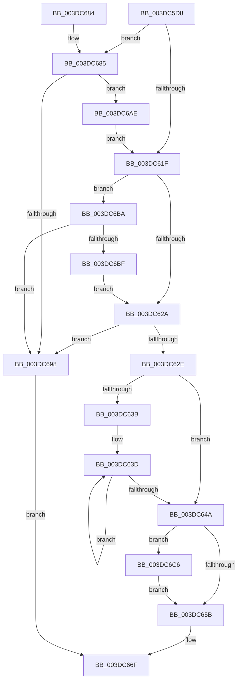

# HalpDmaAllocateScatterPagesFromScatterPoolV3

- RVA: `0x003DC5D8`–`0x003DC6CE` (길이 `246` bytes)
- VA: `0x00000001403DC5D8`
- 실행 섹션: `.text`
- PDB 이름 있음: `예`; PDB Function 태그: `아니요`
- unwind 정보 RVA: `0x000941F8`
- 디코드: `73`개 명령, `246/246` bytes 표시
- 미해석 바이트: `0` (있으면 어셈블리에 `.byte`로 보존)

> 이 문서는 커널 이미지의 기계어와 PDB 기호를 분석해 생성했습니다. 4번과 5번은 함수 원형과 자료형을 바이너리 사용 방식에서 추정한 C 해석이며 원본 소스 복구 결과는 아닙니다.

## 1. Dependencies

- 직접 호출 지점: **3**; 고유 호출 대상: **2**
- 직접 호출자로 확인된 함수: **1**
- RIP 상대 이미지 참조: **0**

### Outgoing calls
- `0x003DC610` → [KeAcquireInStackQueuedSpinLock](../27/KeAcquireInStackQueuedSpinLock_function_002757A0.md) (function, `0x002757A0`)
- `0x003DC660` → [KeReleaseInStackQueuedSpinLock](../34/KeReleaseInStackQueuedSpinLock_function_00342CE0.md) (function, `0x00342CE0`)
- `0x003DC69D` → [KeReleaseInStackQueuedSpinLock](../34/KeReleaseInStackQueuedSpinLock_function_00342CE0.md) (function, `0x00342CE0`)

### Direct callers
- [HalpDmaAllocateScatterPagesFromScatterPool](HalpDmaAllocateScatterPagesFromScatterPool_function_003DC3EC.md) at `0x003DC585`

### Static image references
- 디코드된 RIP-relative 메모리 참조가 없습니다.

## 2. Other-region calls and transfers

- 다른 실행 섹션으로 향하는 call: **0**
- 별도 외부 분기/꼬리 이동을 확인하지 못했습니다.

## 3. Assembly (complete function range)

```asm
003DC5D8  4C 8B DC                        mov r11, rsp
003DC5DB  49 89 5B 08                     mov qword ptr [r11 + 8], rbx
003DC5DF  49 89 6B 10                     mov qword ptr [r11 + 0x10], rbp
003DC5E3  49 89 73 18                     mov qword ptr [r11 + 0x18], rsi
003DC5E7  57                              push rdi
003DC5E8  48 83 EC 40                     sub rsp, 0x40
003DC5EC  0F 57 C0                        xorps xmm0, xmm0
003DC5EF  48 8D 8A 80 00 00 00            lea rcx, [rdx + 0x80]
003DC5F6  48 8B FA                        mov rdi, rdx
003DC5F9  33 C0                           xor eax, eax
003DC5FB  0F 11 44 24 20                  movups xmmword ptr [rsp + 0x20], xmm0
003DC600  49 8D 53 D8                     lea rdx, [r11 - 0x28]
003DC604  49 89 43 E8                     mov qword ptr [r11 - 0x18], rax
003DC608  41 8A E9                        mov bpl, r9b
003DC60B  41 8B D8                        mov ebx, r8d
003DC60E  33 F6                           xor esi, esi
003DC610  E8 8B 91 E9 FF                  call 0x1402757a0
003DC615  44 8A 44 24 70                  mov r8b, byte ptr [rsp + 0x70]
003DC61A  45 84 C0                        test r8b, r8b
003DC61D  75 66                           jne 0x1403dc685
003DC61F  8B 47 28                        mov eax, dword ptr [rdi + 0x28]
003DC622  3B D8                           cmp ebx, eax
003DC624  0F 87 90 00 00 00               ja 0x1403dc6ba
003DC62A  85 DB                           test ebx, ebx
003DC62C  74 6A                           je 0x1403dc698
003DC62E  48 8B 6F 20                     mov rbp, qword ptr [rdi + 0x20]
003DC632  33 D2                           xor edx, edx
003DC634  48 8B CD                        mov rcx, rbp
003DC637  85 DB                           test ebx, ebx
003DC639  74 0F                           je 0x1403dc64a
003DC63B  8B C3                           mov eax, ebx
003DC63D  48 8B D1                        mov rdx, rcx
003DC640  48 8B 49 08                     mov rcx, qword ptr [rcx + 8]
003DC644  48 83 E8 01                     sub rax, 1
003DC648  75 F3                           jne 0x1403dc63d
003DC64A  48 83 62 08 00                  and qword ptr [rdx + 8], 0
003DC64F  29 5F 28                        sub dword ptr [rdi + 0x28], ebx
003DC652  48 89 4F 20                     mov qword ptr [rdi + 0x20], rcx
003DC656  45 84 C0                        test r8b, r8b
003DC659  75 6B                           jne 0x1403dc6c6
003DC65B  48 8D 4C 24 20                  lea rcx, [rsp + 0x20]
003DC660  E8 7B 66 F6 FF                  call 0x140342ce0
003DC665  48 8B 4C 24 78                  mov rcx, qword ptr [rsp + 0x78]
003DC66A  48 8B C5                        mov rax, rbp
003DC66D  89 19                           mov dword ptr [rcx], ebx
003DC66F  48 8B 5C 24 50                  mov rbx, qword ptr [rsp + 0x50]
003DC674  48 8B 6C 24 58                  mov rbp, qword ptr [rsp + 0x58]
003DC679  48 8B 74 24 60                  mov rsi, qword ptr [rsp + 0x60]
003DC67E  48 83 C4 40                     add rsp, 0x40
003DC682  5F                              pop rdi
003DC683  C3                              ret
003DC684  CC                              int3
003DC685  8B 87 E0 00 00 00               mov eax, dword ptr [rdi + 0xe0]
003DC68B  48 8B F7                        mov rsi, rdi
003DC68E  8B 8F E4 00 00 00               mov ecx, dword ptr [rdi + 0xe4]
003DC694  3B C1                           cmp eax, ecx
003DC696  77 16                           ja 0x1403dc6ae
003DC698  48 8D 4C 24 20                  lea rcx, [rsp + 0x20]
003DC69D  E8 3E 66 F6 FF                  call 0x140342ce0
003DC6A2  48 8B 44 24 78                  mov rax, qword ptr [rsp + 0x78]
003DC6A7  83 20 00                        and dword ptr [rax], 0
003DC6AA  33 C0                           xor eax, eax
003DC6AC  EB C1                           jmp 0x1403dc66f
003DC6AE  2B C1                           sub eax, ecx
003DC6B0  3B D8                           cmp ebx, eax
003DC6B2  0F 47 D8                        cmova ebx, eax
003DC6B5  E9 65 FF FF FF                  jmp 0x1403dc61f
003DC6BA  40 84 ED                        test bpl, bpl
003DC6BD  75 D9                           jne 0x1403dc698
003DC6BF  8B D8                           mov ebx, eax
003DC6C1  E9 64 FF FF FF                  jmp 0x1403dc62a
003DC6C6  29 9E E0 00 00 00               sub dword ptr [rsi + 0xe0], ebx
003DC6CC  EB 8D                           jmp 0x1403dc65b
```

## 4. C-style interpretation (structured pseudocode)

```c
__int64 __fastcall HalpDmaAllocateScatterPagesFromScatterPoolV3(__int64 a1, __int64 a2, int a3, unsigned __int8 a4, unsigned __int8 a5, __int64 a6)
{
    __int64 result;
    __int64 v_rbx;
    __int64 v_rsi;
    __int64 v_rsp;
    unsigned __int64 v_stack_m28;
    unsigned __int64 v_stack_p10;
    unsigned __int64 v_stack_p18;
    unsigned __int64 v_stack_p20;
    unsigned __int64 v_stack_p8;

    *(unsigned __int64 *)(v_rsp + 8) = v_rbx;
    *(unsigned __int64 *)(v_rsp + 16) = v_rbp;
    *(unsigned __int64 *)(v_rsp + 24) = v_rsi;
    v_rsp = (v_rsp) - (64);
    result = 0;
    v_stack_m28 = v_xmm0;
    *(unsigned __int64 *)(v_rsp - 24) = 0;
    v_rsi = 0;
    result = KeAcquireInStackQueuedSpinLock(a2 + 128, v_rsp - 40, a3, a4);
    if (a5 != 0) goto loc_003DC685;
loc_003DC61F:
    if (((unsigned int)((unsigned int)(a3))) > ((unsigned int)((unsigned int)(*(unsigned int *)(a2 + 40))))) goto loc_003DC6BA;
loc_003DC62A:
    if ((unsigned int)((unsigned int)(a3)) == 0) goto loc_003DC698;
    a2 = 0;
    if ((unsigned int)((unsigned int)(a3)) == 0) goto loc_003DC64A;
loc_003DC63D:
    result = ((unsigned int)((unsigned int)((unsigned int)(a3)))) - (1);
    if (condition_is_not_equal) goto loc_003DC63D;
loc_003DC64A:
    *(unsigned __int64 *)(a2 + 32) = *(unsigned __int64 *)(*(unsigned __int64 *)(a2 + 32) + 8);
    if (a5 != 0) goto loc_003DC6C6;
loc_003DC65B:
    result = KeReleaseInStackQueuedSpinLock(v_stack_m28, *(unsigned __int64 *)(a2 + 32), a5, a4);
    *(unsigned int *)(a6) = (unsigned int)((unsigned int)(a3));
loc_003DC66F:
    v_rsp = (v_rsp) + (64);
    return *(unsigned __int64 *)(a2 + 32);
loc_003DC685:
    if (((unsigned int)((unsigned int)(*(unsigned int *)(a2 + 224)))) > ((unsigned int)((unsigned int)(*(unsigned int *)(a2 + 228))))) goto loc_003DC6AE;
loc_003DC698:
    result = KeReleaseInStackQueuedSpinLock(v_stack_p20, *(unsigned __int64 *)(a2 + 32), a5, a4);
    result = 0;
    goto loc_003DC66F;
loc_003DC6AE:
    result = (unsigned int)((result) - ((unsigned int)(v_stack_p20)));
    v_rbx = v_stack_p8;
    if (((unsigned int)(v_stack_p8)) > ((unsigned int)(result))) { v_rbx = (unsigned int)(result); }
    goto loc_003DC61F;
loc_003DC6BA:
    if ((unsigned __int8)(v_stack_p10) != 0) goto loc_003DC698;
    goto loc_003DC62A;
loc_003DC6C6:
    goto loc_003DC65B;
}
```

## 5. (Beta) C Style

```c
int64_t HalpDmaAllocateScatterPagesFromScatterPoolV3(int64_t Arg1, void *Arg2, int32_t Arg3, uint8_t Arg4, uint8_t Arg5, void *Arg6)
{
    uint8_t *arg2 = (uint8_t *)Arg2;
    uint8_t *arg6 = (uint8_t *)Arg6;

    int64_t result;
    int64_t local_rbx;
    int64_t local_rsi;
    int64_t local_rsp;
    uint64_t v_stack_m28;
    uint64_t v_stack_p10;
    uint64_t v_stack_p18;
    uint64_t v_stack_p20;
    uint64_t v_stack_p8;

    *(uint64_t *)(local_rsp + 0x8) = local_rbx;
    *(uint64_t *)(local_rsp + 0x10) = local_rbp;
    *(uint64_t *)(local_rsp + 0x18) = local_rsi;
    local_rsp = (local_rsp) - (64);
    result = 0;
    v_stack_m28 = v_xmm0;
    *(uint64_t *)(local_rsp - 0x18) = 0;
    local_rsi = 0;
    result = KeAcquireInStackQueuedSpinLock(Arg2 + 128, local_rsp - 40, Arg3, Arg4);
    if (Arg5 != 0) goto loc_003DC685;
loc_003DC61F:
    if (((uint32_t)((uint32_t)(Arg3))) > ((uint32_t)((uint32_t)(*(uint32_t *)(arg2 + 0x28))))) goto loc_003DC6BA;
loc_003DC62A:
    if ((uint32_t)((uint32_t)(Arg3)) == 0) goto loc_003DC698;
    Arg2 = 0;
    if ((uint32_t)((uint32_t)(Arg3)) == 0) goto loc_003DC64A;
loc_003DC63D:
    result = ((uint32_t)((uint32_t)((uint32_t)(Arg3)))) - (1);
    if (condition_is_not_equal) goto loc_003DC63D;
loc_003DC64A:
    *(uint64_t *)(arg2 + 0x20) = *(uint64_t *)(*(uint64_t *)(arg2 + 0x20) + 0x8);
    if (Arg5 != 0) goto loc_003DC6C6;
loc_003DC65B:
    result = KeReleaseInStackQueuedSpinLock(v_stack_m28, *(uint64_t *)(arg2 + 0x20), Arg5, Arg4);
    *(uint32_t *)(arg6) = (uint32_t)((uint32_t)(Arg3));
loc_003DC66F:
    local_rsp = (local_rsp) + (64);
    return *(uint64_t *)(arg2 + 0x20);
loc_003DC685:
    if (((uint32_t)((uint32_t)(*(uint32_t *)(arg2 + 0xE0)))) > ((uint32_t)((uint32_t)(*(uint32_t *)(arg2 + 0xE4))))) goto loc_003DC6AE;
loc_003DC698:
    result = KeReleaseInStackQueuedSpinLock(v_stack_p20, *(uint64_t *)(arg2 + 0x20), Arg5, Arg4);
    result = 0;
    goto loc_003DC66F;
loc_003DC6AE:
    result = (uint32_t)((result) - ((uint32_t)(v_stack_p20)));
    local_rbx = v_stack_p8;
    if (((uint32_t)(v_stack_p8)) > ((uint32_t)(result))) { local_rbx = (uint32_t)(result); }
    goto loc_003DC61F;
loc_003DC6BA:
    if ((uint8_t)(v_stack_p10) != 0) goto loc_003DC698;
    goto loc_003DC62A;
loc_003DC6C6:
    goto loc_003DC65B;
}
```

### 관측된 메모리 오프셋

구조체 형식이 확인되지 않은 접근은 인자 기준의 오프셋으로만 기록했습니다.

| 기준 인자 | 오프셋 표현 | 폭 (bit) | 접근 |
|---|---:|---:|---|
| `Arg2` | `+ 0x20` | `64` | `R` |
| `Arg2` | `+ 0x20` | `64` | `W` |
| `Arg2` | `+ 0x28` | `32` | `R` |
| `Arg2` | `+ 0x28` | `32` | `R/W` |
| `Arg2` | `+ 0x80` | `64` | `R` |
| `Arg2` | `+ 0xE0` | `32` | `R` |
| `Arg2` | `+ 0xE4` | `32` | `R` |
| `Arg6` | `+ 0x0` | `32` | `R/W` |
| `Arg6` | `+ 0x0` | `32` | `W` |

## 6. Execution-region graph

[열기: 2D/3D 그래프와 함수 탐색 컨트롤 패널](../../../control-panel.html?section=text&rva=0x003DC5D8&view=graph)

- 2D 그래프는 위에서 아래로 흐르고, 3D 그래프는 빈 공간을 드래그해 회전합니다. Shift+드래그는 이동, 휠은 확대·축소, 함수 노드 선택은 대상 보고서 이동입니다.

### Static fallback


