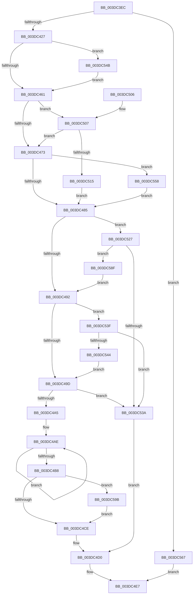

# HalpDmaAllocateScatterPagesFromScatterPool

- RVA: `0x003DC3EC`–`0x003DC5A7` (길이 `443` bytes)
- VA: `0x00000001403DC3EC`
- 실행 섹션: `.text`
- PDB 이름 있음: `예`; PDB Function 태그: `아니요`
- unwind 정보 RVA: `0x000941D8`
- 디코드: `111`개 명령, `443/443` bytes 표시
- 미해석 바이트: `0` (있으면 어셈블리에 `.byte`로 보존)

> 이 문서는 커널 이미지의 기계어와 PDB 기호를 분석해 생성했습니다. 4번과 5번은 함수 원형과 자료형을 바이너리 사용 방식에서 추정한 C 해석이며 원본 소스 복구 결과는 아닙니다.

## 1. Dependencies

- 직접 호출 지점: **6**; 고유 호출 대상: **6**
- 직접 호출자로 확인된 함수: **3**
- RIP 상대 이미지 참조: **3**

### Outgoing calls
- `0x003DC415` → [HalpDmaGetMasterAdapterVersion](HalpDmaGetMasterAdapterVersion_function_003DC5B0.md) (function, `0x003DC5B0`)
- `0x003DC4D5` → [KeReleaseInStackQueuedSpinLock](../34/KeReleaseInStackQueuedSpinLock_function_00342CE0.md) (function, `0x00342CE0`)
- `0x003DC51D` → [KiAcquireQueuedSpinLockInstrumented](../27/KiAcquireQueuedSpinLockInstrumented_function_00275850.md) (function, `0x00275850`)
- `0x003DC54E` → [KiRaiseIrqlProcessIrqlFlags](../4F/KiRaiseIrqlProcessIrqlFlags_function_004F56FC.md) (function, `0x004F56FC`)
- `0x003DC55D` → [KxWaitForLockOwnerShip](../25/KxWaitForLockOwnerShip_function_00257EB0.md) (function, `0x00257EB0`)
- `0x003DC585` → [HalpDmaAllocateScatterPagesFromScatterPoolV3](HalpDmaAllocateScatterPagesFromScatterPoolV3_function_003DC5D8.md) (function, `0x003DC5D8`)

### Direct callers
- [HalpDmaAllocateMapRegisters](HalpDmaAllocateMapRegisters_function_003DDA0C.md) at `0x003DDA88`
- [HalpDmaAllocateMapRegisters](HalpDmaAllocateMapRegisters_function_003DDA0C.md) at `0x003DDAC6`
- [sub_006F79F4](../6F/Unknown_function_006F79F4.md) at `0x006F7A0F`
- [HalpDmaAllocateLocalScatterPool](../../page/70/HalpDmaAllocateLocalScatterPool_function_007091D4.md) at `0x007092FC`

### Static image references
- `0x003DC455` → RVA `0x00FC6D20` (`ALMOSTRO`; read)
- `0x003DC461` → RVA `0x00FC6B06` (`ALMOSTRO`; read)
- `0x003DC507` → RVA `0x00F0DE58` (`.data`; read)

## 2. Other-region calls and transfers

- 다른 실행 섹션으로 향하는 call: **0**
- 별도 외부 분기/꼬리 이동을 확인하지 못했습니다.

## 3. Assembly (complete function range)

```asm
003DC3EC  48 8B C4                        mov rax, rsp
003DC3EF  48 89 58 08                     mov qword ptr [rax + 8], rbx
003DC3F3  48 89 68 10                     mov qword ptr [rax + 0x10], rbp
003DC3F7  48 89 70 18                     mov qword ptr [rax + 0x18], rsi
003DC3FB  48 89 78 20                     mov qword ptr [rax + 0x20], rdi
003DC3FF  41 54                           push r12
003DC401  41 56                           push r14
003DC403  41 57                           push r15
003DC405  48 83 EC 50                     sub rsp, 0x50
003DC409  48 8B CA                        mov rcx, rdx
003DC40C  45 8A E1                        mov r12b, r9b
003DC40F  41 8B F8                        mov edi, r8d
003DC412  48 8B F2                        mov rsi, rdx
003DC415  E8 96 01 00 00                  call 0x1403dc5b0
003DC41A  BA 02 00 00 00                  mov edx, 2
003DC41F  2B C2                           sub eax, edx
003DC421  0F 85 40 01 00 00               jne 0x1403dc567
003DC427  33 DB                           xor ebx, ebx
003DC429  48 8D AE 80 00 00 00            lea rbp, [rsi + 0x80]
003DC430  0F 57 C0                        xorps xmm0, xmm0
003DC433  33 C0                           xor eax, eax
003DC435  0F 11 44 24 30                  movups xmmword ptr [rsp + 0x30], xmm0
003DC43A  48 89 44 24 40                  mov qword ptr [rsp + 0x40], rax
003DC43F  44 8B F3                        mov r14d, ebx
003DC442  48 89 6C 24 38                  mov qword ptr [rsp + 0x38], rbp
003DC447  48 89 5C 24 30                  mov qword ptr [rsp + 0x30], rbx
003DC44C  90                              nop
003DC44D  45 0F 20 C7                     mov r15, cr8
003DC451  44 0F 22 C2                     mov cr8, rdx
003DC455  39 1D C5 A8 BE 00               cmp dword ptr [rip + 0xbea8c5], ebx
003DC45B  0F 85 EA 00 00 00               jne 0x1403dc54b
003DC461  F6 05 9E A6 BE 00 21            test byte ptr [rip + 0xbea69e], 0x21
003DC468  44 88 7C 24 40                  mov byte ptr [rsp + 0x40], r15b
003DC46D  0F 85 94 00 00 00               jne 0x1403dc507
003DC473  48 8D 54 24 30                  lea rdx, [rsp + 0x30]
003DC478  48 87 55 00                     xchg qword ptr [rbp], rdx
003DC47C  48 85 D2                        test rdx, rdx
003DC47F  0F 85 D3 00 00 00               jne 0x1403dc558
003DC485  38 9C 24 90 00 00 00            cmp byte ptr [rsp + 0x90], bl
003DC48C  0F 85 95 00 00 00               jne 0x1403dc527
003DC492  8B 46 28                        mov eax, dword ptr [rsi + 0x28]
003DC495  3B F8                           cmp edi, eax
003DC497  0F 87 A2 00 00 00               ja 0x1403dc53f
003DC49D  85 FF                           test edi, edi
003DC49F  0F 84 95 00 00 00               je 0x1403dc53a
003DC4A5  48 8B 6E 20                     mov rbp, qword ptr [rsi + 0x20]
003DC4A9  48 8B CD                        mov rcx, rbp
003DC4AC  8B D7                           mov edx, edi
003DC4AE  48 8B 49 08                     mov rcx, qword ptr [rcx + 8]
003DC4B2  48 83 EA 01                     sub rdx, 1
003DC4B6  75 F6                           jne 0x1403dc4ae
003DC4B8  2B C7                           sub eax, edi
003DC4BA  48 89 4E 20                     mov qword ptr [rsi + 0x20], rcx
003DC4BE  89 46 28                        mov dword ptr [rsi + 0x28], eax
003DC4C1  38 9C 24 90 00 00 00            cmp byte ptr [rsp + 0x90], bl
003DC4C8  0F 85 CD 00 00 00               jne 0x1403dc59b
003DC4CE  8B DF                           mov ebx, edi
003DC4D0  48 8D 4C 24 30                  lea rcx, [rsp + 0x30]
003DC4D5  E8 06 68 F6 FF                  call 0x140342ce0
003DC4DA  48 8B 8C 24 98 00 00 00         mov rcx, qword ptr [rsp + 0x98]
003DC4E2  48 8B C5                        mov rax, rbp
003DC4E5  89 19                           mov dword ptr [rcx], ebx
003DC4E7  4C 8D 5C 24 50                  lea r11, [rsp + 0x50]
003DC4EC  49 8B 5B 20                     mov rbx, qword ptr [r11 + 0x20]
003DC4F0  49 8B 6B 28                     mov rbp, qword ptr [r11 + 0x28]
003DC4F4  49 8B 73 30                     mov rsi, qword ptr [r11 + 0x30]
003DC4F8  49 8B 7B 38                     mov rdi, qword ptr [r11 + 0x38]
003DC4FC  49 8B E3                        mov rsp, r11
003DC4FF  41 5F                           pop r15
003DC501  41 5E                           pop r14
003DC503  41 5C                           pop r12
003DC505  C3                              ret
003DC506  CC                              int3
003DC507  8B 05 4B 19 B3 00               mov eax, dword ptr [rip + 0xb3194b]
003DC50D  85 C0                           test eax, eax
003DC50F  0F 85 5E FF FF FF               jne 0x1403dc473
003DC515  48 8B D5                        mov rdx, rbp
003DC518  48 8D 4C 24 30                  lea rcx, [rsp + 0x30]
003DC51D  E8 2E 93 E9 FF                  call 0x140275850
003DC522  E9 5E FF FF FF                  jmp 0x1403dc485
003DC527  8B 86 E0 00 00 00               mov eax, dword ptr [rsi + 0xe0]
003DC52D  4C 8B F6                        mov r14, rsi
003DC530  8B 8E E4 00 00 00               mov ecx, dword ptr [rsi + 0xe4]
003DC536  3B C1                           cmp eax, ecx
003DC538  77 55                           ja 0x1403dc58f
003DC53A  48 8B EB                        mov rbp, rbx
003DC53D  EB 91                           jmp 0x1403dc4d0
003DC53F  45 84 E4                        test r12b, r12b
003DC542  75 F6                           jne 0x1403dc53a
003DC544  8B F8                           mov edi, eax
003DC546  E9 52 FF FF FF                  jmp 0x1403dc49d
003DC54B  41 8A CF                        mov cl, r15b
003DC54E  E8 A9 91 11 00                  call 0x1404f56fc
003DC553  E9 09 FF FF FF                  jmp 0x1403dc461
003DC558  48 8D 4C 24 30                  lea rcx, [rsp + 0x30]
003DC55D  E8 4E B9 E7 FF                  call 0x140257eb0
003DC562  E9 1E FF FF FF                  jmp 0x1403dc485
003DC567  83 F8 01                        cmp eax, 1
003DC56A  48 8B D6                        mov rdx, rsi
003DC56D  48 8B 84 24 98 00 00 00         mov rax, qword ptr [rsp + 0x98]
003DC575  48 89 44 24 28                  mov qword ptr [rsp + 0x28], rax
003DC57A  8A 84 24 90 00 00 00            mov al, byte ptr [rsp + 0x90]
003DC581  88 44 24 20                     mov byte ptr [rsp + 0x20], al
003DC585  E8 4E 00 00 00                  call 0x1403dc5d8
003DC58A  E9 58 FF FF FF                  jmp 0x1403dc4e7
003DC58F  2B C1                           sub eax, ecx
003DC591  3B F8                           cmp edi, eax
003DC593  0F 47 F8                        cmova edi, eax
003DC596  E9 F7 FE FF FF                  jmp 0x1403dc492
003DC59B  41 29 BE E0 00 00 00            sub dword ptr [r14 + 0xe0], edi
003DC5A2  E9 27 FF FF FF                  jmp 0x1403dc4ce
```

## 4. C-style interpretation (structured pseudocode)

```c
__int64 __fastcall HalpDmaAllocateScatterPagesFromScatterPool(__int64 a1, __int64 a2, int a3, unsigned __int8 a4, unsigned __int8 a5, __int64 a6)
{
    __int64 result;
    __int64 v_rbx;
    __int64 v_rdi;
    __int64 v_rsp;
    unsigned __int64 v_stack_m18;
    unsigned __int64 v_stack_m20;
    unsigned __int64 v_stack_m28;
    unsigned __int64 v_stack_m30;
    unsigned __int64 v_stack_m38;

    *(unsigned __int64 *)(v_rsp + 8) = v_rbx;
    *(unsigned __int64 *)(v_rsp + 16) = v_rbp;
    *(unsigned __int64 *)(v_rsp + 24) = v_rsi;
    *(unsigned __int64 *)(v_rsp + 32) = v_rdi;
    v_rsp = (v_rsp) - (80);
    result = HalpDmaGetMasterAdapterVersion(a2, a2, a3, a4);
    result = (unsigned int)((result) - (2));
    if (condition_is_not_equal) goto loc_003DC567;
    v_rbx = 0;
    result = 0;
    v_stack_m38 = v_xmm0;
    v_stack_m28 = 0;
    v_stack_m30 = a2 + 128;
    v_stack_m38 = 0;
    if ((*(unsigned int *)(v_rip + 12495045)) != 0) goto loc_003DC54B;
loc_003DC461:
    v_stack_m28 = (unsigned __int8)(v_cr8);
    if (((*(unsigned __int8 *)(v_rip + 12494494)) & (33)) != 0) goto loc_003DC507;
loc_003DC473:
    if (v_stack_m38 != 0) goto loc_003DC558;
loc_003DC485:
    if (a5 != 0) goto loc_003DC527;
loc_003DC492:
    if (((unsigned int)((unsigned int)(a3))) > ((unsigned int)((unsigned int)(*(unsigned int *)(a2 + 40))))) goto loc_003DC53F;
loc_003DC49D:
    if ((unsigned int)((unsigned int)(a3)) == 0) goto loc_003DC53A;
loc_003DC4AE:
    a2 = ((unsigned int)((unsigned int)((unsigned int)(a3)))) - (1);
    if (condition_is_not_equal) goto loc_003DC4AE;
    result = (unsigned int)(((unsigned int)(*(unsigned int *)(a2 + 40))) - ((unsigned int)((unsigned int)(a3))));
    *(unsigned __int64 *)(a2 + 32) = *(unsigned __int64 *)(*(unsigned __int64 *)(a2 + 32) + 8);
    *(unsigned int *)(a2 + 40) = (unsigned int)(result);
    if (a5 != 0) goto loc_003DC59B;
loc_003DC4CE:
loc_003DC4D0:
    result = KeReleaseInStackQueuedSpinLock(v_stack_m38, a2, a3, a4);
    *(unsigned int *)(a6) = (unsigned int)((unsigned int)((unsigned int)((unsigned int)(a3))));
loc_003DC4E7:
    return *(unsigned __int64 *)(a2 + 32);
loc_003DC507:
    if ((unsigned int)((unsigned int)(*(unsigned int *)(v_rip + 11737419))) != 0) goto loc_003DC473;
    result = KiAcquireQueuedSpinLockInstrumented(v_stack_m20, *(unsigned __int64 *)(v_stack_m18 + 40), a3, a4);
    goto loc_003DC485;
loc_003DC527:
    if (((unsigned int)((unsigned int)(*(unsigned int *)(*(unsigned __int64 *)(v_stack_m18 + 48) + 224)))) > ((unsigned int)((unsigned int)(*(unsigned int *)(*(unsigned __int64 *)(v_stack_m18 + 48) + 228))))) goto loc_003DC58F;
loc_003DC53A:
    goto loc_003DC4D0;
loc_003DC53F:
    if (a4 != 0) goto loc_003DC53A;
    goto loc_003DC49D;
loc_003DC54B:
    result = KiRaiseIrqlProcessIrqlFlags((unsigned __int8)(v_cr8), *(unsigned __int64 *)(v_stack_m18 + 40), a3, a4);
    goto loc_003DC461;
loc_003DC558:
    result = KxWaitForLockOwnerShip(v_stack_m20, *(unsigned __int64 *)(v_stack_m18 + 40), a3, a4);
    goto loc_003DC485;
loc_003DC567:
    v_stack_m28 = a6;
    v_stack_m30 = a5;
    result = HalpDmaAllocateScatterPagesFromScatterPoolV3(v_stack_m20, *(unsigned __int64 *)(v_stack_m18 + 48), a3, a4);
    goto loc_003DC4E7;
loc_003DC58F:
    result = (unsigned int)((result) - ((unsigned int)(v_stack_m20)));
    v_rdi = (unsigned int)((unsigned int)((unsigned int)(*(unsigned int *)(*(unsigned __int64 *)(v_stack_m18 + 48) + 224))));
    if (((unsigned int)((unsigned int)((unsigned int)((unsigned int)(*(unsigned int *)(*(unsigned __int64 *)(v_stack_m18 + 48) + 224)))))) > ((unsigned int)(result))) { v_rdi = (unsigned int)(result); }
    goto loc_003DC492;
loc_003DC59B:
    goto loc_003DC4CE;
}
```

## 5. (Beta) C Style

```c
int64_t HalpDmaAllocateScatterPagesFromScatterPool(int64_t Arg1, void *Arg2, int32_t Arg3, uint8_t Arg4, uint8_t Arg5, void *Arg6)
{
    uint8_t *arg2 = (uint8_t *)Arg2;
    uint8_t *arg6 = (uint8_t *)Arg6;

    int64_t result;
    int64_t local_rbx;
    int64_t local_rdi;
    int64_t local_rsp;
    uint64_t v_stack_m18;
    uint64_t v_stack_m20;
    uint64_t v_stack_m28;
    uint64_t v_stack_m30;
    uint64_t v_stack_m38;

    *(uint64_t *)(local_rsp + 0x8) = local_rbx;
    *(uint64_t *)(local_rsp + 0x10) = local_rbp;
    *(uint64_t *)(local_rsp + 0x18) = local_rsi;
    *(uint64_t *)(local_rsp + 0x20) = local_rdi;
    local_rsp = (local_rsp) - (80);
    result = HalpDmaGetMasterAdapterVersion(Arg2, Arg2, Arg3, Arg4);
    result = (uint32_t)((result) - (2));
    if (condition_is_not_equal) goto loc_003DC567;
    local_rbx = 0;
    result = 0;
    v_stack_m38 = v_xmm0;
    v_stack_m28 = 0;
    v_stack_m30 = Arg2 + 128;
    v_stack_m38 = 0;
    if ((*(uint32_t *)(v_rip + 0xBEA8C5)) != 0) goto loc_003DC54B;
loc_003DC461:
    v_stack_m28 = (uint8_t)(v_cr8);
    if (((*(uint8_t *)(v_rip + 0xBEA69E)) & (33)) != 0) goto loc_003DC507;
loc_003DC473:
    if (v_stack_m38 != 0) goto loc_003DC558;
loc_003DC485:
    if (Arg5 != 0) goto loc_003DC527;
loc_003DC492:
    if (((uint32_t)((uint32_t)(Arg3))) > ((uint32_t)((uint32_t)(*(uint32_t *)(arg2 + 0x28))))) goto loc_003DC53F;
loc_003DC49D:
    if ((uint32_t)((uint32_t)(Arg3)) == 0) goto loc_003DC53A;
loc_003DC4AE:
    Arg2 = ((uint32_t)((uint32_t)((uint32_t)(Arg3)))) - (1);
    if (condition_is_not_equal) goto loc_003DC4AE;
    result = (uint32_t)(((uint32_t)(*(uint32_t *)(arg2 + 0x28))) - ((uint32_t)((uint32_t)(Arg3))));
    *(uint64_t *)(arg2 + 0x20) = *(uint64_t *)(*(uint64_t *)(arg2 + 0x20) + 0x8);
    *(uint32_t *)(arg2 + 0x28) = (uint32_t)(result);
    if (Arg5 != 0) goto loc_003DC59B;
loc_003DC4CE:
loc_003DC4D0:
    result = KeReleaseInStackQueuedSpinLock(v_stack_m38, Arg2, Arg3, Arg4);
    *(uint32_t *)(arg6) = (uint32_t)((uint32_t)((uint32_t)((uint32_t)(Arg3))));
loc_003DC4E7:
    return *(uint64_t *)(arg2 + 0x20);
loc_003DC507:
    if ((uint32_t)((uint32_t)(*(uint32_t *)(v_rip + 0xB3194B))) != 0) goto loc_003DC473;
    result = KiAcquireQueuedSpinLockInstrumented(v_stack_m20, *(uint64_t *)(v_stack_m18 + 0x28), Arg3, Arg4);
    goto loc_003DC485;
loc_003DC527:
    if (((uint32_t)((uint32_t)(*(uint32_t *)(*(uint64_t *)(v_stack_m18 + 0x30) + 0xE0)))) > ((uint32_t)((uint32_t)(*(uint32_t *)(*(uint64_t *)(v_stack_m18 + 0x30) + 0xE4))))) goto loc_003DC58F;
loc_003DC53A:
    goto loc_003DC4D0;
loc_003DC53F:
    if (Arg4 != 0) goto loc_003DC53A;
    goto loc_003DC49D;
loc_003DC54B:
    result = KiRaiseIrqlProcessIrqlFlags((uint8_t)(v_cr8), *(uint64_t *)(v_stack_m18 + 0x28), Arg3, Arg4);
    goto loc_003DC461;
loc_003DC558:
    result = KxWaitForLockOwnerShip(v_stack_m20, *(uint64_t *)(v_stack_m18 + 0x28), Arg3, Arg4);
    goto loc_003DC485;
loc_003DC567:
    v_stack_m28 = Arg6;
    v_stack_m30 = Arg5;
    result = HalpDmaAllocateScatterPagesFromScatterPoolV3(v_stack_m20, *(uint64_t *)(v_stack_m18 + 0x30), Arg3, Arg4);
    goto loc_003DC4E7;
loc_003DC58F:
    result = (uint32_t)((result) - ((uint32_t)(v_stack_m20)));
    local_rdi = (uint32_t)((uint32_t)((uint32_t)(*(uint32_t *)(*(uint64_t *)(v_stack_m18 + 0x30) + 0xE0))));
    if (((uint32_t)((uint32_t)((uint32_t)((uint32_t)(*(uint32_t *)(*(uint64_t *)(v_stack_m18 + 0x30) + 0xE0)))))) > ((uint32_t)(result))) { local_rdi = (uint32_t)(result); }
    goto loc_003DC492;
loc_003DC59B:
    goto loc_003DC4CE;
}
```

### 관측된 메모리 오프셋

구조체 형식이 확인되지 않은 접근은 인자 기준의 오프셋으로만 기록했습니다.

| 기준 인자 | 오프셋 표현 | 폭 (bit) | 접근 |
|---|---:|---:|---|
| `Arg2` | `+ 0x0` | `64` | `R/W` |
| `Arg2` | `+ 0x20` | `64` | `R` |
| `Arg2` | `+ 0x20` | `64` | `W` |
| `Arg2` | `+ 0x28` | `32` | `R` |
| `Arg2` | `+ 0x28` | `32` | `W` |
| `Arg2` | `+ 0x80` | `64` | `R` |
| `Arg2` | `+ 0xE0` | `32` | `R` |
| `Arg2` | `+ 0xE4` | `32` | `R` |
| `Arg6` | `+ 0x0` | `32` | `W` |

## 6. Execution-region graph

[열기: 2D/3D 그래프와 함수 탐색 컨트롤 패널](../../../control-panel.html?section=text&rva=0x003DC3EC&view=graph)

- 2D 그래프는 위에서 아래로 흐르고, 3D 그래프는 빈 공간을 드래그해 회전합니다. Shift+드래그는 이동, 휠은 확대·축소, 함수 노드 선택은 대상 보고서 이동입니다.

### Static fallback


