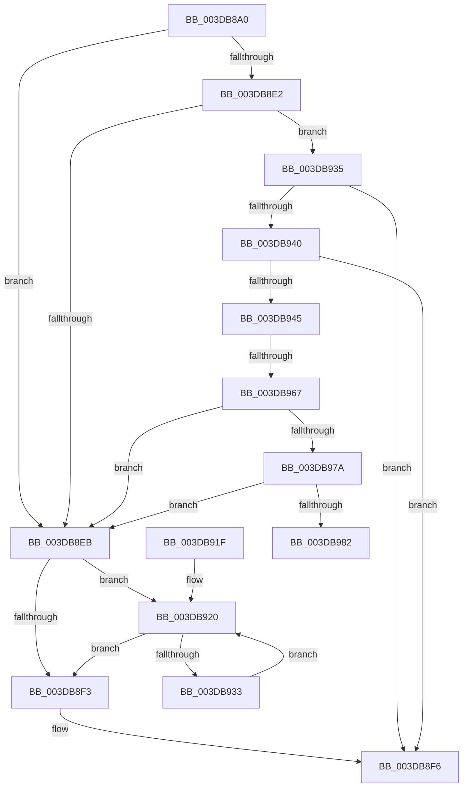

# HalpDmaCheckMdlAccessibility

- RVA: `0x003DB8A0`–`0x003DB987` (길이 `231` bytes)
- VA: `0x00000001403DB8A0`
- 실행 섹션: `.text`
- PDB 이름 있음: `예`; PDB Function 태그: `예`
- unwind 정보 RVA: `0x0009407C`
- 디코드: `66`개 명령, `231/231` bytes 표시
- 미해석 바이트: `0` (있으면 어셈블리에 `.byte`로 보존)

> 이 문서는 커널 이미지의 기계어와 PDB 기호를 분석해 생성했습니다. 4번과 5번은 함수 원형과 자료형을 바이너리 사용 방식에서 추정한 C 해석이며 원본 소스 복구 결과는 아닙니다.

## 1. Dependencies

- 직접 호출 지점: **2**; 고유 호출 대상: **2**
- 직접 호출자로 확인된 함수: **2**
- RIP 상대 이미지 참조: **0**

### Outgoing calls
- `0x003DB923` → [IoFreeMdl](../29/IoFreeMdl_function_0029EA80.md) (function, `0x0029EA80`)
- `0x003DB96A` → [HalpDmaGetAdapterCacheAlignment](HalpDmaGetAdapterCacheAlignment_function_003DC150.md) (function, `0x003DC150`)

### Direct callers
- [HalFlushAdapterBuffersEx](HalFlushAdapterBuffersEx_function_003DADE0.md) at `0x003DAEE2`
- [HalMapTransferEx](HalMapTransferEx_function_003DB450.md) at `0x003DB591`

### Static image references
- 디코드된 RIP-relative 메모리 참조가 없습니다.

## 2. Other-region calls and transfers

- 다른 실행 섹션으로 향하는 call: **0**
- call이 아닌 외부 분기/꼬리 이동: **2**
  - `0x003DB961` → [sub_006E9F12](../6E/Unknown_function_006E9F12.md) (`tail-transfer`)
  - `0x003DB982` → [sub_006E9F12](../6E/Unknown_function_006E9F12.md) (`tail-transfer`)

## 3. Assembly (complete function range)

```asm
003DB8A0  48 89 5C 24 08                  mov qword ptr [rsp + 8], rbx
003DB8A5  48 89 6C 24 10                  mov qword ptr [rsp + 0x10], rbp
003DB8AA  48 89 74 24 18                  mov qword ptr [rsp + 0x18], rsi
003DB8AF  57                              push rdi
003DB8B0  41 54                           push r12
003DB8B2  41 55                           push r13
003DB8B4  41 56                           push r14
003DB8B6  41 57                           push r15
003DB8B8  48 83 EC 40                     sub rsp, 0x40
003DB8BC  48 8B B4 24 98 00 00 00         mov rsi, qword ptr [rsp + 0x98]
003DB8C4  45 8B F9                        mov r15d, r9d
003DB8C7  48 8B FA                        mov rdi, rdx
003DB8CA  48 8B E9                        mov rbp, rcx
003DB8CD  48 83 26 00                     and qword ptr [rsi], 0
003DB8D1  48 83 A4 24 98 00 00 00 00      and qword ptr [rsp + 0x98], 0
003DB8DA  44 0F 20 C0                     mov rax, cr8
003DB8DE  3C 02                           cmp al, 2
003DB8E0  77 09                           ja 0x1403db8eb
003DB8E2  80 B9 BD 01 00 00 00            cmp byte ptr [rcx + 0x1bd], 0
003DB8E9  74 4A                           je 0x1403db935
003DB8EB  48 8B 0E                        mov rcx, qword ptr [rsi]
003DB8EE  48 85 C9                        test rcx, rcx
003DB8F1  75 2D                           jne 0x1403db920
003DB8F3  45 32 E4                        xor r12b, r12b
003DB8F6  48 8B 84 24 90 00 00 00         mov rax, qword ptr [rsp + 0x90]
003DB8FE  4C 8D 5C 24 40                  lea r11, [rsp + 0x40]
003DB903  44 88 20                        mov byte ptr [rax], r12b
003DB906  49 8B 5B 30                     mov rbx, qword ptr [r11 + 0x30]
003DB90A  49 8B 6B 38                     mov rbp, qword ptr [r11 + 0x38]
003DB90E  49 8B 73 40                     mov rsi, qword ptr [r11 + 0x40]
003DB912  49 8B E3                        mov rsp, r11
003DB915  41 5F                           pop r15
003DB917  41 5E                           pop r14
003DB919  41 5D                           pop r13
003DB91B  41 5C                           pop r12
003DB91D  5F                              pop rdi
003DB91E  C3                              ret
003DB91F  CC                              int3
003DB920  48 8B 19                        mov rbx, qword ptr [rcx]
003DB923  E8 58 31 EC FF                  call 0x14029ea80
003DB928  48 89 1E                        mov qword ptr [rsi], rbx
003DB92B  48 8B CB                        mov rcx, rbx
003DB92E  48 85 DB                        test rbx, rbx
003DB931  74 C0                           je 0x1403db8f3
003DB933  EB EB                           jmp 0x1403db920
003DB935  41 BC 01 00 00 00               mov r12d, 1
003DB93B  48 85 FF                        test rdi, rdi
003DB93E  74 B6                           je 0x1403db8f6
003DB940  45 85 FF                        test r15d, r15d
003DB943  74 B1                           je 0x1403db8f6
003DB945  8B 5F 28                        mov ebx, dword ptr [rdi + 0x28]
003DB948  44 8B 4F 2C                     mov r9d, dword ptr [rdi + 0x2c]
003DB94C  41 2B D8                        sub ebx, r8d
003DB94F  41 3B DF                        cmp ebx, r15d
003DB952  41 0F 43 DF                     cmovae ebx, r15d
003DB956  80 BD BD 01 00 00 00            cmp byte ptr [rbp + 0x1bd], 0
003DB95D  47 8D 2C 01                     lea r13d, [r9 + r8]
003DB961  0F 85 AB E5 30 00               jne 0x1406e9f12
003DB967  48 8B CD                        mov rcx, rbp
003DB96A  E8 E1 07 00 00                  call 0x1403dc150
003DB96F  FF C8                           dec eax
003DB971  41 85 C5                        test r13d, eax
003DB974  0F 85 71 FF FF FF               jne 0x1403db8eb
003DB97A  85 D8                           test eax, ebx
003DB97C  0F 85 69 FF FF FF               jne 0x1403db8eb
003DB982  E9 8B E5 30 00                  jmp 0x1406e9f12
```

## 4. C-style interpretation (structured pseudocode)

```c
__int64 __fastcall HalpDmaCheckMdlAccessibility(__int64 a1, __int64 a2, __int64 a3, int a4, __int64 a5, __int64 a6)
{
    __int64 result;
    __int64 v_r12;
    __int64 v_rbx;
    __int64 v_rsp;
    unsigned __int64 v_stack_m28;
    unsigned __int64 v_stack_p10;
    unsigned __int64 v_stack_p18;
    unsigned __int64 v_stack_p8;

    v_stack_p8 = v_rbx;
    v_stack_p10 = v_rbp;
    v_stack_p18 = v_rsi;
    v_rsp = (v_rsp) - (64);
    if (((unsigned __int8)(v_cr8)) > 2) goto loc_003DB8EB;
    if ((*(unsigned __int8 *)(a1 + 445)) == 0) goto loc_003DB935;
loc_003DB8EB:
    if (*(unsigned __int64 *)(a6) != 0) goto loc_003DB920;
loc_003DB8F3:
    v_r12 = 0;
loc_003DB8F6:
    *(unsigned __int8 *)(a5) = 0;
    return a5;
loc_003DB920:
    result = IoFreeMdl(*(unsigned __int64 *)(a6), a2, a3, a4);
    *(unsigned __int64 *)(*(unsigned __int64 *)(v_stack_m28 + 64)) = *(unsigned __int64 *)(*(unsigned __int64 *)(a6));
    if (*(unsigned __int64 *)(*(unsigned __int64 *)(a6)) == 0) goto loc_003DB8F3;
    goto loc_003DB920;
loc_003DB935:
    if (a2 == 0) goto loc_003DB8F6;
    if ((unsigned int)((unsigned int)(a4)) == 0) goto loc_003DB8F6;
    v_rbx = (unsigned int)(((unsigned int)(*(unsigned int *)(a2 + 40))) - ((unsigned int)(a3)));
    if (((unsigned int)(v_rbx)) >= ((unsigned int)((unsigned int)(a4)))) { v_rbx = (unsigned int)((unsigned int)(a4)); }
    result = HalpDmaGetAdapterCacheAlignment(*(unsigned __int64 *)(v_stack_m28 + 56), a2, a3, (unsigned int)(*(unsigned int *)(a2 + 44)));
    result = (unsigned int)((result) - 1);
    if ((((unsigned int)((unsigned int)(*(unsigned int *)(a2 + 44)) + a3 * 1)) & ((unsigned int)(result))) != 0) goto loc_003DB8EB;
    if ((((unsigned int)(result)) & ((unsigned int)(v_rbx))) != 0) goto loc_003DB8EB;
}
```

## 5. (Beta) C Style

```c
void *HalpDmaCheckMdlAccessibility(void *Arg1, int64_t Arg2, int64_t Arg3, int32_t Arg4, void *Arg5, void *Arg6)
{
    uint8_t *arg1 = (uint8_t *)Arg1;
    uint8_t *arg5 = (uint8_t *)Arg5;
    uint8_t *arg6 = (uint8_t *)Arg6;

    int64_t result;
    int64_t local_r12;
    int64_t local_rbx;
    int64_t local_rsp;
    uint64_t v_stack_m28;
    uint64_t v_stack_p10;
    uint64_t v_stack_p18;
    uint64_t v_stack_p8;

    v_stack_p8 = local_rbx;
    v_stack_p10 = local_rbp;
    v_stack_p18 = local_rsi;
    local_rsp = (local_rsp) - (64);
    if (((uint8_t)(v_cr8)) > 2) goto loc_003DB8EB;
    if ((*(uint8_t *)(arg1 + 0x1BD)) == 0) goto loc_003DB935;
loc_003DB8EB:
    if (*(uint64_t *)(arg6) != 0) goto loc_003DB920;
loc_003DB8F3:
    local_r12 = 0;
loc_003DB8F6:
    *(uint8_t *)(arg5) = 0;
    return Arg5;
loc_003DB920:
    result = IoFreeMdl(*(uint64_t *)(arg6), Arg2, Arg3, Arg4);
    *(uint64_t *)(*(uint64_t *)(v_stack_m28 + 0x40)) = *(uint64_t *)(*(uint64_t *)(arg6));
    if (*(uint64_t *)(*(uint64_t *)(arg6)) == 0) goto loc_003DB8F3;
    goto loc_003DB920;
loc_003DB935:
    if (Arg2 == 0) goto loc_003DB8F6;
    if ((uint32_t)((uint32_t)(Arg4)) == 0) goto loc_003DB8F6;
    local_rbx = (uint32_t)(((uint32_t)(*(uint32_t *)(Arg2 + 0x28))) - ((uint32_t)(Arg3)));
    if (((uint32_t)(local_rbx)) >= ((uint32_t)((uint32_t)(Arg4)))) { local_rbx = (uint32_t)((uint32_t)(Arg4)); }
    result = HalpDmaGetAdapterCacheAlignment(*(uint64_t *)(v_stack_m28 + 0x38), Arg2, Arg3, (uint32_t)(*(uint32_t *)(Arg2 + 0x2C)));
    result = (uint32_t)((result) - 1);
    if ((((uint32_t)((uint32_t)(*(uint32_t *)(Arg2 + 0x2C)) + Arg3 * 1)) & ((uint32_t)(result))) != 0) goto loc_003DB8EB;
    if ((((uint32_t)(result)) & ((uint32_t)(local_rbx))) != 0) goto loc_003DB8EB;
}
```

### 관측된 메모리 오프셋

구조체 형식이 확인되지 않은 접근은 인자 기준의 오프셋으로만 기록했습니다.

| 기준 인자 | 오프셋 표현 | 폭 (bit) | 접근 |
|---|---:|---:|---|
| `Arg1` | `+ 0x1BD` | `8` | `R` |
| `Arg5` | `+ 0x0` | `8` | `W` |
| `Arg6` | `+ 0x0` | `64` | `R` |
| `Arg6` | `+ 0x0` | `64` | `R/W` |
| `Arg6` | `+ 0x0` | `64` | `W` |

## 6. Execution-region graph

[열기: 2D/3D 그래프와 함수 탐색 컨트롤 패널](../../../control-panel.html?section=text&rva=0x003DB8A0&view=graph)

- 2D 그래프는 위에서 아래로 흐르고, 3D 그래프는 빈 공간을 드래그해 회전합니다. Shift+드래그는 이동, 휠은 확대·축소, 함수 노드 선택은 대상 보고서 이동입니다.

### Static fallback


