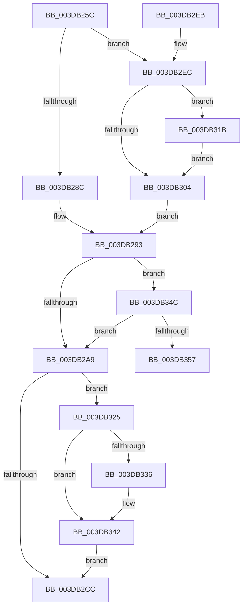

# HalpDmaControllerFlushChannel

- RVA: `0x003DB25C`–`0x003DB372` (길이 `278` bytes)
- VA: `0x00000001403DB25C`
- 실행 섹션: `.text`
- PDB 이름 있음: `예`; PDB Function 태그: `아니요`
- unwind 정보 RVA: `0x00094010`
- 디코드: `72`개 명령, `278/278` bytes 표시
- 미해석 바이트: `0` (있으면 어셈블리에 `.byte`로 보존)

> 이 문서는 커널 이미지의 기계어와 PDB 기호를 분석해 생성했습니다. 4번과 5번은 함수 원형과 자료형을 바이너리 사용 방식에서 추정한 C 해석이며 원본 소스 복구 결과는 아닙니다.

## 1. Dependencies

- 직접 호출 지점: **6**; 고유 호출 대상: **6**
- 직접 호출자로 확인된 함수: **2**
- RIP 상대 이미지 참조: **1**

### Outgoing calls
- `0x003DB2B4` → [guard_dispatch_icall](../6B/guard_dispatch_icall_function_006BAAD0.md) (function, `0x006BAAD0`)
- `0x003DB30E` → [KeAcquireSpinLockAtDpcLevel](../20/KeAcquireSpinLockAtDpcLevel_function_00208430.md) (function, `0x00208430`)
- `0x003DB31E` → [KiRaiseIrqlProcessIrqlFlags](../4F/KiRaiseIrqlProcessIrqlFlags_function_004F56FC.md) (function, `0x004F56FC`)
- `0x003DB328` → [KxReleaseSpinLock](../20/KxReleaseSpinLock_function_00206670.md) (function, `0x00206670`)
- `0x003DB33D` → [KiLowerIrqlProcessIrqlFlags](../4F/KiLowerIrqlProcessIrqlFlags_function_004F5698.md) (function, `0x004F5698`)
- `0x003DB36C` → [KeBugCheckEx](../4F/KeBugCheckEx_function_004FD660.md) (function, `0x004FD660`)

### Direct callers
- [HalFlushAdapterBuffersEx](HalFlushAdapterBuffersEx_function_003DADE0.md) at `0x003DAE96`
- [HalFlushAdapterBuffersEx](HalFlushAdapterBuffersEx_function_003DADE0.md) at `0x003DB029`
- [IoFlushAdapterBuffersV3](../55/IoFlushAdapterBuffersV3_function_005532C0.md) at `0x00553327`

### Static image references
- `0x003DB2FB` → RVA `0x00FC6D20` (`ALMOSTRO`; read)

## 2. Other-region calls and transfers

- 다른 실행 섹션으로 향하는 call: **0**
- 별도 외부 분기/꼬리 이동을 확인하지 못했습니다.

## 3. Assembly (complete function range)

```asm
003DB25C  48 8B C4                        mov rax, rsp
003DB25F  48 89 58 08                     mov qword ptr [rax + 8], rbx
003DB263  48 89 68 10                     mov qword ptr [rax + 0x10], rbp
003DB267  48 89 70 18                     mov qword ptr [rax + 0x18], rsi
003DB26B  48 89 78 20                     mov qword ptr [rax + 0x20], rdi
003DB26F  41 54                           push r12
003DB271  41 56                           push r14
003DB273  41 57                           push r15
003DB275  48 83 EC 30                     sub rsp, 0x30
003DB279  44 8B E2                        mov r12d, edx
003DB27C  48 8B D9                        mov rbx, rcx
003DB27F  44 0F 20 C7                     mov rdi, cr8
003DB283  45 32 FF                        xor r15b, r15b
003DB286  40 80 FF 0F                     cmp dil, 0xf
003DB28A  75 60                           jne 0x1403db2ec
003DB28C  48 8D B1 A8 00 00 00            lea rsi, [rcx + 0xa8]
003DB293  4B 8D 2C A4                     lea rbp, [r12 + r12*4]
003DB297  48 C1 E5 05                     shl rbp, 5
003DB29B  48 03 6B 38                     add rbp, qword ptr [rbx + 0x38]
003DB29F  80 7D 06 00                     cmp byte ptr [rbp + 6], 0
003DB2A3  0F 84 A3 00 00 00               je 0x1403db34c
003DB2A9  48 8B 43 78                     mov rax, qword ptr [rbx + 0x78]
003DB2AD  41 8B D4                        mov edx, r12d
003DB2B0  48 8B 4B 40                     mov rcx, qword ptr [rbx + 0x40]
003DB2B4  E8 17 F8 2D 00                  call 0x1406baad0
003DB2B9  48 83 65 08 00                  and qword ptr [rbp + 8], 0
003DB2BE  48 83 65 10 00                  and qword ptr [rbp + 0x10], 0
003DB2C3  C6 45 06 00                     mov byte ptr [rbp + 6], 0
003DB2C7  45 84 FF                        test r15b, r15b
003DB2CA  75 59                           jne 0x1403db325
003DB2CC  48 8B 5C 24 50                  mov rbx, qword ptr [rsp + 0x50]
003DB2D1  48 8B 6C 24 58                  mov rbp, qword ptr [rsp + 0x58]
003DB2D6  48 8B 74 24 60                  mov rsi, qword ptr [rsp + 0x60]
003DB2DB  48 8B 7C 24 68                  mov rdi, qword ptr [rsp + 0x68]
003DB2E0  48 83 C4 30                     add rsp, 0x30
003DB2E4  41 5F                           pop r15
003DB2E6  41 5E                           pop r14
003DB2E8  41 5C                           pop r12
003DB2EA  C3                              ret
003DB2EB  CC                              int3
003DB2EC  0F B6 91 B0 00 00 00            movzx edx, byte ptr [rcx + 0xb0]
003DB2F3  44 0F 20 C7                     mov rdi, cr8
003DB2F7  44 0F 22 C2                     mov cr8, rdx
003DB2FB  83 3D 1E BA BE 00 00            cmp dword ptr [rip + 0xbeba1e], 0
003DB302  75 17                           jne 0x1403db31b
003DB304  48 8D B3 A8 00 00 00            lea rsi, [rbx + 0xa8]
003DB30B  48 8B CE                        mov rcx, rsi
003DB30E  E8 1D D1 E2 FF                  call 0x140208430
003DB313  41 B7 01                        mov r15b, 1
003DB316  E9 78 FF FF FF                  jmp 0x1403db293
003DB31B  40 8A CF                        mov cl, dil
003DB31E  E8 D9 A3 11 00                  call 0x1404f56fc
003DB323  EB DF                           jmp 0x1403db304
003DB325  48 8B CE                        mov rcx, rsi
003DB328  E8 43 B3 E2 FF                  call 0x140206670
003DB32D  83 3D EC B9 BE 00 00            cmp dword ptr [rip + 0xbeb9ec], 0
003DB334  74 0C                           je 0x1403db342
003DB336  44 0F 20 C1                     mov rcx, cr8
003DB33A  40 8A D7                        mov dl, dil
003DB33D  E8 56 A3 11 00                  call 0x1404f5698
003DB342  40 0F B6 C7                     movzx eax, dil
003DB346  44 0F 22 C0                     mov cr8, rax
003DB34A  EB 80                           jmp 0x1403db2cc
003DB34C  48 83 7D 08 00                  cmp qword ptr [rbp + 8], 0
003DB351  0F 84 52 FF FF FF               je 0x1403db2a9
003DB357  44 8B 4B 20                     mov r9d, dword ptr [rbx + 0x20]
003DB35B  45 33 C0                        xor r8d, r8d
003DB35E  B9 E6 00 00 00                  mov ecx, 0xe6
003DB363  4C 89 64 24 20                  mov qword ptr [rsp + 0x20], r12
003DB368  41 8D 50 23                     lea edx, [r8 + 0x23]
003DB36C  E8 EF 22 12 00                  call 0x1404fd660
003DB371  CC                              int3
```

## 4. C-style interpretation (structured pseudocode)

```c
__int64 __fastcall HalpDmaControllerFlushChannel(__int64 a1, int a2, int a3)
{
    __int64 result;
    __int64 v_r15;
    __int64 v_rbp;
    __int64 v_rsp;
    unsigned __int64 v_stack_p10;
    unsigned __int64 v_stack_p18;
    unsigned __int64 v_stack_p20;
    unsigned __int64 v_stack_p8;

    *(unsigned __int64 *)(v_rsp + 8) = v_rbx;
    *(unsigned __int64 *)(v_rsp + 16) = v_rbp;
    *(unsigned __int64 *)(v_rsp + 24) = v_rsi;
    *(unsigned __int64 *)(v_rsp + 32) = v_rdi;
    v_rsp = (v_rsp) - (48);
    v_r15 = 0;
    if (((unsigned __int8)(v_cr8)) != 15) goto loc_003DB2EC;
loc_003DB293:
    v_rbp = ((unsigned int)(a2) + (unsigned int)(a2) * 4) << (5);
    v_rbp = (v_rbp) + (*(unsigned __int64 *)(a1 + 56));
    if ((*(unsigned __int8 *)(v_rbp + 6)) == 0) goto loc_003DB34C;
loc_003DB2A9:
    result = guard_dispatch_icall(*(unsigned __int64 *)(a1 + 64), (unsigned int)((unsigned int)((unsigned int)(a2))), a3, a4);
    *(unsigned __int8 *)(v_rbp + 6) = 0;
    if (0 != 0) goto loc_003DB325;
loc_003DB2CC:
    v_rsp = (v_rsp) + (48);
    return result;
loc_003DB2EC:
    if ((*(unsigned int *)(v_rip + 12499486)) != 0) goto loc_003DB31B;
loc_003DB304:
    result = KeAcquireSpinLockAtDpcLevel(v_stack_p8 + 168, *(unsigned __int8 *)(*(unsigned __int64 *)(a1 + 64) + 176), a3, a4);
    goto loc_003DB293;
loc_003DB31B:
    result = KiRaiseIrqlProcessIrqlFlags((unsigned __int8)(v_cr8), *(unsigned __int8 *)(*(unsigned __int64 *)(a1 + 64) + 176), a3, a4);
    goto loc_003DB304;
loc_003DB325:
    result = KxReleaseSpinLock(v_stack_p8 + 168, *(unsigned __int8 *)(*(unsigned __int64 *)(a1 + 64) + 176), a3, a4);
    if ((*(unsigned int *)(v_rip + 12499436)) != 0) {
        a1 = *(unsigned __int8 *)(*(unsigned __int64 *)(a1 + 64) + 176);
        a2 = (unsigned __int8)(v_cr8);
        result = KiLowerIrqlProcessIrqlFlags(a1, a2, a3, a4);
    }
    goto loc_003DB2CC;
loc_003DB34C:
    if ((*(unsigned __int64 *)(v_stack_p10 + 8)) == 0) goto loc_003DB2A9;
    a3 = 0;
    v_stack_p20 = (unsigned int)(a2);
    result = KeBugCheckEx(230, a3 + 35, a3, (unsigned int)(*(unsigned int *)(v_stack_p8 + 32)));
    return result;
}
```

## 5. (Beta) C Style

```c
int64_t HalpDmaControllerFlushChannel(void *Arg1, void *Arg2, int32_t Arg3)
{
    uint8_t *arg1 = (uint8_t *)Arg1;
    uint8_t *arg2 = (uint8_t *)Arg2;

    int64_t result;
    int64_t local_r15;
    int64_t local_rbp;
    int64_t local_rsp;
    uint64_t v_stack_p10;
    uint64_t v_stack_p18;
    uint64_t v_stack_p20;
    uint64_t v_stack_p8;

    *(uint64_t *)(local_rsp + 0x8) = local_rbx;
    *(uint64_t *)(local_rsp + 0x10) = local_rbp;
    *(uint64_t *)(local_rsp + 0x18) = local_rsi;
    *(uint64_t *)(local_rsp + 0x20) = local_rdi;
    local_rsp = (local_rsp) - (48);
    local_r15 = 0;
    if (((uint8_t)(v_cr8)) != 15) goto loc_003DB2EC;
loc_003DB293:
    local_rbp = ((uint32_t)(Arg2) + (uint32_t)(Arg2) * 4) << (5);
    local_rbp = (local_rbp) + (*(uint64_t *)(arg1 + 0x38));
    if ((*(uint8_t *)(local_rbp + 0x6)) == 0) goto loc_003DB34C;
loc_003DB2A9:
    result = guard_dispatch_icall(*(uint64_t *)(arg1 + 0x40), (uint32_t)((uint32_t)((uint32_t)(Arg2))), Arg3, a4);
    *(uint8_t *)(local_rbp + 0x6) = 0;
    if (0 != 0) goto loc_003DB325;
loc_003DB2CC:
    local_rsp = (local_rsp) + (48);
    return result;
loc_003DB2EC:
    if ((*(uint32_t *)(v_rip + 0xBEBA1E)) != 0) goto loc_003DB31B;
loc_003DB304:
    result = KeAcquireSpinLockAtDpcLevel(v_stack_p8 + 168, *(uint8_t *)(*(uint64_t *)(arg1 + 0x40) + 0xB0), Arg3, a4);
    goto loc_003DB293;
loc_003DB31B:
    result = KiRaiseIrqlProcessIrqlFlags((uint8_t)(v_cr8), *(uint8_t *)(*(uint64_t *)(arg1 + 0x40) + 0xB0), Arg3, a4);
    goto loc_003DB304;
loc_003DB325:
    result = KxReleaseSpinLock(v_stack_p8 + 168, *(uint8_t *)(*(uint64_t *)(arg1 + 0x40) + 0xB0), Arg3, a4);
    if ((*(uint32_t *)(v_rip + 0xBEB9EC)) != 0) {
        Arg1 = *(uint8_t *)(*(uint64_t *)(arg1 + 0x40) + 0xB0);
        Arg2 = (uint8_t)(v_cr8);
        result = KiLowerIrqlProcessIrqlFlags(Arg1, Arg2, Arg3, a4);
    }
    goto loc_003DB2CC;
loc_003DB34C:
    if ((*(uint64_t *)(v_stack_p10 + 0x8)) == 0) goto loc_003DB2A9;
    Arg3 = 0;
    v_stack_p20 = (uint32_t)(Arg2);
    result = KeBugCheckEx(230, Arg3 + 35, Arg3, (uint32_t)(*(uint32_t *)(v_stack_p8 + 0x20)));
    return result;
}
```

### 관측된 메모리 오프셋

구조체 형식이 확인되지 않은 접근은 인자 기준의 오프셋으로만 기록했습니다.

| 기준 인자 | 오프셋 표현 | 폭 (bit) | 접근 |
|---|---:|---:|---|
| `Arg1` | `+ 0x20` | `32` | `R` |
| `Arg1` | `+ 0x38` | `64` | `R` |
| `Arg1` | `+ 0x40` | `64` | `R` |
| `Arg1` | `+ 0x78` | `64` | `R` |
| `Arg1` | `+ 0xA8` | `64` | `R` |
| `Arg1` | `+ 0xB0` | `8` | `R` |
| `Arg2` | `+ 0x0 + r12*4` | `64` | `R` |

## 6. Execution-region graph

[열기: 2D/3D 그래프와 함수 탐색 컨트롤 패널](../../../control-panel.html?section=text&rva=0x003DB25C&view=graph)

- 2D 그래프는 위에서 아래로 흐르고, 3D 그래프는 빈 공간을 드래그해 회전합니다. Shift+드래그는 이동, 휠은 확대·축소, 함수 노드 선택은 대상 보고서 이동입니다.

### Static fallback


