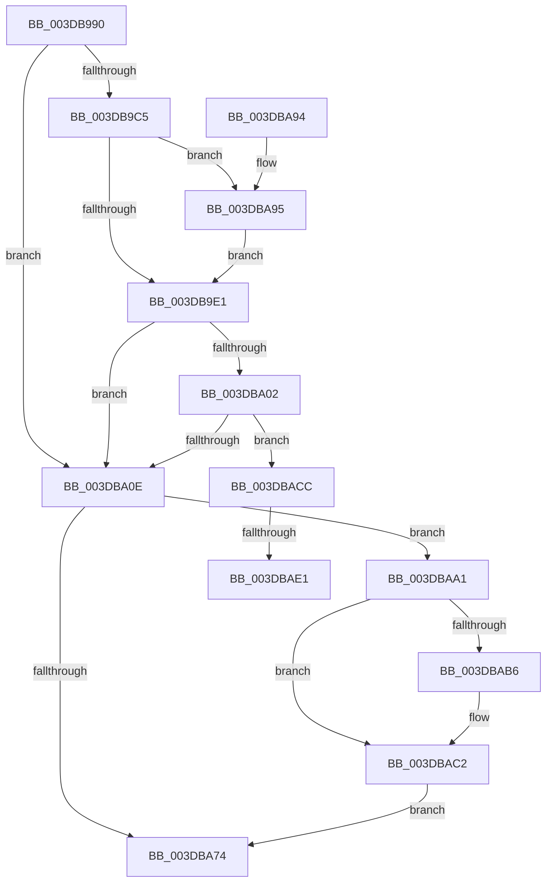

# HalpDmaControllerProgramChannel

- RVA: `0x003DB990`–`0x003DBAF2` (길이 `354` bytes)
- VA: `0x00000001403DB990`
- 실행 섹션: `.text`
- PDB 이름 있음: `예`; PDB Function 태그: `예`
- unwind 정보 RVA: `0x000940AC`
- 디코드: `88`개 명령, `354/354` bytes 표시
- 미해석 바이트: `0` (있으면 어셈블리에 `.byte`로 보존)

> 이 문서는 커널 이미지의 기계어와 PDB 기호를 분석해 생성했습니다. 4번과 5번은 함수 원형과 자료형을 바이너리 사용 방식에서 추정한 C 해석이며 원본 소스 복구 결과는 아닙니다.

## 1. Dependencies

- 직접 호출 지점: **7**; 고유 호출 대상: **5**
- 직접 호출자로 확인된 함수: **1**
- RIP 상대 이미지 참조: **1**

### Outgoing calls
- `0x003DB9EE` → [KeAcquireSpinLockAtDpcLevel](../20/KeAcquireSpinLockAtDpcLevel_function_00208430.md) (function, `0x00208430`)
- `0x003DBA6A` → [guard_dispatch_icall](../6B/guard_dispatch_icall_function_006BAAD0.md) (function, `0x006BAAD0`)
- `0x003DBA97` → [KiRaiseIrqlProcessIrqlFlags](../4F/KiRaiseIrqlProcessIrqlFlags_function_004F56FC.md) (function, `0x004F56FC`)
- `0x003DBAA8` → [KxReleaseSpinLock](../20/KxReleaseSpinLock_function_00206670.md) (function, `0x00206670`)
- `0x003DBABD` → [KiLowerIrqlProcessIrqlFlags](../4F/KiLowerIrqlProcessIrqlFlags_function_004F5698.md) (function, `0x004F5698`)
- `0x003DBACF` → [KxReleaseSpinLock](../20/KxReleaseSpinLock_function_00206670.md) (function, `0x00206670`)
- `0x003DBAE7` → [KiLowerIrqlProcessIrqlFlags](../4F/KiLowerIrqlProcessIrqlFlags_function_004F5698.md) (function, `0x004F5698`)

### Direct callers
- [HalMapTransferEx](HalMapTransferEx_function_003DB450.md) at `0x003DB746`

### Static image references
- `0x003DB9D4` → RVA `0x00FC6D20` (`ALMOSTRO`; read)

## 2. Other-region calls and transfers

- 다른 실행 섹션으로 향하는 call: **0**
- call이 아닌 외부 분기/꼬리 이동: **2**
  - `0x003DBADB` → [sub_006EA010](../6E/Unknown_function_006EA010.md) (`tail-transfer`)
  - `0x003DBAED` → [sub_006EA010](../6E/Unknown_function_006EA010.md) (`tail-transfer`)

## 3. Assembly (complete function range)

```asm
003DB990  48 89 5C 24 08                  mov qword ptr [rsp + 8], rbx
003DB995  48 89 6C 24 10                  mov qword ptr [rsp + 0x10], rbp
003DB99A  48 89 74 24 18                  mov qword ptr [rsp + 0x18], rsi
003DB99F  57                              push rdi
003DB9A0  41 54                           push r12
003DB9A2  41 55                           push r13
003DB9A4  41 56                           push r14
003DB9A6  41 57                           push r15
003DB9A8  48 83 EC 40                     sub rsp, 0x40
003DB9AC  4D 8B E1                        mov r12, r9
003DB9AF  4D 8B E8                        mov r13, r8
003DB9B2  4C 8B FA                        mov r15, rdx
003DB9B5  48 8B F1                        mov rsi, rcx
003DB9B8  44 0F 20 C7                     mov rdi, cr8
003DB9BC  45 32 F6                        xor r14b, r14b
003DB9BF  40 80 FF 0F                     cmp dil, 0xf
003DB9C3  74 49                           je 0x1403dba0e
003DB9C5  0F B6 91 B0 00 00 00            movzx edx, byte ptr [rcx + 0xb0]
003DB9CC  44 0F 20 C3                     mov rbx, cr8
003DB9D0  44 0F 22 C2                     mov cr8, rdx
003DB9D4  83 3D 45 B3 BE 00 00            cmp dword ptr [rip + 0xbeb345], 0
003DB9DB  0F 85 B4 00 00 00               jne 0x1403dba95
003DB9E1  48 8D AE A8 00 00 00            lea rbp, [rsi + 0xa8]
003DB9E8  40 8A FB                        mov dil, bl
003DB9EB  48 8B CD                        mov rcx, rbp
003DB9EE  E8 3D CA E2 FF                  call 0x140208430
003DB9F3  49 8B 87 68 01 00 00            mov rax, qword ptr [r15 + 0x168]
003DB9FA  41 B6 01                        mov r14b, 1
003DB9FD  48 85 C0                        test rax, rax
003DBA00  74 0C                           je 0x1403dba0e
003DBA02  8B 40 0C                        mov eax, dword ptr [rax + 0xc]
003DBA05  41 84 C6                        test r14b, al
003DBA08  0F 85 BE 00 00 00               jne 0x1403dbacc
003DBA0E  41 8B 87 7C 01 00 00            mov eax, dword ptr [r15 + 0x17c]
003DBA15  4C 8B 8C 24 90 00 00 00         mov r9, qword ptr [rsp + 0x90]
003DBA1D  48 8D 0C 80                     lea rcx, [rax + rax*4]
003DBA21  48 C1 E1 05                     shl rcx, 5
003DBA25  48 03 4E 38                     add rcx, qword ptr [rsi + 0x38]
003DBA29  4C 89 69 08                     mov qword ptr [rcx + 8], r13
003DBA2D  4C 89 61 10                     mov qword ptr [rcx + 0x10], r12
003DBA31  41 8A 8F BB 01 00 00            mov cl, byte ptr [r15 + 0x1bb]
003DBA38  48 8B 46 68                     mov rax, qword ptr [rsi + 0x68]
003DBA3C  45 8B 87 80 01 00 00            mov r8d, dword ptr [r15 + 0x180]
003DBA43  41 8B 97 7C 01 00 00            mov edx, dword ptr [r15 + 0x17c]
003DBA4A  88 4C 24 30                     mov byte ptr [rsp + 0x30], cl
003DBA4E  8A 8C 24 A0 00 00 00            mov cl, byte ptr [rsp + 0xa0]
003DBA55  88 4C 24 28                     mov byte ptr [rsp + 0x28], cl
003DBA59  48 8B 8C 24 98 00 00 00         mov rcx, qword ptr [rsp + 0x98]
003DBA61  48 89 4C 24 20                  mov qword ptr [rsp + 0x20], rcx
003DBA66  48 8B 4E 40                     mov rcx, qword ptr [rsi + 0x40]
003DBA6A  E8 61 F0 2D 00                  call 0x1406baad0
003DBA6F  45 84 F6                        test r14b, r14b
003DBA72  75 2D                           jne 0x1403dbaa1
003DBA74  33 C0                           xor eax, eax
003DBA76  4C 8D 5C 24 40                  lea r11, [rsp + 0x40]
003DBA7B  49 8B 5B 30                     mov rbx, qword ptr [r11 + 0x30]
003DBA7F  49 8B 6B 38                     mov rbp, qword ptr [r11 + 0x38]
003DBA83  49 8B 73 40                     mov rsi, qword ptr [r11 + 0x40]
003DBA87  49 8B E3                        mov rsp, r11
003DBA8A  41 5F                           pop r15
003DBA8C  41 5E                           pop r14
003DBA8E  41 5D                           pop r13
003DBA90  41 5C                           pop r12
003DBA92  5F                              pop rdi
003DBA93  C3                              ret
003DBA94  CC                              int3
003DBA95  8A CB                           mov cl, bl
003DBA97  E8 60 9C 11 00                  call 0x1404f56fc
003DBA9C  E9 40 FF FF FF                  jmp 0x1403db9e1
003DBAA1  48 8D 8E A8 00 00 00            lea rcx, [rsi + 0xa8]
003DBAA8  E8 C3 AB E2 FF                  call 0x140206670
003DBAAD  83 3D 6C B2 BE 00 00            cmp dword ptr [rip + 0xbeb26c], 0
003DBAB4  74 0C                           je 0x1403dbac2
003DBAB6  44 0F 20 C1                     mov rcx, cr8
003DBABA  40 8A D7                        mov dl, dil
003DBABD  E8 D6 9B 11 00                  call 0x1404f5698
003DBAC2  40 0F B6 C7                     movzx eax, dil
003DBAC6  44 0F 22 C0                     mov cr8, rax
003DBACA  EB A8                           jmp 0x1403dba74
003DBACC  48 8B CD                        mov rcx, rbp
003DBACF  E8 9C AB E2 FF                  call 0x140206670
003DBAD4  83 3D 45 B2 BE 00 00            cmp dword ptr [rip + 0xbeb245], 0
003DBADB  0F 84 2F E5 30 00               je 0x1406ea010
003DBAE1  44 0F 20 C1                     mov rcx, cr8
003DBAE5  8A D3                           mov dl, bl
003DBAE7  E8 AC 9B 11 00                  call 0x1404f5698
003DBAEC  90                              nop
003DBAED  E9 1E E5 30 00                  jmp 0x1406ea010
```

## 4. C-style interpretation (structured pseudocode)

```c
__int64 __fastcall HalpDmaControllerProgramChannel(__int64 a1, __int64 a2, __int64 a3, __int64 a4, __int64 a5, __int64 a6, unsigned __int8 a7)
{
    __int64 result;
    __int64 v_r14;
    __int64 v_rsp;
    unsigned __int64 v_stack_m28;
    unsigned __int8 v_stack_m38;
    unsigned __int8 v_stack_m40;
    unsigned __int64 v_stack_m48;
    unsigned __int64 v_stack_p10;
    unsigned __int64 v_stack_p18;
    unsigned __int64 v_stack_p8;

    v_stack_p8 = v_rbx;
    v_stack_p10 = v_rbp;
    v_stack_p18 = v_rsi;
    v_rsp = (v_rsp) - (64);
    v_r14 = 0;
    if (((unsigned __int8)(v_cr8)) == 15) goto loc_003DBA0E;
    if ((*(unsigned int *)(v_rip + 12497733)) != 0) goto loc_003DBA95;
loc_003DB9E1:
    result = KeAcquireSpinLockAtDpcLevel(a1 + 168, *(unsigned __int8 *)(a1 + 176), a3, a4);
    if (*(unsigned __int64 *)(a2 + 360) == 0) goto loc_003DBA0E;
    if (((1) & ((unsigned __int8)((unsigned int)(*(unsigned int *)(*(unsigned __int64 *)(a2 + 360) + 12))))) != 0) goto loc_003DBACC;
loc_003DBA0E:
    a1 = ((unsigned int)(*(unsigned int *)(a2 + 380)) + (unsigned int)(*(unsigned int *)(a2 + 380)) * 4) << (5);
    a1 = (a1) + (*(unsigned __int64 *)(a1 + 56));
    *(unsigned __int64 *)(a1 + 8) = a3;
    *(unsigned __int64 *)(a1 + 16) = a4;
    v_stack_m38 = (unsigned __int8)(*(unsigned __int8 *)(a2 + 443));
    v_stack_m40 = a7;
    v_stack_m48 = a6;
    result = guard_dispatch_icall(*(unsigned __int64 *)(a1 + 64), (unsigned int)(*(unsigned int *)(a2 + 380)), (unsigned int)(*(unsigned int *)(a2 + 384)), a5);
    if (1 != 0) goto loc_003DBAA1;
loc_003DBA74:
    result = 0;
    return result;
loc_003DBA95:
    result = KiRaiseIrqlProcessIrqlFlags((unsigned __int8)(*(unsigned __int64 *)(v_stack_m28 + 48)), (unsigned int)(*(unsigned int *)(a2 + 380)), (unsigned int)(*(unsigned int *)(a2 + 384)), a5);
    goto loc_003DB9E1;
loc_003DBAA1:
    result = KxReleaseSpinLock(*(unsigned __int64 *)(v_stack_m28 + 64) + 168, (unsigned int)(*(unsigned int *)(a2 + 380)), (unsigned int)(*(unsigned int *)(a2 + 384)), a5);
    if ((*(unsigned int *)(v_rip + 12497516)) != 0) {
        a1 = *(unsigned __int8 *)(a1 + 176);
        a2 = (unsigned __int8)((unsigned __int8)(v_cr8));
        result = KiLowerIrqlProcessIrqlFlags(a1, a2, (unsigned int)(*(unsigned int *)(a2 + 384)), a5);
    }
    goto loc_003DBA74;
loc_003DBACC:
    result = KxReleaseSpinLock(*(unsigned __int64 *)(v_stack_m28 + 56), a2, (unsigned int)(*(unsigned int *)(a2 + 384)), a5);
    result = KiLowerIrqlProcessIrqlFlags((unsigned __int8)((unsigned __int8)(v_cr8)), (unsigned __int8)(*(unsigned __int64 *)(v_stack_m28 + 48)), (unsigned int)(*(unsigned int *)(a2 + 384)), a5);
}
```

## 5. (Beta) C Style

```c
int64_t HalpDmaControllerProgramChannel(void *Arg1, void *Arg2, int64_t Arg3, int64_t Arg4, int64_t Arg5, int64_t Arg6, uint8_t Arg7)
{
    uint8_t *arg1 = (uint8_t *)Arg1;
    uint8_t *arg2 = (uint8_t *)Arg2;

    int64_t result;
    int64_t local_r14;
    int64_t local_rsp;
    uint64_t v_stack_m28;
    uint8_t v_stack_m38;
    uint8_t v_stack_m40;
    uint64_t v_stack_m48;
    uint64_t v_stack_p10;
    uint64_t v_stack_p18;
    uint64_t v_stack_p8;

    v_stack_p8 = local_rbx;
    v_stack_p10 = local_rbp;
    v_stack_p18 = local_rsi;
    local_rsp = (local_rsp) - (64);
    local_r14 = 0;
    if (((uint8_t)(v_cr8)) == 15) goto loc_003DBA0E;
    if ((*(uint32_t *)(v_rip + 0xBEB345)) != 0) goto loc_003DBA95;
loc_003DB9E1:
    result = KeAcquireSpinLockAtDpcLevel(Arg1 + 168, *(uint8_t *)(arg1 + 0xB0), Arg3, Arg4);
    if (*(uint64_t *)(arg2 + 0x168) == 0) goto loc_003DBA0E;
    if (((1) & ((uint8_t)((uint32_t)(*(uint32_t *)(*(uint64_t *)(arg2 + 0x168) + 0xC))))) != 0) goto loc_003DBACC;
loc_003DBA0E:
    Arg1 = ((uint32_t)(*(uint32_t *)(arg2 + 0x17C)) + (uint32_t)(*(uint32_t *)(arg2 + 0x17C)) * 4) << (5);
    Arg1 = (Arg1) + (*(uint64_t *)(arg1 + 0x38));
    *(uint64_t *)(arg1 + 0x8) = Arg3;
    *(uint64_t *)(arg1 + 0x10) = Arg4;
    v_stack_m38 = (uint8_t)(*(uint8_t *)(arg2 + 0x1BB));
    v_stack_m40 = Arg7;
    v_stack_m48 = Arg6;
    result = guard_dispatch_icall(*(uint64_t *)(arg1 + 0x40), (uint32_t)(*(uint32_t *)(arg2 + 0x17C)), (uint32_t)(*(uint32_t *)(arg2 + 0x180)), Arg5);
    if (1 != 0) goto loc_003DBAA1;
loc_003DBA74:
    result = 0;
    return result;
loc_003DBA95:
    result = KiRaiseIrqlProcessIrqlFlags((uint8_t)(*(uint64_t *)(v_stack_m28 + 0x30)), (uint32_t)(*(uint32_t *)(arg2 + 0x17C)), (uint32_t)(*(uint32_t *)(arg2 + 0x180)), Arg5);
    goto loc_003DB9E1;
loc_003DBAA1:
    result = KxReleaseSpinLock(*(uint64_t *)(v_stack_m28 + 0x40) + 168, (uint32_t)(*(uint32_t *)(arg2 + 0x17C)), (uint32_t)(*(uint32_t *)(arg2 + 0x180)), Arg5);
    if ((*(uint32_t *)(v_rip + 0xBEB26C)) != 0) {
        Arg1 = *(uint8_t *)(arg1 + 0xB0);
        Arg2 = (uint8_t)((uint8_t)(v_cr8));
        result = KiLowerIrqlProcessIrqlFlags(Arg1, Arg2, (uint32_t)(*(uint32_t *)(arg2 + 0x180)), Arg5);
    }
    goto loc_003DBA74;
loc_003DBACC:
    result = KxReleaseSpinLock(*(uint64_t *)(v_stack_m28 + 0x38), Arg2, (uint32_t)(*(uint32_t *)(arg2 + 0x180)), Arg5);
    result = KiLowerIrqlProcessIrqlFlags((uint8_t)((uint8_t)(v_cr8)), (uint8_t)(*(uint64_t *)(v_stack_m28 + 0x30)), (uint32_t)(*(uint32_t *)(arg2 + 0x180)), Arg5);
}
```

### 관측된 메모리 오프셋

구조체 형식이 확인되지 않은 접근은 인자 기준의 오프셋으로만 기록했습니다.

| 기준 인자 | 오프셋 표현 | 폭 (bit) | 접근 |
|---|---:|---:|---|
| `Arg1` | `+ 0x38` | `64` | `R` |
| `Arg1` | `+ 0x40` | `64` | `R` |
| `Arg1` | `+ 0x68` | `64` | `R` |
| `Arg1` | `+ 0xA8` | `64` | `R` |
| `Arg1` | `+ 0xB0` | `8` | `R` |
| `Arg2` | `+ 0x168` | `64` | `R` |
| `Arg2` | `+ 0x17C` | `32` | `R` |
| `Arg2` | `+ 0x180` | `32` | `R` |
| `Arg2` | `+ 0x1BB` | `8` | `R` |

## 6. Execution-region graph

[열기: 2D/3D 그래프와 함수 탐색 컨트롤 패널](../../../control-panel.html?section=text&rva=0x003DB990&view=graph)

- 2D 그래프는 위에서 아래로 흐르고, 3D 그래프는 빈 공간을 드래그해 회전합니다. Shift+드래그는 이동, 휠은 확대·축소, 함수 노드 선택은 대상 보고서 이동입니다.

### Static fallback


