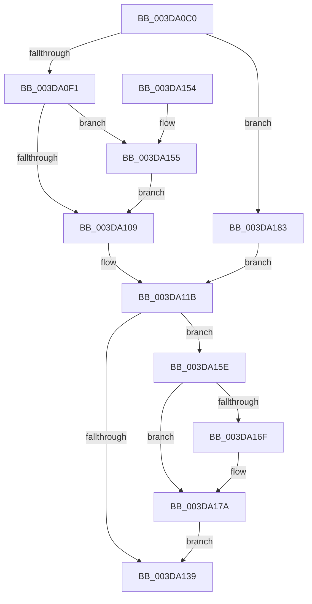

# HalpDmaControllerQueryMaxFragments

- RVA: `0x003DA0C0`–`0x003DA18C` (길이 `204` bytes)
- VA: `0x00000001403DA0C0`
- 실행 섹션: `.text`
- PDB 이름 있음: `예`; PDB Function 태그: `아니요`
- unwind 정보 RVA: `0x00093208`
- 디코드: `56`개 명령, `204/204` bytes 표시
- 미해석 바이트: `0` (있으면 어셈블리에 `.byte`로 보존)

> 이 문서는 커널 이미지의 기계어와 PDB 기호를 분석해 생성했습니다. 4번과 5번은 함수 원형과 자료형을 바이너리 사용 방식에서 추정한 C 해석이며 원본 소스 복구 결과는 아닙니다.

## 1. Dependencies

- 직접 호출 지점: **5**; 고유 호출 대상: **5**
- 직접 호출자로 확인된 함수: **1**
- RIP 상대 이미지 참조: **1**

### Outgoing calls
- `0x003DA113` → [KeAcquireSpinLockAtDpcLevel](../20/KeAcquireSpinLockAtDpcLevel_function_00208430.md) (function, `0x00208430`)
- `0x003DA12D` → [guard_dispatch_icall](../6B/guard_dispatch_icall_function_006BAAD0.md) (function, `0x006BAAD0`)
- `0x003DA157` → [KiRaiseIrqlProcessIrqlFlags](../4F/KiRaiseIrqlProcessIrqlFlags_function_004F56FC.md) (function, `0x004F56FC`)
- `0x003DA161` → [KxReleaseSpinLock](../20/KxReleaseSpinLock_function_00206670.md) (function, `0x00206670`)
- `0x003DA175` → [KiLowerIrqlProcessIrqlFlags](../4F/KiLowerIrqlProcessIrqlFlags_function_004F5698.md) (function, `0x004F5698`)

### Direct callers
- [HalMapTransferEx](HalMapTransferEx_function_003DB450.md) at `0x003DB75D`

### Static image references
- `0x003DA100` → RVA `0x00FC6D20` (`ALMOSTRO`; read)

## 2. Other-region calls and transfers

- 다른 실행 섹션으로 향하는 call: **0**
- 별도 외부 분기/꼬리 이동을 확인하지 못했습니다.

## 3. Assembly (complete function range)

```asm
003DA0C0  48 89 5C 24 08                  mov qword ptr [rsp + 8], rbx
003DA0C5  48 89 6C 24 10                  mov qword ptr [rsp + 0x10], rbp
003DA0CA  48 89 74 24 18                  mov qword ptr [rsp + 0x18], rsi
003DA0CF  57                              push rdi
003DA0D0  41 56                           push r14
003DA0D2  41 57                           push r15
003DA0D4  48 83 EC 20                     sub rsp, 0x20
003DA0D8  45 8B F0                        mov r14d, r8d
003DA0DB  4C 8B FA                        mov r15, rdx
003DA0DE  48 8B F9                        mov rdi, rcx
003DA0E1  40 32 ED                        xor bpl, bpl
003DA0E4  44 0F 20 C3                     mov rbx, cr8
003DA0E8  80 FB 0F                        cmp bl, 0xf
003DA0EB  0F 84 92 00 00 00               je 0x1403da183
003DA0F1  0F B6 91 B0 00 00 00            movzx edx, byte ptr [rcx + 0xb0]
003DA0F8  44 0F 20 C3                     mov rbx, cr8
003DA0FC  44 0F 22 C2                     mov cr8, rdx
003DA100  83 3D 19 CC BE 00 00            cmp dword ptr [rip + 0xbecc19], 0
003DA107  75 4C                           jne 0x1403da155
003DA109  48 8D B7 A8 00 00 00            lea rsi, [rdi + 0xa8]
003DA110  48 8B CE                        mov rcx, rsi
003DA113  E8 18 E3 E2 FF                  call 0x140208430
003DA118  40 B5 01                        mov bpl, 1
003DA11B  48 8B 47 60                     mov rax, qword ptr [rdi + 0x60]
003DA11F  45 8B C6                        mov r8d, r14d
003DA122  41 8B 97 7C 01 00 00            mov edx, dword ptr [r15 + 0x17c]
003DA129  48 8B 4F 40                     mov rcx, qword ptr [rdi + 0x40]
003DA12D  E8 9E 09 2E 00                  call 0x1406baad0
003DA132  8B F8                           mov edi, eax
003DA134  40 84 ED                        test bpl, bpl
003DA137  75 25                           jne 0x1403da15e
003DA139  48 8B 5C 24 40                  mov rbx, qword ptr [rsp + 0x40]
003DA13E  8B C7                           mov eax, edi
003DA140  48 8B 6C 24 48                  mov rbp, qword ptr [rsp + 0x48]
003DA145  48 8B 74 24 50                  mov rsi, qword ptr [rsp + 0x50]
003DA14A  48 83 C4 20                     add rsp, 0x20
003DA14E  41 5F                           pop r15
003DA150  41 5E                           pop r14
003DA152  5F                              pop rdi
003DA153  C3                              ret
003DA154  CC                              int3
003DA155  8A CB                           mov cl, bl
003DA157  E8 A0 B5 11 00                  call 0x1404f56fc
003DA15C  EB AB                           jmp 0x1403da109
003DA15E  48 8B CE                        mov rcx, rsi
003DA161  E8 0A C5 E2 FF                  call 0x140206670
003DA166  83 3D B3 CB BE 00 00            cmp dword ptr [rip + 0xbecbb3], 0
003DA16D  74 0B                           je 0x1403da17a
003DA16F  44 0F 20 C1                     mov rcx, cr8
003DA173  8A D3                           mov dl, bl
003DA175  E8 1E B5 11 00                  call 0x1404f5698
003DA17A  0F B6 C3                        movzx eax, bl
003DA17D  44 0F 22 C0                     mov cr8, rax
003DA181  EB B6                           jmp 0x1403da139
003DA183  48 8D B1 A8 00 00 00            lea rsi, [rcx + 0xa8]
003DA18A  EB 8F                           jmp 0x1403da11b
```

## 4. C-style interpretation (structured pseudocode)

```c
__int64 __fastcall HalpDmaControllerQueryMaxFragments(__int64 a1, __int64 a2, int a3)
{
    __int64 result;
    __int64 v_rbp;
    __int64 v_rsp;
    unsigned __int64 v_stack_p10;
    unsigned __int64 v_stack_p18;
    unsigned __int64 v_stack_p8;

    v_stack_p8 = v_rbx;
    v_stack_p10 = v_rbp;
    v_stack_p18 = v_rsi;
    v_rsp = (v_rsp) - (32);
    v_rbp = 0;
    if (((unsigned __int8)(v_cr8)) == 15) goto loc_003DA183;
    if ((*(unsigned int *)(v_rip + 12504089)) != 0) goto loc_003DA155;
loc_003DA109:
    result = KeAcquireSpinLockAtDpcLevel(a1 + 168, *(unsigned __int8 *)(a1 + 176), a3, a4);
loc_003DA11B:
    result = guard_dispatch_icall(*(unsigned __int64 *)(a1 + 64), (unsigned int)(*(unsigned int *)(a2 + 380)), (unsigned int)((unsigned int)((unsigned int)(a3))), a4);
    if (1 != 0) goto loc_003DA15E;
loc_003DA139:
    v_rsp = (v_rsp) + (32);
    return (unsigned int)((unsigned int)((unsigned int)((unsigned int)(result))));
loc_003DA155:
    result = KiRaiseIrqlProcessIrqlFlags((unsigned __int8)(v_stack_p8), (unsigned int)(*(unsigned int *)(a2 + 380)), (unsigned int)((unsigned int)((unsigned int)(a3))), a4);
    goto loc_003DA109;
loc_003DA15E:
    result = KxReleaseSpinLock(v_stack_p18, (unsigned int)(*(unsigned int *)(a2 + 380)), (unsigned int)((unsigned int)((unsigned int)(a3))), a4);
    if ((*(unsigned int *)(v_rip + 12503987)) != 0) {
        a1 = *(unsigned __int8 *)(a1 + 176);
        a2 = (unsigned __int8)(v_stack_p8);
        result = KiLowerIrqlProcessIrqlFlags(a1, a2, (unsigned int)((unsigned int)((unsigned int)(a3))), a4);
    }
    goto loc_003DA139;
loc_003DA183:
    goto loc_003DA11B;
}
```

## 5. (Beta) C Style

```c
int64_t HalpDmaControllerQueryMaxFragments(void *Arg1, void *Arg2, int32_t Arg3)
{
    uint8_t *arg1 = (uint8_t *)Arg1;
    uint8_t *arg2 = (uint8_t *)Arg2;

    int64_t result;
    int64_t local_rbp;
    int64_t local_rsp;
    uint64_t v_stack_p10;
    uint64_t v_stack_p18;
    uint64_t v_stack_p8;

    v_stack_p8 = local_rbx;
    v_stack_p10 = local_rbp;
    v_stack_p18 = local_rsi;
    local_rsp = (local_rsp) - (32);
    local_rbp = 0;
    if (((uint8_t)(v_cr8)) == 15) goto loc_003DA183;
    if ((*(uint32_t *)(v_rip + 0xBECC19)) != 0) goto loc_003DA155;
loc_003DA109:
    result = KeAcquireSpinLockAtDpcLevel(Arg1 + 168, *(uint8_t *)(arg1 + 0xB0), Arg3, a4);
loc_003DA11B:
    result = guard_dispatch_icall(*(uint64_t *)(arg1 + 0x40), (uint32_t)(*(uint32_t *)(arg2 + 0x17C)), (uint32_t)((uint32_t)((uint32_t)(Arg3))), a4);
    if (1 != 0) goto loc_003DA15E;
loc_003DA139:
    local_rsp = (local_rsp) + (32);
    return (uint32_t)((uint32_t)((uint32_t)((uint32_t)(result))));
loc_003DA155:
    result = KiRaiseIrqlProcessIrqlFlags((uint8_t)(v_stack_p8), (uint32_t)(*(uint32_t *)(arg2 + 0x17C)), (uint32_t)((uint32_t)((uint32_t)(Arg3))), a4);
    goto loc_003DA109;
loc_003DA15E:
    result = KxReleaseSpinLock(v_stack_p18, (uint32_t)(*(uint32_t *)(arg2 + 0x17C)), (uint32_t)((uint32_t)((uint32_t)(Arg3))), a4);
    if ((*(uint32_t *)(v_rip + 0xBECBB3)) != 0) {
        Arg1 = *(uint8_t *)(arg1 + 0xB0);
        Arg2 = (uint8_t)(v_stack_p8);
        result = KiLowerIrqlProcessIrqlFlags(Arg1, Arg2, (uint32_t)((uint32_t)((uint32_t)(Arg3))), a4);
    }
    goto loc_003DA139;
loc_003DA183:
    goto loc_003DA11B;
}
```

### 관측된 메모리 오프셋

구조체 형식이 확인되지 않은 접근은 인자 기준의 오프셋으로만 기록했습니다.

| 기준 인자 | 오프셋 표현 | 폭 (bit) | 접근 |
|---|---:|---:|---|
| `Arg1` | `+ 0x40` | `64` | `R` |
| `Arg1` | `+ 0x60` | `64` | `R` |
| `Arg1` | `+ 0xA8` | `64` | `R` |
| `Arg1` | `+ 0xB0` | `8` | `R` |
| `Arg2` | `+ 0x17C` | `32` | `R` |

## 6. Execution-region graph

[열기: 2D/3D 그래프와 함수 탐색 컨트롤 패널](../../../control-panel.html?section=text&rva=0x003DA0C0&view=graph)

- 2D 그래프는 위에서 아래로 흐르고, 3D 그래프는 빈 공간을 드래그해 회전합니다. Shift+드래그는 이동, 휠은 확대·축소, 함수 노드 선택은 대상 보고서 이동입니다.

### Static fallback


