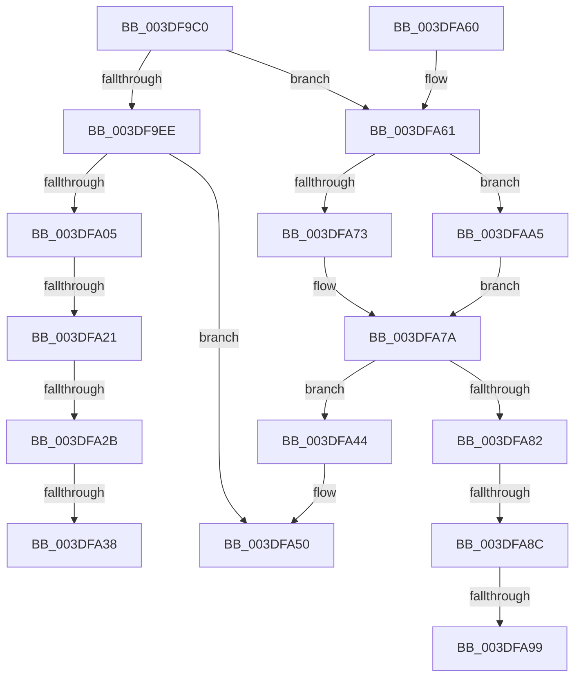

# HalpDmaDequeueAdapter

- RVA: `0x003DF9C0`–`0x003DFAAE` (길이 `238` bytes)
- VA: `0x00000001403DF9C0`
- 실행 섹션: `.text`
- PDB 이름 있음: `예`; PDB Function 태그: `예`
- unwind 정보 RVA: `0x00094880`
- 디코드: `63`개 명령, `238/238` bytes 표시
- 미해석 바이트: `0` (있으면 어셈블리에 `.byte`로 보존)

> 이 문서는 커널 이미지의 기계어와 PDB 기호를 분석해 생성했습니다. 4번과 5번은 함수 원형과 자료형을 바이너리 사용 방식에서 추정한 C 해석이며 원본 소스 복구 결과는 아닙니다.

## 1. Dependencies

- 직접 호출 지점: **3**; 고유 호출 대상: **2**
- 직접 호출자로 확인된 함수: **2**
- RIP 상대 이미지 참조: **1**

### Outgoing calls
- `0x003DFA10` → [KeAcquireInStackQueuedSpinLock](../27/KeAcquireInStackQueuedSpinLock_function_002757A0.md) (function, `0x002757A0`)
- `0x003DFA49` → [KeReleaseInStackQueuedSpinLock](../34/KeReleaseInStackQueuedSpinLock_function_00342CE0.md) (function, `0x00342CE0`)
- `0x003DFA6A` → [KeAcquireInStackQueuedSpinLock](../27/KeAcquireInStackQueuedSpinLock_function_002757A0.md) (function, `0x002757A0`)

### Direct callers
- [HalpDmaProcessMapRegisterQueueV3](HalpDmaProcessMapRegisterQueueV3_function_003DA780.md) at `0x003DA794`
- [HalpDmaProcessMapRegisterQueueV2](HalpDmaProcessMapRegisterQueueV2_function_003DF50C.md) at `0x003DF52C`

### Static image references
- `0x003DF9D9` → RVA `0x00FC18A0` (`.data`; read)

## 2. Other-region calls and transfers

- 다른 실행 섹션으로 향하는 call: **0**
- call이 아닌 외부 분기/꼬리 이동: **7**
  - `0x003DFA1B` → [sub_006EA780 + 0x7](../6E/Unknown_function_006EA780.md) (`tail-transfer`)
  - `0x003DFA25` → [sub_006EA780 + 0x19](../6E/Unknown_function_006EA780.md) (`tail-transfer`)
  - `0x003DFA32` → [sub_006EA780 + 0x19](../6E/Unknown_function_006EA780.md) (`tail-transfer`)
  - `0x003DFA3F` → [sub_006EA780](../6E/Unknown_function_006EA780.md) (`tail-transfer`)
  - `0x003DFA86` → [sub_006EA780 + 0x19](../6E/Unknown_function_006EA780.md) (`tail-transfer`)
  - `0x003DFA93` → [sub_006EA780 + 0x19](../6E/Unknown_function_006EA780.md) (`tail-transfer`)
  - `0x003DFAA0` → [sub_006EA780](../6E/Unknown_function_006EA780.md) (`tail-transfer`)

## 3. Assembly (complete function range)

```asm
003DF9C0  4C 8B DC                        mov r11, rsp
003DF9C3  49 89 5B 08                     mov qword ptr [r11 + 8], rbx
003DF9C7  49 89 73 10                     mov qword ptr [r11 + 0x10], rsi
003DF9CB  57                              push rdi
003DF9CC  48 83 EC 40                     sub rsp, 0x40
003DF9D0  33 C0                           xor eax, eax
003DF9D2  0F 57 C0                        xorps xmm0, xmm0
003DF9D5  33 FF                           xor edi, edi
003DF9D7  8A DA                           mov bl, dl
003DF9D9  40 38 3D C0 1E BE 00            cmp byte ptr [rip + 0xbe1ec0], dil
003DF9E0  48 8B F1                        mov rsi, rcx
003DF9E3  0F 11 44 24 20                  movups xmmword ptr [rsp + 0x20], xmm0
003DF9E8  49 89 43 E8                     mov qword ptr [r11 - 0x18], rax
003DF9EC  74 73                           je 0x1403dfa61
003DF9EE  F6 DB                           neg bl
003DF9F0  48 1B DB                        sbb rbx, rbx
003DF9F3  83 E3 10                        and ebx, 0x10
003DF9F6  48 81 C3 A8 00 00 00            add rbx, 0xa8
003DF9FD  48 03 D9                        add rbx, rcx
003DFA00  48 39 1B                        cmp qword ptr [rbx], rbx
003DFA03  74 4B                           je 0x1403dfa50
003DFA05  48 81 C1 A0 00 00 00            add rcx, 0xa0
003DFA0C  49 8D 53 D8                     lea rdx, [r11 - 0x28]
003DFA10  E8 8B 5D E9 FF                  call 0x1402757a0
003DFA15  48 8B 03                        mov rax, qword ptr [rbx]
003DFA18  48 3B C3                        cmp rax, rbx
003DFA1B  0F 84 66 AD 30 00               je 0x1406ea787
003DFA21  48 39 58 08                     cmp qword ptr [rax + 8], rbx
003DFA25  0F 85 6E AD 30 00               jne 0x1406ea799
003DFA2B  48 8B 08                        mov rcx, qword ptr [rax]
003DFA2E  48 39 41 08                     cmp qword ptr [rcx + 8], rax
003DFA32  0F 85 61 AD 30 00               jne 0x1406ea799
003DFA38  48 89 0B                        mov qword ptr [rbx], rcx
003DFA3B  48 89 59 08                     mov qword ptr [rcx + 8], rbx
003DFA3F  E9 3C AD 30 00                  jmp 0x1406ea780
003DFA44  48 8D 4C 24 20                  lea rcx, [rsp + 0x20]
003DFA49  E8 92 32 F6 FF                  call 0x140342ce0
003DFA4E  33 C0                           xor eax, eax
003DFA50  48 8B 5C 24 50                  mov rbx, qword ptr [rsp + 0x50]
003DFA55  48 8B 74 24 58                  mov rsi, qword ptr [rsp + 0x58]
003DFA5A  48 83 C4 40                     add rsp, 0x40
003DFA5E  5F                              pop rdi
003DFA5F  C3                              ret
003DFA60  CC                              int3
003DFA61  48 83 E9 80                     sub rcx, -0x80
003DFA65  48 8D 54 24 20                  lea rdx, [rsp + 0x20]
003DFA6A  E8 31 5D E9 FF                  call 0x1402757a0
003DFA6F  84 DB                           test bl, bl
003DFA71  75 32                           jne 0x1403dfaa5
003DFA73  48 8D 8E A8 00 00 00            lea rcx, [rsi + 0xa8]
003DFA7A  48 8B 01                        mov rax, qword ptr [rcx]
003DFA7D  48 3B C1                        cmp rax, rcx
003DFA80  74 C2                           je 0x1403dfa44
003DFA82  48 39 48 08                     cmp qword ptr [rax + 8], rcx
003DFA86  0F 85 0D AD 30 00               jne 0x1406ea799
003DFA8C  48 8B 10                        mov rdx, qword ptr [rax]
003DFA8F  48 39 42 08                     cmp qword ptr [rdx + 8], rax
003DFA93  0F 85 00 AD 30 00               jne 0x1406ea799
003DFA99  48 89 11                        mov qword ptr [rcx], rdx
003DFA9C  48 89 4A 08                     mov qword ptr [rdx + 8], rcx
003DFAA0  E9 DB AC 30 00                  jmp 0x1406ea780
003DFAA5  48 8D 8E B8 00 00 00            lea rcx, [rsi + 0xb8]
003DFAAC  EB CC                           jmp 0x1403dfa7a
```

## 4. C-style interpretation (structured pseudocode)

```c
__int64 __fastcall HalpDmaDequeueAdapter(__int64 a1, unsigned __int8 a2)
{
    __int64 result;
    __int64 v_rbx;
    __int64 v_rdi;
    __int64 v_rsp;
    unsigned __int64 v_stack_m28;
    unsigned __int64 v_stack_p10;
    unsigned __int64 v_stack_p20;
    unsigned __int64 v_stack_p8;

    *(unsigned __int64 *)(v_rsp + 8) = v_rbx;
    *(unsigned __int64 *)(v_rsp + 16) = v_rsi;
    v_rsp = (v_rsp) - (64);
    result = 0;
    v_rdi = 0;
    v_stack_m28 = v_xmm0;
    *(unsigned __int64 *)(v_rsp - 24) = 0;
    if ((*(unsigned __int8 *)(v_rip + 12459712)) == 0) goto loc_003DFA61;
    v_rbx = (unsigned __int8)(-(a2));
    v_rbx = (unsigned int)((v_rbx) & (16));
    v_rbx = (v_rbx) + (168);
    v_rbx = (v_rbx) + (a1);
    if ((*(unsigned __int64 *)(v_rbx)) == v_rbx) goto loc_003DFA50;
    a1 = (a1) + (160);
    result = KeAcquireInStackQueuedSpinLock(a1, v_rsp - 40, a3, a4);
    *(unsigned __int64 *)(v_rbx) = *(unsigned __int64 *)(*(unsigned __int64 *)(v_rbx));
    *(unsigned __int64 *)(*(unsigned __int64 *)(*(unsigned __int64 *)(v_rbx)) + 8) = v_rbx;
loc_003DFA44:
    result = KeReleaseInStackQueuedSpinLock(v_stack_m28, v_rsp - 40, a3, a4);
    result = 0;
loc_003DFA50:
    v_rsp = (v_rsp) + (64);
    return result;
loc_003DFA61:
    a1 = (v_stack_m28) - (-128);
    result = KeAcquireInStackQueuedSpinLock(a1, v_stack_p20, a3, a4);
    if ((unsigned __int8)(v_stack_p8) != 0) goto loc_003DFAA5;
loc_003DFA7A:
    if ((*(unsigned __int64 *)(v_stack_p10 + 168)) == (v_stack_p10 + 168)) goto loc_003DFA44;
    *(unsigned __int64 *)(v_stack_p10 + 168) = *(unsigned __int64 *)(*(unsigned __int64 *)(v_stack_p10 + 168));
    *(unsigned __int64 *)(*(unsigned __int64 *)(*(unsigned __int64 *)(v_stack_p10 + 168)) + 8) = v_stack_p10 + 168;
loc_003DFAA5:
    goto loc_003DFA7A;
}
```

## 5. (Beta) C Style

```c
int64_t HalpDmaDequeueAdapter(void *Arg1, uint8_t Arg2)
{
    uint8_t *arg1 = (uint8_t *)Arg1;

    int64_t result;
    int64_t local_rbx;
    int64_t local_rdi;
    int64_t local_rsp;
    uint64_t v_stack_m28;
    uint64_t v_stack_p10;
    uint64_t v_stack_p20;
    uint64_t v_stack_p8;

    *(uint64_t *)(local_rsp + 0x8) = local_rbx;
    *(uint64_t *)(local_rsp + 0x10) = local_rsi;
    local_rsp = (local_rsp) - (64);
    result = 0;
    local_rdi = 0;
    v_stack_m28 = v_xmm0;
    *(uint64_t *)(local_rsp - 0x18) = 0;
    if ((*(uint8_t *)(v_rip + 0xBE1EC0)) == 0) goto loc_003DFA61;
    local_rbx = (uint8_t)(-(Arg2));
    local_rbx = (uint32_t)((local_rbx) & (16));
    local_rbx = (local_rbx) + (168);
    local_rbx = (local_rbx) + (Arg1);
    if ((*(uint64_t *)(local_rbx)) == local_rbx) goto loc_003DFA50;
    Arg1 = (Arg1) + (160);
    result = KeAcquireInStackQueuedSpinLock(Arg1, local_rsp - 40, a3, a4);
    *(uint64_t *)(local_rbx) = *(uint64_t *)(*(uint64_t *)(local_rbx));
    *(uint64_t *)(*(uint64_t *)(*(uint64_t *)(local_rbx)) + 0x8) = local_rbx;
loc_003DFA44:
    result = KeReleaseInStackQueuedSpinLock(v_stack_m28, local_rsp - 40, a3, a4);
    result = 0;
loc_003DFA50:
    local_rsp = (local_rsp) + (64);
    return result;
loc_003DFA61:
    Arg1 = (v_stack_m28) - (-128);
    result = KeAcquireInStackQueuedSpinLock(Arg1, v_stack_p20, a3, a4);
    if ((uint8_t)(v_stack_p8) != 0) goto loc_003DFAA5;
loc_003DFA7A:
    if ((*(uint64_t *)(v_stack_p10 + 0xA8)) == (v_stack_p10 + 168)) goto loc_003DFA44;
    *(uint64_t *)(v_stack_p10 + 0xA8) = *(uint64_t *)(*(uint64_t *)(v_stack_p10 + 0xA8));
    *(uint64_t *)(*(uint64_t *)(*(uint64_t *)(v_stack_p10 + 0xA8)) + 0x8) = v_stack_p10 + 168;
loc_003DFAA5:
    goto loc_003DFA7A;
}
```

### 관측된 메모리 오프셋

구조체 형식이 확인되지 않은 접근은 인자 기준의 오프셋으로만 기록했습니다.

| 기준 인자 | 오프셋 표현 | 폭 (bit) | 접근 |
|---|---:|---:|---|
| `Arg1` | `+ 0x0` | `64` | `R` |
| `Arg1` | `+ 0x0` | `64` | `W` |
| `Arg1` | `+ 0xA8` | `64` | `R` |
| `Arg1` | `+ 0xB8` | `64` | `R` |

## 6. Execution-region graph

[열기: 2D/3D 그래프와 함수 탐색 컨트롤 패널](../../../control-panel.html?section=text&rva=0x003DF9C0&view=graph)

- 2D 그래프는 위에서 아래로 흐르고, 3D 그래프는 빈 공간을 드래그해 회전합니다. Shift+드래그는 이동, 휠은 확대·축소, 함수 노드 선택은 대상 보고서 이동입니다.

### Static fallback


