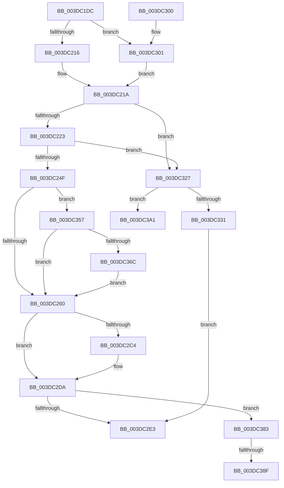

# HalpDmaFlushBuffer

- RVA: `0x003DC1DC`–`0x003DC3BF` (길이 `483` bytes)
- VA: `0x00000001403DC1DC`
- 실행 섹션: `.text`
- PDB 이름 있음: `예`; PDB Function 태그: `예`
- unwind 정보 RVA: `0x000941A8`
- 디코드: `120`개 명령, `483/483` bytes 표시
- 미해석 바이트: `0` (있으면 어셈블리에 `.byte`로 보존)

> 이 문서는 커널 이미지의 기계어와 PDB 기호를 분석해 생성했습니다. 4번과 5번은 함수 원형과 자료형을 바이너리 사용 방식에서 추정한 C 해석이며 원본 소스 복구 결과는 아닙니다.

## 1. Dependencies

- 직접 호출 지점: **7**; 고유 호출 대상: **7**
- 직접 호출자로 확인된 함수: **13**
- RIP 상대 이미지 참조: **2**

### Outgoing calls
- `0x003DC2B3` → [IoBuildPartialMdl](../26/IoBuildPartialMdl_function_00267BE0.md) (function, `0x00267BE0`)
- `0x003DC2D5` → [KeFlushIoBuffers](KeFlushIoBuffers_function_003DA340.md) (function, `0x003DA340`)
- `0x003DC31A` → [MmMapLockedPagesSpecifyCache](../31/MmMapLockedPagesSpecifyCache_function_00318800.md) (function, `0x00318800`)
- `0x003DC350` → [HalpDmaFlushBufferWithEmergencyResources](../4D/HalpDmaFlushBufferWithEmergencyResources_function_004D8024.md) (function, `0x004D8024`)
- `0x003DC371` → [KiRaiseIrqlProcessIrqlFlags](../4F/KiRaiseIrqlProcessIrqlFlags_function_004F56FC.md) (function, `0x004F56FC`)
- `0x003DC396` → [KiLowerIrqlProcessIrqlFlags](../4F/KiLowerIrqlProcessIrqlFlags_function_004F5698.md) (function, `0x004F5698`)
- `0x003DC3B9` → [KeBugCheckEx](../4F/KeBugCheckEx_function_004FD660.md) (function, `0x004FD660`)

### Direct callers
- [HalpDmaFlushContiguousTransferV3](HalpDmaFlushContiguousTransferV3_function_003D9E70.md) at `0x003D9EE3`
- [HalpDmaFlushScatterTransferV3](HalpDmaFlushScatterTransferV3_function_003DB06C.md) at `0x003DB24B`
- [IoMapTransferInternal](IoMapTransferInternal_function_003DC910.md) at `0x003DCAE9`
- [IoMapTransferInternal](IoMapTransferInternal_function_003DC910.md) at `0x003DCBB6`
- [IopMapTransfer](IopMapTransfer_function_003DCD80.md) at `0x003DCF6B`
- [IopMapTransfer](IopMapTransfer_function_003DCD80.md) at `0x003DD020`
- [sub_003DD598](Unknown_function_003DD598.md) at `0x003DD5E7`
- [sub_003DE181](Unknown_function_003DE181.md) at `0x003DE1AF`
- [sub_003DE181](Unknown_function_003DE181.md) at `0x003DE266`
- [sub_003DEA82](Unknown_function_003DEA82.md) at `0x003DEAE8`
- [sub_003DEA82](Unknown_function_003DEA82.md) at `0x003DEC33`
- [HalpDmaMapContiguousTransferV2](HalpDmaMapContiguousTransferV2_function_003DFDF4.md) at `0x003DFEDE`
- [HalpDmaFlushContiguousTransferV2](HalpDmaFlushContiguousTransferV2_function_003DFF3C.md) at `0x003E003A`
- [IoFlushAdapterBuffersV2](../3E/IoFlushAdapterBuffersV2_function_003E0050.md) at `0x003E0128`
- [IoFlushAdapterBuffersV2](../3E/IoFlushAdapterBuffersV2_function_003E0050.md) at `0x003E021A`
- [HalpDmaMapScatterTransferV3](../4A/HalpDmaMapScatterTransferV3_function_004A1EDC.md) at `0x004A2054`
- [HalpDmaMapContiguousTransferV3](../4D/HalpDmaMapContiguousTransferV3_function_004D6C38.md) at `0x004D6CD0`
- [sub_006E9D14](../6E/Unknown_function_006E9D14.md) at `0x006E9DAD`

### Static image references
- `0x003DC275` → RVA `0x00E3EC68` (`.data`; read)
- `0x003DC35F` → RVA `0x00FC6D20` (`ALMOSTRO`; read)

## 2. Other-region calls and transfers

- 다른 실행 섹션으로 향하는 call: **0**
- call이 아닌 외부 분기/꼬리 이동: **2**
  - `0x003DC389` → [sub_006EA08A](../6E/Unknown_function_006EA08A.md) (`tail-transfer`)
  - `0x003DC39C` → [sub_006EA08A](../6E/Unknown_function_006EA08A.md) (`tail-transfer`)

## 3. Assembly (complete function range)

```asm
003DC1DC  48 8B C4                        mov rax, rsp
003DC1DF  48 89 58 10                     mov qword ptr [rax + 0x10], rbx
003DC1E3  48 89 68 18                     mov qword ptr [rax + 0x18], rbp
003DC1E7  48 89 70 20                     mov qword ptr [rax + 0x20], rsi
003DC1EB  48 89 48 08                     mov qword ptr [rax + 8], rcx
003DC1EF  57                              push rdi
003DC1F0  41 54                           push r12
003DC1F2  41 55                           push r13
003DC1F4  41 56                           push r14
003DC1F6  41 57                           push r15
003DC1F8  48 83 EC 30                     sub rsp, 0x30
003DC1FC  45 8B E1                        mov r12d, r9d
003DC1FF  4D 8B E8                        mov r13, r8
003DC202  48 8B F2                        mov rsi, rdx
003DC205  44 0F 20 C5                     mov rbp, cr8
003DC209  45 33 C0                        xor r8d, r8d
003DC20C  F6 42 0A 05                     test byte ptr [rdx + 0xa], 5
003DC210  0F 84 EB 00 00 00               je 0x1403dc301
003DC216  48 8B 42 18                     mov rax, qword ptr [rdx + 0x18]
003DC21A  48 85 C0                        test rax, rax
003DC21D  0F 84 04 01 00 00               je 0x1403dc327
003DC223  41 8B D5                        mov edx, r13d
003DC226  4D 8D B4 24 FF 0F 00 00         lea r14, [r12 + 0xfff]
003DC22E  8B CA                           mov ecx, edx
003DC230  48 89 54 24 60                  mov qword ptr [rsp + 0x60], rdx
003DC235  81 E1 FF 0F 00 00               and ecx, 0xfff
003DC23B  4C 03 F1                        add r14, rcx
003DC23E  49 C1 EE 0C                     shr r14, 0xc
003DC242  41 81 FE 00 02 00 00            cmp r14d, 0x200
003DC249  0F 87 D8 00 00 00               ja 0x1403dc327
003DC24F  BB 02 00 00 00                  mov ebx, 2
003DC254  40 8A FD                        mov dil, bpl
003DC257  40 3A EB                        cmp bpl, bl
003DC25A  0F 82 F7 00 00 00               jb 0x1403dc357
003DC260  65 8B 04 25 A4 01 00 00         mov eax, dword ptr gs:[0x1a4]
003DC268  81 E2 FF 0F 00 00               and edx, 0xfff
003DC26E  8B C8                           mov ecx, eax
003DC270  66 41 83 C6 06                  add r14w, 6
003DC275  48 8B 05 EC 29 A6 00            mov rax, qword ptr [rip + 0xa629ec]
003DC27C  45 8B CC                        mov r9d, r12d
003DC27F  66 41 C1 E6 03                  shl r14w, 3
003DC284  4C 8B 3C C8                     mov r15, qword ptr [rax + rcx*8]
003DC288  49 8B C5                        mov rax, r13
003DC28B  48 25 00 F0 FF FF               and rax, 0xfffffffffffff000
003DC291  48 8B CE                        mov rcx, rsi
003DC294  4D 89 07                        mov qword ptr [r15], r8
003DC297  66 45 89 47 0A                  mov word ptr [r15 + 0xa], r8w
003DC29C  4D 8B C5                        mov r8, r13
003DC29F  41 89 57 2C                     mov dword ptr [r15 + 0x2c], edx
003DC2A3  49 8B D7                        mov rdx, r15
003DC2A6  66 45 89 77 08                  mov word ptr [r15 + 8], r14w
003DC2AB  49 89 47 20                     mov qword ptr [r15 + 0x20], rax
003DC2AF  45 89 67 28                     mov dword ptr [r15 + 0x28], r12d
003DC2B3  E8 28 B9 E8 FF                  call 0x140267be0
003DC2B8  33 F6                           xor esi, esi
003DC2BA  40 38 B4 24 88 00 00 00         cmp byte ptr [rsp + 0x88], sil
003DC2C2  75 16                           jne 0x1403dc2da
003DC2C4  40 38 B4 24 80 00 00 00         cmp byte ptr [rsp + 0x80], sil
003DC2CC  41 B0 01                        mov r8b, 1
003DC2CF  49 8B CF                        mov rcx, r15
003DC2D2  0F 94 C2                        sete dl
003DC2D5  E8 66 E0 FF FF                  call 0x1403da340
003DC2DA  40 3A EB                        cmp bpl, bl
003DC2DD  0F 82 A0 00 00 00               jb 0x1403dc383
003DC2E3  48 8B 5C 24 68                  mov rbx, qword ptr [rsp + 0x68]
003DC2E8  48 8B 6C 24 70                  mov rbp, qword ptr [rsp + 0x70]
003DC2ED  48 8B 74 24 78                  mov rsi, qword ptr [rsp + 0x78]
003DC2F2  48 83 C4 30                     add rsp, 0x30
003DC2F6  41 5F                           pop r15
003DC2F8  41 5E                           pop r14
003DC2FA  41 5D                           pop r13
003DC2FC  41 5C                           pop r12
003DC2FE  5F                              pop rdi
003DC2FF  C3                              ret
003DC300  CC                              int3
003DC301  45 33 C9                        xor r9d, r9d
003DC304  C7 44 24 28 20 00 00 40         mov dword ptr [rsp + 0x28], 0x40000020
003DC30C  44 89 44 24 20                  mov dword ptr [rsp + 0x20], r8d
003DC311  33 D2                           xor edx, edx
003DC313  48 8B CE                        mov rcx, rsi
003DC316  45 8D 41 01                     lea r8d, [r9 + 1]
003DC31A  E8 E1 C4 F3 FF                  call 0x140318800
003DC31F  45 33 C0                        xor r8d, r8d
003DC322  E9 F3 FE FF FF                  jmp 0x1403dc21a
003DC327  BB 02 00 00 00                  mov ebx, 2
003DC32C  40 3A EB                        cmp bpl, bl
003DC32F  77 70                           ja 0x1403dc3a1
003DC331  8A 84 24 88 00 00 00            mov al, byte ptr [rsp + 0x88]
003DC338  45 8B CC                        mov r9d, r12d
003DC33B  88 44 24 28                     mov byte ptr [rsp + 0x28], al
003DC33F  4D 8B C5                        mov r8, r13
003DC342  8A 84 24 80 00 00 00            mov al, byte ptr [rsp + 0x80]
003DC349  48 8B D6                        mov rdx, rsi
003DC34C  88 44 24 20                     mov byte ptr [rsp + 0x20], al
003DC350  E8 CF BC 0F 00                  call 0x1404d8024
003DC355  EB 8C                           jmp 0x1403dc2e3
003DC357  44 0F 20 C7                     mov rdi, cr8
003DC35B  44 0F 22 C3                     mov cr8, rbx
003DC35F  44 39 05 BA A9 BE 00            cmp dword ptr [rip + 0xbea9ba], r8d
003DC366  0F 84 F4 FE FF FF               je 0x1403dc260
003DC36C  8A D3                           mov dl, bl
003DC36E  40 8A CF                        mov cl, dil
003DC371  E8 86 93 11 00                  call 0x1404f56fc
003DC376  48 8B 54 24 60                  mov rdx, qword ptr [rsp + 0x60]
003DC37B  45 33 C0                        xor r8d, r8d
003DC37E  E9 DD FE FF FF                  jmp 0x1403dc260
003DC383  39 35 97 A9 BE 00               cmp dword ptr [rip + 0xbea997], esi
003DC389  0F 84 FB DC 30 00               je 0x1406ea08a
003DC38F  44 0F 20 C1                     mov rcx, cr8
003DC393  40 8A D7                        mov dl, dil
003DC396  E8 FD 92 11 00                  call 0x1404f5698
003DC39B  90                              nop
003DC39C  E9 E9 DC 30 00                  jmp 0x1406ea08a
003DC3A1  4C 89 44 24 20                  mov qword ptr [rsp + 0x20], r8
003DC3A6  45 33 C9                        xor r9d, r9d
003DC3A9  41 B8 05 EF 00 00               mov r8d, 0xef05
003DC3AF  BA 00 10 00 00                  mov edx, 0x1000
003DC3B4  B9 AC 00 00 00                  mov ecx, 0xac
003DC3B9  E8 A2 12 12 00                  call 0x1404fd660
003DC3BE  CC                              int3
```

## 4. C-style interpretation (structured pseudocode)

```c
__int64 __fastcall HalpDmaFlushBuffer(__int64 a1, __int64 a2, __int64 a3, int a4, unsigned __int8 a5, unsigned __int8 a6)
{
    __int64 result;
    __int64 v_r14;
    __int64 v_rsi;
    __int64 v_rsp;
    unsigned __int64 v_stack_p10;
    unsigned __int64 v_stack_p18;
    unsigned __int64 v_stack_p20;
    unsigned int v_stack_p28;
    unsigned __int64 v_stack_p60;
    unsigned __int64 v_stack_p8;

    *(unsigned __int64 *)(v_rsp + 16) = v_rbx;
    *(unsigned __int64 *)(v_rsp + 24) = v_rbp;
    *(unsigned __int64 *)(v_rsp + 32) = v_rsi;
    *(unsigned __int64 *)(v_rsp + 8) = a1;
    v_rsp = (v_rsp) - (48);
    a3 = 0;
    if (((*(unsigned __int8 *)(a2 + 10)) & (5)) == 0) goto loc_003DC301;
loc_003DC21A:
    if (*(unsigned __int64 *)(a2 + 24) == 0) goto loc_003DC327;
    v_stack_p8 = 0;
    a1 = (unsigned int)((0) & (0xFFFULL));
    v_r14 = ((unsigned int)(a4) + 4095) + (a1);
    v_r14 = (v_r14) >> (12);
    if (((unsigned int)(v_r14)) > 512) goto loc_003DC327;
    if (((unsigned __int8)(v_cr8)) < 2) goto loc_003DC357;
loc_003DC260:
    a2 = (unsigned int)((0) & (0xFFFULL));
    v_r14 = (unsigned __int16)((v_r14) + (6));
    v_r14 = (unsigned __int16)((v_r14) << (3));
    result = (0) & (0xFFFFFFFFFFFFF000ULL);
    *(unsigned __int64 *)(*(unsigned __int64 *)(*(unsigned __int64 *)(v_rip + 10889708) + (unsigned int)((unsigned int)((unsigned int)(*(unsigned int *)(gs_base + (0 + 420))))) * 8)) = 0;
    *(unsigned __int16 *)(*(unsigned __int64 *)(*(unsigned __int64 *)(v_rip + 10889708) + (unsigned int)((unsigned int)((unsigned int)(*(unsigned int *)(gs_base + (0 + 420))))) * 8) + 10) = 0;
    *(unsigned int *)(*(unsigned __int64 *)(*(unsigned __int64 *)(v_rip + 10889708) + (unsigned int)((unsigned int)((unsigned int)(*(unsigned int *)(gs_base + (0 + 420))))) * 8) + 44) = (unsigned int)(a2);
    *(unsigned __int16 *)(*(unsigned __int64 *)(*(unsigned __int64 *)(v_rip + 10889708) + (unsigned int)((unsigned int)((unsigned int)(*(unsigned int *)(gs_base + (0 + 420))))) * 8) + 8) = (unsigned __int16)(v_r14);
    *(unsigned __int64 *)(*(unsigned __int64 *)(*(unsigned __int64 *)(v_rip + 10889708) + (unsigned int)((unsigned int)((unsigned int)(*(unsigned int *)(gs_base + (0 + 420))))) * 8) + 32) = result;
    *(unsigned int *)(*(unsigned __int64 *)(*(unsigned __int64 *)(v_rip + 10889708) + (unsigned int)((unsigned int)((unsigned int)(*(unsigned int *)(gs_base + (0 + 420))))) * 8) + 40) = (unsigned int)((unsigned int)(a4));
    result = IoBuildPartialMdl(a2, *(unsigned __int64 *)(*(unsigned __int64 *)(v_rip + 10889708) + (unsigned int)((unsigned int)((unsigned int)(*(unsigned int *)(gs_base + (0 + 420))))) * 8), 0, (unsigned int)((unsigned int)((unsigned int)(a4))));
    v_rsi = 0;
    if (a6 == 0) {
        a3 = 1;
        a1 = *(unsigned __int64 *)(*(unsigned __int64 *)(v_rip + 10889708) + (unsigned int)((unsigned int)((unsigned int)(*(unsigned int *)(gs_base + (0 + 420))))) * 8);
        a2 = (a5 == 0) ? 1 : 0;
        result = KeFlushIoBuffers(a1, a2, a3, (unsigned int)((unsigned int)((unsigned int)(a4))));
    }
    if (((unsigned __int8)(v_cr8)) < 2) goto loc_003DC383;
loc_003DC2E3:
    v_rsp = (v_rsp) + (48);
    return result;
loc_003DC301:
    a4 = 0;
    v_stack_p28 = 0x40000020ULL;
    v_stack_p20 = (unsigned int)(a3);
    a2 = 0;
    result = MmMapLockedPagesSpecifyCache(v_stack_p20, a2, a4 + 1, a4);
    a3 = 0;
    goto loc_003DC21A;
loc_003DC327:
    if (((unsigned __int8)(v_stack_p18)) > 2) goto loc_003DC3A1;
    v_stack_p28 = a6;
    v_stack_p20 = a5;
    result = HalpDmaFlushBufferWithEmergencyResources(v_stack_p20, v_stack_p20, 0, (unsigned int)((unsigned int)((unsigned int)(a4))));
    goto loc_003DC2E3;
loc_003DC357:
    if ((*(unsigned int *)(v_rip + 12495290)) == 0) goto loc_003DC260;
    result = KiRaiseIrqlProcessIrqlFlags((unsigned __int8)(v_cr8), 2, 0, (unsigned int)((unsigned int)((unsigned int)(a4))));
    a3 = 0;
    goto loc_003DC260;
loc_003DC383:
    result = KiLowerIrqlProcessIrqlFlags(2, (unsigned __int8)(v_cr8), a3, (unsigned int)((unsigned int)((unsigned int)(a4))));
loc_003DC3A1:
    v_stack_p20 = 0;
    a4 = 0;
    result = KeBugCheckEx(172, (unsigned int)(0x1000ULL), (unsigned int)(0xEF05ULL), a4);
    return result;
}
```

## 5. (Beta) C Style

```c
int64_t HalpDmaFlushBuffer(int64_t Arg1, void *Arg2, int64_t Arg3, void *Arg4, uint8_t Arg5, uint8_t Arg6)
{
    uint8_t *arg2 = (uint8_t *)Arg2;
    uint8_t *arg4 = (uint8_t *)Arg4;

    int64_t result;
    int64_t local_r14;
    int64_t local_rsi;
    int64_t local_rsp;
    uint64_t v_stack_p10;
    uint64_t v_stack_p18;
    uint64_t v_stack_p20;
    uint32_t v_stack_p28;
    uint64_t v_stack_p60;
    uint64_t v_stack_p8;

    *(uint64_t *)(local_rsp + 0x10) = local_rbx;
    *(uint64_t *)(local_rsp + 0x18) = local_rbp;
    *(uint64_t *)(local_rsp + 0x20) = local_rsi;
    *(uint64_t *)(local_rsp + 0x8) = Arg1;
    local_rsp = (local_rsp) - (48);
    Arg3 = 0;
    if (((*(uint8_t *)(arg2 + 0xA)) & (5)) == 0) goto loc_003DC301;
loc_003DC21A:
    if (*(uint64_t *)(arg2 + 0x18) == 0) goto loc_003DC327;
    v_stack_p8 = 0;
    Arg1 = (uint32_t)((0) & (0xFFFULL));
    local_r14 = ((uint32_t)(Arg4) + 4095) + (Arg1);
    local_r14 = (local_r14) >> (12);
    if (((uint32_t)(local_r14)) > 512) goto loc_003DC327;
    if (((uint8_t)(v_cr8)) < 2) goto loc_003DC357;
loc_003DC260:
    Arg2 = (uint32_t)((0) & (0xFFFULL));
    local_r14 = (uint16_t)((local_r14) + (6));
    local_r14 = (uint16_t)((local_r14) << (3));
    result = (0) & (0xFFFFFFFFFFFFF000ULL);
    *(uint64_t *)(*(uint64_t *)(*(uint64_t *)(v_rip + 0xA629EC) + (uint32_t)((uint32_t)((uint32_t)(*(uint32_t *)(gs_base + (0 + 0x1A4))))) * 8)) = 0;
    *(uint16_t *)(*(uint64_t *)(*(uint64_t *)(v_rip + 0xA629EC) + (uint32_t)((uint32_t)((uint32_t)(*(uint32_t *)(gs_base + (0 + 0x1A4))))) * 8) + 0xA) = 0;
    *(uint32_t *)(*(uint64_t *)(*(uint64_t *)(v_rip + 0xA629EC) + (uint32_t)((uint32_t)((uint32_t)(*(uint32_t *)(gs_base + (0 + 0x1A4))))) * 8) + 0x2C) = (uint32_t)(Arg2);
    *(uint16_t *)(*(uint64_t *)(*(uint64_t *)(v_rip + 0xA629EC) + (uint32_t)((uint32_t)((uint32_t)(*(uint32_t *)(gs_base + (0 + 0x1A4))))) * 8) + 0x8) = (uint16_t)(local_r14);
    *(uint64_t *)(*(uint64_t *)(*(uint64_t *)(v_rip + 0xA629EC) + (uint32_t)((uint32_t)((uint32_t)(*(uint32_t *)(gs_base + (0 + 0x1A4))))) * 8) + 0x20) = result;
    *(uint32_t *)(*(uint64_t *)(*(uint64_t *)(v_rip + 0xA629EC) + (uint32_t)((uint32_t)((uint32_t)(*(uint32_t *)(gs_base + (0 + 0x1A4))))) * 8) + 0x28) = (uint32_t)((uint32_t)(Arg4));
    result = IoBuildPartialMdl(Arg2, *(uint64_t *)(*(uint64_t *)(v_rip + 0xA629EC) + (uint32_t)((uint32_t)((uint32_t)(*(uint32_t *)(gs_base + (0 + 0x1A4))))) * 8), 0, (uint32_t)((uint32_t)((uint32_t)(Arg4))));
    local_rsi = 0;
    if (Arg6 == 0) {
        Arg3 = 1;
        Arg1 = *(uint64_t *)(*(uint64_t *)(v_rip + 0xA629EC) + (uint32_t)((uint32_t)((uint32_t)(*(uint32_t *)(gs_base + (0 + 0x1A4))))) * 8);
        Arg2 = (Arg5 == 0) ? 1 : 0;
        result = KeFlushIoBuffers(Arg1, Arg2, Arg3, (uint32_t)((uint32_t)((uint32_t)(Arg4))));
    }
    if (((uint8_t)(v_cr8)) < 2) goto loc_003DC383;
loc_003DC2E3:
    local_rsp = (local_rsp) + (48);
    return result;
loc_003DC301:
    Arg4 = 0;
    v_stack_p28 = 0x40000020ULL;
    v_stack_p20 = (uint32_t)(Arg3);
    Arg2 = 0;
    result = MmMapLockedPagesSpecifyCache(v_stack_p20, Arg2, Arg4 + 1, Arg4);
    Arg3 = 0;
    goto loc_003DC21A;
loc_003DC327:
    if (((uint8_t)(v_stack_p18)) > 2) goto loc_003DC3A1;
    v_stack_p28 = Arg6;
    v_stack_p20 = Arg5;
    result = HalpDmaFlushBufferWithEmergencyResources(v_stack_p20, v_stack_p20, 0, (uint32_t)((uint32_t)((uint32_t)(Arg4))));
    goto loc_003DC2E3;
loc_003DC357:
    if ((*(uint32_t *)(v_rip + 0xBEA9BA)) == 0) goto loc_003DC260;
    result = KiRaiseIrqlProcessIrqlFlags((uint8_t)(v_cr8), 2, 0, (uint32_t)((uint32_t)((uint32_t)(Arg4))));
    Arg3 = 0;
    goto loc_003DC260;
loc_003DC383:
    result = KiLowerIrqlProcessIrqlFlags(2, (uint8_t)(v_cr8), Arg3, (uint32_t)((uint32_t)((uint32_t)(Arg4))));
loc_003DC3A1:
    v_stack_p20 = 0;
    Arg4 = 0;
    result = KeBugCheckEx(172, (uint32_t)(0x1000ULL), (uint32_t)(0xEF05ULL), Arg4);
    return result;
}
```

### 관측된 메모리 오프셋

구조체 형식이 확인되지 않은 접근은 인자 기준의 오프셋으로만 기록했습니다.

| 기준 인자 | 오프셋 표현 | 폭 (bit) | 접근 |
|---|---:|---:|---|
| `Arg2` | `+ 0xA` | `8` | `R` |
| `Arg2` | `+ 0x18` | `64` | `R` |
| `Arg4` | `+ 0xFFF` | `64` | `R` |

## 6. Execution-region graph

[열기: 2D/3D 그래프와 함수 탐색 컨트롤 패널](../../../control-panel.html?section=text&rva=0x003DC1DC&view=graph)

- 2D 그래프는 위에서 아래로 흐르고, 3D 그래프는 빈 공간을 드래그해 회전합니다. Shift+드래그는 이동, 휠은 확대·축소, 함수 노드 선택은 대상 보고서 이동입니다.

### Static fallback


