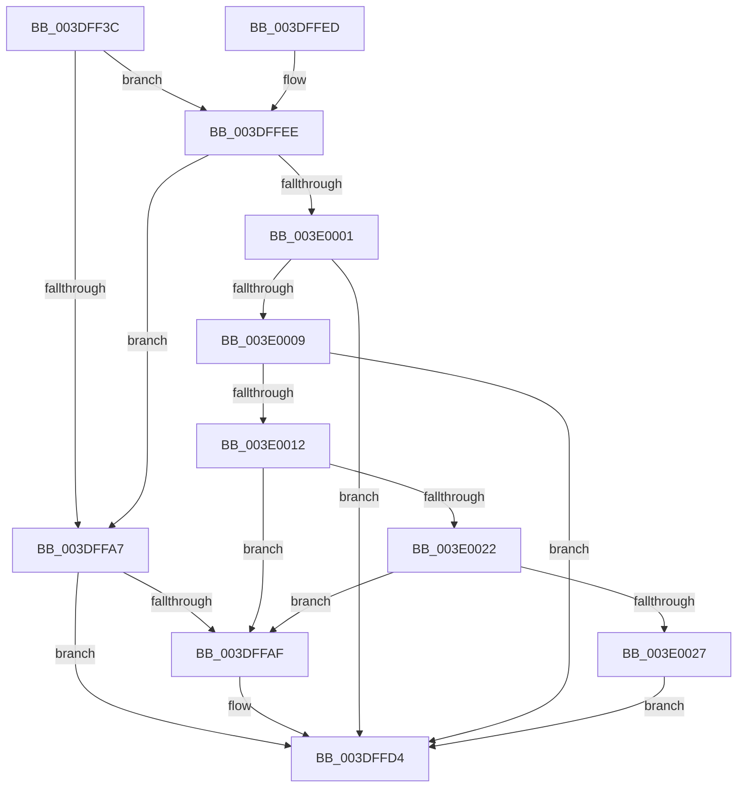

# HalpDmaFlushContiguousTransferV2

- RVA: `0x003DFF3C`–`0x003E0041` (길이 `261` bytes)
- VA: `0x00000001403DFF3C`
- 실행 섹션: `.text`
- PDB 이름 있음: `예`; PDB Function 태그: `아니요`
- unwind 정보 RVA: `0x00094914`
- 디코드: `74`개 명령, `261/261` bytes 표시
- 미해석 바이트: `0` (있으면 어셈블리에 `.byte`로 보존)

> 이 문서는 커널 이미지의 기계어와 PDB 기호를 분석해 생성했습니다. 4번과 5번은 함수 원형과 자료형을 바이너리 사용 방식에서 추정한 C 해석이며 원본 소스 복구 결과는 아닙니다.

## 1. Dependencies

- 직접 호출 지점: **4**; 고유 호출 대상: **4**
- 직접 호출자로 확인된 함수: **2**
- RIP 상대 이미지 참조: **0**

### Outgoing calls
- `0x003DFF7B` → [HalpDmaNextContiguousPiece](HalpDmaNextContiguousPiece_function_003DECB0.md) (function, `0x003DECB0`)
- `0x003DFFCF` → [HalpDmaSyncMapBuffers](HalpDmaSyncMapBuffers_function_003DEFD0.md) (function, `0x003DEFD0`)
- `0x003E0015` → [HalpDmaGetAdapterCacheAlignment](HalpDmaGetAdapterCacheAlignment_function_003DC150.md) (function, `0x003DC150`)
- `0x003E003A` → [HalpDmaFlushBuffer](HalpDmaFlushBuffer_function_003DC1DC.md) (function, `0x003DC1DC`)

### Direct callers
- [sub_003DEA82](Unknown_function_003DEA82.md) at `0x003DEA98`
- [IoFlushAdapterBuffersV2](../3E/IoFlushAdapterBuffersV2_function_003E0050.md) at `0x003E00FB`

### Static image references
- 디코드된 RIP-relative 메모리 참조가 없습니다.

## 2. Other-region calls and transfers

- 다른 실행 섹션으로 향하는 call: **0**
- 별도 외부 분기/꼬리 이동을 확인하지 못했습니다.

## 3. Assembly (complete function range)

```asm
003DFF3C  48 8B C4                        mov rax, rsp
003DFF3F  48 89 58 08                     mov qword ptr [rax + 8], rbx
003DFF43  48 89 68 10                     mov qword ptr [rax + 0x10], rbp
003DFF47  48 89 70 18                     mov qword ptr [rax + 0x18], rsi
003DFF4B  57                              push rdi
003DFF4C  41 56                           push r14
003DFF4E  41 57                           push r15
003DFF50  48 83 EC 40                     sub rsp, 0x40
003DFF54  44 8B B4 24 80 00 00 00         mov r14d, dword ptr [rsp + 0x80]
003DFF5C  4D 8B F8                        mov r15, r8
003DFF5F  40 8A AC 24 88 00 00 00         mov bpl, byte ptr [rsp + 0x88]
003DFF67  45 33 C0                        xor r8d, r8d
003DFF6A  44 89 70 D0                     mov dword ptr [rax - 0x30], r14d
003DFF6E  49 8B F9                        mov rdi, r9
003DFF71  40 88 68 C8                     mov byte ptr [rax - 0x38], bpl
003DFF75  48 8B F2                        mov rsi, rdx
003DFF78  48 8B D9                        mov rbx, rcx
003DFF7B  E8 30 ED FF FF                  call 0x1403decb0
003DFF80  48 8B CF                        mov rcx, rdi
003DFF83  48 2B 4E 20                     sub rcx, qword ptr [rsi + 0x20]
003DFF87  48 C1 E9 0C                     shr rcx, 0xc
003DFF8B  8B C9                           mov ecx, ecx
003DFF8D  4C 8B 54 CE 30                  mov r10, qword ptr [rsi + rcx*8 + 0x30]
003DFF92  48 8B CF                        mov rcx, rdi
003DFF95  81 E1 FF 0F 00 00               and ecx, 0xfff
003DFF9B  49 C1 E2 0C                     shl r10, 0xc
003DFF9F  4C 03 D1                        add r10, rcx
003DFFA2  41 3B C6                        cmp eax, r14d
003DFFA5  74 47                           je 0x1403dffee
003DFFA7  45 32 C0                        xor r8b, r8b
003DFFAA  40 84 ED                        test bpl, bpl
003DFFAD  75 25                           jne 0x1403dffd4
003DFFAF  44 88 44 24 38                  mov byte ptr [rsp + 0x38], r8b
003DFFB4  4D 8B CF                        mov r9, r15
003DFFB7  44 88 44 24 30                  mov byte ptr [rsp + 0x30], r8b
003DFFBC  48 8B D6                        mov rdx, rsi
003DFFBF  44 88 44 24 28                  mov byte ptr [rsp + 0x28], r8b
003DFFC4  48 8B CB                        mov rcx, rbx
003DFFC7  4C 8B C7                        mov r8, rdi
003DFFCA  44 89 74 24 20                  mov dword ptr [rsp + 0x20], r14d
003DFFCF  E8 FC EF FF FF                  call 0x1403defd0
003DFFD4  48 8B 5C 24 60                  mov rbx, qword ptr [rsp + 0x60]
003DFFD9  48 8B 6C 24 68                  mov rbp, qword ptr [rsp + 0x68]
003DFFDE  48 8B 74 24 70                  mov rsi, qword ptr [rsp + 0x70]
003DFFE3  48 83 C4 40                     add rsp, 0x40
003DFFE7  41 5F                           pop r15
003DFFE9  41 5E                           pop r14
003DFFEB  5F                              pop rdi
003DFFEC  C3                              ret
003DFFED  CC                              int3
003DFFEE  44 8B D8                        mov r11d, eax
003DFFF1  4D 03 DA                        add r11, r10
003DFFF4  49 8D 43 FF                     lea rax, [r11 - 1]
003DFFF8  48 39 83 90 00 00 00            cmp qword ptr [rbx + 0x90], rax
003DFFFF  72 A6                           jb 0x1403dffa7
003E0001  45 33 C0                        xor r8d, r8d
003E0004  40 84 ED                        test bpl, bpl
003E0007  75 CB                           jne 0x1403dffd4
003E0009  44 38 83 BD 01 00 00            cmp byte ptr [rbx + 0x1bd], r8b
003E0010  75 C2                           jne 0x1403dffd4
003E0012  48 8B CB                        mov rcx, rbx
003E0015  E8 36 C1 FF FF                  call 0x1403dc150
003E001A  8D 48 FF                        lea ecx, [rax - 1]
003E001D  49 85 CA                        test r10, rcx
003E0020  75 8D                           jne 0x1403dffaf
003E0022  49 85 CB                        test r11, rcx
003E0025  75 88                           jne 0x1403dffaf
003E0027  44 88 44 24 28                  mov byte ptr [rsp + 0x28], r8b
003E002C  45 8B CE                        mov r9d, r14d
003E002F  44 88 44 24 20                  mov byte ptr [rsp + 0x20], r8b
003E0034  48 8B D6                        mov rdx, rsi
003E0037  4C 8B C7                        mov r8, rdi
003E003A  E8 9D C1 FF FF                  call 0x1403dc1dc
003E003F  EB 93                           jmp 0x1403dffd4
```

## 4. C-style interpretation (structured pseudocode)

```c
__int64 __fastcall HalpDmaFlushContiguousTransferV2(__int64 a1, __int64 a2, __int64 a3, __int64 a4, unsigned int a5, unsigned __int8 a6)
{
    __int64 result;
    __int64 v_r10;
    __int64 v_r11;
    __int64 v_rsp;
    unsigned __int8 v_stack_m20;
    unsigned __int8 v_stack_m28;
    unsigned __int8 v_stack_m30;
    unsigned int v_stack_m38;
    unsigned __int64 v_stack_p10;
    unsigned __int64 v_stack_p18;
    unsigned __int8 v_stack_p20;
    unsigned __int8 v_stack_p28;
    unsigned __int64 v_stack_p8;

    *(unsigned __int64 *)(v_rsp + 8) = v_rbx;
    *(unsigned __int64 *)(v_rsp + 16) = v_rbp;
    *(unsigned __int64 *)(v_rsp + 24) = v_rsi;
    v_rsp = (v_rsp) - (64);
    a3 = 0;
    *(unsigned int *)(v_rsp - 48) = (unsigned int)((unsigned int)(a5));
    *(unsigned __int8 *)(v_rsp - 56) = a6;
    result = HalpDmaNextContiguousPiece(a1, a2, a3, a4);
    a1 = (a4) - (*(unsigned __int64 *)(a2 + 32));
    a1 = (a1) >> (12);
    a1 = (unsigned int)((a4) & (0xFFFULL));
    v_r10 = (*(unsigned __int64 *)(a2 + (unsigned int)((unsigned int)(a1)) * 8 + 48)) << (12);
    v_r10 = (v_r10) + (a1);
    if (((unsigned int)(result)) == ((unsigned int)((unsigned int)(a5)))) goto loc_003DFFEE;
loc_003DFFA7:
    a3 = 0;
    if (a6 == 0) {
        v_stack_m20 = 0;
        a4 = 0;
        v_stack_m28 = 0;
        a2 = a2;
        v_stack_m30 = 0;
        a1 = a1;
        a3 = a4;
        v_stack_m38 = (unsigned int)((unsigned int)(a5));
        result = HalpDmaSyncMapBuffers(a1, a2, a3, a4);
    }
    v_rsp = (v_rsp) + (64);
    return result;
loc_003DFFEE:
    v_r11 = ((unsigned int)((unsigned int)(result))) + (v_r10);
    if ((*(unsigned __int64 *)(v_stack_p8 + 144)) < (v_r11 - 1)) goto loc_003DFFA7;
    a3 = 0;
    if ((unsigned __int8)(v_stack_p10) != 0) goto loc_003DFFD4;
    if ((*(unsigned __int8 *)(v_stack_p8 + 445)) != 0) goto loc_003DFFD4;
    result = HalpDmaGetAdapterCacheAlignment(v_stack_p8, a2, a3, a4);
    if (((v_r10) & (result - 1)) != 0) goto loc_003DFFAF;
    if (((v_r11) & (result - 1)) != 0) goto loc_003DFFAF;
    v_stack_p28 = 0;
    v_stack_p20 = 0;
    result = HalpDmaFlushBuffer(result - 1, v_stack_p18, a4, (unsigned int)((unsigned int)((unsigned int)(a5))));
    goto loc_003DFFD4;
}
```

## 5. (Beta) C Style

```c
int64_t HalpDmaFlushContiguousTransferV2(void *Arg1, void *Arg2, int64_t Arg3, int64_t Arg4, uint32_t Arg5, uint8_t Arg6)
{
    uint8_t *arg1 = (uint8_t *)Arg1;
    uint8_t *arg2 = (uint8_t *)Arg2;

    int64_t result;
    int64_t local_r10;
    int64_t local_r11;
    int64_t local_rsp;
    uint8_t v_stack_m20;
    uint8_t v_stack_m28;
    uint8_t v_stack_m30;
    uint32_t v_stack_m38;
    uint64_t v_stack_p10;
    uint64_t v_stack_p18;
    uint8_t v_stack_p20;
    uint8_t v_stack_p28;
    uint64_t v_stack_p8;

    *(uint64_t *)(local_rsp + 0x8) = local_rbx;
    *(uint64_t *)(local_rsp + 0x10) = local_rbp;
    *(uint64_t *)(local_rsp + 0x18) = local_rsi;
    local_rsp = (local_rsp) - (64);
    Arg3 = 0;
    *(uint32_t *)(local_rsp - 0x30) = (uint32_t)((uint32_t)(Arg5));
    *(uint8_t *)(local_rsp - 0x38) = Arg6;
    result = HalpDmaNextContiguousPiece(Arg1, Arg2, Arg3, Arg4);
    Arg1 = (Arg4) - (*(uint64_t *)(arg2 + 0x20));
    Arg1 = (Arg1) >> (12);
    Arg1 = (uint32_t)((Arg4) & (0xFFFULL));
    local_r10 = (*(uint64_t *)(arg2 + (uint32_t)((uint32_t)(arg1)) * 8 + 0x30)) << (12);
    local_r10 = (local_r10) + (Arg1);
    if (((uint32_t)(result)) == ((uint32_t)((uint32_t)(Arg5)))) goto loc_003DFFEE;
loc_003DFFA7:
    Arg3 = 0;
    if (Arg6 == 0) {
        v_stack_m20 = 0;
        Arg4 = 0;
        v_stack_m28 = 0;
        Arg2 = Arg2;
        v_stack_m30 = 0;
        Arg1 = Arg1;
        Arg3 = Arg4;
        v_stack_m38 = (uint32_t)((uint32_t)(Arg5));
        result = HalpDmaSyncMapBuffers(Arg1, Arg2, Arg3, Arg4);
    }
    local_rsp = (local_rsp) + (64);
    return result;
loc_003DFFEE:
    local_r11 = ((uint32_t)((uint32_t)(result))) + (local_r10);
    if ((*(uint64_t *)(v_stack_p8 + 0x90)) < (local_r11 - 1)) goto loc_003DFFA7;
    Arg3 = 0;
    if ((uint8_t)(v_stack_p10) != 0) goto loc_003DFFD4;
    if ((*(uint8_t *)(v_stack_p8 + 0x1BD)) != 0) goto loc_003DFFD4;
    result = HalpDmaGetAdapterCacheAlignment(v_stack_p8, Arg2, Arg3, Arg4);
    if (((local_r10) & (result - 1)) != 0) goto loc_003DFFAF;
    if (((local_r11) & (result - 1)) != 0) goto loc_003DFFAF;
    v_stack_p28 = 0;
    v_stack_p20 = 0;
    result = HalpDmaFlushBuffer(result - 1, v_stack_p18, Arg4, (uint32_t)((uint32_t)((uint32_t)(Arg5))));
    goto loc_003DFFD4;
}
```

### 관측된 메모리 오프셋

구조체 형식이 확인되지 않은 접근은 인자 기준의 오프셋으로만 기록했습니다.

| 기준 인자 | 오프셋 표현 | 폭 (bit) | 접근 |
|---|---:|---:|---|
| `Arg1` | `+ 0x90` | `64` | `R` |
| `Arg1` | `+ 0x1BD` | `8` | `R` |
| `Arg2` | `+ 0x20` | `64` | `R` |
| `Arg2` | `+ 0x30 + rcx*8` | `64` | `R` |

## 6. Execution-region graph

[열기: 2D/3D 그래프와 함수 탐색 컨트롤 패널](../../../control-panel.html?section=text&rva=0x003DFF3C&view=graph)

- 2D 그래프는 위에서 아래로 흐르고, 3D 그래프는 빈 공간을 드래그해 회전합니다. Shift+드래그는 이동, 휠은 확대·축소, 함수 노드 선택은 대상 보고서 이동입니다.

### Static fallback


