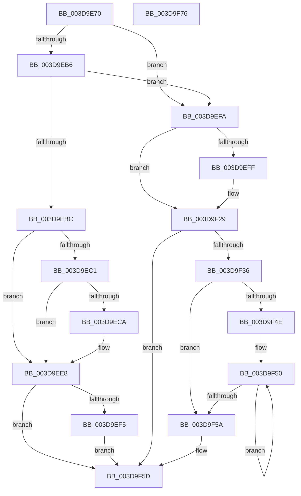

# HalpDmaFlushContiguousTransferV3

- RVA: `0x003D9E70`–`0x003D9F77` (길이 `263` bytes)
- VA: `0x00000001403D9E70`
- 실행 섹션: `.text`
- PDB 이름 있음: `예`; PDB Function 태그: `아니요`
- unwind 정보 RVA: `0x00093E28`
- 디코드: `73`개 명령, `263/263` bytes 표시
- 미해석 바이트: `0` (있으면 어셈블리에 `.byte`로 보존)

> 이 문서는 커널 이미지의 기계어와 PDB 기호를 분석해 생성했습니다. 4번과 5번은 함수 원형과 자료형을 바이너리 사용 방식에서 추정한 C 해석이며 원본 소스 복구 결과는 아닙니다.

## 1. Dependencies

- 직접 호출 지점: **3**; 고유 호출 대상: **3**
- 직접 호출자로 확인된 함수: **2**
- RIP 상대 이미지 참조: **0**

### Outgoing calls
- `0x003D9EAD` → [HalpDmaNextContiguousPiece](HalpDmaNextContiguousPiece_function_003DECB0.md) (function, `0x003DECB0`)
- `0x003D9EE3` → [HalpDmaFlushBuffer](HalpDmaFlushBuffer_function_003DC1DC.md) (function, `0x003DC1DC`)
- `0x003D9F24` → [HalpDmaSyncMapBuffers](HalpDmaSyncMapBuffers_function_003DEFD0.md) (function, `0x003DEFD0`)

### Direct callers
- [HalFlushAdapterBuffersEx](HalFlushAdapterBuffersEx_function_003DADE0.md) at `0x003DAFE8`
- [IoFlushAdapterBuffersV3](../55/IoFlushAdapterBuffersV3_function_005532C0.md) at `0x0055336A`

### Static image references
- 디코드된 RIP-relative 메모리 참조가 없습니다.

## 2. Other-region calls and transfers

- 다른 실행 섹션으로 향하는 call: **0**
- 별도 외부 분기/꼬리 이동을 확인하지 못했습니다.

## 3. Assembly (complete function range)

```asm
003D9E70  48 8B C4                        mov rax, rsp
003D9E73  48 89 58 08                     mov qword ptr [rax + 8], rbx
003D9E77  48 89 68 10                     mov qword ptr [rax + 0x10], rbp
003D9E7B  48 89 70 18                     mov qword ptr [rax + 0x18], rsi
003D9E7F  57                              push rdi
003D9E80  41 56                           push r14
003D9E82  41 57                           push r15
003D9E84  48 83 EC 40                     sub rsp, 0x40
003D9E88  8B B4 24 80 00 00 00            mov esi, dword ptr [rsp + 0x80]
003D9E8F  49 8B D8                        mov rbx, r8
003D9E92  40 8A AC 24 88 00 00 00         mov bpl, byte ptr [rsp + 0x88]
003D9E9A  45 33 C0                        xor r8d, r8d
003D9E9D  89 70 D0                        mov dword ptr [rax - 0x30], esi
003D9EA0  49 8B F9                        mov rdi, r9
003D9EA3  40 88 68 C8                     mov byte ptr [rax - 0x38], bpl
003D9EA7  4C 8B FA                        mov r15, rdx
003D9EAA  4C 8B F1                        mov r14, rcx
003D9EAD  E8 FE 4D 00 00                  call 0x1403decb0
003D9EB2  3B C6                           cmp eax, esi
003D9EB4  75 44                           jne 0x1403d9efa
003D9EB6  80 7B 40 00                     cmp byte ptr [rbx + 0x40], 0
003D9EBA  75 3E                           jne 0x1403d9efa
003D9EBC  40 84 ED                        test bpl, bpl
003D9EBF  75 27                           jne 0x1403d9ee8
003D9EC1  41 38 AE BD 01 00 00            cmp byte ptr [r14 + 0x1bd], bpl
003D9EC8  75 1E                           jne 0x1403d9ee8
003D9ECA  8A 84 24 90 00 00 00            mov al, byte ptr [rsp + 0x90]
003D9ED1  44 8B CE                        mov r9d, esi
003D9ED4  88 44 24 28                     mov byte ptr [rsp + 0x28], al
003D9ED8  4C 8B C7                        mov r8, rdi
003D9EDB  49 8B D7                        mov rdx, r15
003D9EDE  40 88 6C 24 20                  mov byte ptr [rsp + 0x20], bpl
003D9EE3  E8 F4 22 00 00                  call 0x1403dc1dc
003D9EE8  48 8B 84 24 98 00 00 00         mov rax, qword ptr [rsp + 0x98]
003D9EF0  48 85 C0                        test rax, rax
003D9EF3  74 68                           je 0x1403d9f5d
003D9EF5  48 89 18                        mov qword ptr [rax], rbx
003D9EF8  EB 63                           jmp 0x1403d9f5d
003D9EFA  40 84 ED                        test bpl, bpl
003D9EFD  75 2A                           jne 0x1403d9f29
003D9EFF  8A 84 24 90 00 00 00            mov al, byte ptr [rsp + 0x90]
003D9F06  4C 8B CB                        mov r9, rbx
003D9F09  88 44 24 38                     mov byte ptr [rsp + 0x38], al
003D9F0D  4C 8B C7                        mov r8, rdi
003D9F10  40 88 6C 24 30                  mov byte ptr [rsp + 0x30], bpl
003D9F15  49 8B D7                        mov rdx, r15
003D9F18  40 88 6C 24 28                  mov byte ptr [rsp + 0x28], bpl
003D9F1D  49 8B CE                        mov rcx, r14
003D9F20  89 74 24 20                     mov dword ptr [rsp + 0x20], esi
003D9F24  E8 A7 50 00 00                  call 0x1403defd0
003D9F29  48 8B 94 24 98 00 00 00         mov rdx, qword ptr [rsp + 0x98]
003D9F31  48 85 D2                        test rdx, rdx
003D9F34  74 27                           je 0x1403d9f5d
003D9F36  81 E7 FF 0F 00 00               and edi, 0xfff
003D9F3C  48 8D 8E FF 0F 00 00            lea rcx, [rsi + 0xfff]
003D9F43  48 03 CF                        add rcx, rdi
003D9F46  48 C1 E9 0C                     shr rcx, 0xc
003D9F4A  85 C9                           test ecx, ecx
003D9F4C  74 0C                           je 0x1403d9f5a
003D9F4E  8B C1                           mov eax, ecx
003D9F50  48 8B 5B 08                     mov rbx, qword ptr [rbx + 8]
003D9F54  48 83 E8 01                     sub rax, 1
003D9F58  75 F6                           jne 0x1403d9f50
003D9F5A  48 89 1A                        mov qword ptr [rdx], rbx
003D9F5D  48 8B 5C 24 60                  mov rbx, qword ptr [rsp + 0x60]
003D9F62  48 8B 6C 24 68                  mov rbp, qword ptr [rsp + 0x68]
003D9F67  48 8B 74 24 70                  mov rsi, qword ptr [rsp + 0x70]
003D9F6C  48 83 C4 40                     add rsp, 0x40
003D9F70  41 5F                           pop r15
003D9F72  41 5E                           pop r14
003D9F74  5F                              pop rdi
003D9F75  C3                              ret
003D9F76  CC                              int3
```

## 4. C-style interpretation (structured pseudocode)

```c
__int64 __fastcall HalpDmaFlushContiguousTransferV3(__int64 a1, __int64 a2, __int64 a3, __int64 a4, unsigned int a5, unsigned __int8 a6, unsigned __int8 a7, __int64 a8)
{
    __int64 result;
    __int64 v_rdi;
    __int64 v_rsp;
    unsigned __int8 v_stack_m20;
    unsigned __int8 v_stack_m28;
    unsigned __int8 v_stack_m30;
    unsigned __int8 v_stack_m38;
    unsigned __int64 v_stack_p10;
    unsigned __int64 v_stack_p18;
    unsigned __int64 v_stack_p8;

    *(unsigned __int64 *)(v_rsp + 8) = v_rbx;
    *(unsigned __int64 *)(v_rsp + 16) = v_rbp;
    *(unsigned __int64 *)(v_rsp + 24) = v_rsi;
    v_rsp = (v_rsp) - (64);
    a3 = 0;
    *(unsigned int *)(v_rsp - 48) = (unsigned int)((unsigned int)(a5));
    *(unsigned __int8 *)(v_rsp - 56) = a6;
    result = HalpDmaNextContiguousPiece(a1, a2, a3, a4);
    if (((unsigned int)(result)) != ((unsigned int)((unsigned int)(a5)))) goto loc_003D9EFA;
    if ((*(unsigned __int8 *)(a3 + 64)) != 0) goto loc_003D9EFA;
    if (a6 != 0) goto loc_003D9EE8;
    if ((*(unsigned __int8 *)(a1 + 445)) == a6) {
        result = a7;
        a4 = (unsigned int)((unsigned int)(a5));
        v_stack_m30 = (unsigned __int8)(result);
        a3 = a4;
        a2 = a2;
        v_stack_m38 = a6;
        result = HalpDmaFlushBuffer(a1, a2, a3, a4);
    }
    if (a8 == 0) goto loc_003D9F5D;
    *(unsigned __int64 *)(a8) = a3;
    goto loc_003D9F5D;
loc_003D9EFA:
    result = a8;
    if (a6 == 0) {
        result = a7;
        a4 = a3;
        v_stack_m20 = (unsigned __int8)(result);
        a3 = a4;
        v_stack_m28 = a6;
        a2 = a2;
        v_stack_m30 = a6;
        a1 = a1;
        v_stack_m38 = (unsigned int)((unsigned int)(a5));
        result = HalpDmaSyncMapBuffers(a1, a2, a3, a4);
    }
    if (a8 == 0) goto loc_003D9F5D;
    v_rdi = (unsigned int)((a4) & (0xFFFULL));
    a1 = ((unsigned int)(a5) + 4095) + (v_rdi);
    a1 = (a1) >> (12);
    if ((unsigned int)(a1) == 0) goto loc_003D9F5A;
loc_003D9F50:
    result = ((unsigned int)((unsigned int)(a1))) - (1);
    if (condition_is_not_equal) goto loc_003D9F50;
loc_003D9F5A:
    *(unsigned __int64 *)(a8) = *(unsigned __int64 *)(a3 + 8);
loc_003D9F5D:
    v_rsp = (v_rsp) + (64);
    return result;
}
```

## 5. (Beta) C Style

```c
int64_t HalpDmaFlushContiguousTransferV3(void *Arg1, int64_t Arg2, void *Arg3, int64_t Arg4, void *Arg5, uint8_t Arg6, uint8_t Arg7, int64_t Arg8)
{
    uint8_t *arg1 = (uint8_t *)Arg1;
    uint8_t *arg3 = (uint8_t *)Arg3;
    uint8_t *arg5 = (uint8_t *)Arg5;

    int64_t result;
    int64_t local_rdi;
    int64_t local_rsp;
    uint8_t v_stack_m20;
    uint8_t v_stack_m28;
    uint8_t v_stack_m30;
    uint8_t v_stack_m38;
    uint64_t v_stack_p10;
    uint64_t v_stack_p18;
    uint64_t v_stack_p8;

    *(uint64_t *)(local_rsp + 0x8) = local_rbx;
    *(uint64_t *)(local_rsp + 0x10) = local_rbp;
    *(uint64_t *)(local_rsp + 0x18) = local_rsi;
    local_rsp = (local_rsp) - (64);
    Arg3 = 0;
    *(uint32_t *)(local_rsp - 0x30) = (uint32_t)((uint32_t)(Arg5));
    *(uint8_t *)(local_rsp - 0x38) = Arg6;
    result = HalpDmaNextContiguousPiece(Arg1, Arg2, Arg3, Arg4);
    if (((uint32_t)(result)) != ((uint32_t)((uint32_t)(Arg5)))) goto loc_003D9EFA;
    if ((*(uint8_t *)(arg3 + 0x40)) != 0) goto loc_003D9EFA;
    if (Arg6 != 0) goto loc_003D9EE8;
    if ((*(uint8_t *)(arg1 + 0x1BD)) == Arg6) {
        result = Arg7;
        Arg4 = (uint32_t)((uint32_t)(Arg5));
        v_stack_m30 = (uint8_t)(result);
        Arg3 = Arg4;
        Arg2 = Arg2;
        v_stack_m38 = Arg6;
        result = HalpDmaFlushBuffer(Arg1, Arg2, Arg3, Arg4);
    }
    if (Arg8 == 0) goto loc_003D9F5D;
    *(void **)(Arg8) = Arg3;
    goto loc_003D9F5D;
loc_003D9EFA:
    result = Arg8;
    if (Arg6 == 0) {
        result = Arg7;
        Arg4 = Arg3;
        v_stack_m20 = (uint8_t)(result);
        Arg3 = Arg4;
        v_stack_m28 = Arg6;
        Arg2 = Arg2;
        v_stack_m30 = Arg6;
        Arg1 = Arg1;
        v_stack_m38 = (uint32_t)((uint32_t)(Arg5));
        result = HalpDmaSyncMapBuffers(Arg1, Arg2, Arg3, Arg4);
    }
    if (Arg8 == 0) goto loc_003D9F5D;
    local_rdi = (uint32_t)((Arg4) & (0xFFFULL));
    Arg1 = ((uint32_t)(Arg5) + 4095) + (local_rdi);
    Arg1 = (Arg1) >> (12);
    if ((uint32_t)(Arg1) == 0) goto loc_003D9F5A;
loc_003D9F50:
    result = ((uint32_t)((uint32_t)(Arg1))) - (1);
    if (condition_is_not_equal) goto loc_003D9F50;
loc_003D9F5A:
    *(uint64_t *)(Arg8) = *(uint64_t *)(arg3 + 0x8);
loc_003D9F5D:
    local_rsp = (local_rsp) + (64);
    return result;
}
```

### 관측된 메모리 오프셋

구조체 형식이 확인되지 않은 접근은 인자 기준의 오프셋으로만 기록했습니다.

| 기준 인자 | 오프셋 표현 | 폭 (bit) | 접근 |
|---|---:|---:|---|
| `Arg1` | `+ 0x1BD` | `8` | `R` |
| `Arg3` | `+ 0x40` | `8` | `R` |
| `Arg5` | `+ 0xFFF` | `64` | `R` |

## 6. Execution-region graph

[열기: 2D/3D 그래프와 함수 탐색 컨트롤 패널](../../../control-panel.html?section=text&rva=0x003D9E70&view=graph)

- 2D 그래프는 위에서 아래로 흐르고, 3D 그래프는 빈 공간을 드래그해 회전합니다. Shift+드래그는 이동, 휠은 확대·축소, 함수 노드 선택은 대상 보고서 이동입니다.

### Static fallback


