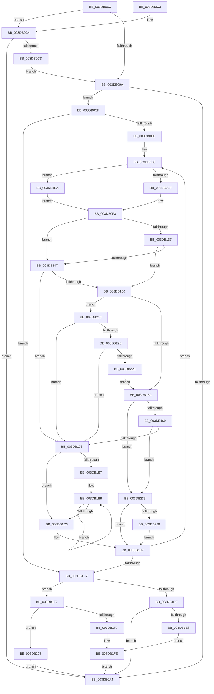

# HalpDmaFlushScatterTransferV3

- RVA: `0x003DB06C`–`0x003DB255` (길이 `489` bytes)
- VA: `0x00000001403DB06C`
- 실행 섹션: `.text`
- PDB 이름 있음: `예`; PDB Function 태그: `아니요`
- unwind 정보 RVA: `0x00093FF0`
- 디코드: `127`개 명령, `489/489` bytes 표시
- 미해석 바이트: `0` (있으면 어셈블리에 `.byte`로 보존)

> 이 문서는 커널 이미지의 기계어와 PDB 기호를 분석해 생성했습니다. 4번과 5번은 함수 원형과 자료형을 바이너리 사용 방식에서 추정한 C 해석이며 원본 소스 복구 결과는 아닙니다.

## 1. Dependencies

- 직접 호출 지점: **4**; 고유 호출 대상: **4**
- 직접 호출자로 확인된 함수: **2**
- RIP 상대 이미지 참조: **1**

### Outgoing calls
- `0x003DB105` → [HalpDmaNextContiguousPiece](HalpDmaNextContiguousPiece_function_003DECB0.md) (function, `0x003DECB0`)
- `0x003DB193` → [HalpDmaSyncMapBuffers](HalpDmaSyncMapBuffers_function_003DEFD0.md) (function, `0x003DEFD0`)
- `0x003DB213` → [HalpDmaGetAdapterCacheAlignment](HalpDmaGetAdapterCacheAlignment_function_003DC150.md) (function, `0x003DC150`)
- `0x003DB24B` → [HalpDmaFlushBuffer](HalpDmaFlushBuffer_function_003DC1DC.md) (function, `0x003DC1DC`)

### Direct callers
- [HalFlushAdapterBuffersEx](HalFlushAdapterBuffersEx_function_003DADE0.md) at `0x003DAF6A`
- [IoFlushAdapterBuffersV3](../55/IoFlushAdapterBuffersV3_function_005532C0.md) at `0x00553371`

### Static image references
- `0x003DB12E` → RVA `0x00FC18A0` (`.data`; read)

## 2. Other-region calls and transfers

- 다른 실행 섹션으로 향하는 call: **0**
- 별도 외부 분기/꼬리 이동을 확인하지 못했습니다.

## 3. Assembly (complete function range)

```asm
003DB06C  48 8B C4                        mov rax, rsp
003DB06F  48 89 58 08                     mov qword ptr [rax + 8], rbx
003DB073  48 89 68 10                     mov qword ptr [rax + 0x10], rbp
003DB077  48 89 70 18                     mov qword ptr [rax + 0x18], rsi
003DB07B  48 89 78 20                     mov qword ptr [rax + 0x20], rdi
003DB07F  41 54                           push r12
003DB081  41 56                           push r14
003DB083  41 57                           push r15
003DB085  48 83 EC 40                     sub rsp, 0x40
003DB089  4D 8B F1                        mov r14, r9
003DB08C  49 8B D8                        mov rbx, r8
003DB08F  4C 8B FA                        mov r15, rdx
003DB092  48 8B F9                        mov rdi, rcx
003DB095  4D 85 C0                        test r8, r8
003DB098  74 2A                           je 0x1403db0c4
003DB09A  80 BC 24 88 00 00 00 00         cmp byte ptr [rsp + 0x88], 0
003DB0A2  74 2B                           je 0x1403db0cf
003DB0A4  48 8B 5C 24 60                  mov rbx, qword ptr [rsp + 0x60]
003DB0A9  48 8B 6C 24 68                  mov rbp, qword ptr [rsp + 0x68]
003DB0AE  48 8B 74 24 70                  mov rsi, qword ptr [rsp + 0x70]
003DB0B3  48 8B 7C 24 78                  mov rdi, qword ptr [rsp + 0x78]
003DB0B8  48 83 C4 40                     add rsp, 0x40
003DB0BC  41 5F                           pop r15
003DB0BE  41 5E                           pop r14
003DB0C0  41 5C                           pop r12
003DB0C2  C3                              ret
003DB0C3  CC                              int3
003DB0C4  80 B9 BD 01 00 00 00            cmp byte ptr [rcx + 0x1bd], 0
003DB0CB  75 D7                           jne 0x1403db0a4
003DB0CD  EB CB                           jmp 0x1403db09a
003DB0CF  8B AC 24 80 00 00 00            mov ebp, dword ptr [rsp + 0x80]
003DB0D6  85 ED                           test ebp, ebp
003DB0D8  0F 84 F4 00 00 00               je 0x1403db1d2
003DB0DE  44 8A A4 24 90 00 00 00         mov r12b, byte ptr [rsp + 0x90]
003DB0E6  48 85 DB                        test rbx, rbx
003DB0E9  0F 84 FB 00 00 00               je 0x1403db1ea
003DB0EF  4C 8B 43 38                     mov r8, qword ptr [rbx + 0x38]
003DB0F3  89 6C 24 28                     mov dword ptr [rsp + 0x28], ebp
003DB0F7  4D 8B CE                        mov r9, r14
003DB0FA  49 8B D7                        mov rdx, r15
003DB0FD  C6 44 24 20 00                  mov byte ptr [rsp + 0x20], 0
003DB102  48 8B CF                        mov rcx, rdi
003DB105  E8 A6 3B 00 00                  call 0x1403decb0
003DB10A  49 8B CE                        mov rcx, r14
003DB10D  8B F0                           mov esi, eax
003DB10F  49 2B 4F 20                     sub rcx, qword ptr [r15 + 0x20]
003DB113  48 C1 E9 0C                     shr rcx, 0xc
003DB117  8B C9                           mov ecx, ecx
003DB119  4D 8B 44 CF 30                  mov r8, qword ptr [r15 + rcx*8 + 0x30]
003DB11E  49 8B CE                        mov rcx, r14
003DB121  81 E1 FF 0F 00 00               and ecx, 0xfff
003DB127  49 C1 E0 0C                     shl r8, 0xc
003DB12B  4C 03 C1                        add r8, rcx
003DB12E  80 3D 6B 67 BE 00 00            cmp byte ptr [rip + 0xbe676b], 0
003DB135  75 10                           jne 0x1403db147
003DB137  48 8D 4E FF                     lea rcx, [rsi - 1]
003DB13B  49 03 C8                        add rcx, r8
003DB13E  48 39 8F 90 00 00 00            cmp qword ptr [rdi + 0x90], rcx
003DB145  73 09                           jae 0x1403db150
003DB147  83 BF 08 02 00 00 03            cmp dword ptr [rdi + 0x208], 3
003DB14E  75 23                           jne 0x1403db173
003DB150  44 8A 8F BD 01 00 00            mov r9b, byte ptr [rdi + 0x1bd]
003DB157  45 84 C9                        test r9b, r9b
003DB15A  0F 84 B0 00 00 00               je 0x1403db210
003DB160  48 85 DB                        test rbx, rbx
003DB163  0F 84 CA 00 00 00               je 0x1403db233
003DB169  80 7B 40 00                     cmp byte ptr [rbx + 0x40], 0
003DB16D  0F 84 C0 00 00 00               je 0x1403db233
003DB173  4C 8B 4B 38                     mov r9, qword ptr [rbx + 0x38]
003DB177  4D 8B C6                        mov r8, r14
003DB17A  44 88 64 24 38                  mov byte ptr [rsp + 0x38], r12b
003DB17F  49 8B D7                        mov rdx, r15
003DB182  C6 44 24 30 00                  mov byte ptr [rsp + 0x30], 0
003DB187  48 8B CF                        mov rcx, rdi
003DB18A  C6 44 24 28 00                  mov byte ptr [rsp + 0x28], 0
003DB18F  89 74 24 20                     mov dword ptr [rsp + 0x20], esi
003DB193  E8 38 3E 00 00                  call 0x1403defd0
003DB198  48 8B 43 38                     mov rax, qword ptr [rbx + 0x38]
003DB19C  48 8D 96 FF 0F 00 00            lea rdx, [rsi + 0xfff]
003DB1A3  49 8B CE                        mov rcx, r14
003DB1A6  81 E1 FF 0F 00 00               and ecx, 0xfff
003DB1AC  48 03 D1                        add rdx, rcx
003DB1AF  48 C1 EA 0C                     shr rdx, 0xc
003DB1B3  85 D2                           test edx, edx
003DB1B5  74 0C                           je 0x1403db1c3
003DB1B7  8B CA                           mov ecx, edx
003DB1B9  48 8B 40 08                     mov rax, qword ptr [rax + 8]
003DB1BD  48 83 E9 01                     sub rcx, 1
003DB1C1  75 F6                           jne 0x1403db1b9
003DB1C3  48 89 43 38                     mov qword ptr [rbx + 0x38], rax
003DB1C7  4C 03 F6                        add r14, rsi
003DB1CA  2B EE                           sub ebp, esi
003DB1CC  0F 85 14 FF FF FF               jne 0x1403db0e6
003DB1D2  48 8B 8C 24 98 00 00 00         mov rcx, qword ptr [rsp + 0x98]
003DB1DA  48 85 C9                        test rcx, rcx
003DB1DD  75 13                           jne 0x1403db1f2
003DB1DF  48 85 DB                        test rbx, rbx
003DB1E2  0F 84 BC FE FF FF               je 0x1403db0a4
003DB1E8  EB 14                           jmp 0x1403db1fe
003DB1EA  45 33 C0                        xor r8d, r8d
003DB1ED  E9 01 FF FF FF                  jmp 0x1403db0f3
003DB1F2  48 85 DB                        test rbx, rbx
003DB1F5  74 10                           je 0x1403db207
003DB1F7  48 8B 43 38                     mov rax, qword ptr [rbx + 0x38]
003DB1FB  48 89 01                        mov qword ptr [rcx], rax
003DB1FE  48 89 5B 38                     mov qword ptr [rbx + 0x38], rbx
003DB202  E9 9D FE FF FF                  jmp 0x1403db0a4
003DB207  48 83 21 00                     and qword ptr [rcx], 0
003DB20B  E9 94 FE FF FF                  jmp 0x1403db0a4
003DB210  48 8B CF                        mov rcx, rdi
003DB213  E8 38 0F 00 00                  call 0x1403dc150
003DB218  8D 48 FF                        lea ecx, [rax - 1]
003DB21B  8B C1                           mov eax, ecx
003DB21D  49 85 C0                        test r8, rax
003DB220  0F 85 4D FF FF FF               jne 0x1403db173
003DB226  85 CE                           test esi, ecx
003DB228  0F 85 45 FF FF FF               jne 0x1403db173
003DB22E  E9 2D FF FF FF                  jmp 0x1403db160
003DB233  45 84 C9                        test r9b, r9b
003DB236  75 8F                           jne 0x1403db1c7
003DB238  44 88 64 24 28                  mov byte ptr [rsp + 0x28], r12b
003DB23D  4D 8B C6                        mov r8, r14
003DB240  44 88 4C 24 20                  mov byte ptr [rsp + 0x20], r9b
003DB245  49 8B D7                        mov rdx, r15
003DB248  44 8B CE                        mov r9d, esi
003DB24B  E8 8C 0F 00 00                  call 0x1403dc1dc
003DB250  E9 72 FF FF FF                  jmp 0x1403db1c7
```

## 4. C-style interpretation (structured pseudocode)

```c
__int64 __fastcall HalpDmaFlushScatterTransferV3(__int64 a1, __int64 a2, __int64 a3, __int64 a4, unsigned int a5, unsigned __int8 a6, unsigned __int8 a7, __int64 a8)
{
    __int64 result;
    __int64 v_r14;
    __int64 v_rbp;
    __int64 v_rsp;
    unsigned __int64 v_stack_p10;
    unsigned __int64 v_stack_p18;
    unsigned __int64 v_stack_p20;
    unsigned int v_stack_p28;
    unsigned __int8 v_stack_p30;
    unsigned __int8 v_stack_p38;
    unsigned __int64 v_stack_p8;

    *(unsigned __int64 *)(v_rsp + 8) = v_rbx;
    *(unsigned __int64 *)(v_rsp + 16) = v_rbp;
    *(unsigned __int64 *)(v_rsp + 24) = v_rsi;
    *(unsigned __int64 *)(v_rsp + 32) = v_rdi;
    v_rsp = (v_rsp) - (64);
    if (a3 == 0) goto loc_003DB0C4;
loc_003DB09A:
    if (a6 == 0) goto loc_003DB0CF;
loc_003DB0A4:
    v_rsp = (v_rsp) + (64);
    return v_rsp;
loc_003DB0C4:
    if ((*(unsigned __int8 *)(a1 + 445)) != 0) goto loc_003DB0A4;
    goto loc_003DB09A;
loc_003DB0CF:
    if ((unsigned int)((unsigned int)(a5)) == 0) goto loc_003DB1D2;
loc_003DB0E6:
    if (v_stack_p8 == 0) goto loc_003DB1EA;
loc_003DB0F3:
    v_stack_p28 = (unsigned int)((unsigned int)(a5));
    v_stack_p20 = 0;
    result = HalpDmaNextContiguousPiece(v_stack_p20, a2, *(unsigned __int64 *)(v_stack_p8 + 56), a4);
    a1 = (a4) - (*(unsigned __int64 *)(a2 + 32));
    a1 = (a1) >> (12);
    a1 = (unsigned int)((a4) & (0xFFFULL));
    a3 = (*(unsigned __int64 *)(a2 + (unsigned int)((unsigned int)(a1)) * 8 + 48)) << (12);
    a3 = (a3) + (a1);
    if ((*(unsigned __int8 *)(v_rip + 12478315)) != 0) goto loc_003DB147;
    a1 = ((unsigned int)((unsigned int)(result)) - 1) + (a3);
    if ((*(unsigned __int64 *)(v_stack_p20 + 144)) >= a1) goto loc_003DB150;
loc_003DB147:
    if ((*(unsigned int *)(v_stack_p20 + 520)) != 3) goto loc_003DB173;
loc_003DB150:
    if ((unsigned __int8)(*(unsigned __int8 *)(v_stack_p20 + 445)) == 0) goto loc_003DB210;
loc_003DB160:
    if (v_stack_p8 == 0) goto loc_003DB233;
    if ((*(unsigned __int8 *)(v_stack_p8 + 64)) == 0) goto loc_003DB233;
loc_003DB173:
    v_stack_p38 = a7;
    v_stack_p30 = 0;
    v_stack_p28 = 0;
    v_stack_p20 = (unsigned int)((unsigned int)((unsigned int)(result)));
    result = HalpDmaSyncMapBuffers(v_stack_p20, a2, a4, *(unsigned __int64 *)(v_stack_p8 + 56));
    a1 = (unsigned int)((a4) & (0xFFFULL));
    a2 = ((unsigned int)((unsigned int)(result)) + 4095) + (a1);
    a2 = (a2) >> (12);
    if ((unsigned int)(a2) == 0) goto loc_003DB1C3;
loc_003DB1B9:
    a1 = ((unsigned int)((unsigned int)(a2))) - (1);
    if (condition_is_not_equal) goto loc_003DB1B9;
loc_003DB1C3:
    *(unsigned __int64 *)(v_stack_p8 + 56) = *(unsigned __int64 *)(*(unsigned __int64 *)(v_stack_p8 + 56) + 8);
loc_003DB1C7:
    v_r14 = (a4) + ((unsigned int)((unsigned int)(result)));
    v_rbp = (unsigned int)(((unsigned int)(a5)) - ((unsigned int)((unsigned int)((unsigned int)(result)))));
    if (condition_is_not_equal) goto loc_003DB0E6;
loc_003DB1D2:
    if (a8 != 0) goto loc_003DB1F2;
    if (v_stack_p8 == 0) goto loc_003DB0A4;
    goto loc_003DB1FE;
loc_003DB1EA:
    a3 = 0;
    goto loc_003DB0F3;
loc_003DB1F2:
    if (v_stack_p8 == 0) goto loc_003DB207;
    *(unsigned __int64 *)(a8) = *(unsigned __int64 *)(v_stack_p8 + 56);
loc_003DB1FE:
    *(unsigned __int64 *)(v_stack_p8 + 56) = v_stack_p8;
    goto loc_003DB0A4;
loc_003DB207:
    goto loc_003DB0A4;
loc_003DB210:
    result = HalpDmaGetAdapterCacheAlignment(v_stack_p20, a2, a3, *(unsigned __int64 *)(v_stack_p8 + 56));
    if (((0) & ((unsigned int)((unsigned int)(result - 1)))) != 0) goto loc_003DB173;
    if ((((unsigned int)((unsigned int)((unsigned int)(result)))) & ((unsigned int)(result - 1))) != 0) goto loc_003DB173;
    goto loc_003DB160;
loc_003DB233:
    if ((unsigned __int8)(*(unsigned __int64 *)(v_stack_p8 + 56)) != 0) goto loc_003DB1C7;
    v_stack_p28 = a7;
    v_stack_p20 = (unsigned __int8)(*(unsigned __int64 *)(v_stack_p8 + 56));
    result = HalpDmaFlushBuffer(result - 1, a2, v_r14, (unsigned int)((unsigned int)((unsigned int)((unsigned int)(result)))));
    goto loc_003DB1C7;
}
```

## 5. (Beta) C Style

```c
int64_t HalpDmaFlushScatterTransferV3(void *Arg1, void *Arg2, int64_t Arg3, int64_t Arg4, uint32_t Arg5, uint8_t Arg6, uint8_t Arg7, int64_t Arg8)
{
    uint8_t *arg1 = (uint8_t *)Arg1;
    uint8_t *arg2 = (uint8_t *)Arg2;

    int64_t result;
    int64_t local_r14;
    int64_t local_rbp;
    int64_t local_rsp;
    uint64_t v_stack_p10;
    uint64_t v_stack_p18;
    uint64_t v_stack_p20;
    uint32_t v_stack_p28;
    uint8_t v_stack_p30;
    uint8_t v_stack_p38;
    uint64_t v_stack_p8;

    *(uint64_t *)(local_rsp + 0x8) = local_rbx;
    *(uint64_t *)(local_rsp + 0x10) = local_rbp;
    *(uint64_t *)(local_rsp + 0x18) = local_rsi;
    *(uint64_t *)(local_rsp + 0x20) = local_rdi;
    local_rsp = (local_rsp) - (64);
    if (Arg3 == 0) goto loc_003DB0C4;
loc_003DB09A:
    if (Arg6 == 0) goto loc_003DB0CF;
loc_003DB0A4:
    local_rsp = (local_rsp) + (64);
    return local_rsp;
loc_003DB0C4:
    if ((*(uint8_t *)(arg1 + 0x1BD)) != 0) goto loc_003DB0A4;
    goto loc_003DB09A;
loc_003DB0CF:
    if ((uint32_t)((uint32_t)(Arg5)) == 0) goto loc_003DB1D2;
loc_003DB0E6:
    if (v_stack_p8 == 0) goto loc_003DB1EA;
loc_003DB0F3:
    v_stack_p28 = (uint32_t)((uint32_t)(Arg5));
    v_stack_p20 = 0;
    result = HalpDmaNextContiguousPiece(v_stack_p20, Arg2, *(uint64_t *)(v_stack_p8 + 0x38), Arg4);
    Arg1 = (Arg4) - (*(uint64_t *)(arg2 + 0x20));
    Arg1 = (Arg1) >> (12);
    Arg1 = (uint32_t)((Arg4) & (0xFFFULL));
    Arg3 = (*(uint64_t *)(arg2 + (uint32_t)((uint32_t)(arg1)) * 8 + 0x30)) << (12);
    Arg3 = (Arg3) + (Arg1);
    if ((*(uint8_t *)(v_rip + 0xBE676B)) != 0) goto loc_003DB147;
    Arg1 = ((uint32_t)((uint32_t)(result)) - 1) + (Arg3);
    if ((*(uint64_t *)(v_stack_p20 + 0x90)) >= Arg1) goto loc_003DB150;
loc_003DB147:
    if ((*(uint32_t *)(v_stack_p20 + 0x208)) != 3) goto loc_003DB173;
loc_003DB150:
    if ((uint8_t)(*(uint8_t *)(v_stack_p20 + 0x1BD)) == 0) goto loc_003DB210;
loc_003DB160:
    if (v_stack_p8 == 0) goto loc_003DB233;
    if ((*(uint8_t *)(v_stack_p8 + 0x40)) == 0) goto loc_003DB233;
loc_003DB173:
    v_stack_p38 = Arg7;
    v_stack_p30 = 0;
    v_stack_p28 = 0;
    v_stack_p20 = (uint32_t)((uint32_t)((uint32_t)(result)));
    result = HalpDmaSyncMapBuffers(v_stack_p20, Arg2, Arg4, *(uint64_t *)(v_stack_p8 + 0x38));
    Arg1 = (uint32_t)((Arg4) & (0xFFFULL));
    Arg2 = ((uint32_t)((uint32_t)(result)) + 4095) + (Arg1);
    Arg2 = (Arg2) >> (12);
    if ((uint32_t)(Arg2) == 0) goto loc_003DB1C3;
loc_003DB1B9:
    Arg1 = ((uint32_t)((uint32_t)(Arg2))) - (1);
    if (condition_is_not_equal) goto loc_003DB1B9;
loc_003DB1C3:
    *(uint64_t *)(v_stack_p8 + 0x38) = *(uint64_t *)(*(uint64_t *)(v_stack_p8 + 0x38) + 0x8);
loc_003DB1C7:
    local_r14 = (Arg4) + ((uint32_t)((uint32_t)(result)));
    local_rbp = (uint32_t)(((uint32_t)(Arg5)) - ((uint32_t)((uint32_t)((uint32_t)(result)))));
    if (condition_is_not_equal) goto loc_003DB0E6;
loc_003DB1D2:
    if (Arg8 != 0) goto loc_003DB1F2;
    if (v_stack_p8 == 0) goto loc_003DB0A4;
    goto loc_003DB1FE;
loc_003DB1EA:
    Arg3 = 0;
    goto loc_003DB0F3;
loc_003DB1F2:
    if (v_stack_p8 == 0) goto loc_003DB207;
    *(uint64_t *)(Arg8) = *(uint64_t *)(v_stack_p8 + 0x38);
loc_003DB1FE:
    *(uint64_t *)(v_stack_p8 + 0x38) = v_stack_p8;
    goto loc_003DB0A4;
loc_003DB207:
    goto loc_003DB0A4;
loc_003DB210:
    result = HalpDmaGetAdapterCacheAlignment(v_stack_p20, Arg2, Arg3, *(uint64_t *)(v_stack_p8 + 0x38));
    if (((0) & ((uint32_t)((uint32_t)(result - 1)))) != 0) goto loc_003DB173;
    if ((((uint32_t)((uint32_t)((uint32_t)(result)))) & ((uint32_t)(result - 1))) != 0) goto loc_003DB173;
    goto loc_003DB160;
loc_003DB233:
    if ((uint8_t)(*(uint64_t *)(v_stack_p8 + 0x38)) != 0) goto loc_003DB1C7;
    v_stack_p28 = Arg7;
    v_stack_p20 = (uint8_t)(*(uint64_t *)(v_stack_p8 + 0x38));
    result = HalpDmaFlushBuffer(result - 1, Arg2, local_r14, (uint32_t)((uint32_t)((uint32_t)((uint32_t)(result)))));
    goto loc_003DB1C7;
}
```

### 관측된 메모리 오프셋

구조체 형식이 확인되지 않은 접근은 인자 기준의 오프셋으로만 기록했습니다.

| 기준 인자 | 오프셋 표현 | 폭 (bit) | 접근 |
|---|---:|---:|---|
| `Arg1` | `+ 0x90` | `64` | `R` |
| `Arg1` | `+ 0x1BD` | `8` | `R` |
| `Arg1` | `+ 0x208` | `32` | `R` |
| `Arg2` | `+ 0x20` | `64` | `R` |
| `Arg2` | `+ 0x30 + rcx*8` | `64` | `R` |

## 6. Execution-region graph

[열기: 2D/3D 그래프와 함수 탐색 컨트롤 패널](../../../control-panel.html?section=text&rva=0x003DB06C&view=graph)

- 2D 그래프는 위에서 아래로 흐르고, 3D 그래프는 빈 공간을 드래그해 회전합니다. Shift+드래그는 이동, 휠은 확대·축소, 함수 노드 선택은 대상 보고서 이동입니다.

### Static fallback


