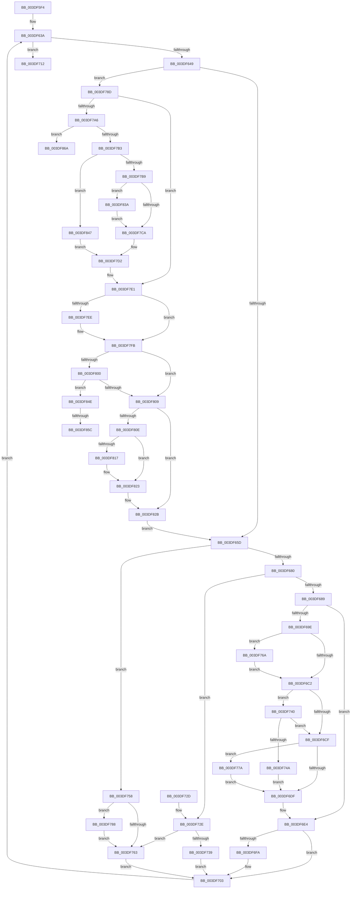

# HalpDmaFreeMapRegisters

- RVA: `0x003DF5F4`–`0x003DF889` (길이 `661` bytes)
- VA: `0x00000001403DF5F4`
- 실행 섹션: `.text`
- PDB 이름 있음: `예`; PDB Function 태그: `예`
- unwind 정보 RVA: `0x00094844`
- 디코드: `177`개 명령, `661/661` bytes 표시
- 미해석 바이트: `0` (있으면 어셈블리에 `.byte`로 보존)

> 이 문서는 커널 이미지의 기계어와 PDB 기호를 분석해 생성했습니다. 4번과 5번은 함수 원형과 자료형을 바이너리 사용 방식에서 추정한 C 해석이며 원본 소스 복구 결과는 아닙니다.

## 1. Dependencies

- 직접 호출 지점: **12**; 고유 호출 대상: **11**
- 직접 호출자로 확인된 함수: **6**
- RIP 상대 이미지 참조: **3**

### Outgoing calls
- `0x003DF6FE` → [KeReleaseInStackQueuedSpinLock](../34/KeReleaseInStackQueuedSpinLock_function_00342CE0.md) (function, `0x00342CE0`)
- `0x003DF739` → [HalpDmaReturnToScatterPool](HalpDmaReturnToScatterPool_function_003DFD00.md) (function, `0x003DFD00`)
- `0x003DF751` → [KiAcquireQueuedSpinLockInstrumented](../27/KiAcquireQueuedSpinLockInstrumented_function_00275850.md) (function, `0x00275850`)
- `0x003DF763` → [HalpDmaReturnToContiguousPool](../3E/HalpDmaReturnToContiguousPool_function_003E1758.md) (function, `0x003E1758`)
- `0x003DF770` → [KiRaiseIrqlProcessIrqlFlags](../4F/KiRaiseIrqlProcessIrqlFlags_function_004F56FC.md) (function, `0x004F56FC`)
- `0x003DF77E` → [KxWaitForLockOwnerShip](../25/KxWaitForLockOwnerShip_function_00257EB0.md) (function, `0x00257EB0`)
- `0x003DF7DC` → [HalpDmaAcquireBufferMappings](HalpDmaAcquireBufferMappings_function_003DF38C.md) (function, `0x003DF38C`)
- `0x003DF7F6` → [memset](../6C/memset_function_006C6C40.md) (function, `0x006C6C40`)
- `0x003DF81E` → [KiLowerIrqlProcessIrqlFlags](../4F/KiLowerIrqlProcessIrqlFlags_function_004F5698.md) (function, `0x004F5698`)
- `0x003DF840` → [KiRaiseIrqlProcessIrqlFlags](../4F/KiRaiseIrqlProcessIrqlFlags_function_004F56FC.md) (function, `0x004F56FC`)
- `0x003DF85F` → [MmUnmapLockedPages](../24/MmUnmapLockedPages_function_00246E60.md) (function, `0x00246E60`)
- `0x003DF883` → [KeBugCheckEx](../4F/KeBugCheckEx_function_004FD660.md) (function, `0x004FD660`)

### Direct callers
- [IoFreeMapRegistersV3](IoFreeMapRegistersV3_function_003DAAD0.md) at `0x003DAB22`
- [IoFreeMapRegistersV2](IoFreeMapRegistersV2_function_003DF440.md) at `0x003DF492`
- [HalpDmaProcessMapRegisterQueueV2](HalpDmaProcessMapRegisterQueueV2_function_003DF50C.md) at `0x003DF5DD`
- [HalDmaAllocateCrashDumpRegistersEx](../53/HalDmaAllocateCrashDumpRegistersEx_function_0053F6D0.md) at `0x0053F8F4`
- [HalDmaAllocateCrashDumpRegistersEx](../53/HalDmaAllocateCrashDumpRegistersEx_function_0053F6D0.md) at `0x0053F921`
- [HalDmaAllocateCrashDumpRegistersEx](../53/HalDmaAllocateCrashDumpRegistersEx_function_0053F6D0.md) at `0x0053F9C1`
- [HalpDmaFreeCrashDumpRegisters](../53/HalpDmaFreeCrashDumpRegisters_function_0053FE10.md) at `0x0053FE5C`
- [sub_006FC1F6](../6F/Unknown_function_006FC1F6.md) at `0x006FC24F`

### Static image references
- `0x003DF6B6` → RVA `0x00FC6D20` (`ALMOSTRO`; read)
- `0x003DF6C2` → RVA `0x00FC6B06` (`ALMOSTRO`; read)
- `0x003DF740` → RVA `0x00F0DE58` (`.data`; read)

## 2. Other-region calls and transfers

- 다른 실행 섹션으로 향하는 call: **0**
- call이 아닌 외부 분기/꼬리 이동: **2**
  - `0x003DF856` → [sub_006EA71E](../6E/Unknown_function_006EA71E.md) (`tail-transfer`)
  - `0x003DF865` → [sub_006EA71E + 0x45](../6E/Unknown_function_006EA71E.md) (`tail-transfer`)

## 3. Assembly (complete function range)

```asm
003DF5F4  48 89 5C 24 08                  mov qword ptr [rsp + 8], rbx
003DF5F9  44 89 44 24 18                  mov dword ptr [rsp + 0x18], r8d
003DF5FE  55                              push rbp
003DF5FF  56                              push rsi
003DF600  57                              push rdi
003DF601  41 54                           push r12
003DF603  41 55                           push r13
003DF605  41 56                           push r14
003DF607  41 57                           push r15
003DF609  48 8B EC                        mov rbp, rsp
003DF60C  48 81 EC 80 00 00 00            sub rsp, 0x80
003DF613  0F 57 C0                        xorps xmm0, xmm0
003DF616  4C 8B F9                        mov r15, rcx
003DF619  33 C9                           xor ecx, ecx
003DF61B  41 8B C0                        mov eax, r8d
003DF61E  4C 8B EA                        mov r13, rdx
003DF621  48 89 4D F8                     mov qword ptr [rbp - 8], rcx
003DF625  0F 11 45 C8                     movups xmmword ptr [rbp - 0x38], xmm0
003DF629  48 8B DA                        mov rbx, rdx
003DF62C  45 33 E4                        xor r12d, r12d
003DF62F  8D 79 01                        lea edi, [rcx + 1]
003DF632  0F 11 45 D8                     movups xmmword ptr [rbp - 0x28], xmm0
003DF636  0F 11 45 E8                     movups xmmword ptr [rbp - 0x18], xmm0
003DF63A  41 B8 02 00 00 00               mov r8d, 2
003DF640  44 3B E0                        cmp r12d, eax
003DF643  0F 83 C9 00 00 00               jae 0x1403df712
003DF649  48 8B 43 08                     mov rax, qword ptr [rbx + 8]
003DF64D  48 89 45 58                     mov qword ptr [rbp + 0x58], rax
003DF651  48 8B 43 30                     mov rax, qword ptr [rbx + 0x30]
003DF655  A8 20                           test al, 0x20
003DF657  0F 85 30 01 00 00               jne 0x1403df78d
003DF65D  48 8B 53 30                     mov rdx, qword ptr [rbx + 0x30]
003DF661  49 8B 8F A0 00 00 00            mov rcx, qword ptr [r15 + 0xa0]
003DF668  48 8B C2                        mov rax, rdx
003DF66B  83 E0 04                        and eax, 4
003DF66E  48 89 5B 38                     mov qword ptr [rbx + 0x38], rbx
003DF672  41 80 BF BA 01 00 00 00         cmp byte ptr [r15 + 0x1ba], 0
003DF67A  0F 84 D8 00 00 00               je 0x1403df758
003DF680  48 85 C0                        test rax, rax
003DF683  0F 85 A5 00 00 00               jne 0x1403df72e
003DF689  0F 57 C0                        xorps xmm0, xmm0
003DF68C  48 89 45 C0                     mov qword ptr [rbp - 0x40], rax
003DF690  0F 11 45 B0                     movups xmmword ptr [rbp - 0x50], xmm0
003DF694  45 0F 20 C6                     mov r14, cr8
003DF698  41 80 FE 0F                     cmp r14b, 0xf
003DF69C  74 46                           je 0x1403df6e4
003DF69E  48 21 45 B0                     and qword ptr [rbp - 0x50], rax
003DF6A2  49 8D BF 80 00 00 00            lea rdi, [r15 + 0x80]
003DF6A9  48 89 7D B8                     mov qword ptr [rbp - 0x48], rdi
003DF6AD  90                              nop
003DF6AE  44 0F 20 C6                     mov rsi, cr8
003DF6B2  45 0F 22 C0                     mov cr8, r8
003DF6B6  39 05 64 76 BE 00               cmp dword ptr [rip + 0xbe7664], eax
003DF6BC  0F 85 A8 00 00 00               jne 0x1403df76a
003DF6C2  F6 05 3D 74 BE 00 21            test byte ptr [rip + 0xbe743d], 0x21
003DF6C9  40 88 75 C0                     mov byte ptr [rbp - 0x40], sil
003DF6CD  75 71                           jne 0x1403df740
003DF6CF  48 8D 55 B0                     lea rdx, [rbp - 0x50]
003DF6D3  48 87 17                        xchg qword ptr [rdi], rdx
003DF6D6  48 85 D2                        test rdx, rdx
003DF6D9  0F 85 9B 00 00 00               jne 0x1403df77a
003DF6DF  BF 01 00 00 00                  mov edi, 1
003DF6E4  49 8B 47 20                     mov rax, qword ptr [r15 + 0x20]
003DF6E8  48 89 43 08                     mov qword ptr [rbx + 8], rax
003DF6EC  41 01 7F 28                     add dword ptr [r15 + 0x28], edi
003DF6F0  49 89 5F 20                     mov qword ptr [r15 + 0x20], rbx
003DF6F4  41 80 FE 0F                     cmp r14b, 0xf
003DF6F8  74 09                           je 0x1403df703
003DF6FA  48 8D 4D B0                     lea rcx, [rbp - 0x50]
003DF6FE  E8 DD 35 F6 FF                  call 0x140342ce0
003DF703  48 8B 5D 58                     mov rbx, qword ptr [rbp + 0x58]
003DF707  44 03 E7                        add r12d, edi
003DF70A  8B 45 50                        mov eax, dword ptr [rbp + 0x50]
003DF70D  E9 28 FF FF FF                  jmp 0x1403df63a
003DF712  48 8B 9C 24 C0 00 00 00         mov rbx, qword ptr [rsp + 0xc0]
003DF71A  48 81 C4 80 00 00 00            add rsp, 0x80
003DF721  41 5F                           pop r15
003DF723  41 5E                           pop r14
003DF725  41 5D                           pop r13
003DF727  41 5C                           pop r12
003DF729  5F                              pop rdi
003DF72A  5E                              pop rsi
003DF72B  5D                              pop rbp
003DF72C  C3                              ret
003DF72D  CC                              int3
003DF72E  45 33 C0                        xor r8d, r8d
003DF731  F6 C2 08                        test dl, 8
003DF734  48 8B D3                        mov rdx, rbx
003DF737  74 2A                           je 0x1403df763
003DF739  E8 C2 05 00 00                  call 0x1403dfd00
003DF73E  EB C3                           jmp 0x1403df703
003DF740  8B 05 12 E7 B2 00               mov eax, dword ptr [rip + 0xb2e712]
003DF746  85 C0                           test eax, eax
003DF748  75 85                           jne 0x1403df6cf
003DF74A  48 8B D7                        mov rdx, rdi
003DF74D  48 8D 4D B0                     lea rcx, [rbp - 0x50]
003DF751  E8 FA 60 E9 FF                  call 0x140275850
003DF756  EB 87                           jmp 0x1403df6df
003DF758  45 33 C0                        xor r8d, r8d
003DF75B  48 8B D3                        mov rdx, rbx
003DF75E  48 85 C0                        test rax, rax
003DF761  74 25                           je 0x1403df788
003DF763  E8 F0 1F 00 00                  call 0x1403e1758
003DF768  EB 99                           jmp 0x1403df703
003DF76A  41 8A D0                        mov dl, r8b
003DF76D  40 8A CE                        mov cl, sil
003DF770  E8 87 5F 11 00                  call 0x1404f56fc
003DF775  E9 48 FF FF FF                  jmp 0x1403df6c2
003DF77A  48 8D 4D B0                     lea rcx, [rbp - 0x50]
003DF77E  E8 2D 87 E7 FF                  call 0x140257eb0
003DF783  E9 57 FF FF FF                  jmp 0x1403df6df
003DF788  49 8B CF                        mov rcx, r15
003DF78B  EB D6                           jmp 0x1403df763
003DF78D  48 83 E0 DF                     and rax, 0xffffffffffffffdf
003DF791  40 32 F6                        xor sil, sil
003DF794  45 32 F6                        xor r14b, r14b
003DF797  48 89 43 30                     mov qword ptr [rbx + 0x30], rax
003DF79B  40 32 FF                        xor dil, dil
003DF79E  48 A9 00 F0 FF FF               test rax, -0x1000
003DF7A4  75 3B                           jne 0x1403df7e1
003DF7A6  44 0F 20 C7                     mov rdi, cr8
003DF7AA  41 3A F8                        cmp dil, r8b
003DF7AD  0F 87 B7 00 00 00               ja 0x1403df86a
003DF7B3  0F 83 8E 00 00 00               jae 0x1403df847
003DF7B9  44 0F 20 C7                     mov rdi, cr8
003DF7BD  45 0F 22 C0                     mov cr8, r8
003DF7C1  83 3D 58 75 BE 00 00            cmp dword ptr [rip + 0xbe7558], 0
003DF7C8  75 70                           jne 0x1403df83a
003DF7CA  BE 01 00 00 00                  mov esi, 1
003DF7CF  44 8A F6                        mov r14b, sil
003DF7D2  4C 8D 4D C8                     lea r9, [rbp - 0x38]
003DF7D6  44 8B C6                        mov r8d, esi
003DF7D9  48 8B D3                        mov rdx, rbx
003DF7DC  E8 AB FB FF FF                  call 0x1403df38c
003DF7E1  48 8B 4B 30                     mov rcx, qword ptr [rbx + 0x30]
003DF7E5  48 81 E1 00 F0 FF FF            and rcx, 0xfffffffffffff000
003DF7EC  74 0D                           je 0x1403df7fb
003DF7EE  33 D2                           xor edx, edx
003DF7F0  41 B8 00 10 00 00               mov r8d, 0x1000
003DF7F6  E8 45 74 2E 00                  call 0x1406c6c40
003DF7FB  40 84 F6                        test sil, sil
003DF7FE  74 09                           je 0x1403df809
003DF800  4C 8B 45 C8                     mov r8, qword ptr [rbp - 0x38]
003DF804  4D 85 C0                        test r8, r8
003DF807  75 45                           jne 0x1403df84e
003DF809  45 84 F6                        test r14b, r14b
003DF80C  74 1D                           je 0x1403df82b
003DF80E  83 3D 0B 75 BE 00 00            cmp dword ptr [rip + 0xbe750b], 0
003DF815  74 0C                           je 0x1403df823
003DF817  44 0F 20 C1                     mov rcx, cr8
003DF81B  40 8A D7                        mov dl, dil
003DF81E  E8 75 5E 11 00                  call 0x1404f5698
003DF823  40 0F B6 C7                     movzx eax, dil
003DF827  44 0F 22 C0                     mov cr8, rax
003DF82B  41 B8 02 00 00 00               mov r8d, 2
003DF831  41 8D 78 FF                     lea edi, [r8 - 1]
003DF835  E9 23 FE FF FF                  jmp 0x1403df65d
003DF83A  41 8A D0                        mov dl, r8b
003DF83D  40 8A CF                        mov cl, dil
003DF840  E8 B7 5E 11 00                  call 0x1404f56fc
003DF845  EB 83                           jmp 0x1403df7ca
003DF847  BE 01 00 00 00                  mov esi, 1
003DF84C  EB 84                           jmp 0x1403df7d2
003DF84E  80 7D F8 00                     cmp byte ptr [rbp - 8], 0
003DF852  48 8B 4D D0                     mov rcx, qword ptr [rbp - 0x30]
003DF856  0F 85 C2 AE 30 00               jne 0x1406ea71e
003DF85C  49 8B D0                        mov rdx, r8
003DF85F  E8 FC 75 E6 FF                  call 0x140246e60
003DF864  90                              nop
003DF865  E9 F9 AE 30 00                  jmp 0x1406ea763
003DF86A  48 83 64 24 20 00               and qword ptr [rsp + 0x20], 0
003DF870  45 33 C9                        xor r9d, r9d
003DF873  BA 00 10 00 00                  mov edx, 0x1000
003DF878  B9 AC 00 00 00                  mov ecx, 0xac
003DF87D  41 B8 03 EF 00 00               mov r8d, 0xef03
003DF883  E8 D8 DD 11 00                  call 0x1404fd660
003DF888  CC                              int3
```

## 4. C-style interpretation (structured pseudocode)

```c
__int64 __fastcall HalpDmaFreeMapRegisters(__int64 a1, __int64 a2, int a3)
{
    __int64 result;
    __int64 v_r12;
    __int64 v_r14;
    __int64 v_rdi;
    __int64 v_rsi;
    __int64 v_rsp;
    unsigned __int64 v_stack_m40;
    unsigned __int64 v_stack_m50;
    unsigned __int64 v_stack_m60;
    unsigned __int64 v_stack_m68;
    unsigned __int64 v_stack_m70;
    unsigned __int64 v_stack_m78;
    unsigned __int64 v_stack_m80;
    unsigned __int64 v_stack_m88;
    unsigned int v_stack_p18;
    unsigned __int64 v_stack_p20;
    unsigned __int64 v_stack_p8;

    v_stack_p8 = v_rbx;
    v_stack_p18 = a3;
    v_rsp = (v_rsp) - (128);
    a1 = 0;
    v_stack_m40 = 0;
    v_stack_m70 = v_xmm0;
    v_r12 = 0;
    v_stack_m60 = v_xmm0;
    v_stack_m50 = v_xmm0;
loc_003DF63A:
    if (0 >= ((unsigned int)((unsigned int)(a3)))) goto loc_003DF712;
    v_stack_p20 = *(unsigned __int64 *)(a2 + 8);
    if ((((unsigned __int8)(*(unsigned __int64 *)(a2 + 48))) & (32)) != 0) goto loc_003DF78D;
loc_003DF65D:
    result = (unsigned int)((*(unsigned __int64 *)(a2 + 48)) & (4));
    *(unsigned __int64 *)(a2 + 56) = a2;
    if ((*(unsigned __int8 *)(a1 + 442)) == 0) goto loc_003DF758;
    if (result != 0) goto loc_003DF72E;
    v_stack_m78 = result;
    v_stack_m88 = v_xmm0;
    if (((unsigned __int8)(v_cr8)) == 15) goto loc_003DF6E4;
    v_stack_m80 = a1 + 128;
    if ((*(unsigned int *)(v_rip + 12482148)) != ((unsigned int)(result))) goto loc_003DF76A;
loc_003DF6C2:
    v_stack_m78 = (unsigned __int8)(v_cr8);
    if (((*(unsigned __int8 *)(v_rip + 12481597)) & (33)) != 0) goto loc_003DF740;
loc_003DF6CF:
    if (v_stack_m88 != 0) goto loc_003DF77A;
loc_003DF6DF:
loc_003DF6E4:
    *(unsigned __int64 *)(a2 + 8) = *(unsigned __int64 *)(a1 + 32);
    *(unsigned __int64 *)(a1 + 32) = a2;
    result = *(unsigned __int64 *)(a1 + 32);
    if (((unsigned __int8)(v_cr8)) != 15) {
        a1 = v_stack_m88;
        result = KeReleaseInStackQueuedSpinLock(a1, v_stack_m88, 2, a4);
    }
    v_r12 = (unsigned int)((v_r12) + (1));
    goto loc_003DF63A;
loc_003DF712:
    v_rsp = (v_rsp) + (128);
    return (unsigned int)(v_stack_p18);
loc_003DF72E:
    a3 = 0;
    if ((((unsigned __int8)(v_stack_m88)) & (8)) == 0) goto loc_003DF763;
    result = HalpDmaReturnToScatterPool(a1, v_stack_p8, a3, a4);
    goto loc_003DF703;
loc_003DF740:
    if ((unsigned int)((unsigned int)(*(unsigned int *)(v_rip + 11724562))) != 0) goto loc_003DF6CF;
    result = KiAcquireQueuedSpinLockInstrumented(v_stack_m88, 1, a3, a4);
    goto loc_003DF6DF;
loc_003DF758:
    a3 = 0;
    if (result == 0) goto loc_003DF788;
loc_003DF763:
    result = HalpDmaReturnToContiguousPool(v_stack_m88, v_stack_p8, a3, a4);
    goto loc_003DF703;
loc_003DF76A:
    result = KiRaiseIrqlProcessIrqlFlags((unsigned __int8)(v_cr8), 0, a3, a4);
    goto loc_003DF6C2;
loc_003DF77A:
    result = KxWaitForLockOwnerShip(v_stack_m88, 0, a3, a4);
    goto loc_003DF6DF;
loc_003DF788:
    goto loc_003DF763;
loc_003DF78D:
    result = (result) & (-33);
    v_rsi = 0;
    v_r14 = 0;
    *(unsigned __int64 *)(v_stack_p8 + 48) = result;
    v_rdi = 0;
    if (((result) & (0xFFFFFFFFFFFFF000ULL)) != 0) goto loc_003DF7E1;
    if (2 > 0) goto loc_003DF86A;
    if (2 >= 0) goto loc_003DF847;
    if ((*(unsigned int *)(v_rip + 12481880)) != 0) goto loc_003DF83A;
loc_003DF7CA:
loc_003DF7D2:
    result = HalpDmaAcquireBufferMappings(a1, v_stack_p8, 1, v_stack_m70);
loc_003DF7E1:
    a1 = (*(unsigned __int64 *)(v_stack_p8 + 48)) & (0xFFFFFFFFFFFFF000ULL);
    if (!(condition_is_equal)) {
        a2 = 0;
        a3 = 0x1000ULL;
        result = memset(a1, a2, a3, v_stack_m70);
    }
    if (1 == 0) goto loc_003DF809;
    if (v_stack_m70 != 0) goto loc_003DF84E;
loc_003DF809:
    if (1 == 0) goto loc_003DF82B;
    if ((*(unsigned int *)(v_rip + 12481803)) != 0) {
        a1 = 0;
        a2 = 2;
        result = KiLowerIrqlProcessIrqlFlags(a1, a2, v_stack_m70, v_stack_m70);
    }
loc_003DF82B:
    goto loc_003DF65D;
loc_003DF83A:
    result = KiRaiseIrqlProcessIrqlFlags((unsigned __int8)(2 - 1), 2, 2, v_stack_m70);
    goto loc_003DF7CA;
loc_003DF847:
    goto loc_003DF7D2;
loc_003DF84E:
    result = MmUnmapLockedPages(v_stack_m68, 2, 2, v_stack_m70);
loc_003DF86A:
    a4 = 0;
    result = KeBugCheckEx(172, (unsigned int)(0x1000ULL), (unsigned int)(0xEF03ULL), a4);
    return result;
}
```

## 5. (Beta) C Style

```c
int64_t HalpDmaFreeMapRegisters(void *Arg1, int64_t Arg2, int32_t Arg3)
{
    uint8_t *arg1 = (uint8_t *)Arg1;

    int64_t result;
    int64_t local_r12;
    int64_t local_r14;
    int64_t local_rdi;
    int64_t local_rsi;
    int64_t local_rsp;
    uint64_t v_stack_m40;
    uint64_t v_stack_m50;
    uint64_t v_stack_m60;
    uint64_t v_stack_m68;
    uint64_t v_stack_m70;
    uint64_t v_stack_m78;
    uint64_t v_stack_m80;
    uint64_t v_stack_m88;
    uint32_t v_stack_p18;
    uint64_t v_stack_p20;
    uint64_t v_stack_p8;

    v_stack_p8 = local_rbx;
    v_stack_p18 = Arg3;
    local_rsp = (local_rsp) - (128);
    Arg1 = 0;
    v_stack_m40 = 0;
    v_stack_m70 = v_xmm0;
    local_r12 = 0;
    v_stack_m60 = v_xmm0;
    v_stack_m50 = v_xmm0;
loc_003DF63A:
    if (0 >= ((uint32_t)((uint32_t)(Arg3)))) goto loc_003DF712;
    v_stack_p20 = *(uint64_t *)(Arg2 + 0x8);
    if ((((uint8_t)(*(uint64_t *)(Arg2 + 0x30))) & (32)) != 0) goto loc_003DF78D;
loc_003DF65D:
    result = (uint32_t)((*(uint64_t *)(Arg2 + 0x30)) & (4));
    *(uint64_t *)(Arg2 + 0x38) = Arg2;
    if ((*(uint8_t *)(arg1 + 0x1BA)) == 0) goto loc_003DF758;
    if (result != 0) goto loc_003DF72E;
    v_stack_m78 = result;
    v_stack_m88 = v_xmm0;
    if (((uint8_t)(v_cr8)) == 15) goto loc_003DF6E4;
    v_stack_m80 = Arg1 + 128;
    if ((*(uint32_t *)(v_rip + 0xBE7664)) != ((uint32_t)(result))) goto loc_003DF76A;
loc_003DF6C2:
    v_stack_m78 = (uint8_t)(v_cr8);
    if (((*(uint8_t *)(v_rip + 0xBE743D)) & (33)) != 0) goto loc_003DF740;
loc_003DF6CF:
    if (v_stack_m88 != 0) goto loc_003DF77A;
loc_003DF6DF:
loc_003DF6E4:
    *(uint64_t *)(Arg2 + 0x8) = *(uint64_t *)(arg1 + 0x20);
    *(uint64_t *)(arg1 + 0x20) = Arg2;
    result = *(uint64_t *)(arg1 + 0x20);
    if (((uint8_t)(v_cr8)) != 15) {
        Arg1 = v_stack_m88;
        result = KeReleaseInStackQueuedSpinLock(Arg1, v_stack_m88, 2, a4);
    }
    local_r12 = (uint32_t)((local_r12) + (1));
    goto loc_003DF63A;
loc_003DF712:
    local_rsp = (local_rsp) + (128);
    return (uint32_t)(v_stack_p18);
loc_003DF72E:
    Arg3 = 0;
    if ((((uint8_t)(v_stack_m88)) & (8)) == 0) goto loc_003DF763;
    result = HalpDmaReturnToScatterPool(Arg1, v_stack_p8, Arg3, a4);
    goto loc_003DF703;
loc_003DF740:
    if ((uint32_t)((uint32_t)(*(uint32_t *)(v_rip + 0xB2E712))) != 0) goto loc_003DF6CF;
    result = KiAcquireQueuedSpinLockInstrumented(v_stack_m88, 1, Arg3, a4);
    goto loc_003DF6DF;
loc_003DF758:
    Arg3 = 0;
    if (result == 0) goto loc_003DF788;
loc_003DF763:
    result = HalpDmaReturnToContiguousPool(v_stack_m88, v_stack_p8, Arg3, a4);
    goto loc_003DF703;
loc_003DF76A:
    result = KiRaiseIrqlProcessIrqlFlags((uint8_t)(v_cr8), 0, Arg3, a4);
    goto loc_003DF6C2;
loc_003DF77A:
    result = KxWaitForLockOwnerShip(v_stack_m88, 0, Arg3, a4);
    goto loc_003DF6DF;
loc_003DF788:
    goto loc_003DF763;
loc_003DF78D:
    result = (result) & (-33);
    local_rsi = 0;
    local_r14 = 0;
    *(uint64_t *)(v_stack_p8 + 0x30) = result;
    local_rdi = 0;
    if (((result) & (0xFFFFFFFFFFFFF000ULL)) != 0) goto loc_003DF7E1;
    if (2 > 0) goto loc_003DF86A;
    if (2 >= 0) goto loc_003DF847;
    if ((*(uint32_t *)(v_rip + 0xBE7558)) != 0) goto loc_003DF83A;
loc_003DF7CA:
loc_003DF7D2:
    result = HalpDmaAcquireBufferMappings(Arg1, v_stack_p8, 1, v_stack_m70);
loc_003DF7E1:
    Arg1 = (*(uint64_t *)(v_stack_p8 + 0x30)) & (0xFFFFFFFFFFFFF000ULL);
    if (!(condition_is_equal)) {
        Arg2 = 0;
        Arg3 = 0x1000ULL;
        result = memset(Arg1, Arg2, Arg3, v_stack_m70);
    }
    if (1 == 0) goto loc_003DF809;
    if (v_stack_m70 != 0) goto loc_003DF84E;
loc_003DF809:
    if (1 == 0) goto loc_003DF82B;
    if ((*(uint32_t *)(v_rip + 0xBE750B)) != 0) {
        Arg1 = 0;
        Arg2 = 2;
        result = KiLowerIrqlProcessIrqlFlags(Arg1, Arg2, v_stack_m70, v_stack_m70);
    }
loc_003DF82B:
    goto loc_003DF65D;
loc_003DF83A:
    result = KiRaiseIrqlProcessIrqlFlags((uint8_t)(2 - 1), 2, 2, v_stack_m70);
    goto loc_003DF7CA;
loc_003DF847:
    goto loc_003DF7D2;
loc_003DF84E:
    result = MmUnmapLockedPages(v_stack_m68, 2, 2, v_stack_m70);
loc_003DF86A:
    a4 = 0;
    result = KeBugCheckEx(172, (uint32_t)(0x1000ULL), (uint32_t)(0xEF03ULL), a4);
    return result;
}
```

### 관측된 메모리 오프셋

구조체 형식이 확인되지 않은 접근은 인자 기준의 오프셋으로만 기록했습니다.

| 기준 인자 | 오프셋 표현 | 폭 (bit) | 접근 |
|---|---:|---:|---|
| `Arg1` | `+ 0x0` | `64` | `R/W` |
| `Arg1` | `+ 0x20` | `64` | `R` |
| `Arg1` | `+ 0x20` | `64` | `W` |
| `Arg1` | `+ 0x28` | `32` | `R/W` |
| `Arg1` | `+ 0x80` | `64` | `R` |
| `Arg1` | `+ 0xA0` | `64` | `R` |
| `Arg1` | `+ 0x1BA` | `8` | `R` |

## 6. Execution-region graph

[열기: 2D/3D 그래프와 함수 탐색 컨트롤 패널](../../../control-panel.html?section=text&rva=0x003DF5F4&view=graph)

- 2D 그래프는 위에서 아래로 흐르고, 3D 그래프는 빈 공간을 드래그해 회전합니다. Shift+드래그는 이동, 휠은 확대·축소, 함수 노드 선택은 대상 보고서 이동입니다.

### Static fallback


