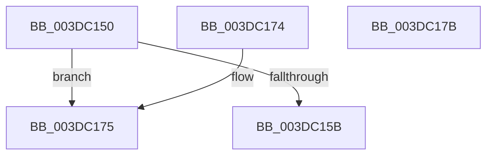

# HalpDmaGetAdapterCacheAlignment

- RVA: `0x003DC150`–`0x003DC17C` (길이 `44` bytes)
- VA: `0x00000001403DC150`
- 실행 섹션: `.text`
- PDB 이름 있음: `예`; PDB Function 태그: `아니요`
- unwind 정보 RVA: `0x000DB714`
- 디코드: `13`개 명령, `44/44` bytes 표시
- 미해석 바이트: `0` (있으면 어셈블리에 `.byte`로 보존)

> 이 문서는 커널 이미지의 기계어와 PDB 기호를 분석해 생성했습니다. 4번과 5번은 함수 원형과 자료형을 바이너리 사용 방식에서 추정한 C 해석이며 원본 소스 복구 결과는 아닙니다.

## 1. Dependencies

- 직접 호출 지점: **0**; 고유 호출 대상: **0**
- 직접 호출자로 확인된 함수: **15**
- RIP 상대 이미지 참조: **1**

### Outgoing calls
- 직접 디코드된 call 명령이 없습니다.

### Direct callers
- [HalFlushAdapterBuffersEx](HalFlushAdapterBuffersEx_function_003DADE0.md) at `0x003DAFA8`
- [HalpDmaFlushScatterTransferV3](HalpDmaFlushScatterTransferV3_function_003DB06C.md) at `0x003DB213`
- [HalpDmaCheckMdlAccessibility](HalpDmaCheckMdlAccessibility_function_003DB8A0.md) at `0x003DB96A`
- [sub_003DC0D3](Unknown_function_003DC0D3.md) at `0x003DC0D6`
- [IoMapTransferInternal](IoMapTransferInternal_function_003DC910.md) at `0x003DCBD2`
- [IopMapTransfer](IopMapTransfer_function_003DCD80.md) at `0x003DD03A`
- [sub_003DE181](Unknown_function_003DE181.md) at `0x003DE280`
- [sub_003DEA82](Unknown_function_003DEA82.md) at `0x003DEC06`
- [HalpDmaNextContiguousPieceV3](HalpDmaNextContiguousPieceV3_function_003DECFC.md) at `0x003DEF11`
- [HalpDmaNextContiguousPieceV3](HalpDmaNextContiguousPieceV3_function_003DECFC.md) at `0x003DEF5E`
- [HalpDmaNextContiguousPieceV3](HalpDmaNextContiguousPieceV3_function_003DECFC.md) at `0x003DEF95`
- [HalpDmaMapContiguousTransferV2](HalpDmaMapContiguousTransferV2_function_003DFDF4.md) at `0x003DFEF1`
- [HalpDmaFlushContiguousTransferV2](HalpDmaFlushContiguousTransferV2_function_003DFF3C.md) at `0x003E0015`
- [IoFlushAdapterBuffersV2](../3E/IoFlushAdapterBuffersV2_function_003E0050.md) at `0x003E01F5`
- [HalpDmaMapScatterTransferV3](../4A/HalpDmaMapScatterTransferV3_function_004A1EDC.md) at `0x004A2087`
- [HalpDmaSyncMapBuffersWithEmergencyResources](../4D/HalpDmaSyncMapBuffersWithEmergencyResources_function_004DE714.md) at `0x004DE750`
- [HalpFlushMapBuffers](../55/HalpFlushMapBuffers_function_00551358.md) at `0x00551380`

### Static image references
- `0x003DC16A` → RVA `0x00E0A778` (`.data`; read)

## 2. Other-region calls and transfers

- 다른 실행 섹션으로 향하는 call: **0**
- 별도 외부 분기/꼬리 이동을 확인하지 못했습니다.

## 3. Assembly (complete function range)

```asm
003DC150  8B 81 9C 00 00 00               mov eax, dword ptr [rcx + 0x9c]
003DC156  83 F8 02                        cmp eax, 2
003DC159  74 1A                           je 0x1403dc175
003DC15B  83 F8 03                        cmp eax, 3
003DC15E  BA 01 00 00 00                  mov edx, 1
003DC163  80 B9 BD 01 00 00 00            cmp byte ptr [rcx + 0x1bd], 0
003DC16A  8B 05 08 E6 A2 00               mov eax, dword ptr [rip + 0xa2e608]
003DC170  0F 45 C2                        cmovne eax, edx
003DC173  C3                              ret
003DC174  CC                              int3
003DC175  B8 01 00 00 00                  mov eax, 1
003DC17A  C3                              ret
003DC17B  CC                              int3
```

## 4. C-style interpretation (structured pseudocode)

```c
__int64 __fastcall HalpDmaGetAdapterCacheAlignment(__int64 a1)
{
    __int64 result;

    if (((unsigned int)((unsigned int)(*(unsigned int *)(a1 + 156)))) == 2) goto loc_003DC175;
    result = (unsigned int)(*(unsigned int *)(v_rip + 10675720));
    if ((*(unsigned __int8 *)(a1 + 445)) != 0) { result = 1; }
    return result;
loc_003DC175:
    return 1;
}
```

## 5. (Beta) C Style

```c
int64_t HalpDmaGetAdapterCacheAlignment(void *Arg1)
{
    uint8_t *arg1 = (uint8_t *)Arg1;

    int64_t result;

    if (((uint32_t)((uint32_t)(*(uint32_t *)(arg1 + 0x9C)))) == 2) goto loc_003DC175;
    result = (uint32_t)(*(uint32_t *)(v_rip + 0xA2E608));
    if ((*(uint8_t *)(arg1 + 0x1BD)) != 0) { result = 1; }
    return result;
loc_003DC175:
    return 1;
}
```

### 관측된 메모리 오프셋

구조체 형식이 확인되지 않은 접근은 인자 기준의 오프셋으로만 기록했습니다.

| 기준 인자 | 오프셋 표현 | 폭 (bit) | 접근 |
|---|---:|---:|---|
| `Arg1` | `+ 0x9C` | `32` | `R` |
| `Arg1` | `+ 0x1BD` | `8` | `R` |

## 6. Execution-region graph

[열기: 2D/3D 그래프와 함수 탐색 컨트롤 패널](../../../control-panel.html?section=text&rva=0x003DC150&view=graph)

- 2D 그래프는 위에서 아래로 흐르고, 3D 그래프는 빈 공간을 드래그해 회전합니다. Shift+드래그는 이동, 휠은 확대·축소, 함수 노드 선택은 대상 보고서 이동입니다.

### Static fallback


