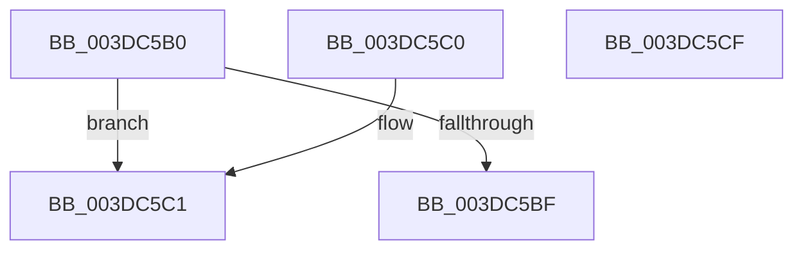

# HalpDmaGetMasterAdapterVersion

- RVA: `0x003DC5B0`–`0x003DC5D0` (길이 `32` bytes)
- VA: `0x00000001403DC5B0`
- 실행 섹션: `.text`
- PDB 이름 있음: `예`; PDB Function 태그: `아니요`
- unwind 정보 RVA: `0x000DB714`
- 디코드: `12`개 명령, `32/32` bytes 표시
- 미해석 바이트: `0` (있으면 어셈블리에 `.byte`로 보존)

> 이 문서는 커널 이미지의 기계어와 PDB 기호를 분석해 생성했습니다. 4번과 5번은 함수 원형과 자료형을 바이너리 사용 방식에서 추정한 C 해석이며 원본 소스 복구 결과는 아닙니다.

## 1. Dependencies

- 직접 호출 지점: **0**; 고유 호출 대상: **0**
- 직접 호출자로 확인된 함수: **3**
- RIP 상대 이미지 참조: **0**

### Outgoing calls
- 직접 디코드된 call 명령이 없습니다.

### Direct callers
- [HalpDmaAllocateScatterPagesFromContiguousPool](HalpDmaAllocateScatterPagesFromContiguousPool_function_003DC184.md) at `0x003DC18E`
- [HalpDmaAllocateScatterPagesFromScatterPool](HalpDmaAllocateScatterPagesFromScatterPool_function_003DC3EC.md) at `0x003DC415`
- [HalpDmaAllocateMapRegisters](HalpDmaAllocateMapRegisters_function_003DDA0C.md) at `0x003DDCA2`

### Static image references
- 디코드된 RIP-relative 메모리 참조가 없습니다.

## 2. Other-region calls and transfers

- 다른 실행 섹션으로 향하는 call: **0**
- 별도 외부 분기/꼬리 이동을 확인하지 못했습니다.

## 3. Assembly (complete function range)

```asm
003DC5B0  8B 91 9C 00 00 00               mov edx, dword ptr [rcx + 0x9c]
003DC5B6  B8 02 00 00 00                  mov eax, 2
003DC5BB  3B D0                           cmp edx, eax
003DC5BD  75 02                           jne 0x1403dc5c1
003DC5BF  C3                              ret
003DC5C0  CC                              int3
003DC5C1  83 C8 FF                        or eax, 0xffffffff
003DC5C4  B9 03 00 00 00                  mov ecx, 3
003DC5C9  3B D1                           cmp edx, ecx
003DC5CB  0F 44 C1                        cmove eax, ecx
003DC5CE  C3                              ret
003DC5CF  CC                              int3
```

## 4. C-style interpretation (structured pseudocode)

```c
__int64 __fastcall HalpDmaGetMasterAdapterVersion(__int64 a1)
{
    __int64 result;

    if (((unsigned int)((unsigned int)(*(unsigned int *)(a1 + 156)))) != 2) goto loc_003DC5C1;
    return 2;
loc_003DC5C1:
    result = (unsigned int)((2) | (0xFFFFFFFFULL));
    if (((unsigned int)((unsigned int)(*(unsigned int *)(a1 + 156)))) == 3) { result = 3; }
    return result;
}
```

## 5. (Beta) C Style

```c
int64_t HalpDmaGetMasterAdapterVersion(void *Arg1)
{
    uint8_t *arg1 = (uint8_t *)Arg1;

    int64_t result;

    if (((uint32_t)((uint32_t)(*(uint32_t *)(arg1 + 0x9C)))) != 2) goto loc_003DC5C1;
    return 2;
loc_003DC5C1:
    result = (uint32_t)((2) | (0xFFFFFFFFULL));
    if (((uint32_t)((uint32_t)(*(uint32_t *)(arg1 + 0x9C)))) == 3) { result = 3; }
    return result;
}
```

### 관측된 메모리 오프셋

구조체 형식이 확인되지 않은 접근은 인자 기준의 오프셋으로만 기록했습니다.

| 기준 인자 | 오프셋 표현 | 폭 (bit) | 접근 |
|---|---:|---:|---|
| `Arg1` | `+ 0x9C` | `32` | `R` |

## 6. Execution-region graph

[열기: 2D/3D 그래프와 함수 탐색 컨트롤 패널](../../../control-panel.html?section=text&rva=0x003DC5B0&view=graph)

- 2D 그래프는 위에서 아래로 흐르고, 3D 그래프는 빈 공간을 드래그해 회전합니다. Shift+드래그는 이동, 휠은 확대·축소, 함수 노드 선택은 대상 보고서 이동입니다.

### Static fallback


