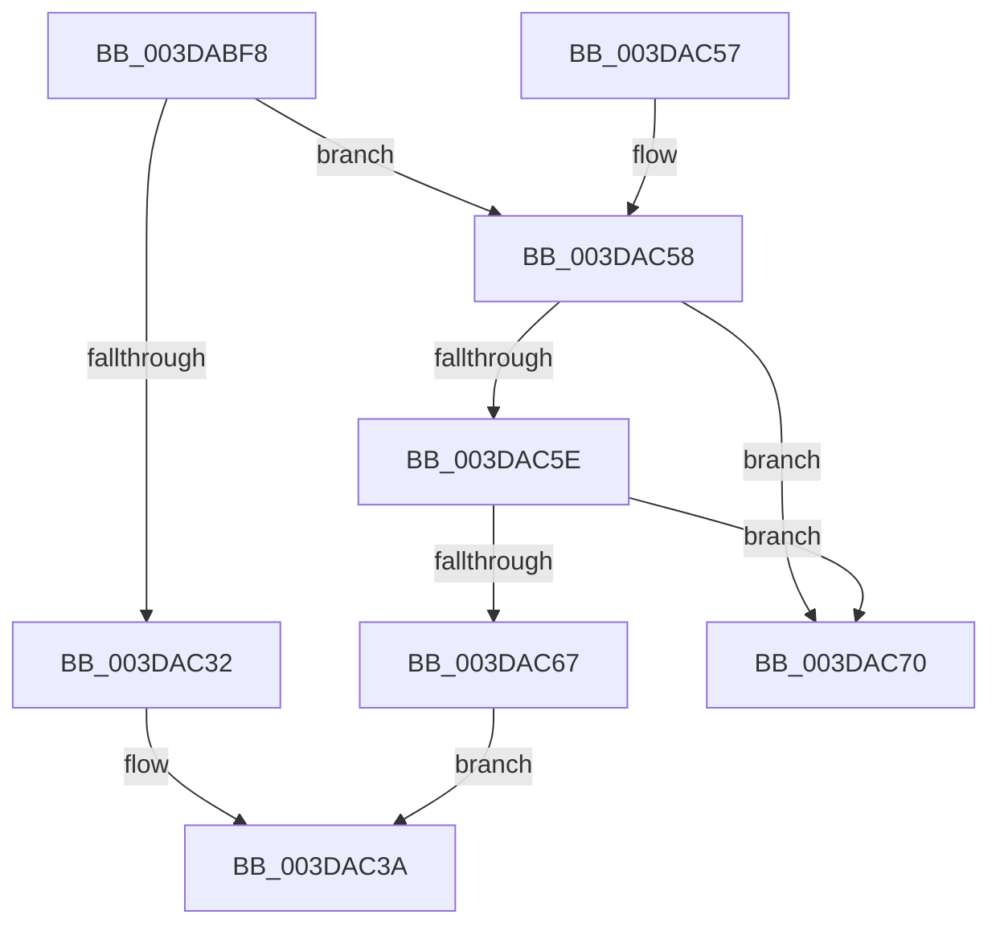

# HalpDmaGetNextWcb

- RVA: `0x003DABF8`–`0x003DAC77` (길이 `127` bytes)
- VA: `0x00000001403DABF8`
- 실행 섹션: `.text`
- PDB 이름 있음: `예`; PDB Function 태그: `아니요`
- unwind 정보 RVA: `0x000707E0`
- 디코드: `36`개 명령, `127/127` bytes 표시
- 미해석 바이트: `0` (있으면 어셈블리에 `.byte`로 보존)

> 이 문서는 커널 이미지의 기계어와 PDB 기호를 분석해 생성했습니다. 4번과 5번은 함수 원형과 자료형을 바이너리 사용 방식에서 추정한 C 해석이며 원본 소스 복구 결과는 아닙니다.

## 1. Dependencies

- 직접 호출 지점: **2**; 고유 호출 대상: **2**
- 직접 호출자로 확인된 함수: **2**
- RIP 상대 이미지 참조: **0**

### Outgoing calls
- `0x003DAC14` → [KeAcquireSpinLockRaiseToDpc](../20/KeAcquireSpinLockRaiseToDpc_function_00208470.md) (function, `0x00208470`)
- `0x003DAC3F` → [KeReleaseSpinLock](../39/KeReleaseSpinLock_function_00392BA0.md) (function, `0x00392BA0`)

### Direct callers
- [HalpContinueProcessingWaitQueue](HalpContinueProcessingWaitQueue_function_003DAB9C.md) at `0x003DABBD`
- [sub_006E9BFE](../6E/Unknown_function_006E9BFE.md) at `0x006E9CB5`

### Static image references
- 디코드된 RIP-relative 메모리 참조가 없습니다.

## 2. Other-region calls and transfers

- 다른 실행 섹션으로 향하는 call: **0**
- 별도 외부 분기/꼬리 이동을 확인하지 못했습니다.

## 3. Assembly (complete function range)

```asm
003DABF8  48 89 5C 24 08                  mov qword ptr [rsp + 8], rbx
003DABFD  48 89 74 24 10                  mov qword ptr [rsp + 0x10], rsi
003DAC02  57                              push rdi
003DAC03  48 83 EC 20                     sub rsp, 0x20
003DAC07  48 8D B1 B8 00 00 00            lea rsi, [rcx + 0xb8]
003DAC0E  48 8B F9                        mov rdi, rcx
003DAC11  48 8B CE                        mov rcx, rsi
003DAC14  E8 57 D8 E2 FF                  call 0x140208470
003DAC19  48 83 A7 68 01 00 00 00         and qword ptr [rdi + 0x168], 0
003DAC21  48 8D 97 C0 00 00 00            lea rdx, [rdi + 0xc0]
003DAC28  48 8B 1A                        mov rbx, qword ptr [rdx]
003DAC2B  8A C8                           mov cl, al
003DAC2D  48 3B DA                        cmp rbx, rdx
003DAC30  75 26                           jne 0x1403dac58
003DAC32  33 DB                           xor ebx, ebx
003DAC34  88 9F E0 00 00 00               mov byte ptr [rdi + 0xe0], bl
003DAC3A  8A D1                           mov dl, cl
003DAC3C  48 8B CE                        mov rcx, rsi
003DAC3F  E8 5C 7F FB FF                  call 0x140392ba0
003DAC44  48 8B 74 24 38                  mov rsi, qword ptr [rsp + 0x38]
003DAC49  48 8B C3                        mov rax, rbx
003DAC4C  48 8B 5C 24 30                  mov rbx, qword ptr [rsp + 0x30]
003DAC51  48 83 C4 20                     add rsp, 0x20
003DAC55  5F                              pop rdi
003DAC56  C3                              ret
003DAC57  CC                              int3
003DAC58  48 39 53 08                     cmp qword ptr [rbx + 8], rdx
003DAC5C  75 12                           jne 0x1403dac70
003DAC5E  48 8B 03                        mov rax, qword ptr [rbx]
003DAC61  48 39 58 08                     cmp qword ptr [rax + 8], rbx
003DAC65  75 09                           jne 0x1403dac70
003DAC67  48 89 02                        mov qword ptr [rdx], rax
003DAC6A  48 89 50 08                     mov qword ptr [rax + 8], rdx
003DAC6E  EB CA                           jmp 0x1403dac3a
003DAC70  B9 03 00 00 00                  mov ecx, 3
003DAC75  CD 29                           int 0x29
```

## 4. C-style interpretation (structured pseudocode)

```c
__int64 __fastcall HalpDmaGetNextWcb(__int64 a1)
{
    __int64 result;
    __int64 v_rbx;
    __int64 v_rsp;
    unsigned __int64 v_stack_p10;
    unsigned __int64 v_stack_p8;

    v_stack_p8 = v_rbx;
    v_stack_p10 = v_rsi;
    v_rsp = (v_rsp) - (32);
    result = KeAcquireSpinLockRaiseToDpc(a1 + 184, a2, a3, a4);
    if ((*(unsigned __int64 *)(a1 + 192)) != (a1 + 192)) goto loc_003DAC58;
    v_rbx = 0;
    *(unsigned __int8 *)(a1 + 224) = 0;
loc_003DAC3A:
    result = KeReleaseSpinLock(a1 + 184, (unsigned __int8)((unsigned __int8)(result)), a3, a4);
    v_rsp = (v_rsp) + (32);
    return 0;
loc_003DAC58:
    if ((*(unsigned __int64 *)(v_stack_p8 + 8)) != ((unsigned __int8)((unsigned __int8)(result)))) goto loc_003DAC70;
    if ((*(unsigned __int64 *)(*(unsigned __int64 *)(v_stack_p8) + 8)) != v_stack_p8) goto loc_003DAC70;
    *(unsigned __int64 *)((unsigned __int8)((unsigned __int8)(result))) = *(unsigned __int64 *)(v_stack_p8);
    *(unsigned __int64 *)(*(unsigned __int64 *)(v_stack_p8) + 8) = (unsigned __int8)((unsigned __int8)(result));
    goto loc_003DAC3A;
loc_003DAC70:
    return *(unsigned __int64 *)(v_stack_p8);
}
```

## 5. (Beta) C Style

```c
int64_t HalpDmaGetNextWcb(void *Arg1)
{
    uint8_t *arg1 = (uint8_t *)Arg1;

    int64_t result;
    int64_t local_rbx;
    int64_t local_rsp;
    uint64_t v_stack_p10;
    uint64_t v_stack_p8;

    v_stack_p8 = local_rbx;
    v_stack_p10 = local_rsi;
    local_rsp = (local_rsp) - (32);
    result = KeAcquireSpinLockRaiseToDpc(Arg1 + 184, a2, a3, a4);
    if ((*(uint64_t *)(arg1 + 0xC0)) != (Arg1 + 192)) goto loc_003DAC58;
    local_rbx = 0;
    *(uint8_t *)(arg1 + 0xE0) = 0;
loc_003DAC3A:
    result = KeReleaseSpinLock(Arg1 + 184, (uint8_t)((uint8_t)(result)), a3, a4);
    local_rsp = (local_rsp) + (32);
    return 0;
loc_003DAC58:
    if ((*(uint64_t *)(v_stack_p8 + 0x8)) != ((uint8_t)((uint8_t)(result)))) goto loc_003DAC70;
    if ((*(uint64_t *)(*(uint64_t *)(v_stack_p8) + 0x8)) != v_stack_p8) goto loc_003DAC70;
    *(uint64_t *)((uint8_t)((uint8_t)(result))) = *(uint64_t *)(v_stack_p8);
    *(uint64_t *)(*(uint64_t *)(v_stack_p8) + 0x8) = (uint8_t)((uint8_t)(result));
    goto loc_003DAC3A;
loc_003DAC70:
    return *(uint64_t *)(v_stack_p8);
}
```

### 관측된 메모리 오프셋

구조체 형식이 확인되지 않은 접근은 인자 기준의 오프셋으로만 기록했습니다.

| 기준 인자 | 오프셋 표현 | 폭 (bit) | 접근 |
|---|---:|---:|---|
| `Arg1` | `+ 0x0` | `64` | `R` |
| `Arg1` | `+ 0x0` | `64` | `W` |
| `Arg1` | `+ 0xB8` | `64` | `R` |
| `Arg1` | `+ 0xC0` | `64` | `R` |
| `Arg1` | `+ 0xE0` | `8` | `W` |
| `Arg1` | `+ 0x168` | `64` | `R/W` |

## 6. Execution-region graph

[열기: 2D/3D 그래프와 함수 탐색 컨트롤 패널](../../../control-panel.html?section=text&rva=0x003DABF8&view=graph)

- 2D 그래프는 위에서 아래로 흐르고, 3D 그래프는 빈 공간을 드래그해 회전합니다. Shift+드래그는 이동, 휠은 확대·축소, 함수 노드 선택은 대상 보고서 이동입니다.

### Static fallback


