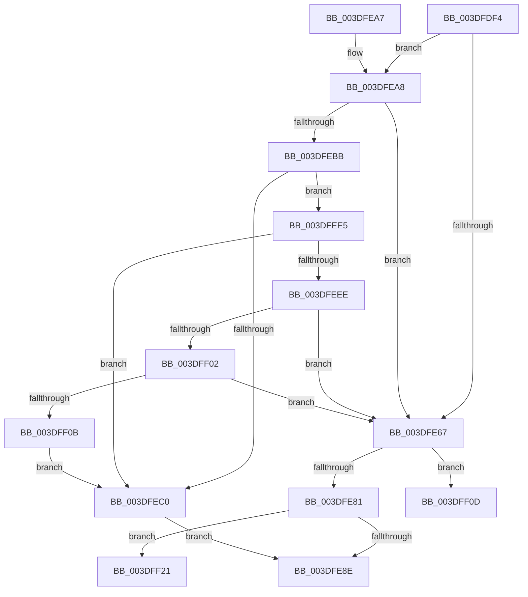

# HalpDmaMapContiguousTransferV2

- RVA: `0x003DFDF4`–`0x003DFF35` (길이 `321` bytes)
- VA: `0x00000001403DFDF4`
- 실행 섹션: `.text`
- PDB 이름 있음: `예`; PDB Function 태그: `예`
- unwind 정보 RVA: `0x000948E8`
- 디코드: `82`개 명령, `321/321` bytes 표시
- 미해석 바이트: `0` (있으면 어셈블리에 `.byte`로 보존)

> 이 문서는 커널 이미지의 기계어와 PDB 기호를 분석해 생성했습니다. 4번과 5번은 함수 원형과 자료형을 바이너리 사용 방식에서 추정한 C 해석이며 원본 소스 복구 결과는 아닙니다.

## 1. Dependencies

- 직접 호출 지점: **3**; 고유 호출 대상: **3**
- 직접 호출자로 확인된 함수: **3**
- RIP 상대 이미지 참조: **0**

### Outgoing calls
- `0x003DFE37` → [HalpDmaNextContiguousPiece](HalpDmaNextContiguousPiece_function_003DECB0.md) (function, `0x003DECB0`)
- `0x003DFEDE` → [HalpDmaFlushBuffer](HalpDmaFlushBuffer_function_003DC1DC.md) (function, `0x003DC1DC`)
- `0x003DFEF1` → [HalpDmaGetAdapterCacheAlignment](HalpDmaGetAdapterCacheAlignment_function_003DC150.md) (function, `0x003DC150`)

### Direct callers
- [IoMapTransferInternal](IoMapTransferInternal_function_003DC910.md) at `0x003DCB15`
- [IopMapTransfer](IopMapTransfer_function_003DCD80.md) at `0x003DCF8F`
- [sub_003DE181](Unknown_function_003DE181.md) at `0x003DE1DD`

### Static image references
- 디코드된 RIP-relative 메모리 참조가 없습니다.

## 2. Other-region calls and transfers

- 다른 실행 섹션으로 향하는 call: **0**
- call이 아닌 외부 분기/꼬리 이동: **2**
  - `0x003DFF1C` → [sub_006EA7A0](../6E/Unknown_function_006EA7A0.md) (`tail-transfer`)
  - `0x003DFF30` → [sub_006EA7A0](../6E/Unknown_function_006EA7A0.md) (`tail-transfer`)

## 3. Assembly (complete function range)

```asm
003DFDF4  4C 8B DC                        mov r11, rsp
003DFDF7  49 89 5B 08                     mov qword ptr [r11 + 8], rbx
003DFDFB  49 89 6B 10                     mov qword ptr [r11 + 0x10], rbp
003DFDFF  49 89 73 18                     mov qword ptr [r11 + 0x18], rsi
003DFE03  57                              push rdi
003DFE04  41 56                           push r14
003DFE06  41 57                           push r15
003DFE08  48 83 EC 40                     sub rsp, 0x40
003DFE0C  48 8B 84 24 80 00 00 00         mov rax, qword ptr [rsp + 0x80]
003DFE14  4D 8B F8                        mov r15, r8
003DFE17  40 8A BC 24 88 00 00 00         mov dil, byte ptr [rsp + 0x88]
003DFE1F  45 33 C0                        xor r8d, r8d
003DFE22  49 8B F1                        mov rsi, r9
003DFE25  48 8B EA                        mov rbp, rdx
003DFE28  48 8B D9                        mov rbx, rcx
003DFE2B  44 8B 30                        mov r14d, dword ptr [rax]
003DFE2E  45 89 73 D0                     mov dword ptr [r11 - 0x30], r14d
003DFE32  40 88 7C 24 20                  mov byte ptr [rsp + 0x20], dil
003DFE37  E8 74 EE FF FF                  call 0x1403decb0
003DFE3C  4C 8B D6                        mov r10, rsi
003DFE3F  48 8B CE                        mov rcx, rsi
003DFE42  48 2B 4D 20                     sub rcx, qword ptr [rbp + 0x20]
003DFE46  41 81 E2 FF 0F 00 00            and r10d, 0xfff
003DFE4D  48 C1 E9 0C                     shr rcx, 0xc
003DFE51  45 33 DB                        xor r11d, r11d
003DFE54  8B C9                           mov ecx, ecx
003DFE56  4C 8B 44 CD 30                  mov r8, qword ptr [rbp + rcx*8 + 0x30]
003DFE5B  49 C1 E0 0C                     shl r8, 0xc
003DFE5F  4D 03 C2                        add r8, r10
003DFE62  41 3B C6                        cmp eax, r14d
003DFE65  74 41                           je 0x1403dfea8
003DFE67  49 8B 0F                        mov rcx, qword ptr [r15]
003DFE6A  48 8B 84 24 90 00 00 00         mov rax, qword ptr [rsp + 0x90]
003DFE72  49 03 CA                        add rcx, r10
003DFE75  48 89 08                        mov qword ptr [rax], rcx
003DFE78  40 84 FF                        test dil, dil
003DFE7B  0F 85 8C 00 00 00               jne 0x1403dff0d
003DFE81  44 38 9B BD 01 00 00            cmp byte ptr [rbx + 0x1bd], r11b
003DFE88  0F 84 93 00 00 00               je 0x1403dff21
003DFE8E  48 8B 5C 24 60                  mov rbx, qword ptr [rsp + 0x60]
003DFE93  48 8B 6C 24 68                  mov rbp, qword ptr [rsp + 0x68]
003DFE98  48 8B 74 24 70                  mov rsi, qword ptr [rsp + 0x70]
003DFE9D  48 83 C4 40                     add rsp, 0x40
003DFEA1  41 5F                           pop r15
003DFEA3  41 5E                           pop r14
003DFEA5  5F                              pop rdi
003DFEA6  C3                              ret
003DFEA7  CC                              int3
003DFEA8  44 8B C8                        mov r9d, eax
003DFEAB  4D 03 C8                        add r9, r8
003DFEAE  49 8D 41 FF                     lea rax, [r9 - 1]
003DFEB2  48 39 83 90 00 00 00            cmp qword ptr [rbx + 0x90], rax
003DFEB9  72 AC                           jb 0x1403dfe67
003DFEBB  40 84 FF                        test dil, dil
003DFEBE  74 25                           je 0x1403dfee5
003DFEC0  48 8B 84 24 90 00 00 00         mov rax, qword ptr [rsp + 0x90]
003DFEC8  45 8B CE                        mov r9d, r14d
003DFECB  44 88 5C 24 28                  mov byte ptr [rsp + 0x28], r11b
003DFED0  48 8B D5                        mov rdx, rbp
003DFED3  40 88 7C 24 20                  mov byte ptr [rsp + 0x20], dil
003DFED8  4C 89 00                        mov qword ptr [rax], r8
003DFEDB  4C 8B C6                        mov r8, rsi
003DFEDE  E8 F9 C2 FF FF                  call 0x1403dc1dc
003DFEE3  EB A9                           jmp 0x1403dfe8e
003DFEE5  44 38 9B BD 01 00 00            cmp byte ptr [rbx + 0x1bd], r11b
003DFEEC  75 D2                           jne 0x1403dfec0
003DFEEE  48 8B CB                        mov rcx, rbx
003DFEF1  E8 5A C2 FF FF                  call 0x1403dc150
003DFEF6  8D 48 FF                        lea ecx, [rax - 1]
003DFEF9  49 85 C8                        test r8, rcx
003DFEFC  0F 85 65 FF FF FF               jne 0x1403dfe67
003DFF02  49 85 C9                        test r9, rcx
003DFF05  0F 85 5C FF FF FF               jne 0x1403dfe67
003DFF0B  EB B3                           jmp 0x1403dfec0
003DFF0D  44 88 5C 24 38                  mov byte ptr [rsp + 0x38], r11b
003DFF12  44 88 5C 24 30                  mov byte ptr [rsp + 0x30], r11b
003DFF17  40 88 7C 24 28                  mov byte ptr [rsp + 0x28], dil
003DFF1C  E9 7F A8 30 00                  jmp 0x1406ea7a0
003DFF21  44 88 5C 24 38                  mov byte ptr [rsp + 0x38], r11b
003DFF26  C6 44 24 30 01                  mov byte ptr [rsp + 0x30], 1
003DFF2B  44 88 5C 24 28                  mov byte ptr [rsp + 0x28], r11b
003DFF30  E9 6B A8 30 00                  jmp 0x1406ea7a0
```

## 4. C-style interpretation (structured pseudocode)

```c
__int64 __fastcall HalpDmaMapContiguousTransferV2(__int64 a1, __int64 a2, __int64 a3, __int64 a4, __int64 a5, unsigned __int8 a6, __int64 a7)
{
    __int64 result;
    __int64 v_r10;
    __int64 v_r11;
    __int64 v_rsp;
    unsigned __int8 v_stack_m38;
    unsigned __int64 v_stack_p10;
    unsigned __int64 v_stack_p18;
    unsigned __int8 v_stack_p20;
    unsigned __int8 v_stack_p28;
    unsigned __int8 v_stack_p30;
    unsigned __int8 v_stack_p38;
    unsigned __int64 v_stack_p8;

    *(unsigned __int64 *)(v_rsp + 8) = v_rbx;
    *(unsigned __int64 *)(v_rsp + 16) = v_rbp;
    *(unsigned __int64 *)(v_rsp + 24) = v_rsi;
    v_rsp = (v_rsp) - (64);
    a3 = 0;
    *(unsigned int *)(v_rsp - 48) = (unsigned int)((unsigned int)(*(unsigned int *)(a5)));
    v_stack_m38 = a6;
    result = HalpDmaNextContiguousPiece(a1, a2, a3, a4);
    a1 = (a4) - (*(unsigned __int64 *)(a2 + 32));
    v_r10 = (unsigned int)((a4) & (0xFFFULL));
    a1 = (a1) >> (12);
    v_r11 = 0;
    a3 = (*(unsigned __int64 *)(a2 + (unsigned int)((unsigned int)(a1)) * 8 + 48)) << (12);
    a3 = (a3) + (v_r10);
    if (((unsigned int)(result)) == ((unsigned int)((unsigned int)(*(unsigned int *)(a5))))) goto loc_003DFEA8;
loc_003DFE67:
    a1 = (*(unsigned __int64 *)(a3)) + (v_r10);
    *(unsigned __int64 *)(a7) = a1;
    if (a6 != 0) goto loc_003DFF0D;
    if ((*(unsigned __int8 *)(a1 + 445)) == 0) goto loc_003DFF21;
loc_003DFE8E:
    v_rsp = (v_rsp) + (64);
    return a7;
loc_003DFEA8:
    a4 = ((unsigned int)((unsigned int)(a7))) + (a3);
    if ((*(unsigned __int64 *)(v_stack_p8 + 144)) < (a4 - 1)) goto loc_003DFE67;
    if (a6 == 0) goto loc_003DFEE5;
loc_003DFEC0:
    v_stack_p28 = 0;
    v_stack_p20 = a6;
    *(unsigned __int64 *)(a7) = a3;
    result = HalpDmaFlushBuffer(a1, v_stack_p10, v_stack_p18, (unsigned int)((unsigned int)((unsigned int)(*(unsigned int *)(a5)))));
    goto loc_003DFE8E;
loc_003DFEE5:
    if ((*(unsigned __int8 *)(v_stack_p8 + 445)) != 0) goto loc_003DFEC0;
    result = HalpDmaGetAdapterCacheAlignment(v_stack_p8, v_stack_p10, v_stack_p18, (unsigned int)((unsigned int)((unsigned int)(*(unsigned int *)(a5)))));
    if (((v_stack_p18) & (result - 1)) != 0) goto loc_003DFE67;
    if ((((unsigned int)((unsigned int)((unsigned int)(*(unsigned int *)(a5))))) & (result - 1)) != 0) goto loc_003DFE67;
    goto loc_003DFEC0;
loc_003DFF0D:
    v_stack_p38 = 0;
    v_stack_p30 = 0;
    v_stack_p28 = a6;
loc_003DFF21:
    v_stack_p38 = 0;
    v_stack_p30 = 1;
    v_stack_p28 = 0;
}
```

## 5. (Beta) C Style

```c
void *HalpDmaMapContiguousTransferV2(void *Arg1, void *Arg2, void *Arg3, int64_t Arg4, void *Arg5, uint8_t Arg6, void *Arg7)
{
    uint8_t *arg1 = (uint8_t *)Arg1;
    uint8_t *arg2 = (uint8_t *)Arg2;
    uint8_t *arg3 = (uint8_t *)Arg3;
    uint8_t *arg5 = (uint8_t *)Arg5;
    uint8_t *arg7 = (uint8_t *)Arg7;

    int64_t result;
    int64_t local_r10;
    int64_t local_r11;
    int64_t local_rsp;
    uint8_t v_stack_m38;
    uint64_t v_stack_p10;
    uint64_t v_stack_p18;
    uint8_t v_stack_p20;
    uint8_t v_stack_p28;
    uint8_t v_stack_p30;
    uint8_t v_stack_p38;
    uint64_t v_stack_p8;

    *(uint64_t *)(local_rsp + 0x8) = local_rbx;
    *(uint64_t *)(local_rsp + 0x10) = local_rbp;
    *(uint64_t *)(local_rsp + 0x18) = local_rsi;
    local_rsp = (local_rsp) - (64);
    Arg3 = 0;
    *(uint32_t *)(local_rsp - 0x30) = (uint32_t)((uint32_t)(*(uint32_t *)(arg5)));
    v_stack_m38 = Arg6;
    result = HalpDmaNextContiguousPiece(Arg1, Arg2, Arg3, Arg4);
    Arg1 = (Arg4) - (*(uint64_t *)(arg2 + 0x20));
    local_r10 = (uint32_t)((Arg4) & (0xFFFULL));
    Arg1 = (Arg1) >> (12);
    local_r11 = 0;
    Arg3 = (*(uint64_t *)(arg2 + (uint32_t)((uint32_t)(arg1)) * 8 + 0x30)) << (12);
    Arg3 = (Arg3) + (local_r10);
    if (((uint32_t)(result)) == ((uint32_t)((uint32_t)(*(uint32_t *)(arg5))))) goto loc_003DFEA8;
loc_003DFE67:
    Arg1 = (*(uint64_t *)(arg3)) + (local_r10);
    *(void **)(arg7) = Arg1;
    if (Arg6 != 0) goto loc_003DFF0D;
    if ((*(uint8_t *)(arg1 + 0x1BD)) == 0) goto loc_003DFF21;
loc_003DFE8E:
    local_rsp = (local_rsp) + (64);
    return Arg7;
loc_003DFEA8:
    Arg4 = ((uint32_t)((uint32_t)(Arg7))) + (Arg3);
    if ((*(uint64_t *)(v_stack_p8 + 0x90)) < (Arg4 - 1)) goto loc_003DFE67;
    if (Arg6 == 0) goto loc_003DFEE5;
loc_003DFEC0:
    v_stack_p28 = 0;
    v_stack_p20 = Arg6;
    *(void **)(arg7) = Arg3;
    result = HalpDmaFlushBuffer(Arg1, v_stack_p10, v_stack_p18, (uint32_t)((uint32_t)((uint32_t)(*(uint32_t *)(arg5)))));
    goto loc_003DFE8E;
loc_003DFEE5:
    if ((*(uint8_t *)(v_stack_p8 + 0x1BD)) != 0) goto loc_003DFEC0;
    result = HalpDmaGetAdapterCacheAlignment(v_stack_p8, v_stack_p10, v_stack_p18, (uint32_t)((uint32_t)((uint32_t)(*(uint32_t *)(arg5)))));
    if (((v_stack_p18) & (result - 1)) != 0) goto loc_003DFE67;
    if ((((uint32_t)((uint32_t)((uint32_t)(*(uint32_t *)(arg5))))) & (result - 1)) != 0) goto loc_003DFE67;
    goto loc_003DFEC0;
loc_003DFF0D:
    v_stack_p38 = 0;
    v_stack_p30 = 0;
    v_stack_p28 = Arg6;
loc_003DFF21:
    v_stack_p38 = 0;
    v_stack_p30 = 1;
    v_stack_p28 = 0;
}
```

### 관측된 메모리 오프셋

구조체 형식이 확인되지 않은 접근은 인자 기준의 오프셋으로만 기록했습니다.

| 기준 인자 | 오프셋 표현 | 폭 (bit) | 접근 |
|---|---:|---:|---|
| `Arg1` | `+ 0x90` | `64` | `R` |
| `Arg1` | `+ 0x1BD` | `8` | `R` |
| `Arg2` | `+ 0x20` | `64` | `R` |
| `Arg2` | `+ 0x30 + rcx*8` | `64` | `R` |
| `Arg3` | `+ 0x0` | `64` | `R` |
| `Arg5` | `+ 0x0` | `32` | `R` |
| `Arg7` | `+ 0x0` | `64` | `W` |

## 6. Execution-region graph

[열기: 2D/3D 그래프와 함수 탐색 컨트롤 패널](../../../control-panel.html?section=text&rva=0x003DFDF4&view=graph)

- 2D 그래프는 위에서 아래로 흐르고, 3D 그래프는 빈 공간을 드래그해 회전합니다. Shift+드래그는 이동, 휠은 확대·축소, 함수 노드 선택은 대상 보고서 이동입니다.

### Static fallback


