# HalpDmaNextContiguousPieceV3

- RVA: `0x003DECFC`–`0x003DEFC6` (길이 `714` bytes)
- VA: `0x00000001403DECFC`
- 실행 섹션: `.text`
- PDB 이름 있음: `예`; PDB Function 태그: `아니요`
- unwind 정보 RVA: `0x000946C4`
- 디코드: `190`개 명령, `714/714` bytes 표시
- 미해석 바이트: `0` (있으면 어셈블리에 `.byte`로 보존)

> 이 문서는 커널 이미지의 기계어와 PDB 기호를 분석해 생성했습니다. 4번과 5번은 함수 원형과 자료형을 바이너리 사용 방식에서 추정한 C 해석이며 원본 소스 복구 결과는 아닙니다.

## 1. Dependencies

- 직접 호출 지점: **3**; 고유 호출 대상: **1**
- 직접 호출자로 확인된 함수: **5**
- RIP 상대 이미지 참조: **1**

### Outgoing calls
- `0x003DEF11` → [HalpDmaGetAdapterCacheAlignment](HalpDmaGetAdapterCacheAlignment_function_003DC150.md) (function, `0x003DC150`)
- `0x003DEF5E` → [HalpDmaGetAdapterCacheAlignment](HalpDmaGetAdapterCacheAlignment_function_003DC150.md) (function, `0x003DC150`)
- `0x003DEF95` → [HalpDmaGetAdapterCacheAlignment](HalpDmaGetAdapterCacheAlignment_function_003DC150.md) (function, `0x003DC150`)

### Direct callers
- [IoMapTransferInternal](IoMapTransferInternal_function_003DC910.md) at `0x003DCC6C`
- [IopMapTransfer](IopMapTransfer_function_003DCD80.md) at `0x003DD0DD`
- [sub_003DE181](Unknown_function_003DE181.md) at `0x003DE35D`
- [sub_003DE84B](Unknown_function_003DE84B.md) at `0x003DE93F`
- [HalpDmaNextContiguousPiece](HalpDmaNextContiguousPiece_function_003DECB0.md) at `0x003DECD2`

### Static image references
- `0x003DEE8C` → RVA `0x00FC18A0` (`.data`; read)

## 2. Other-region calls and transfers

- 다른 실행 섹션으로 향하는 call: **0**
- 별도 외부 분기/꼬리 이동을 확인하지 못했습니다.

## 3. Assembly (complete function range)

```asm
003DECFC  4C 89 44 24 18                  mov qword ptr [rsp + 0x18], r8
003DED01  53                              push rbx
003DED02  55                              push rbp
003DED03  56                              push rsi
003DED04  57                              push rdi
003DED05  41 54                           push r12
003DED07  41 55                           push r13
003DED09  41 56                           push r14
003DED0B  41 57                           push r15
003DED0D  48 83 EC 28                     sub rsp, 0x28
003DED11  48 8B 81 90 00 00 00            mov rax, qword ptr [rcx + 0x90]
003DED18  4C 8D 99 BD 01 00 00            lea r11, [rcx + 0x1bd]
003DED1F  44 8A B9 99 00 00 00            mov r15b, byte ptr [rcx + 0x99]
003DED26  4C 8B F0                        mov r14, rax
003DED29  49 C1 EE 0C                     shr r14, 0xc
003DED2D  49 8B F9                        mov rdi, r9
003DED30  80 BC 24 90 00 00 00 00         cmp byte ptr [rsp + 0x90], 0
003DED38  4D 8B E8                        mov r13, r8
003DED3B  48 8B D9                        mov rbx, rcx
003DED3E  48 89 84 24 88 00 00 00         mov qword ptr [rsp + 0x88], rax
003DED46  44 88 7C 24 70                  mov byte ptr [rsp + 0x70], r15b
003DED4B  0F 84 EA 01 00 00               je 0x1403def3b
003DED51  40 32 ED                        xor bpl, bpl
003DED54  44 8B 8C 24 98 00 00 00         mov r9d, dword ptr [rsp + 0x98]
003DED5C  48 8B F7                        mov rsi, rdi
003DED5F  48 2B 72 20                     sub rsi, qword ptr [rdx + 0x20]
003DED63  8B C7                           mov eax, edi
003DED65  48 C1 EE 0C                     shr rsi, 0xc
003DED69  25 FF 0F 00 00                  and eax, 0xfff
003DED6E  8B F6                           mov esi, esi
003DED70  B9 00 10 00 00                  mov ecx, 0x1000
003DED75  48 83 C6 06                     add rsi, 6
003DED79  44 8B D1                        mov r10d, ecx
003DED7C  44 2B D0                        sub r10d, eax
003DED7F  45 8B C2                        mov r8d, r10d
003DED82  48 8D 34 F2                     lea rsi, [rdx + rsi*8]
003DED86  4C 8B E6                        mov r12, rsi
003DED89  48 89 74 24 78                  mov qword ptr [rsp + 0x78], rsi
003DED8E  4C 39 36                        cmp qword ptr [rsi], r14
003DED91  0F 86 B6 00 00 00               jbe 0x1403dee4d
003DED97  45 33 C0                        xor r8d, r8d
003DED9A  80 BB BA 01 00 00 00            cmp byte ptr [rbx + 0x1ba], 0
003DEDA1  0F 84 83 00 00 00               je 0x1403dee2a
003DEDA7  45 85 C9                        test r9d, r9d
003DEDAA  74 7E                           je 0x1403dee2a
003DEDAC  45 85 C0                        test r8d, r8d
003DEDAF  75 79                           jne 0x1403dee2a
003DEDB1  48 8D 46 08                     lea rax, [rsi + 8]
003DEDB5  41 8B CA                        mov ecx, r10d
003DEDB8  45 3B D1                        cmp r10d, r9d
003DEDBB  73 14                           jae 0x1403dedd1
003DEDBD  4C 39 30                        cmp qword ptr [rax], r14
003DEDC0  76 16                           jbe 0x1403dedd8
003DEDC2  81 C1 00 10 00 00               add ecx, 0x1000
003DEDC8  48 83 C0 08                     add rax, 8
003DEDCC  41 3B C9                        cmp ecx, r9d
003DEDCF  72 EC                           jb 0x1403dedbd
003DEDD1  41 3B C9                        cmp ecx, r9d
003DEDD4  41 0F 47 C9                     cmova ecx, r9d
003DEDD8  4D 8B 4D 38                     mov r9, qword ptr [r13 + 0x38]
003DEDDC  4D 85 C9                        test r9, r9
003DEDDF  74 5E                           je 0x1403dee3f
003DEDE1  49 8B 11                        mov rdx, qword ptr [r9]
003DEDE4  48 C1 EA 0C                     shr rdx, 0xc
003DEDE8  4D 8B 49 08                     mov r9, qword ptr [r9 + 8]
003DEDEC  44 3B D1                        cmp r10d, ecx
003DEDEF  73 51                           jae 0x1403dee42
003DEDF1  4D 85 C9                        test r9, r9
003DEDF4  74 4C                           je 0x1403dee42
003DEDF6  4D 8B 01                        mov r8, qword ptr [r9]
003DEDF9  48 8D 42 01                     lea rax, [rdx + 1]
003DEDFD  49 C1 E8 0C                     shr r8, 0xc
003DEE01  4C 3B C0                        cmp r8, rax
003DEE04  75 3C                           jne 0x1403dee42
003DEE06  49 8B C0                        mov rax, r8
003DEE09  48 33 C2                        xor rax, rdx
003DEE0C  48 A9 00 00 F0 FF               test rax, -0x100000
003DEE12  75 2E                           jne 0x1403dee42
003DEE14  41 80 FF 01                     cmp r15b, 1
003DEE18  0F 85 91 01 00 00               jne 0x1403defaf
003DEE1E  49 8B D0                        mov rdx, r8
003DEE21  41 81 C2 00 10 00 00            add r10d, 0x1000
003DEE28  EB BE                           jmp 0x1403dede8
003DEE2A  41 8B C0                        mov eax, r8d
003DEE2D  48 83 C4 28                     add rsp, 0x28
003DEE31  41 5F                           pop r15
003DEE33  41 5E                           pop r14
003DEE35  41 5D                           pop r13
003DEE37  41 5C                           pop r12
003DEE39  5F                              pop rdi
003DEE3A  5E                              pop rsi
003DEE3B  5D                              pop rbp
003DEE3C  5B                              pop rbx
003DEE3D  C3                              ret
003DEE3E  CC                              int3
003DEE3F  45 33 D2                        xor r10d, r10d
003DEE42  44 3B D1                        cmp r10d, ecx
003DEE45  41 0F 46 CA                     cmovbe ecx, r10d
003DEE49  8B C1                           mov eax, ecx
003DEE4B  EB E0                           jmp 0x1403dee2d
003DEE4D  40 84 ED                        test bpl, bpl
003DEE50  0F 85 3C 01 00 00               jne 0x1403def92
003DEE56  45 3B D1                        cmp r10d, r9d
003DEE59  0F 83 9A 00 00 00               jae 0x1403deef9
003DEE5F  49 8B 7C 24 08                  mov rdi, qword ptr [r12 + 8]
003DEE64  49 3B FE                        cmp rdi, r14
003DEE67  0F 87 13 01 00 00               ja 0x1403def80
003DEE6D  4D 8B 2C 24                     mov r13, qword ptr [r12]
003DEE71  49 8D 45 01                     lea rax, [r13 + 1]
003DEE75  48 3B C7                        cmp rax, rdi
003DEE78  75 72                           jne 0x1403deeec
003DEE7A  41 8B F1                        mov esi, r9d
003DEE7D  4C 8B FF                        mov r15, rdi
003DEE80  41 2B F0                        sub esi, r8d
003DEE83  3B F1                           cmp esi, ecx
003DEE85  0F 47 F1                        cmova esi, ecx
003DEE88  49 C1 E7 0C                     shl r15, 0xc
003DEE8C  80 3D 0D 2A BE 00 00            cmp byte ptr [rip + 0xbe2a0d], 0
003DEE93  75 12                           jne 0x1403deea7
003DEE95  8B CE                           mov ecx, esi
003DEE97  48 FF C9                        dec rcx
003DEE9A  49 03 CF                        add rcx, r15
003DEE9D  48 39 8C 24 88 00 00 00         cmp qword ptr [rsp + 0x88], rcx
003DEEA5  73 0D                           jae 0x1403deeb4
003DEEA7  83 BB 08 02 00 00 03            cmp dword ptr [rbx + 0x208], 3
003DEEAE  0F 85 B9 00 00 00               jne 0x1403def6d
003DEEB4  41 80 3B 00                     cmp byte ptr [r11], 0
003DEEB8  0F 84 8F 00 00 00               je 0x1403def4d
003DEEBE  44 8A 7C 24 70                  mov r15b, byte ptr [rsp + 0x70]
003DEEC3  48 8B C7                        mov rax, rdi
003DEEC6  49 33 C5                        xor rax, r13
003DEEC9  48 A9 00 00 F0 FF               test rax, -0x100000
003DEECF  75 1B                           jne 0x1403deeec
003DEED1  41 80 FF 01                     cmp r15b, 1
003DEED5  75 56                           jne 0x1403def2d
003DEED7  B9 00 10 00 00                  mov ecx, 0x1000
003DEEDC  49 83 C4 08                     add r12, 8
003DEEE0  44 03 C1                        add r8d, ecx
003DEEE3  45 3B C1                        cmp r8d, r9d
003DEEE6  0F 82 73 FF FF FF               jb 0x1403dee5f
003DEEEC  48 8B 74 24 78                  mov rsi, qword ptr [rsp + 0x78]
003DEEF1  4C 8B AC 24 80 00 00 00         mov r13, qword ptr [rsp + 0x80]
003DEEF9  45 3B C1                        cmp r8d, r9d
003DEEFC  0F 86 98 FE FF FF               jbe 0x1403ded9a
003DEF02  45 8B C1                        mov r8d, r9d
003DEF05  40 84 ED                        test bpl, bpl
003DEF08  0F 84 8C FE FF FF               je 0x1403ded9a
003DEF0E  48 8B CB                        mov rcx, rbx
003DEF11  E8 3A D2 FF FF                  call 0x1403dc150
003DEF16  FF C8                           dec eax
003DEF18  41 85 C1                        test r9d, eax
003DEF1B  0F 84 79 FE FF FF               je 0x1403ded9a
003DEF21  41 81 E0 00 F0 FF FF            and r8d, 0xfffff000
003DEF28  E9 6D FE FF FF                  jmp 0x1403ded9a
003DEF2D  49 33 FD                        xor rdi, r13
003DEF30  48 F7 C7 F0 FF FF FF            test rdi, -0x10
003DEF37  74 9E                           je 0x1403deed7
003DEF39  EB B1                           jmp 0x1403deeec
003DEF3B  41 80 3B 00                     cmp byte ptr [r11], 0
003DEF3F  0F 85 0C FE FF FF               jne 0x1403ded51
003DEF45  40 B5 01                        mov bpl, 1
003DEF48  E9 07 FE FF FF                  jmp 0x1403ded54
003DEF4D  80 BC 24 90 00 00 00 00         cmp byte ptr [rsp + 0x90], 0
003DEF55  0F 85 63 FF FF FF               jne 0x1403deebe
003DEF5B  48 8B CB                        mov rcx, rbx
003DEF5E  E8 ED D1 FF FF                  call 0x1403dc150
003DEF63  8D 48 FF                        lea ecx, [rax - 1]
003DEF66  8B C1                           mov eax, ecx
003DEF68  49 85 C7                        test r15, rax
003DEF6B  74 0A                           je 0x1403def77
003DEF6D  44 8A 7C 24 70                  mov r15b, byte ptr [rsp + 0x70]
003DEF72  E9 75 FF FF FF                  jmp 0x1403deeec
003DEF77  85 CE                           test esi, ecx
003DEF79  75 F2                           jne 0x1403def6d
003DEF7B  E9 3E FF FF FF                  jmp 0x1403deebe
003DEF80  48 8B 74 24 78                  mov rsi, qword ptr [rsp + 0x78]
003DEF85  4C 8B AC 24 80 00 00 00         mov r13, qword ptr [rsp + 0x80]
003DEF8D  E9 08 FE FF FF                  jmp 0x1403ded9a
003DEF92  48 8B CB                        mov rcx, rbx
003DEF95  E8 B6 D1 FF FF                  call 0x1403dc150
003DEF9A  FF C8                           dec eax
003DEF9C  48 85 C7                        test rdi, rax
003DEF9F  0F 85 F2 FD FF FF               jne 0x1403ded97
003DEFA5  B9 00 10 00 00                  mov ecx, 0x1000
003DEFAA  E9 A7 FE FF FF                  jmp 0x1403dee56
003DEFAF  49 8B C0                        mov rax, r8
003DEFB2  48 33 C2                        xor rax, rdx
003DEFB5  48 A9 F0 FF FF FF               test rax, -0x10
003DEFBB  0F 85 81 FE FF FF               jne 0x1403dee42
003DEFC1  E9 58 FE FF FF                  jmp 0x1403dee1e
```

## 4. C-style interpretation (structured pseudocode)

```c
__int64 __fastcall HalpDmaNextContiguousPieceV3(__int64 a1, __int64 a2, __int64 a3, __int64 a4, unsigned __int8 a5, unsigned int a6)
{
    __int64 result;
    __int64 v_r10;
    __int64 v_r12;
    __int64 v_r14;
    __int64 v_r15;
    __int64 v_rbp;
    __int64 v_rdi;
    __int64 v_rsi;
    __int64 v_rsp;
    unsigned __int64 v_stack_p10;
    unsigned __int64 v_stack_p18;
    unsigned __int64 v_stack_p20;
    unsigned __int8 v_stack_p70;
    unsigned __int64 v_stack_p78;
    unsigned __int8 v_stack_p8;
    unsigned __int64 v_stack_p80;
    unsigned __int64 v_stack_p88;

    v_stack_p18 = a3;
    v_rsp = (v_rsp) - (40);
    v_r14 = (*(unsigned __int64 *)(a1 + 144)) >> (12);
    v_stack_p20 = *(unsigned __int64 *)(a1 + 144);
    v_stack_p8 = (unsigned __int8)(*(unsigned __int8 *)(a1 + 153));
    if (a5 == 0) goto loc_003DEF3B;
loc_003DED51:
    v_rbp = 0;
loc_003DED54:
    v_rsi = (a4) - (*(unsigned __int64 *)(a2 + 32));
    v_rsi = (v_rsi) >> (12);
    result = (unsigned int)(((unsigned int)((unsigned int)(a4))) & (0xFFFULL));
    v_rsi = ((unsigned int)((unsigned int)(v_rsi))) + (6);
    v_r10 = (unsigned int)(((unsigned int)((unsigned int)((unsigned int)(0x1000ULL)))) - ((unsigned int)(result)));
    v_stack_p10 = a2 + v_rsi * 8;
    if ((*(unsigned __int64 *)(a2 + v_rsi * 8)) <= v_r14) goto loc_003DEE4D;
loc_003DED97:
    a3 = 0;
loc_003DED9A:
    if ((*(unsigned __int8 *)(a1 + 442)) == 0) goto loc_003DEE2A;
    if ((unsigned int)((unsigned int)(a6)) == 0) goto loc_003DEE2A;
    if (0 != 0) goto loc_003DEE2A;
    if (((unsigned int)(v_r10)) >= ((unsigned int)((unsigned int)(a6)))) goto loc_003DEDD1;
loc_003DEDBD:
    if ((*(unsigned __int64 *)(a2 + v_rsi * 8 + 8)) <= v_r14) goto loc_003DEDD8;
    a1 = (unsigned int)(((unsigned int)((unsigned int)(v_r10))) + (0x1000ULL));
    result = (a2 + v_rsi * 8 + 8) + (8);
    if (((unsigned int)(a1)) < ((unsigned int)((unsigned int)(a6)))) goto loc_003DEDBD;
loc_003DEDD1:
    if (((unsigned int)(a1)) > ((unsigned int)((unsigned int)(a6)))) { a1 = (unsigned int)((unsigned int)(a6)); }
loc_003DEDD8:
    if (*(unsigned __int64 *)(a3 + 56) == 0) goto loc_003DEE3F;
    a2 = (*(unsigned __int64 *)(*(unsigned __int64 *)(a3 + 56))) >> (12);
loc_003DEDE8:
    if (((unsigned int)(v_r10)) >= ((unsigned int)(a1))) goto loc_003DEE42;
    if (*(unsigned __int64 *)(*(unsigned __int64 *)(a3 + 56) + 8) == 0) goto loc_003DEE42;
    a3 = (*(unsigned __int64 *)(*(unsigned __int64 *)(*(unsigned __int64 *)(a3 + 56) + 8))) >> (12);
    if (a3 != (a2 + 1)) goto loc_003DEE42;
    result = (a3) ^ (a2);
    if (((result) & (0xFFFFFFFFFFF00000ULL)) != 0) goto loc_003DEE42;
    if (((unsigned __int8)(*(unsigned __int8 *)(a1 + 153))) != 1) goto loc_003DEFAF;
loc_003DEE1E:
    v_r10 = (unsigned int)((v_r10) + (0x1000ULL));
    goto loc_003DEDE8;
loc_003DEE2A:
loc_003DEE2D:
    v_rsp = (v_rsp) + (40);
    return (unsigned int)((unsigned int)(a3));
loc_003DEE3F:
    v_r10 = 0;
loc_003DEE42:
    if (0 <= ((unsigned int)(a1))) { a1 = 0; }
    goto loc_003DEE2D;
loc_003DEE4D:
    if (0 != 0) goto loc_003DEF92;
loc_003DEE56:
    if (0 >= ((unsigned int)(*(unsigned __int64 *)(*(unsigned __int64 *)(a3 + 56) + 8)))) goto loc_003DEEF9;
loc_003DEE5F:
    if ((*(unsigned __int64 *)(a2 + v_rsi * 8 + 8)) > v_r14) goto loc_003DEF80;
    if ((*(unsigned __int64 *)(a2 + v_rsi * 8) + 1) != (*(unsigned __int64 *)(a2 + v_rsi * 8 + 8))) goto loc_003DEEEC;
    v_rsi = (unsigned int)(((unsigned int)((unsigned int)(*(unsigned __int64 *)(*(unsigned __int64 *)(a3 + 56) + 8)))) - ((unsigned int)(a3)));
    if (((unsigned int)(v_rsi)) > ((unsigned int)(a1))) { v_rsi = (unsigned int)(a1); }
    v_r15 = (*(unsigned __int64 *)(a2 + v_rsi * 8 + 8)) << (12);
    if ((*(unsigned __int8 *)(v_rip + 12462605)) != 0) goto loc_003DEEA7;
    a1 = ((unsigned int)((unsigned int)(v_rsi))) - 1;
    a1 = (a1) + (v_r15);
    if (v_stack_p88 >= a1) goto loc_003DEEB4;
loc_003DEEA7:
    if ((*(unsigned int *)(a1 + 520)) != 3) goto loc_003DEF6D;
loc_003DEEB4:
    if ((*(unsigned __int8 *)(a1 + 445)) == 0) goto loc_003DEF4D;
loc_003DEEBE:
    result = (*(unsigned __int64 *)(a2 + v_rsi * 8 + 8)) ^ (*(unsigned __int64 *)(a2 + v_rsi * 8));
    if (((result) & (0xFFFFFFFFFFF00000ULL)) != 0) goto loc_003DEEEC;
    if (((unsigned __int8)(v_stack_p70)) != 1) goto loc_003DEF2D;
loc_003DEED7:
    v_r12 = (a2 + v_rsi * 8) + (8);
    a3 = (unsigned int)((a3) + ((unsigned int)((unsigned int)(0x1000ULL))));
    if (((unsigned int)(a3)) < ((unsigned int)(*(unsigned __int64 *)(*(unsigned __int64 *)(a3 + 56) + 8)))) goto loc_003DEE5F;
loc_003DEEEC:
loc_003DEEF9:
    if (((unsigned int)(a3)) <= ((unsigned int)(*(unsigned __int64 *)(*(unsigned __int64 *)(a3 + 56) + 8)))) goto loc_003DED9A;
    if (0 == 0) goto loc_003DED9A;
    result = HalpDmaGetAdapterCacheAlignment(a1, a3, (unsigned int)((unsigned int)(*(unsigned __int64 *)(*(unsigned __int64 *)(a3 + 56) + 8))), *(unsigned __int64 *)(*(unsigned __int64 *)(a3 + 56) + 8));
    result = (unsigned int)((result) - 1);
    if ((((unsigned int)(*(unsigned __int64 *)(*(unsigned __int64 *)(a3 + 56) + 8))) & ((unsigned int)(result))) == 0) goto loc_003DED9A;
    a3 = (unsigned int)(((unsigned int)((unsigned int)(*(unsigned __int64 *)(*(unsigned __int64 *)(a3 + 56) + 8)))) & (0xFFFFF000ULL));
    goto loc_003DED9A;
loc_003DEF2D:
    v_rdi = (*(unsigned __int64 *)(a2 + v_rsi * 8 + 8)) ^ (v_stack_p80);
    if (((v_rdi) & (-16)) == 0) goto loc_003DEED7;
    goto loc_003DEEEC;
loc_003DEF3B:
    if ((*(unsigned __int8 *)(a1 + 445)) != 0) goto loc_003DED51;
    goto loc_003DED54;
loc_003DEF4D:
    if (a5 != 0) goto loc_003DEEBE;
    result = HalpDmaGetAdapterCacheAlignment(a1, a3, a3, *(unsigned __int64 *)(*(unsigned __int64 *)(a3 + 56) + 8));
    if (((v_stack_p70) & ((unsigned int)((unsigned int)(result - 1)))) == 0) goto loc_003DEF77;
loc_003DEF6D:
    goto loc_003DEEEC;
loc_003DEF77:
    if ((((unsigned int)(v_stack_p78)) & ((unsigned int)(result - 1))) != 0) goto loc_003DEF6D;
    goto loc_003DEEBE;
loc_003DEF80:
    goto loc_003DED9A;
loc_003DEF92:
    result = HalpDmaGetAdapterCacheAlignment(a1, a3, a3, *(unsigned __int64 *)(*(unsigned __int64 *)(a3 + 56) + 8));
    result = (unsigned int)((result) - 1);
    if (((v_rdi) & (result)) != 0) goto loc_003DED97;
    goto loc_003DEE56;
loc_003DEFAF:
    result = (a3) ^ (a3);
    if (((result) & (-16)) != 0) goto loc_003DEE42;
    goto loc_003DEE1E;
}
```

## 5. (Beta) C Style

```c
int64_t HalpDmaNextContiguousPieceV3(void *Arg1, void *Arg2, int64_t Arg3, int64_t Arg4, uint8_t Arg5, uint32_t Arg6)
{
    uint8_t *arg1 = (uint8_t *)Arg1;
    uint8_t *arg2 = (uint8_t *)Arg2;

    int64_t result;
    int64_t local_r10;
    int64_t local_r12;
    int64_t local_r14;
    int64_t local_r15;
    int64_t local_rbp;
    int64_t local_rdi;
    int64_t local_rsi;
    int64_t local_rsp;
    uint64_t v_stack_p10;
    uint64_t v_stack_p18;
    uint64_t v_stack_p20;
    uint8_t v_stack_p70;
    uint64_t v_stack_p78;
    uint8_t v_stack_p8;
    uint64_t v_stack_p80;
    uint64_t v_stack_p88;

    v_stack_p18 = Arg3;
    local_rsp = (local_rsp) - (40);
    local_r14 = (*(uint64_t *)(arg1 + 0x90)) >> (12);
    v_stack_p20 = *(uint64_t *)(arg1 + 0x90);
    v_stack_p8 = (uint8_t)(*(uint8_t *)(arg1 + 0x99));
    if (Arg5 == 0) goto loc_003DEF3B;
loc_003DED51:
    local_rbp = 0;
loc_003DED54:
    local_rsi = (Arg4) - (*(uint64_t *)(arg2 + 0x20));
    local_rsi = (local_rsi) >> (12);
    result = (uint32_t)(((uint32_t)((uint32_t)(Arg4))) & (0xFFFULL));
    local_rsi = ((uint32_t)((uint32_t)(local_rsi))) + (6);
    local_r10 = (uint32_t)(((uint32_t)((uint32_t)((uint32_t)(0x1000ULL)))) - ((uint32_t)(result)));
    v_stack_p10 = Arg2 + local_rsi * 8;
    if ((*(uint64_t *)(arg2 + local_rsi * 8)) <= local_r14) goto loc_003DEE4D;
loc_003DED97:
    Arg3 = 0;
loc_003DED9A:
    if ((*(uint8_t *)(arg1 + 0x1BA)) == 0) goto loc_003DEE2A;
    if ((uint32_t)((uint32_t)(Arg6)) == 0) goto loc_003DEE2A;
    if (0 != 0) goto loc_003DEE2A;
    if (((uint32_t)(local_r10)) >= ((uint32_t)((uint32_t)(Arg6)))) goto loc_003DEDD1;
loc_003DEDBD:
    if ((*(uint64_t *)(arg2 + local_rsi * 8 + 0x8)) <= local_r14) goto loc_003DEDD8;
    Arg1 = (uint32_t)(((uint32_t)((uint32_t)(local_r10))) + (0x1000ULL));
    result = (Arg2 + local_rsi * 8 + 8) + (8);
    if (((uint32_t)(Arg1)) < ((uint32_t)((uint32_t)(Arg6)))) goto loc_003DEDBD;
loc_003DEDD1:
    if (((uint32_t)(Arg1)) > ((uint32_t)((uint32_t)(Arg6)))) { Arg1 = (uint32_t)((uint32_t)(Arg6)); }
loc_003DEDD8:
    if (*(uint64_t *)(Arg3 + 0x38) == 0) goto loc_003DEE3F;
    Arg2 = (*(uint64_t *)(*(uint64_t *)(Arg3 + 0x38))) >> (12);
loc_003DEDE8:
    if (((uint32_t)(local_r10)) >= ((uint32_t)(Arg1))) goto loc_003DEE42;
    if (*(uint64_t *)(*(uint64_t *)(Arg3 + 0x38) + 0x8) == 0) goto loc_003DEE42;
    Arg3 = (*(uint64_t *)(*(uint64_t *)(*(uint64_t *)(Arg3 + 0x38) + 0x8))) >> (12);
    if (Arg3 != (Arg2 + 1)) goto loc_003DEE42;
    result = (Arg3) ^ (Arg2);
    if (((result) & (0xFFFFFFFFFFF00000ULL)) != 0) goto loc_003DEE42;
    if (((uint8_t)(*(uint8_t *)(arg1 + 0x99))) != 1) goto loc_003DEFAF;
loc_003DEE1E:
    local_r10 = (uint32_t)((local_r10) + (0x1000ULL));
    goto loc_003DEDE8;
loc_003DEE2A:
loc_003DEE2D:
    local_rsp = (local_rsp) + (40);
    return (uint32_t)((uint32_t)(Arg3));
loc_003DEE3F:
    local_r10 = 0;
loc_003DEE42:
    if (0 <= ((uint32_t)(Arg1))) { Arg1 = 0; }
    goto loc_003DEE2D;
loc_003DEE4D:
    if (0 != 0) goto loc_003DEF92;
loc_003DEE56:
    if (0 >= ((uint32_t)(*(uint64_t *)(*(uint64_t *)(Arg3 + 0x38) + 0x8)))) goto loc_003DEEF9;
loc_003DEE5F:
    if ((*(uint64_t *)(arg2 + local_rsi * 8 + 0x8)) > local_r14) goto loc_003DEF80;
    if ((*(uint64_t *)(arg2 + local_rsi * 8) + 1) != (*(uint64_t *)(arg2 + local_rsi * 8 + 0x8))) goto loc_003DEEEC;
    local_rsi = (uint32_t)(((uint32_t)((uint32_t)(*(uint64_t *)(*(uint64_t *)(Arg3 + 0x38) + 0x8)))) - ((uint32_t)(Arg3)));
    if (((uint32_t)(local_rsi)) > ((uint32_t)(Arg1))) { local_rsi = (uint32_t)(Arg1); }
    local_r15 = (*(uint64_t *)(arg2 + local_rsi * 8 + 0x8)) << (12);
    if ((*(uint8_t *)(v_rip + 0xBE2A0D)) != 0) goto loc_003DEEA7;
    Arg1 = ((uint32_t)((uint32_t)(local_rsi))) - 1;
    Arg1 = (Arg1) + (local_r15);
    if (v_stack_p88 >= Arg1) goto loc_003DEEB4;
loc_003DEEA7:
    if ((*(uint32_t *)(arg1 + 0x208)) != 3) goto loc_003DEF6D;
loc_003DEEB4:
    if ((*(uint8_t *)(arg1 + 0x1BD)) == 0) goto loc_003DEF4D;
loc_003DEEBE:
    result = (*(uint64_t *)(arg2 + local_rsi * 8 + 0x8)) ^ (*(uint64_t *)(arg2 + local_rsi * 8));
    if (((result) & (0xFFFFFFFFFFF00000ULL)) != 0) goto loc_003DEEEC;
    if (((uint8_t)(v_stack_p70)) != 1) goto loc_003DEF2D;
loc_003DEED7:
    local_r12 = (Arg2 + local_rsi * 8) + (8);
    Arg3 = (uint32_t)((Arg3) + ((uint32_t)((uint32_t)(0x1000ULL))));
    if (((uint32_t)(Arg3)) < ((uint32_t)(*(uint64_t *)(*(uint64_t *)(Arg3 + 0x38) + 0x8)))) goto loc_003DEE5F;
loc_003DEEEC:
loc_003DEEF9:
    if (((uint32_t)(Arg3)) <= ((uint32_t)(*(uint64_t *)(*(uint64_t *)(Arg3 + 0x38) + 0x8)))) goto loc_003DED9A;
    if (0 == 0) goto loc_003DED9A;
    result = HalpDmaGetAdapterCacheAlignment(Arg1, Arg3, (uint32_t)((uint32_t)(*(uint64_t *)(*(uint64_t *)(Arg3 + 0x38) + 0x8))), *(uint64_t *)(*(uint64_t *)(Arg3 + 0x38) + 0x8));
    result = (uint32_t)((result) - 1);
    if ((((uint32_t)(*(uint64_t *)(*(uint64_t *)(Arg3 + 0x38) + 0x8))) & ((uint32_t)(result))) == 0) goto loc_003DED9A;
    Arg3 = (uint32_t)(((uint32_t)((uint32_t)(*(uint64_t *)(*(uint64_t *)(Arg3 + 0x38) + 0x8)))) & (0xFFFFF000ULL));
    goto loc_003DED9A;
loc_003DEF2D:
    local_rdi = (*(uint64_t *)(arg2 + local_rsi * 8 + 0x8)) ^ (v_stack_p80);
    if (((local_rdi) & (-16)) == 0) goto loc_003DEED7;
    goto loc_003DEEEC;
loc_003DEF3B:
    if ((*(uint8_t *)(arg1 + 0x1BD)) != 0) goto loc_003DED51;
    goto loc_003DED54;
loc_003DEF4D:
    if (Arg5 != 0) goto loc_003DEEBE;
    result = HalpDmaGetAdapterCacheAlignment(Arg1, Arg3, Arg3, *(uint64_t *)(*(uint64_t *)(Arg3 + 0x38) + 0x8));
    if (((v_stack_p70) & ((uint32_t)((uint32_t)(result - 1)))) == 0) goto loc_003DEF77;
loc_003DEF6D:
    goto loc_003DEEEC;
loc_003DEF77:
    if ((((uint32_t)(v_stack_p78)) & ((uint32_t)(result - 1))) != 0) goto loc_003DEF6D;
    goto loc_003DEEBE;
loc_003DEF80:
    goto loc_003DED9A;
loc_003DEF92:
    result = HalpDmaGetAdapterCacheAlignment(Arg1, Arg3, Arg3, *(uint64_t *)(*(uint64_t *)(Arg3 + 0x38) + 0x8));
    result = (uint32_t)((result) - 1);
    if (((local_rdi) & (result)) != 0) goto loc_003DED97;
    goto loc_003DEE56;
loc_003DEFAF:
    result = (Arg3) ^ (Arg3);
    if (((result) & (-16)) != 0) goto loc_003DEE42;
    goto loc_003DEE1E;
}
```

### 관측된 메모리 오프셋

구조체 형식이 확인되지 않은 접근은 인자 기준의 오프셋으로만 기록했습니다.

| 기준 인자 | 오프셋 표현 | 폭 (bit) | 접근 |
|---|---:|---:|---|
| `Arg1` | `+ 0x0` | `8` | `R` |
| `Arg1` | `+ 0x90` | `64` | `R` |
| `Arg1` | `+ 0x99` | `8` | `R` |
| `Arg1` | `+ 0x1BA` | `8` | `R` |
| `Arg1` | `+ 0x1BD` | `64` | `R` |
| `Arg1` | `+ 0x208` | `32` | `R` |
| `Arg2` | `+ 0x0` | `64` | `R` |
| `Arg2` | `+ 0x0 + rsi*8` | `64` | `R` |
| `Arg2` | `+ 0x8` | `64` | `R` |
| `Arg2` | `+ 0x20` | `64` | `R` |

## 6. Execution-region graph

[열기: 2D/3D 그래프와 함수 탐색 컨트롤 패널](../../../control-panel.html?section=text&rva=0x003DECFC&view=graph)

- 2D 그래프는 위에서 아래로 흐르고, 3D 그래프는 빈 공간을 드래그해 회전합니다. Shift+드래그는 이동, 휠은 확대·축소, 함수 노드 선택은 대상 보고서 이동입니다.

### Static fallback

```mermaid
flowchart TD
  bb_003DECFC[BB_003DECFC]
  bb_003DED51[BB_003DED51]
  bb_003DED54[BB_003DED54]
  bb_003DED97[BB_003DED97]
  bb_003DED9A[BB_003DED9A]
  bb_003DEDA7[BB_003DEDA7]
  bb_003DEDAC[BB_003DEDAC]
  bb_003DEDB1[BB_003DEDB1]
  bb_003DEDBD[BB_003DEDBD]
  bb_003DEDC2[BB_003DEDC2]
  bb_003DEDD1[BB_003DEDD1]
  bb_003DEDD8[BB_003DEDD8]
  bb_003DEDE1[BB_003DEDE1]
  bb_003DEDE8[BB_003DEDE8]
  bb_003DEDF1[BB_003DEDF1]
  bb_003DEDF6[BB_003DEDF6]
  bb_003DEE06[BB_003DEE06]
  bb_003DEE14[BB_003DEE14]
  bb_003DEE1E[BB_003DEE1E]
  bb_003DEE2A[BB_003DEE2A]
  bb_003DEE2D[BB_003DEE2D]
  bb_003DEE3E[BB_003DEE3E]
  bb_003DEE3F[BB_003DEE3F]
  bb_003DEE42[BB_003DEE42]
  bb_003DEE4D[BB_003DEE4D]
  bb_003DEE56[BB_003DEE56]
  bb_003DEE5F[BB_003DEE5F]
  bb_003DEE6D[BB_003DEE6D]
  bb_003DEE7A[BB_003DEE7A]
  bb_003DEE95[BB_003DEE95]
  bb_003DEEA7[BB_003DEEA7]
  bb_003DEEB4[BB_003DEEB4]
  bb_003DEEBE[BB_003DEEBE]
  bb_003DEED1[BB_003DEED1]
  bb_003DEED7[BB_003DEED7]
  bb_003DEEEC[BB_003DEEEC]
  bb_003DEEF9[BB_003DEEF9]
  bb_003DEF02[BB_003DEF02]
  bb_003DEF0E[BB_003DEF0E]
  bb_003DEF21[BB_003DEF21]
  bb_003DEF2D[BB_003DEF2D]
  bb_003DEF39[BB_003DEF39]
  bb_003DEF3B[BB_003DEF3B]
  bb_003DEF45[BB_003DEF45]
  bb_003DEF4D[BB_003DEF4D]
  bb_003DEF5B[BB_003DEF5B]
  bb_003DEF6D[BB_003DEF6D]
  bb_003DEF77[BB_003DEF77]
  bb_003DEF7B[BB_003DEF7B]
  bb_003DEF80[BB_003DEF80]
  bb_003DEF92[BB_003DEF92]
  bb_003DEFA5[BB_003DEFA5]
  bb_003DEFAF[BB_003DEFAF]
  bb_003DEFC1[BB_003DEFC1]
  bb_003DECFC -->|branch| bb_003DEF3B
  bb_003DECFC -->|fallthrough| bb_003DED51
  bb_003DED51 -->|flow| bb_003DED54
  bb_003DED54 -->|branch| bb_003DEE4D
  bb_003DED54 -->|fallthrough| bb_003DED97
  bb_003DED97 -->|flow| bb_003DED9A
  bb_003DED9A -->|branch| bb_003DEE2A
  bb_003DED9A -->|fallthrough| bb_003DEDA7
  bb_003DEDA7 -->|branch| bb_003DEE2A
  bb_003DEDA7 -->|fallthrough| bb_003DEDAC
  bb_003DEDAC -->|branch| bb_003DEE2A
  bb_003DEDAC -->|fallthrough| bb_003DEDB1
  bb_003DEDB1 -->|branch| bb_003DEDD1
  bb_003DEDB1 -->|fallthrough| bb_003DEDBD
  bb_003DEDBD -->|branch| bb_003DEDD8
  bb_003DEDBD -->|fallthrough| bb_003DEDC2
  bb_003DEDC2 -->|branch| bb_003DEDBD
  bb_003DEDC2 -->|fallthrough| bb_003DEDD1
  bb_003DEDD1 -->|flow| bb_003DEDD8
  bb_003DEDD8 -->|branch| bb_003DEE3F
  bb_003DEDD8 -->|fallthrough| bb_003DEDE1
  bb_003DEDE1 -->|flow| bb_003DEDE8
  bb_003DEDE8 -->|branch| bb_003DEE42
  bb_003DEDE8 -->|fallthrough| bb_003DEDF1
  bb_003DEDF1 -->|branch| bb_003DEE42
  bb_003DEDF1 -->|fallthrough| bb_003DEDF6
  bb_003DEDF6 -->|branch| bb_003DEE42
  bb_003DEDF6 -->|fallthrough| bb_003DEE06
  bb_003DEE06 -->|branch| bb_003DEE42
  bb_003DEE06 -->|fallthrough| bb_003DEE14
  bb_003DEE14 -->|branch| bb_003DEFAF
  bb_003DEE14 -->|fallthrough| bb_003DEE1E
  bb_003DEE1E -->|branch| bb_003DEDE8
  bb_003DEE2A -->|flow| bb_003DEE2D
  bb_003DEE3E -->|flow| bb_003DEE3F
  bb_003DEE3F -->|flow| bb_003DEE42
  bb_003DEE42 -->|branch| bb_003DEE2D
  bb_003DEE4D -->|branch| bb_003DEF92
  bb_003DEE4D -->|fallthrough| bb_003DEE56
  bb_003DEE56 -->|branch| bb_003DEEF9
  bb_003DEE56 -->|fallthrough| bb_003DEE5F
  bb_003DEE5F -->|branch| bb_003DEF80
  bb_003DEE5F -->|fallthrough| bb_003DEE6D
  bb_003DEE6D -->|branch| bb_003DEEEC
  bb_003DEE6D -->|fallthrough| bb_003DEE7A
  bb_003DEE7A -->|branch| bb_003DEEA7
  bb_003DEE7A -->|fallthrough| bb_003DEE95
  bb_003DEE95 -->|branch| bb_003DEEB4
  bb_003DEE95 -->|fallthrough| bb_003DEEA7
  bb_003DEEA7 -->|branch| bb_003DEF6D
  bb_003DEEA7 -->|fallthrough| bb_003DEEB4
  bb_003DEEB4 -->|branch| bb_003DEF4D
  bb_003DEEB4 -->|fallthrough| bb_003DEEBE
  bb_003DEEBE -->|branch| bb_003DEEEC
  bb_003DEEBE -->|fallthrough| bb_003DEED1
  bb_003DEED1 -->|branch| bb_003DEF2D
  bb_003DEED1 -->|fallthrough| bb_003DEED7
  bb_003DEED7 -->|branch| bb_003DEE5F
  bb_003DEED7 -->|fallthrough| bb_003DEEEC
  bb_003DEEEC -->|flow| bb_003DEEF9
  bb_003DEEF9 -->|branch| bb_003DED9A
  bb_003DEEF9 -->|fallthrough| bb_003DEF02
  bb_003DEF02 -->|branch| bb_003DED9A
  bb_003DEF02 -->|fallthrough| bb_003DEF0E
  bb_003DEF0E -->|branch| bb_003DED9A
  bb_003DEF0E -->|fallthrough| bb_003DEF21
  bb_003DEF21 -->|branch| bb_003DED9A
  bb_003DEF2D -->|branch| bb_003DEED7
  bb_003DEF2D -->|fallthrough| bb_003DEF39
  bb_003DEF39 -->|branch| bb_003DEEEC
  bb_003DEF3B -->|branch| bb_003DED51
  bb_003DEF3B -->|fallthrough| bb_003DEF45
  bb_003DEF45 -->|branch| bb_003DED54
  bb_003DEF4D -->|branch| bb_003DEEBE
  bb_003DEF4D -->|fallthrough| bb_003DEF5B
  bb_003DEF5B -->|branch| bb_003DEF77
  bb_003DEF5B -->|fallthrough| bb_003DEF6D
  bb_003DEF6D -->|branch| bb_003DEEEC
  bb_003DEF77 -->|branch| bb_003DEF6D
  bb_003DEF77 -->|fallthrough| bb_003DEF7B
  bb_003DEF7B -->|branch| bb_003DEEBE
  bb_003DEF80 -->|branch| bb_003DED9A
  bb_003DEF92 -->|branch| bb_003DED97
  bb_003DEF92 -->|fallthrough| bb_003DEFA5
  bb_003DEFA5 -->|branch| bb_003DEE56
  bb_003DEFAF -->|branch| bb_003DEE42
  bb_003DEFAF -->|fallthrough| bb_003DEFC1
  bb_003DEFC1 -->|branch| bb_003DEE1E
```


