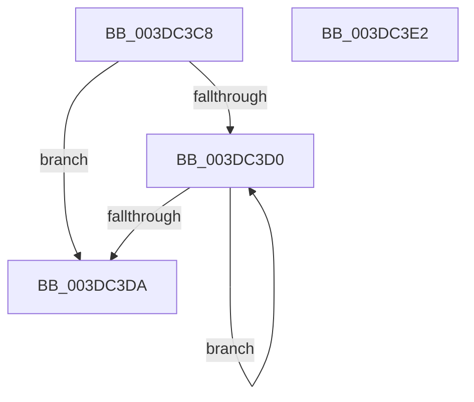

# HalpDmaPrependTranslations

- RVA: `0x003DC3C8`–`0x003DC3E3` (길이 `27` bytes)
- VA: `0x00000001403DC3C8`
- 실행 섹션: `.text`
- PDB 이름 있음: `예`; PDB Function 태그: `아니요`
- unwind 정보 RVA: `0x000DB714`
- 디코드: `10`개 명령, `27/27` bytes 표시
- 미해석 바이트: `0` (있으면 어셈블리에 `.byte`로 보존)

> 이 문서는 커널 이미지의 기계어와 PDB 기호를 분석해 생성했습니다. 4번과 5번은 함수 원형과 자료형을 바이너리 사용 방식에서 추정한 C 해석이며 원본 소스 복구 결과는 아닙니다.

## 1. Dependencies

- 직접 호출 지점: **0**; 고유 호출 대상: **0**
- 직접 호출자로 확인된 함수: **4**
- RIP 상대 이미지 참조: **0**

### Outgoing calls
- 직접 디코드된 call 명령이 없습니다.

### Direct callers
- [HalpDmaAllocateMapRegisters](HalpDmaAllocateMapRegisters_function_003DDA0C.md) at `0x003DDAD9`
- [HalpDmaAllocateMapRegisters](HalpDmaAllocateMapRegisters_function_003DDA0C.md) at `0x003DDD8B`
- [HalpDmaAllocateMapRegisters](HalpDmaAllocateMapRegisters_function_003DDA0C.md) at `0x003DDDE6`
- [HalpDmaCommitScatterMapBuffers](../49/HalpDmaCommitScatterMapBuffers_function_0049A9D0.md) at `0x0049AAF1`
- [HalpDmaAllocateMapRegistersAtHighLevel](../55/HalpDmaAllocateMapRegistersAtHighLevel_function_005507A8.md) at `0x00550889`
- [HalpDmaAllocateMapRegistersAtHighLevel](../55/HalpDmaAllocateMapRegistersAtHighLevel_function_005507A8.md) at `0x005508D0`
- [HalpDmaAllocateMapRegistersAtHighLevel](../55/HalpDmaAllocateMapRegistersAtHighLevel_function_005507A8.md) at `0x005509E8`
- [HalpDmaAllocateMapRegistersAtHighLevel](../55/HalpDmaAllocateMapRegistersAtHighLevel_function_005507A8.md) at `0x00550A30`
- [HalpDmaAllocateLocalScatterPool](../../page/70/HalpDmaAllocateLocalScatterPool_function_007091D4.md) at `0x00709343`
- [HalpDmaAllocateLocalScatterPool](../../page/70/HalpDmaAllocateLocalScatterPool_function_007091D4.md) at `0x007093AF`

### Static image references
- 디코드된 RIP-relative 메모리 참조가 없습니다.

## 2. Other-region calls and transfers

- 다른 실행 섹션으로 향하는 call: **0**
- 별도 외부 분기/꼬리 이동을 확인하지 못했습니다.

## 3. Assembly (complete function range)

```asm
003DC3C8  48 8B C1                        mov rax, rcx
003DC3CB  83 EA 01                        sub edx, 1
003DC3CE  74 0A                           je 0x1403dc3da
003DC3D0  48 8B 40 08                     mov rax, qword ptr [rax + 8]
003DC3D4  48 83 EA 01                     sub rdx, 1
003DC3D8  75 F6                           jne 0x1403dc3d0
003DC3DA  4C 89 40 08                     mov qword ptr [rax + 8], r8
003DC3DE  48 8B C1                        mov rax, rcx
003DC3E1  C3                              ret
003DC3E2  CC                              int3
```

## 4. C-style interpretation (structured pseudocode)

```c
__int64 __fastcall HalpDmaPrependTranslations(__int64 a1, int a2, __int64 a3)
{
    a2 = (unsigned int)((a2) - (1));
    if (condition_is_equal) goto loc_003DC3DA;
loc_003DC3D0:
    a2 = (a2) - (1);
    if (condition_is_not_equal) goto loc_003DC3D0;
loc_003DC3DA:
    *(unsigned __int64 *)(*(unsigned __int64 *)(a1 + 8) + 8) = a3;
    return a1;
}
```

## 5. (Beta) C Style

```c
int64_t HalpDmaPrependTranslations(int64_t Arg1, int32_t Arg2, int64_t Arg3)
{
    Arg2 = (uint32_t)((Arg2) - (1));
    if (condition_is_equal) goto loc_003DC3DA;
loc_003DC3D0:
    Arg2 = (Arg2) - (1);
    if (condition_is_not_equal) goto loc_003DC3D0;
loc_003DC3DA:
    *(uint64_t *)(*(uint64_t *)(Arg1 + 0x8) + 0x8) = Arg3;
    return Arg1;
}
```

## 6. Execution-region graph

[열기: 2D/3D 그래프와 함수 탐색 컨트롤 패널](../../../control-panel.html?section=text&rva=0x003DC3C8&view=graph)

- 2D 그래프는 위에서 아래로 흐르고, 3D 그래프는 빈 공간을 드래그해 회전합니다. Shift+드래그는 이동, 휠은 확대·축소, 함수 노드 선택은 대상 보고서 이동입니다.

### Static fallback


