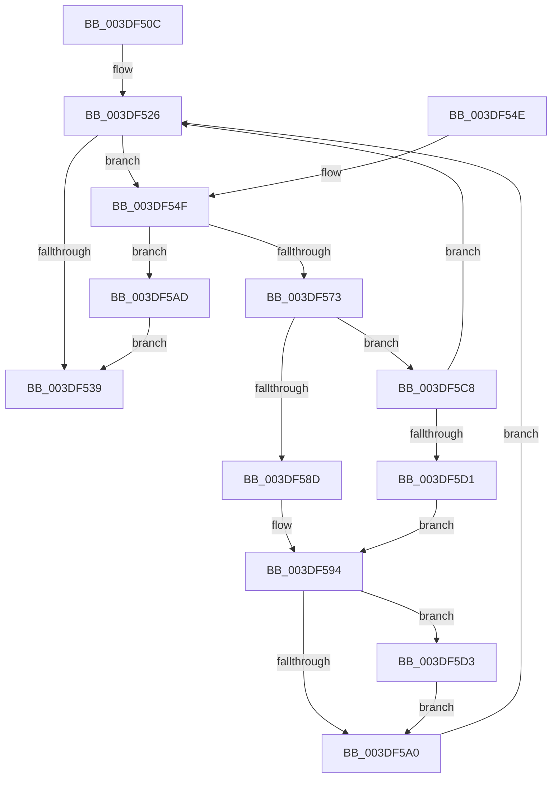

# HalpDmaProcessMapRegisterQueueV2

- RVA: `0x003DF50C`–`0x003DF5EB` (길이 `223` bytes)
- VA: `0x00000001403DF50C`
- 실행 섹션: `.text`
- PDB 이름 있음: `예`; PDB Function 태그: `아니요`
- unwind 정보 RVA: `0x0009482C`
- 디코드: `56`개 명령, `223/223` bytes 표시
- 미해석 바이트: `0` (있으면 어셈블리에 `.byte`로 보존)

> 이 문서는 커널 이미지의 기계어와 PDB 기호를 분석해 생성했습니다. 4번과 5번은 함수 원형과 자료형을 바이너리 사용 방식에서 추정한 C 해석이며 원본 소스 복구 결과는 아닙니다.

## 1. Dependencies

- 직접 호출 지점: **7**; 고유 호출 대상: **7**
- 직접 호출자로 확인된 함수: **2**
- RIP 상대 이미지 참조: **0**

### Outgoing calls
- `0x003DF52C` → [HalpDmaDequeueAdapter](HalpDmaDequeueAdapter_function_003DF9C0.md) (function, `0x003DF9C0`)
- `0x003DF55F` → [HalpDmaAllocateMapRegisters](HalpDmaAllocateMapRegisters_function_003DDA0C.md) (function, `0x003DDA0C`)
- `0x003DF583` → [guard_dispatch_icall](../6B/guard_dispatch_icall_function_006BAAD0.md) (function, `0x006BAAD0`)
- `0x003DF5A3` → [IoFreeAdapterChannelV2](IoFreeAdapterChannelV2_function_003DE3B0.md) (function, `0x003DE3B0`)
- `0x003DF5B0` → [HalpDmaQueueAdapter](../4E/HalpDmaQueueAdapter_function_004E2B3C.md) (function, `0x004E2B3C`)
- `0x003DF5BE` → [HalpQueueMapBufferWorker](../4A/HalpQueueMapBufferWorker_function_004A7B38.md) (function, `0x004A7B38`)
- `0x003DF5DD` → [HalpDmaFreeMapRegisters](HalpDmaFreeMapRegisters_function_003DF5F4.md) (function, `0x003DF5F4`)

### Direct callers
- [IoFreeMapRegistersV2](IoFreeMapRegistersV2_function_003DF440.md) at `0x003DF4A0`
- [HalpGrowMapBufferWorker](../4C/HalpGrowMapBufferWorker_function_004C09B0.md) at `0x004C0A30`

### Static image references
- 디코드된 RIP-relative 메모리 참조가 없습니다.

## 2. Other-region calls and transfers

- 다른 실행 섹션으로 향하는 call: **0**
- 별도 외부 분기/꼬리 이동을 확인하지 못했습니다.

## 3. Assembly (complete function range)

```asm
003DF50C  48 89 5C 24 08                  mov qword ptr [rsp + 8], rbx
003DF511  48 89 6C 24 10                  mov qword ptr [rsp + 0x10], rbp
003DF516  48 89 74 24 18                  mov qword ptr [rsp + 0x18], rsi
003DF51B  57                              push rdi
003DF51C  48 83 EC 30                     sub rsp, 0x30
003DF520  40 8A F2                        mov sil, dl
003DF523  48 8B E9                        mov rbp, rcx
003DF526  40 8A D6                        mov dl, sil
003DF529  48 8B CD                        mov rcx, rbp
003DF52C  E8 8F 04 00 00                  call 0x1403df9c0
003DF531  48 8B D8                        mov rbx, rax
003DF534  48 85 C0                        test rax, rax
003DF537  75 16                           jne 0x1403df54f
003DF539  48 8B 5C 24 40                  mov rbx, qword ptr [rsp + 0x40]
003DF53E  48 8B 6C 24 48                  mov rbp, qword ptr [rsp + 0x48]
003DF543  48 8B 74 24 50                  mov rsi, qword ptr [rsp + 0x50]
003DF548  48 83 C4 30                     add rsp, 0x30
003DF54C  5F                              pop rdi
003DF54D  C3                              ret
003DF54E  CC                              int3
003DF54F  8B 90 F8 00 00 00               mov edx, dword ptr [rax + 0xf8]
003DF555  48 8B CB                        mov rcx, rbx
003DF558  48 8B B8 60 01 00 00            mov rdi, qword ptr [rax + 0x160]
003DF55F  E8 A8 E4 FF FF                  call 0x1403dda0c
003DF564  48 89 83 F0 00 00 00            mov qword ptr [rbx + 0xf0], rax
003DF56B  4C 8B C0                        mov r8, rax
003DF56E  48 85 C0                        test rax, rax
003DF571  74 3A                           je 0x1403df5ad
003DF573  48 8B 47 18                     mov rax, qword ptr [rdi + 0x18]
003DF577  4C 8B 4F 20                     mov r9, qword ptr [rdi + 0x20]
003DF57B  48 8B 57 38                     mov rdx, qword ptr [rdi + 0x38]
003DF57F  48 8B 4F 30                     mov rcx, qword ptr [rdi + 0x30]
003DF583  E8 48 B5 2D 00                  call 0x1406baad0
003DF588  83 F8 03                        cmp eax, 3
003DF58B  75 3B                           jne 0x1403df5c8
003DF58D  83 A3 F8 00 00 00 00            and dword ptr [rbx + 0xf8], 0
003DF594  44 8B 83 F8 00 00 00            mov r8d, dword ptr [rbx + 0xf8]
003DF59B  45 85 C0                        test r8d, r8d
003DF59E  75 33                           jne 0x1403df5d3
003DF5A0  48 8B CB                        mov rcx, rbx
003DF5A3  E8 08 EE FF FF                  call 0x1403de3b0
003DF5A8  E9 79 FF FF FF                  jmp 0x1403df526
003DF5AD  48 8B CB                        mov rcx, rbx
003DF5B0  E8 87 35 10 00                  call 0x1404e2b3c
003DF5B5  8B 93 F8 00 00 00               mov edx, dword ptr [rbx + 0xf8]
003DF5BB  48 8B CB                        mov rcx, rbx
003DF5BE  E8 75 85 0C 00                  call 0x1404a7b38
003DF5C3  E9 71 FF FF FF                  jmp 0x1403df539
003DF5C8  83 F8 02                        cmp eax, 2
003DF5CB  0F 85 55 FF FF FF               jne 0x1403df526
003DF5D1  EB C1                           jmp 0x1403df594
003DF5D3  48 8B 93 F0 00 00 00            mov rdx, qword ptr [rbx + 0xf0]
003DF5DA  48 8B CB                        mov rcx, rbx
003DF5DD  E8 12 00 00 00                  call 0x1403df5f4
003DF5E2  83 A3 F8 00 00 00 00            and dword ptr [rbx + 0xf8], 0
003DF5E9  EB B5                           jmp 0x1403df5a0
```

## 4. C-style interpretation (structured pseudocode)

```c
__int64 __fastcall HalpDmaProcessMapRegisterQueueV2(__int64 a1, unsigned __int8 a2)
{
    __int64 result;
    __int64 v_rsp;
    unsigned __int64 v_stack_p10;
    unsigned __int64 v_stack_p18;
    unsigned __int64 v_stack_p8;

    v_stack_p8 = v_rbx;
    v_stack_p10 = v_rbp;
    v_stack_p18 = v_rsi;
    v_rsp = (v_rsp) - (48);
loc_003DF526:
    result = HalpDmaDequeueAdapter(a1, a2, a3, a4);
    if (result != 0) goto loc_003DF54F;
loc_003DF539:
    v_rsp = (v_rsp) + (48);
    return result;
loc_003DF54F:
    result = HalpDmaAllocateMapRegisters(v_stack_p8, (unsigned int)(*(unsigned int *)(result + 248)), a3, a4);
    *(unsigned __int64 *)(v_stack_p8 + 240) = result;
    if (result == 0) goto loc_003DF5AD;
    result = guard_dispatch_icall(*(unsigned __int64 *)(*(unsigned __int64 *)(result + 352) + 48), *(unsigned __int64 *)(*(unsigned __int64 *)(result + 352) + 56), result, *(unsigned __int64 *)(*(unsigned __int64 *)(result + 352) + 32));
    if (((unsigned int)(result)) != 3) goto loc_003DF5C8;
loc_003DF594:
    if ((unsigned int)((unsigned int)(*(unsigned int *)(v_stack_p8 + 248))) != 0) goto loc_003DF5D3;
loc_003DF5A0:
    result = IoFreeAdapterChannelV2(v_stack_p8, *(unsigned __int64 *)(*(unsigned __int64 *)(result + 352) + 56), (unsigned int)(*(unsigned int *)(v_stack_p8 + 248)), *(unsigned __int64 *)(*(unsigned __int64 *)(result + 352) + 32));
    goto loc_003DF526;
loc_003DF5AD:
    result = HalpDmaQueueAdapter(v_stack_p8, *(unsigned __int64 *)(*(unsigned __int64 *)(result + 352) + 56), (unsigned int)(*(unsigned int *)(v_stack_p8 + 248)), *(unsigned __int64 *)(*(unsigned __int64 *)(result + 352) + 32));
    result = HalpQueueMapBufferWorker(v_stack_p8, (unsigned int)(*(unsigned int *)(v_stack_p8 + 248)), (unsigned int)(*(unsigned int *)(v_stack_p8 + 248)), *(unsigned __int64 *)(*(unsigned __int64 *)(result + 352) + 32));
    goto loc_003DF539;
loc_003DF5C8:
    if (((unsigned int)(result)) != 2) goto loc_003DF526;
    goto loc_003DF594;
loc_003DF5D3:
    result = HalpDmaFreeMapRegisters(v_stack_p8, *(unsigned __int64 *)(v_stack_p8 + 240), (unsigned int)(*(unsigned int *)(v_stack_p8 + 248)), *(unsigned __int64 *)(*(unsigned __int64 *)(result + 352) + 32));
    goto loc_003DF5A0;
}
```

## 5. (Beta) C Style

```c
int64_t HalpDmaProcessMapRegisterQueueV2(int64_t Arg1, uint8_t Arg2)
{
    int64_t result;
    int64_t local_rsp;
    uint64_t v_stack_p10;
    uint64_t v_stack_p18;
    uint64_t v_stack_p8;

    v_stack_p8 = local_rbx;
    v_stack_p10 = local_rbp;
    v_stack_p18 = local_rsi;
    local_rsp = (local_rsp) - (48);
loc_003DF526:
    result = HalpDmaDequeueAdapter(Arg1, Arg2, a3, a4);
    if (result != 0) goto loc_003DF54F;
loc_003DF539:
    local_rsp = (local_rsp) + (48);
    return result;
loc_003DF54F:
    result = HalpDmaAllocateMapRegisters(v_stack_p8, (uint32_t)(*(uint32_t *)(result + 0xF8)), a3, a4);
    *(uint64_t *)(v_stack_p8 + 0xF0) = result;
    if (result == 0) goto loc_003DF5AD;
    result = guard_dispatch_icall(*(uint64_t *)(*(uint64_t *)(result + 0x160) + 0x30), *(uint64_t *)(*(uint64_t *)(result + 0x160) + 0x38), result, *(uint64_t *)(*(uint64_t *)(result + 0x160) + 0x20));
    if (((uint32_t)(result)) != 3) goto loc_003DF5C8;
loc_003DF594:
    if ((uint32_t)((uint32_t)(*(uint32_t *)(v_stack_p8 + 0xF8))) != 0) goto loc_003DF5D3;
loc_003DF5A0:
    result = IoFreeAdapterChannelV2(v_stack_p8, *(uint64_t *)(*(uint64_t *)(result + 0x160) + 0x38), (uint32_t)(*(uint32_t *)(v_stack_p8 + 0xF8)), *(uint64_t *)(*(uint64_t *)(result + 0x160) + 0x20));
    goto loc_003DF526;
loc_003DF5AD:
    result = HalpDmaQueueAdapter(v_stack_p8, *(uint64_t *)(*(uint64_t *)(result + 0x160) + 0x38), (uint32_t)(*(uint32_t *)(v_stack_p8 + 0xF8)), *(uint64_t *)(*(uint64_t *)(result + 0x160) + 0x20));
    result = HalpQueueMapBufferWorker(v_stack_p8, (uint32_t)(*(uint32_t *)(v_stack_p8 + 0xF8)), (uint32_t)(*(uint32_t *)(v_stack_p8 + 0xF8)), *(uint64_t *)(*(uint64_t *)(result + 0x160) + 0x20));
    goto loc_003DF539;
loc_003DF5C8:
    if (((uint32_t)(result)) != 2) goto loc_003DF526;
    goto loc_003DF594;
loc_003DF5D3:
    result = HalpDmaFreeMapRegisters(v_stack_p8, *(uint64_t *)(v_stack_p8 + 0xF0), (uint32_t)(*(uint32_t *)(v_stack_p8 + 0xF8)), *(uint64_t *)(*(uint64_t *)(result + 0x160) + 0x20));
    goto loc_003DF5A0;
}
```

## 6. Execution-region graph

[열기: 2D/3D 그래프와 함수 탐색 컨트롤 패널](../../../control-panel.html?section=text&rva=0x003DF50C&view=graph)

- 2D 그래프는 위에서 아래로 흐르고, 3D 그래프는 빈 공간을 드래그해 회전합니다. Shift+드래그는 이동, 휠은 확대·축소, 함수 노드 선택은 대상 보고서 이동입니다.

### Static fallback


