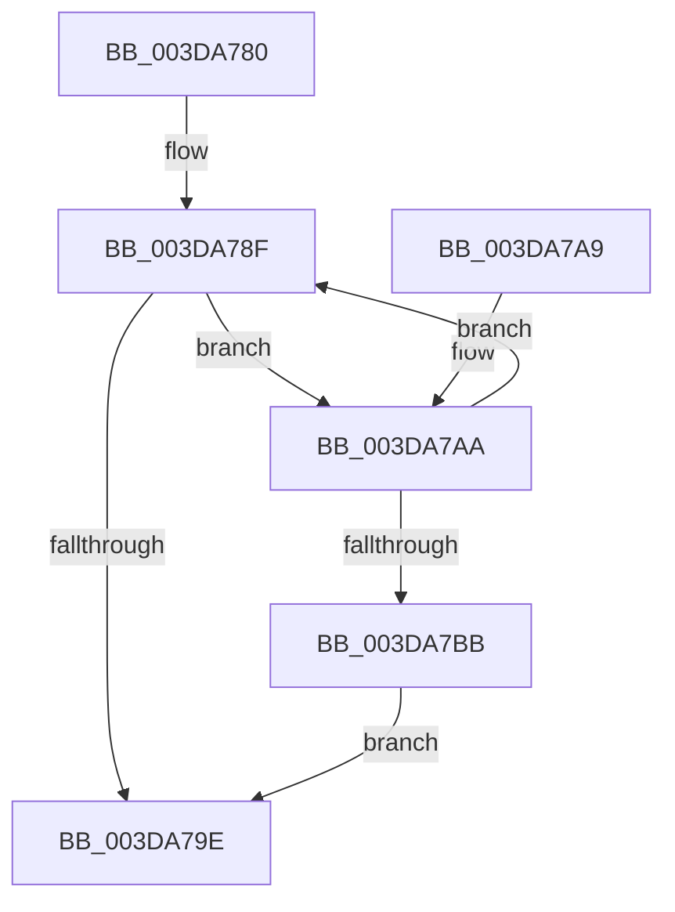

# HalpDmaProcessMapRegisterQueueV3

- RVA: `0x003DA780`–`0x003DA7BD` (길이 `61` bytes)
- VA: `0x00000001403DA780`
- 실행 섹션: `.text`
- PDB 이름 있음: `예`; PDB Function 태그: `아니요`
- unwind 정보 RVA: `0x00065624`
- 디코드: `22`개 명령, `61/61` bytes 표시
- 미해석 바이트: `0` (있으면 어셈블리에 `.byte`로 보존)

> 이 문서는 커널 이미지의 기계어와 PDB 기호를 분석해 생성했습니다. 4번과 5번은 함수 원형과 자료형을 바이너리 사용 방식에서 추정한 C 해석이며 원본 소스 복구 결과는 아닙니다.

## 1. Dependencies

- 직접 호출 지점: **2**; 고유 호출 대상: **2**
- 직접 호출자로 확인된 함수: **2**
- RIP 상대 이미지 참조: **0**

### Outgoing calls
- `0x003DA794` → [HalpDmaDequeueAdapter](HalpDmaDequeueAdapter_function_003DF9C0.md) (function, `0x003DF9C0`)
- `0x003DA7B2` → [HalpAllocateDmaResourcesInternal](HalpAllocateDmaResourcesInternal_function_003DA7C4.md) (function, `0x003DA7C4`)

### Direct callers
- [IoFreeMapRegistersV3](IoFreeMapRegistersV3_function_003DAAD0.md) at `0x003DAB30`
- [HalpGrowMapBufferWorker](../4C/HalpGrowMapBufferWorker_function_004C09B0.md) at `0x004C0A42`

### Static image references
- 디코드된 RIP-relative 메모리 참조가 없습니다.

## 2. Other-region calls and transfers

- 다른 실행 섹션으로 향하는 call: **0**
- 별도 외부 분기/꼬리 이동을 확인하지 못했습니다.

## 3. Assembly (complete function range)

```asm
003DA780  48 89 5C 24 08                  mov qword ptr [rsp + 8], rbx
003DA785  57                              push rdi
003DA786  48 83 EC 20                     sub rsp, 0x20
003DA78A  8A DA                           mov bl, dl
003DA78C  48 8B F9                        mov rdi, rcx
003DA78F  8A D3                           mov dl, bl
003DA791  48 8B CF                        mov rcx, rdi
003DA794  E8 27 52 00 00                  call 0x1403df9c0
003DA799  48 85 C0                        test rax, rax
003DA79C  75 0C                           jne 0x1403da7aa
003DA79E  48 8B 5C 24 30                  mov rbx, qword ptr [rsp + 0x30]
003DA7A3  48 83 C4 20                     add rsp, 0x20
003DA7A7  5F                              pop rdi
003DA7A8  C3                              ret
003DA7A9  CC                              int3
003DA7AA  45 33 C0                        xor r8d, r8d
003DA7AD  B2 01                           mov dl, 1
003DA7AF  48 8B C8                        mov rcx, rax
003DA7B2  E8 0D 00 00 00                  call 0x1403da7c4
003DA7B7  84 C0                           test al, al
003DA7B9  75 D4                           jne 0x1403da78f
003DA7BB  EB E1                           jmp 0x1403da79e
```

## 4. C-style interpretation (structured pseudocode)

```c
__int64 __fastcall HalpDmaProcessMapRegisterQueueV3(__int64 a1, unsigned __int8 a2, int a3)
{
    __int64 result;
    __int64 v_rsp;
    unsigned __int64 v_stack_p8;

    v_stack_p8 = v_rbx;
    v_rsp = (v_rsp) - (32);
loc_003DA78F:
    result = HalpDmaDequeueAdapter(a1, a2, a3, a4);
    if (result != 0) goto loc_003DA7AA;
loc_003DA79E:
    v_rsp = (v_rsp) + (32);
    return result;
loc_003DA7AA:
    a3 = 0;
    result = HalpAllocateDmaResourcesInternal(result, 1, a3, a4);
    if ((unsigned __int8)(result) != 0) goto loc_003DA78F;
    goto loc_003DA79E;
}
```

## 5. (Beta) C Style

```c
int64_t HalpDmaProcessMapRegisterQueueV3(int64_t Arg1, uint8_t Arg2, int32_t Arg3)
{
    int64_t result;
    int64_t local_rsp;
    uint64_t v_stack_p8;

    v_stack_p8 = local_rbx;
    local_rsp = (local_rsp) - (32);
loc_003DA78F:
    result = HalpDmaDequeueAdapter(Arg1, Arg2, Arg3, a4);
    if (result != 0) goto loc_003DA7AA;
loc_003DA79E:
    local_rsp = (local_rsp) + (32);
    return result;
loc_003DA7AA:
    Arg3 = 0;
    result = HalpAllocateDmaResourcesInternal(result, 1, Arg3, a4);
    if ((uint8_t)(result) != 0) goto loc_003DA78F;
    goto loc_003DA79E;
}
```

## 6. Execution-region graph

[열기: 2D/3D 그래프와 함수 탐색 컨트롤 패널](../../../control-panel.html?section=text&rva=0x003DA780&view=graph)

- 2D 그래프는 위에서 아래로 흐르고, 3D 그래프는 빈 공간을 드래그해 회전합니다. Shift+드래그는 이동, 휠은 확대·축소, 함수 노드 선택은 대상 보고서 이동입니다.

### Static fallback


