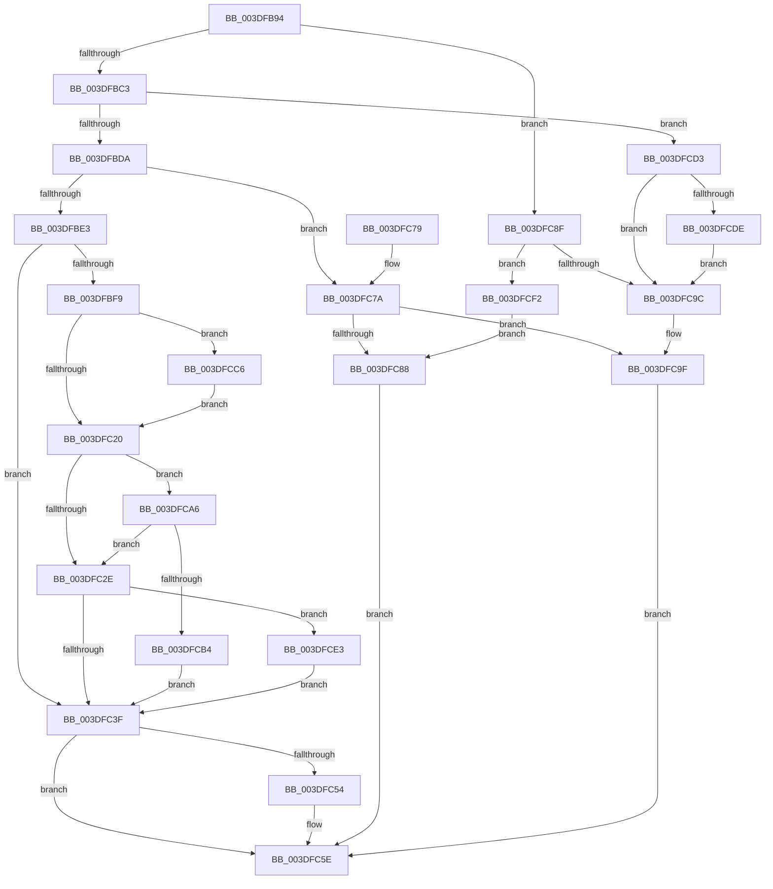

# HalpDmaReturnPageToOwner

- RVA: `0x003DFB94`–`0x003DFCF7` (길이 `355` bytes)
- VA: `0x00000001403DFB94`
- 실행 섹션: `.text`
- PDB 이름 있음: `예`; PDB Function 태그: `아니요`
- unwind 정보 RVA: `0x000948B0`
- 디코드: `93`개 명령, `355/355` bytes 표시
- 미해석 바이트: `0` (있으면 어셈블리에 `.byte`로 보존)

> 이 문서는 커널 이미지의 기계어와 PDB 기호를 분석해 생성했습니다. 4번과 5번은 함수 원형과 자료형을 바이너리 사용 방식에서 추정한 C 해석이며 원본 소스 복구 결과는 아닙니다.

## 1. Dependencies

- 직접 호출 지점: **6**; 고유 호출 대상: **6**
- 직접 호출자로 확인된 함수: **2**
- RIP 상대 이미지 참조: **3**

### Outgoing calls
- `0x003DFC59` → [KeReleaseInStackQueuedSpinLock](../34/KeReleaseInStackQueuedSpinLock_function_00342CE0.md) (function, `0x00342CE0`)
- `0x003DFC88` → [HalpDmaReturnToScatterPool](HalpDmaReturnToScatterPool_function_003DFD00.md) (function, `0x003DFD00`)
- `0x003DFC9F` → [HalpDmaReturnToContiguousPool](../3E/HalpDmaReturnToContiguousPool_function_003E1758.md) (function, `0x003E1758`)
- `0x003DFCBC` → [KiAcquireQueuedSpinLockInstrumented](../27/KiAcquireQueuedSpinLockInstrumented_function_00275850.md) (function, `0x00275850`)
- `0x003DFCC9` → [KiRaiseIrqlProcessIrqlFlags](../4F/KiRaiseIrqlProcessIrqlFlags_function_004F56FC.md) (function, `0x004F56FC`)
- `0x003DFCE8` → [KxWaitForLockOwnerShip](../25/KxWaitForLockOwnerShip_function_00257EB0.md) (function, `0x00257EB0`)

### Direct callers
- [sub_006EA22C](../6E/Unknown_function_006EA22C.md) at `0x006EA39D`
- [sub_006F79F4](../6F/Unknown_function_006F79F4.md) at `0x006F7B3E`

### Static image references
- `0x003DFC14` → RVA `0x00FC6D20` (`ALMOSTRO`; read)
- `0x003DFC20` → RVA `0x00FC6B06` (`ALMOSTRO`; read)
- `0x003DFCA6` → RVA `0x00F0DE58` (`.data`; read)

## 2. Other-region calls and transfers

- 다른 실행 섹션으로 향하는 call: **0**
- 별도 외부 분기/꼬리 이동을 확인하지 못했습니다.

## 3. Assembly (complete function range)

```asm
003DFB94  4C 8B DC                        mov r11, rsp
003DFB97  49 89 5B 08                     mov qword ptr [r11 + 8], rbx
003DFB9B  49 89 6B 10                     mov qword ptr [r11 + 0x10], rbp
003DFB9F  49 89 73 18                     mov qword ptr [r11 + 0x18], rsi
003DFBA3  49 89 7B 20                     mov qword ptr [r11 + 0x20], rdi
003DFBA7  41 56                           push r14
003DFBA9  48 83 EC 40                     sub rsp, 0x40
003DFBAD  49 8B D8                        mov rbx, r8
003DFBB0  4C 8B CA                        mov r9, rdx
003DFBB3  49 89 58 38                     mov qword ptr [r8 + 0x38], rbx
003DFBB7  48 8B F9                        mov rdi, rcx
003DFBBA  48 85 C9                        test rcx, rcx
003DFBBD  0F 84 CC 00 00 00               je 0x1403dfc8f
003DFBC3  49 8B 48 30                     mov rcx, qword ptr [r8 + 0x30]
003DFBC7  48 8B C1                        mov rax, rcx
003DFBCA  83 E0 04                        and eax, 4
003DFBCD  80 BF BA 01 00 00 00            cmp byte ptr [rdi + 0x1ba], 0
003DFBD4  0F 84 F9 00 00 00               je 0x1403dfcd3
003DFBDA  48 85 C0                        test rax, rax
003DFBDD  0F 85 97 00 00 00               jne 0x1403dfc7a
003DFBE3  0F 57 C0                        xorps xmm0, xmm0
003DFBE6  0F 11 44 24 20                  movups xmmword ptr [rsp + 0x20], xmm0
003DFBEB  49 89 43 E8                     mov qword ptr [r11 - 0x18], rax
003DFBEF  45 0F 20 C6                     mov r14, cr8
003DFBF3  41 80 FE 0F                     cmp r14b, 0xf
003DFBF7  74 46                           je 0x1403dfc3f
003DFBF9  49 21 43 D8                     and qword ptr [r11 - 0x28], rax
003DFBFD  48 8D B7 80 00 00 00            lea rsi, [rdi + 0x80]
003DFC04  49 89 73 E0                     mov qword ptr [r11 - 0x20], rsi
003DFC08  90                              nop
003DFC09  44 0F 20 C5                     mov rbp, cr8
003DFC0D  8D 50 02                        lea edx, [rax + 2]
003DFC10  44 0F 22 C2                     mov cr8, rdx
003DFC14  39 05 06 71 BE 00               cmp dword ptr [rip + 0xbe7106], eax
003DFC1A  0F 85 A6 00 00 00               jne 0x1403dfcc6
003DFC20  F6 05 DF 6E BE 00 21            test byte ptr [rip + 0xbe6edf], 0x21
003DFC27  40 88 6C 24 30                  mov byte ptr [rsp + 0x30], bpl
003DFC2C  75 78                           jne 0x1403dfca6
003DFC2E  48 8D 54 24 20                  lea rdx, [rsp + 0x20]
003DFC33  48 87 16                        xchg qword ptr [rsi], rdx
003DFC36  48 85 D2                        test rdx, rdx
003DFC39  0F 85 A4 00 00 00               jne 0x1403dfce3
003DFC3F  48 8B 47 20                     mov rax, qword ptr [rdi + 0x20]
003DFC43  48 89 43 08                     mov qword ptr [rbx + 8], rax
003DFC47  FF 47 28                        inc dword ptr [rdi + 0x28]
003DFC4A  48 89 5F 20                     mov qword ptr [rdi + 0x20], rbx
003DFC4E  41 80 FE 0F                     cmp r14b, 0xf
003DFC52  74 0A                           je 0x1403dfc5e
003DFC54  48 8D 4C 24 20                  lea rcx, [rsp + 0x20]
003DFC59  E8 82 30 F6 FF                  call 0x140342ce0
003DFC5E  48 8B 5C 24 50                  mov rbx, qword ptr [rsp + 0x50]
003DFC63  48 8B 6C 24 58                  mov rbp, qword ptr [rsp + 0x58]
003DFC68  48 8B 74 24 60                  mov rsi, qword ptr [rsp + 0x60]
003DFC6D  48 8B 7C 24 68                  mov rdi, qword ptr [rsp + 0x68]
003DFC72  48 83 C4 40                     add rsp, 0x40
003DFC76  41 5E                           pop r14
003DFC78  C3                              ret
003DFC79  CC                              int3
003DFC7A  45 33 C0                        xor r8d, r8d
003DFC7D  48 8B D3                        mov rdx, rbx
003DFC80  F6 C1 08                        test cl, 8
003DFC83  49 8B C9                        mov rcx, r9
003DFC86  74 17                           je 0x1403dfc9f
003DFC88  E8 73 00 00 00                  call 0x1403dfd00
003DFC8D  EB CF                           jmp 0x1403dfc5e
003DFC8F  41 F6 40 30 08                  test byte ptr [r8 + 0x30], 8
003DFC94  48 8B D3                        mov rdx, rbx
003DFC97  49 8B C9                        mov rcx, r9
003DFC9A  75 56                           jne 0x1403dfcf2
003DFC9C  45 33 C0                        xor r8d, r8d
003DFC9F  E8 B4 1A 00 00                  call 0x1403e1758
003DFCA4  EB B8                           jmp 0x1403dfc5e
003DFCA6  8B 05 AC E1 B2 00               mov eax, dword ptr [rip + 0xb2e1ac]
003DFCAC  85 C0                           test eax, eax
003DFCAE  0F 85 7A FF FF FF               jne 0x1403dfc2e
003DFCB4  48 8B D6                        mov rdx, rsi
003DFCB7  48 8D 4C 24 20                  lea rcx, [rsp + 0x20]
003DFCBC  E8 8F 5B E9 FF                  call 0x140275850
003DFCC1  E9 79 FF FF FF                  jmp 0x1403dfc3f
003DFCC6  40 8A CD                        mov cl, bpl
003DFCC9  E8 2E 5A 11 00                  call 0x1404f56fc
003DFCCE  E9 4D FF FF FF                  jmp 0x1403dfc20
003DFCD3  48 8B D3                        mov rdx, rbx
003DFCD6  49 8B C9                        mov rcx, r9
003DFCD9  48 85 C0                        test rax, rax
003DFCDC  75 BE                           jne 0x1403dfc9c
003DFCDE  48 8B CF                        mov rcx, rdi
003DFCE1  EB B9                           jmp 0x1403dfc9c
003DFCE3  48 8D 4C 24 20                  lea rcx, [rsp + 0x20]
003DFCE8  E8 C3 81 E7 FF                  call 0x140257eb0
003DFCED  E9 4D FF FF FF                  jmp 0x1403dfc3f
003DFCF2  45 33 C0                        xor r8d, r8d
003DFCF5  EB 91                           jmp 0x1403dfc88
```

## 4. C-style interpretation (structured pseudocode)

```c
__int64 __fastcall HalpDmaReturnPageToOwner(__int64 a1, __int64 a2, __int64 a3)
{
    __int64 result;
    __int64 v_rsp;
    unsigned __int8 v_stack_m18;
    unsigned __int64 v_stack_m28;
    unsigned __int64 v_stack_p10;
    unsigned __int64 v_stack_p18;
    unsigned __int64 v_stack_p20;
    unsigned __int64 v_stack_p8;

    *(unsigned __int64 *)(v_rsp + 8) = v_rbx;
    *(unsigned __int64 *)(v_rsp + 16) = v_rbp;
    *(unsigned __int64 *)(v_rsp + 24) = v_rsi;
    *(unsigned __int64 *)(v_rsp + 32) = v_rdi;
    v_rsp = (v_rsp) - (64);
    *(unsigned __int64 *)(a3 + 56) = a3;
    if (a1 == 0) goto loc_003DFC8F;
    result = (unsigned int)((*(unsigned __int64 *)(a3 + 48)) & (4));
    if ((*(unsigned __int8 *)(a1 + 442)) == 0) goto loc_003DFCD3;
    if (result != 0) goto loc_003DFC7A;
    v_stack_m28 = v_xmm0;
    *(unsigned __int64 *)(v_rsp - 24) = result;
    if (((unsigned __int8)(v_cr8)) == 15) goto loc_003DFC3F;
    *(unsigned __int64 *)(v_rsp - 32) = a1 + 128;
    if ((*(unsigned int *)(v_rip + 12480774)) != ((unsigned int)(result))) goto loc_003DFCC6;
loc_003DFC20:
    v_stack_m18 = (unsigned __int8)(v_cr8);
    if (((*(unsigned __int8 *)(v_rip + 12480223)) & (33)) != 0) goto loc_003DFCA6;
loc_003DFC2E:
    if (v_stack_m28 != 0) goto loc_003DFCE3;
loc_003DFC3F:
    *(unsigned __int64 *)(a3 + 8) = *(unsigned __int64 *)(a1 + 32);
    *(unsigned __int64 *)(a1 + 32) = a3;
    result = *(unsigned __int64 *)(a1 + 32);
    if (((unsigned __int8)(v_cr8)) != 15) {
        a1 = v_stack_m28;
        result = KeReleaseInStackQueuedSpinLock(a1, v_stack_m28, a3, a2);
    }
    v_rsp = (v_rsp) + (64);
    return result;
loc_003DFC7A:
    a3 = 0;
    if ((((unsigned __int8)(a1)) & (8)) == 0) goto loc_003DFC9F;
loc_003DFC88:
    result = HalpDmaReturnToScatterPool(a2, v_stack_p8, a3, a2);
    goto loc_003DFC5E;
loc_003DFC8F:
    if (((*(unsigned __int8 *)(a3 + 48)) & (8)) != 0) goto loc_003DFCF2;
loc_003DFC9C:
    a3 = 0;
loc_003DFC9F:
    result = HalpDmaReturnToContiguousPool(a2, v_stack_p8, a3, a2);
    goto loc_003DFC5E;
loc_003DFCA6:
    if ((unsigned int)((unsigned int)(*(unsigned int *)(v_rip + 11723180))) != 0) goto loc_003DFC2E;
    result = KiAcquireQueuedSpinLockInstrumented(v_stack_p20, v_stack_p18, a3, a2);
    goto loc_003DFC3F;
loc_003DFCC6:
    result = KiRaiseIrqlProcessIrqlFlags((unsigned __int8)(v_stack_p10), v_stack_p18, a3, a2);
    goto loc_003DFC20;
loc_003DFCD3:
    if (result != 0) goto loc_003DFC9C;
    goto loc_003DFC9C;
loc_003DFCE3:
    result = KxWaitForLockOwnerShip(v_stack_p20, v_stack_p8, a3, a2);
    goto loc_003DFC3F;
loc_003DFCF2:
    a3 = 0;
    goto loc_003DFC88;
}
```

## 5. (Beta) C Style

```c
int64_t HalpDmaReturnPageToOwner(void *Arg1, int64_t Arg2, void *Arg3)
{
    uint8_t *arg1 = (uint8_t *)Arg1;
    uint8_t *arg3 = (uint8_t *)Arg3;

    int64_t result;
    int64_t local_rsp;
    uint8_t v_stack_m18;
    uint64_t v_stack_m28;
    uint64_t v_stack_p10;
    uint64_t v_stack_p18;
    uint64_t v_stack_p20;
    uint64_t v_stack_p8;

    *(uint64_t *)(local_rsp + 0x8) = local_rbx;
    *(uint64_t *)(local_rsp + 0x10) = local_rbp;
    *(uint64_t *)(local_rsp + 0x18) = local_rsi;
    *(uint64_t *)(local_rsp + 0x20) = local_rdi;
    local_rsp = (local_rsp) - (64);
    *(void **)(arg3 + 0x38) = Arg3;
    if (Arg1 == NULL) goto loc_003DFC8F;
    result = (uint32_t)((*(uint64_t *)(arg3 + 0x30)) & (4));
    if ((*(uint8_t *)(arg1 + 0x1BA)) == 0) goto loc_003DFCD3;
    if (result != 0) goto loc_003DFC7A;
    v_stack_m28 = v_xmm0;
    *(uint64_t *)(local_rsp - 0x18) = result;
    if (((uint8_t)(v_cr8)) == 15) goto loc_003DFC3F;
    *(void **)(local_rsp - 0x20) = Arg1 + 128;
    if ((*(uint32_t *)(v_rip + 0xBE7106)) != ((uint32_t)(result))) goto loc_003DFCC6;
loc_003DFC20:
    v_stack_m18 = (uint8_t)(v_cr8);
    if (((*(uint8_t *)(v_rip + 0xBE6EDF)) & (33)) != 0) goto loc_003DFCA6;
loc_003DFC2E:
    if (v_stack_m28 != 0) goto loc_003DFCE3;
loc_003DFC3F:
    *(uint64_t *)(arg3 + 0x8) = *(uint64_t *)(arg1 + 0x20);
    *(void **)(arg1 + 0x20) = Arg3;
    result = *(uint64_t *)(arg1 + 0x20);
    if (((uint8_t)(v_cr8)) != 15) {
        Arg1 = v_stack_m28;
        result = KeReleaseInStackQueuedSpinLock(Arg1, v_stack_m28, Arg3, Arg2);
    }
    local_rsp = (local_rsp) + (64);
    return result;
loc_003DFC7A:
    Arg3 = 0;
    if ((((uint8_t)(Arg1)) & (8)) == 0) goto loc_003DFC9F;
loc_003DFC88:
    result = HalpDmaReturnToScatterPool(Arg2, v_stack_p8, Arg3, Arg2);
    goto loc_003DFC5E;
loc_003DFC8F:
    if (((*(uint8_t *)(arg3 + 0x30)) & (8)) != 0) goto loc_003DFCF2;
loc_003DFC9C:
    Arg3 = 0;
loc_003DFC9F:
    result = HalpDmaReturnToContiguousPool(Arg2, v_stack_p8, Arg3, Arg2);
    goto loc_003DFC5E;
loc_003DFCA6:
    if ((uint32_t)((uint32_t)(*(uint32_t *)(v_rip + 0xB2E1AC))) != 0) goto loc_003DFC2E;
    result = KiAcquireQueuedSpinLockInstrumented(v_stack_p20, v_stack_p18, Arg3, Arg2);
    goto loc_003DFC3F;
loc_003DFCC6:
    result = KiRaiseIrqlProcessIrqlFlags((uint8_t)(v_stack_p10), v_stack_p18, Arg3, Arg2);
    goto loc_003DFC20;
loc_003DFCD3:
    if (result != 0) goto loc_003DFC9C;
    goto loc_003DFC9C;
loc_003DFCE3:
    result = KxWaitForLockOwnerShip(v_stack_p20, v_stack_p8, Arg3, Arg2);
    goto loc_003DFC3F;
loc_003DFCF2:
    Arg3 = 0;
    goto loc_003DFC88;
}
```

### 관측된 메모리 오프셋

구조체 형식이 확인되지 않은 접근은 인자 기준의 오프셋으로만 기록했습니다.

| 기준 인자 | 오프셋 표현 | 폭 (bit) | 접근 |
|---|---:|---:|---|
| `Arg1` | `+ 0x0` | `64` | `R/W` |
| `Arg1` | `+ 0x20` | `64` | `R` |
| `Arg1` | `+ 0x20` | `64` | `W` |
| `Arg1` | `+ 0x28` | `32` | `R/W` |
| `Arg1` | `+ 0x80` | `64` | `R` |
| `Arg1` | `+ 0x1BA` | `8` | `R` |
| `Arg3` | `+ 0x8` | `64` | `W` |
| `Arg3` | `+ 0x30` | `8` | `R` |
| `Arg3` | `+ 0x30` | `64` | `R` |
| `Arg3` | `+ 0x38` | `64` | `W` |

## 6. Execution-region graph

[열기: 2D/3D 그래프와 함수 탐색 컨트롤 패널](../../../control-panel.html?section=text&rva=0x003DFB94&view=graph)

- 2D 그래프는 위에서 아래로 흐르고, 3D 그래프는 빈 공간을 드래그해 회전합니다. Shift+드래그는 이동, 휠은 확대·축소, 함수 노드 선택은 대상 보고서 이동입니다.

### Static fallback


