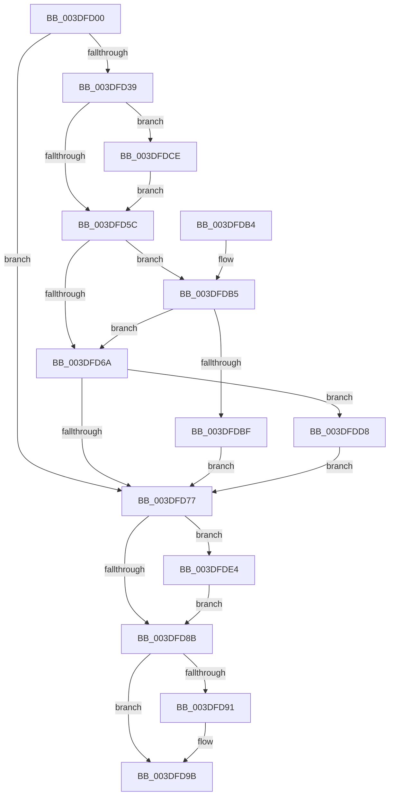

# HalpDmaReturnToScatterPool

- RVA: `0x003DFD00`–`0x003DFDEC` (길이 `236` bytes)
- VA: `0x00000001403DFD00`
- 실행 섹션: `.text`
- PDB 이름 있음: `예`; PDB Function 태그: `아니요`
- unwind 정보 RVA: `0x000948CC`
- 디코드: `68`개 명령, `236/236` bytes 표시
- 미해석 바이트: `0` (있으면 어셈블리에 `.byte`로 보존)

> 이 문서는 커널 이미지의 기계어와 PDB 기호를 분석해 생성했습니다. 4번과 5번은 함수 원형과 자료형을 바이너리 사용 방식에서 추정한 C 해석이며 원본 소스 복구 결과는 아닙니다.

## 1. Dependencies

- 직접 호출 지점: **4**; 고유 호출 대상: **4**
- 직접 호출자로 확인된 함수: **3**
- RIP 상대 이미지 참조: **3**

### Outgoing calls
- `0x003DFD96` → [KeReleaseInStackQueuedSpinLock](../34/KeReleaseInStackQueuedSpinLock_function_00342CE0.md) (function, `0x00342CE0`)
- `0x003DFDC7` → [KiAcquireQueuedSpinLockInstrumented](../27/KiAcquireQueuedSpinLockInstrumented_function_00275850.md) (function, `0x00275850`)
- `0x003DFDD1` → [KiRaiseIrqlProcessIrqlFlags](../4F/KiRaiseIrqlProcessIrqlFlags_function_004F56FC.md) (function, `0x004F56FC`)
- `0x003DFDDD` → [KxWaitForLockOwnerShip](../25/KxWaitForLockOwnerShip_function_00257EB0.md) (function, `0x00257EB0`)

### Direct callers
- [HalpDmaFreeMapRegisters](HalpDmaFreeMapRegisters_function_003DF5F4.md) at `0x003DF739`
- [HalpDmaReturnPageToOwner](HalpDmaReturnPageToOwner_function_003DFB94.md) at `0x003DFC88`
- [HalpDmaReturnPageToSource](../55/HalpDmaReturnPageToSource_function_0055119C.md) at `0x005511CC`

### Static image references
- `0x003DFD54` → RVA `0x00FC6D20` (`ALMOSTRO`; read)
- `0x003DFD5C` → RVA `0x00FC6B06` (`ALMOSTRO`; read)
- `0x003DFDB5` → RVA `0x00F0DE58` (`.data`; read)

## 2. Other-region calls and transfers

- 다른 실행 섹션으로 향하는 call: **0**
- 별도 외부 분기/꼬리 이동을 확인하지 못했습니다.

## 3. Assembly (complete function range)

```asm
003DFD00  4C 8B DC                        mov r11, rsp
003DFD03  49 89 5B 08                     mov qword ptr [r11 + 8], rbx
003DFD07  49 89 6B 10                     mov qword ptr [r11 + 0x10], rbp
003DFD0B  49 89 73 18                     mov qword ptr [r11 + 0x18], rsi
003DFD0F  57                              push rdi
003DFD10  41 56                           push r14
003DFD12  41 57                           push r15
003DFD14  48 83 EC 40                     sub rsp, 0x40
003DFD18  0F 57 C0                        xorps xmm0, xmm0
003DFD1B  33 C0                           xor eax, eax
003DFD1D  0F 11 44 24 20                  movups xmmword ptr [rsp + 0x20], xmm0
003DFD22  49 89 43 D8                     mov qword ptr [r11 - 0x28], rax
003DFD26  45 8A F8                        mov r15b, r8b
003DFD29  4C 8B F2                        mov r14, rdx
003DFD2C  48 8B D9                        mov rbx, rcx
003DFD2F  44 0F 20 C5                     mov rbp, cr8
003DFD33  40 80 FD 0F                     cmp bpl, 0xf
003DFD37  74 3E                           je 0x1403dfd77
003DFD39  49 21 43 C8                     and qword ptr [r11 - 0x38], rax
003DFD3D  48 8D B9 80 00 00 00            lea rdi, [rcx + 0x80]
003DFD44  49 89 7B D0                     mov qword ptr [r11 - 0x30], rdi
003DFD48  90                              nop
003DFD49  44 0F 20 C6                     mov rsi, cr8
003DFD4D  8D 50 02                        lea edx, [rax + 2]
003DFD50  44 0F 22 C2                     mov cr8, rdx
003DFD54  39 05 C6 6F BE 00               cmp dword ptr [rip + 0xbe6fc6], eax
003DFD5A  75 72                           jne 0x1403dfdce
003DFD5C  F6 05 A3 6D BE 00 21            test byte ptr [rip + 0xbe6da3], 0x21
003DFD63  40 88 74 24 30                  mov byte ptr [rsp + 0x30], sil
003DFD68  75 4B                           jne 0x1403dfdb5
003DFD6A  48 8D 54 24 20                  lea rdx, [rsp + 0x20]
003DFD6F  48 87 17                        xchg qword ptr [rdi], rdx
003DFD72  48 85 D2                        test rdx, rdx
003DFD75  75 61                           jne 0x1403dfdd8
003DFD77  48 8B 43 20                     mov rax, qword ptr [rbx + 0x20]
003DFD7B  49 89 46 08                     mov qword ptr [r14 + 8], rax
003DFD7F  FF 43 28                        inc dword ptr [rbx + 0x28]
003DFD82  4C 89 73 20                     mov qword ptr [rbx + 0x20], r14
003DFD86  45 84 FF                        test r15b, r15b
003DFD89  75 59                           jne 0x1403dfde4
003DFD8B  40 80 FD 0F                     cmp bpl, 0xf
003DFD8F  74 0A                           je 0x1403dfd9b
003DFD91  48 8D 4C 24 20                  lea rcx, [rsp + 0x20]
003DFD96  E8 45 2F F6 FF                  call 0x140342ce0
003DFD9B  48 8B 5C 24 60                  mov rbx, qword ptr [rsp + 0x60]
003DFDA0  48 8B 6C 24 68                  mov rbp, qword ptr [rsp + 0x68]
003DFDA5  48 8B 74 24 70                  mov rsi, qword ptr [rsp + 0x70]
003DFDAA  48 83 C4 40                     add rsp, 0x40
003DFDAE  41 5F                           pop r15
003DFDB0  41 5E                           pop r14
003DFDB2  5F                              pop rdi
003DFDB3  C3                              ret
003DFDB4  CC                              int3
003DFDB5  8B 05 9D E0 B2 00               mov eax, dword ptr [rip + 0xb2e09d]
003DFDBB  85 C0                           test eax, eax
003DFDBD  75 AB                           jne 0x1403dfd6a
003DFDBF  48 8B D7                        mov rdx, rdi
003DFDC2  48 8D 4C 24 20                  lea rcx, [rsp + 0x20]
003DFDC7  E8 84 5A E9 FF                  call 0x140275850
003DFDCC  EB A9                           jmp 0x1403dfd77
003DFDCE  40 8A CE                        mov cl, sil
003DFDD1  E8 26 59 11 00                  call 0x1404f56fc
003DFDD6  EB 84                           jmp 0x1403dfd5c
003DFDD8  48 8D 4C 24 20                  lea rcx, [rsp + 0x20]
003DFDDD  E8 CE 80 E7 FF                  call 0x140257eb0
003DFDE2  EB 93                           jmp 0x1403dfd77
003DFDE4  FF 83 E0 00 00 00               inc dword ptr [rbx + 0xe0]
003DFDEA  EB 9F                           jmp 0x1403dfd8b
```

## 4. C-style interpretation (structured pseudocode)

```c
__int64 __fastcall HalpDmaReturnToScatterPool(__int64 a1, __int64 a2, unsigned __int8 a3)
{
    __int64 result;
    __int64 v_rsp;
    unsigned __int8 v_stack_m28;
    unsigned __int64 v_stack_m38;
    unsigned __int64 v_stack_p10;
    unsigned __int64 v_stack_p18;
    unsigned __int64 v_stack_p20;
    unsigned __int64 v_stack_p8;

    *(unsigned __int64 *)(v_rsp + 8) = v_rbx;
    *(unsigned __int64 *)(v_rsp + 16) = v_rbp;
    *(unsigned __int64 *)(v_rsp + 24) = v_rsi;
    v_rsp = (v_rsp) - (64);
    result = 0;
    v_stack_m38 = v_xmm0;
    *(unsigned __int64 *)(v_rsp - 40) = 0;
    if (((unsigned __int8)(v_cr8)) == 15) goto loc_003DFD77;
    *(unsigned __int64 *)(v_rsp - 48) = a1 + 128;
    if ((*(unsigned int *)(v_rip + 12480454)) != 0) goto loc_003DFDCE;
loc_003DFD5C:
    v_stack_m28 = (unsigned __int8)(v_cr8);
    if (((*(unsigned __int8 *)(v_rip + 12479907)) & (33)) != 0) goto loc_003DFDB5;
loc_003DFD6A:
    if (v_stack_m38 != 0) goto loc_003DFDD8;
loc_003DFD77:
    *(unsigned __int64 *)(a2 + 8) = *(unsigned __int64 *)(a1 + 32);
    *(unsigned __int64 *)(a1 + 32) = a2;
    if (a3 != 0) goto loc_003DFDE4;
loc_003DFD8B:
    result = *(unsigned __int64 *)(a1 + 32);
    if (((unsigned __int8)(v_cr8)) != 15) {
        a1 = v_stack_m38;
        result = KeReleaseInStackQueuedSpinLock(a1, v_stack_m38, a3, a4);
    }
    v_rsp = (v_rsp) + (64);
    return result;
loc_003DFDB5:
    if ((unsigned int)((unsigned int)(*(unsigned int *)(v_rip + 11722909))) != 0) goto loc_003DFD6A;
    result = KiAcquireQueuedSpinLockInstrumented(v_stack_p20, a1 + 128, a3, a4);
    goto loc_003DFD77;
loc_003DFDCE:
    result = KiRaiseIrqlProcessIrqlFlags((unsigned __int8)(v_stack_p18), a1 + 128, a3, a4);
    goto loc_003DFD5C;
loc_003DFDD8:
    result = KxWaitForLockOwnerShip(v_stack_p20, a1 + 128, a3, a4);
    goto loc_003DFD77;
loc_003DFDE4:
    goto loc_003DFD8B;
}
```

## 5. (Beta) C Style

```c
int64_t HalpDmaReturnToScatterPool(void *Arg1, void *Arg2, uint8_t Arg3)
{
    uint8_t *arg1 = (uint8_t *)Arg1;
    uint8_t *arg2 = (uint8_t *)Arg2;

    int64_t result;
    int64_t local_rsp;
    uint8_t v_stack_m28;
    uint64_t v_stack_m38;
    uint64_t v_stack_p10;
    uint64_t v_stack_p18;
    uint64_t v_stack_p20;
    uint64_t v_stack_p8;

    *(uint64_t *)(local_rsp + 0x8) = local_rbx;
    *(uint64_t *)(local_rsp + 0x10) = local_rbp;
    *(uint64_t *)(local_rsp + 0x18) = local_rsi;
    local_rsp = (local_rsp) - (64);
    result = 0;
    v_stack_m38 = v_xmm0;
    *(uint64_t *)(local_rsp - 0x28) = 0;
    if (((uint8_t)(v_cr8)) == 15) goto loc_003DFD77;
    *(void **)(local_rsp - 0x30) = Arg1 + 128;
    if ((*(uint32_t *)(v_rip + 0xBE6FC6)) != 0) goto loc_003DFDCE;
loc_003DFD5C:
    v_stack_m28 = (uint8_t)(v_cr8);
    if (((*(uint8_t *)(v_rip + 0xBE6DA3)) & (33)) != 0) goto loc_003DFDB5;
loc_003DFD6A:
    if (v_stack_m38 != 0) goto loc_003DFDD8;
loc_003DFD77:
    *(uint64_t *)(arg2 + 0x8) = *(uint64_t *)(arg1 + 0x20);
    *(void **)(arg1 + 0x20) = Arg2;
    if (Arg3 != 0) goto loc_003DFDE4;
loc_003DFD8B:
    result = *(uint64_t *)(arg1 + 0x20);
    if (((uint8_t)(v_cr8)) != 15) {
        Arg1 = v_stack_m38;
        result = KeReleaseInStackQueuedSpinLock(Arg1, v_stack_m38, Arg3, a4);
    }
    local_rsp = (local_rsp) + (64);
    return result;
loc_003DFDB5:
    if ((uint32_t)((uint32_t)(*(uint32_t *)(v_rip + 0xB2E09D))) != 0) goto loc_003DFD6A;
    result = KiAcquireQueuedSpinLockInstrumented(v_stack_p20, Arg1 + 128, Arg3, a4);
    goto loc_003DFD77;
loc_003DFDCE:
    result = KiRaiseIrqlProcessIrqlFlags((uint8_t)(v_stack_p18), Arg1 + 128, Arg3, a4);
    goto loc_003DFD5C;
loc_003DFDD8:
    result = KxWaitForLockOwnerShip(v_stack_p20, Arg1 + 128, Arg3, a4);
    goto loc_003DFD77;
loc_003DFDE4:
    goto loc_003DFD8B;
}
```

### 관측된 메모리 오프셋

구조체 형식이 확인되지 않은 접근은 인자 기준의 오프셋으로만 기록했습니다.

| 기준 인자 | 오프셋 표현 | 폭 (bit) | 접근 |
|---|---:|---:|---|
| `Arg1` | `+ 0x0` | `64` | `R/W` |
| `Arg1` | `+ 0x20` | `64` | `R` |
| `Arg1` | `+ 0x20` | `64` | `W` |
| `Arg1` | `+ 0x28` | `32` | `R/W` |
| `Arg1` | `+ 0x80` | `64` | `R` |
| `Arg1` | `+ 0xE0` | `32` | `R/W` |
| `Arg2` | `+ 0x8` | `64` | `W` |

## 6. Execution-region graph

[열기: 2D/3D 그래프와 함수 탐색 컨트롤 패널](../../../control-panel.html?section=text&rva=0x003DFD00&view=graph)

- 2D 그래프는 위에서 아래로 흐르고, 3D 그래프는 빈 공간을 드래그해 회전합니다. Shift+드래그는 이동, 휠은 확대·축소, 함수 노드 선택은 대상 보고서 이동입니다.

### Static fallback


