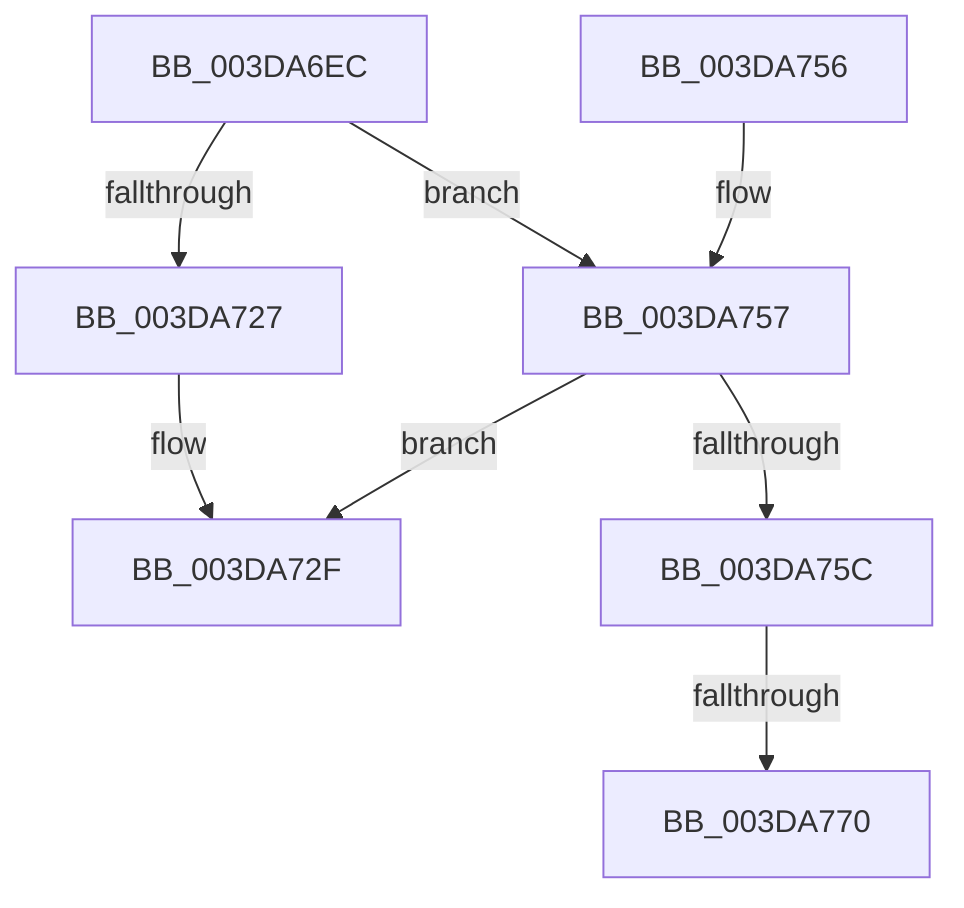

# HalpDmaStartWcb

- RVA: `0x003DA6EC`–`0x003DA777` (길이 `139` bytes)
- VA: `0x00000001403DA6EC`
- 실행 섹션: `.text`
- PDB 이름 있음: `예`; PDB Function 태그: `예`
- unwind 정보 RVA: `0x00084A84`
- 디코드: `38`개 명령, `139/139` bytes 표시
- 미해석 바이트: `0` (있으면 어셈블리에 `.byte`로 보존)

> 이 문서는 커널 이미지의 기계어와 PDB 기호를 분석해 생성했습니다. 4번과 5번은 함수 원형과 자료형을 바이너리 사용 방식에서 추정한 C 해석이며 원본 소스 복구 결과는 아닙니다.

## 1. Dependencies

- 직접 호출 지점: **2**; 고유 호출 대상: **2**
- 직접 호출자로 확인된 함수: **2**
- RIP 상대 이미지 참조: **0**

### Outgoing calls
- `0x003DA718` → [KeAcquireSpinLockRaiseToDpc](../20/KeAcquireSpinLockRaiseToDpc_function_00208470.md) (function, `0x00208470`)
- `0x003DA734` → [KeReleaseSpinLock](../39/KeReleaseSpinLock_function_00392BA0.md) (function, `0x00392BA0`)

### Direct callers
- [HalpAllocateAdapterChannel](HalpAllocateAdapterChannel_function_003DA544.md) at `0x003DA607`
- [HalPutScatterGatherListV3](HalPutScatterGatherListV3_function_003DACA8.md) at `0x003DAD91`

### Static image references
- 디코드된 RIP-relative 메모리 참조가 없습니다.

## 2. Other-region calls and transfers

- 다른 실행 섹션으로 향하는 call: **0**
- call이 아닌 외부 분기/꼬리 이동: **1**
  - `0x003DA76A` → [sub_006E9B3C](../6E/Unknown_function_006E9B3C.md) (`tail-transfer`)

## 3. Assembly (complete function range)

```asm
003DA6EC  48 8B C4                        mov rax, rsp
003DA6EF  48 89 58 08                     mov qword ptr [rax + 8], rbx
003DA6F3  48 89 68 10                     mov qword ptr [rax + 0x10], rbp
003DA6F7  48 89 70 18                     mov qword ptr [rax + 0x18], rsi
003DA6FB  48 89 78 20                     mov qword ptr [rax + 0x20], rdi
003DA6FF  41 56                           push r14
003DA701  48 83 EC 20                     sub rsp, 0x20
003DA705  48 8D A9 B8 00 00 00            lea rbp, [rcx + 0xb8]
003DA70C  48 8B F1                        mov rsi, rcx
003DA70F  48 8B CD                        mov rcx, rbp
003DA712  45 8A F0                        mov r14b, r8b
003DA715  48 8B FA                        mov rdi, rdx
003DA718  E8 53 DD E2 FF                  call 0x140208470
003DA71D  32 DB                           xor bl, bl
003DA71F  38 9E E0 00 00 00               cmp byte ptr [rsi + 0xe0], bl
003DA725  75 30                           jne 0x1403da757
003DA727  B3 01                           mov bl, 1
003DA729  88 9E E0 00 00 00               mov byte ptr [rsi + 0xe0], bl
003DA72F  8A D0                           mov dl, al
003DA731  48 8B CD                        mov rcx, rbp
003DA734  E8 67 84 FB FF                  call 0x140392ba0
003DA739  48 8B 6C 24 38                  mov rbp, qword ptr [rsp + 0x38]
003DA73E  8A C3                           mov al, bl
003DA740  48 8B 5C 24 30                  mov rbx, qword ptr [rsp + 0x30]
003DA745  48 8B 74 24 40                  mov rsi, qword ptr [rsp + 0x40]
003DA74A  48 8B 7C 24 48                  mov rdi, qword ptr [rsp + 0x48]
003DA74F  48 83 C4 20                     add rsp, 0x20
003DA753  41 5E                           pop r14
003DA755  C3                              ret
003DA756  CC                              int3
003DA757  45 84 F6                        test r14b, r14b
003DA75A  75 D3                           jne 0x1403da72f
003DA75C  48 8D 8E C0 00 00 00            lea rcx, [rsi + 0xc0]
003DA763  48 8B 51 08                     mov rdx, qword ptr [rcx + 8]
003DA767  48 39 0A                        cmp qword ptr [rdx], rcx
003DA76A  0F 84 CC F3 30 00               je 0x1406e9b3c
003DA770  B9 03 00 00 00                  mov ecx, 3
003DA775  CD 29                           int 0x29
```

## 4. C-style interpretation (structured pseudocode)

```c
__int64 __fastcall HalpDmaStartWcb(__int64 a1, __int64 a2, unsigned __int8 a3)
{
    __int64 result;
    __int64 v_rbx;
    __int64 v_rsp;
    unsigned __int64 v_stack_p10;
    unsigned __int64 v_stack_p18;
    unsigned __int64 v_stack_p20;
    unsigned __int64 v_stack_p8;

    *(unsigned __int64 *)(v_rsp + 8) = v_rbx;
    *(unsigned __int64 *)(v_rsp + 16) = v_rbp;
    *(unsigned __int64 *)(v_rsp + 24) = v_rsi;
    *(unsigned __int64 *)(v_rsp + 32) = v_rdi;
    v_rsp = (v_rsp) - (32);
    result = KeAcquireSpinLockRaiseToDpc(a1 + 184, a2, a3, a4);
    v_rbx = 0;
    if ((*(unsigned __int8 *)(a1 + 224)) != 0) goto loc_003DA757;
    *(unsigned __int8 *)(a1 + 224) = 1;
loc_003DA72F:
    result = KeReleaseSpinLock(a1 + 184, (unsigned __int8)(result), a3, a4);
    v_rsp = (v_rsp) + (32);
    return 1;
loc_003DA757:
    if (a3 != 0) goto loc_003DA72F;
    return 1;
}
```

## 5. (Beta) C Style

```c
int64_t HalpDmaStartWcb(void *Arg1, int64_t Arg2, uint8_t Arg3)
{
    uint8_t *arg1 = (uint8_t *)Arg1;

    int64_t result;
    int64_t local_rbx;
    int64_t local_rsp;
    uint64_t v_stack_p10;
    uint64_t v_stack_p18;
    uint64_t v_stack_p20;
    uint64_t v_stack_p8;

    *(uint64_t *)(local_rsp + 0x8) = local_rbx;
    *(uint64_t *)(local_rsp + 0x10) = local_rbp;
    *(uint64_t *)(local_rsp + 0x18) = local_rsi;
    *(uint64_t *)(local_rsp + 0x20) = local_rdi;
    local_rsp = (local_rsp) - (32);
    result = KeAcquireSpinLockRaiseToDpc(Arg1 + 184, Arg2, Arg3, a4);
    local_rbx = 0;
    if ((*(uint8_t *)(arg1 + 0xE0)) != 0) goto loc_003DA757;
    *(uint8_t *)(arg1 + 0xE0) = 1;
loc_003DA72F:
    result = KeReleaseSpinLock(Arg1 + 184, (uint8_t)(result), Arg3, a4);
    local_rsp = (local_rsp) + (32);
    return 1;
loc_003DA757:
    if (Arg3 != 0) goto loc_003DA72F;
    return 1;
}
```

### 관측된 메모리 오프셋

구조체 형식이 확인되지 않은 접근은 인자 기준의 오프셋으로만 기록했습니다.

| 기준 인자 | 오프셋 표현 | 폭 (bit) | 접근 |
|---|---:|---:|---|
| `Arg1` | `+ 0x8` | `64` | `R` |
| `Arg1` | `+ 0xB8` | `64` | `R` |
| `Arg1` | `+ 0xC0` | `64` | `R` |
| `Arg1` | `+ 0xE0` | `8` | `R` |
| `Arg1` | `+ 0xE0` | `8` | `W` |

## 6. Execution-region graph

[열기: 2D/3D 그래프와 함수 탐색 컨트롤 패널](../../../control-panel.html?section=text&rva=0x003DA6EC&view=graph)

- 2D 그래프는 위에서 아래로 흐르고, 3D 그래프는 빈 공간을 드래그해 회전합니다. Shift+드래그는 이동, 휠은 확대·축소, 함수 노드 선택은 대상 보고서 이동입니다.

### Static fallback


