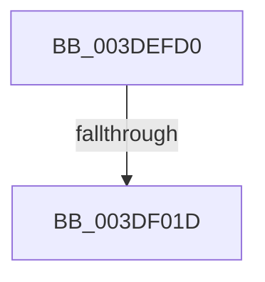

# HalpDmaSyncMapBuffers

- RVA: `0x003DEFD0`–`0x003DF02A` (길이 `90` bytes)
- VA: `0x00000001403DEFD0`
- 실행 섹션: `.text`
- PDB 이름 있음: `예`; PDB Function 태그: `예`
- unwind 정보 RVA: `0x000946E0`
- 디코드: `25`개 명령, `90/90` bytes 표시
- 미해석 바이트: `0` (있으면 어셈블리에 `.byte`로 보존)

> 이 문서는 커널 이미지의 기계어와 PDB 기호를 분석해 생성했습니다. 4번과 5번은 함수 원형과 자료형을 바이너리 사용 방식에서 추정한 C 해석이며 원본 소스 복구 결과는 아닙니다.

## 1. Dependencies

- 직접 호출 지점: **0**; 고유 호출 대상: **0**
- 직접 호출자로 확인된 함수: **11**
- RIP 상대 이미지 참조: **0**

### Outgoing calls
- 직접 디코드된 call 명령이 없습니다.

### Direct callers
- [HalpDmaFlushContiguousTransferV3](HalpDmaFlushContiguousTransferV3_function_003D9E70.md) at `0x003D9F24`
- [HalpDmaFlushScatterTransferV3](HalpDmaFlushScatterTransferV3_function_003DB06C.md) at `0x003DB193`
- [IoMapTransferInternal](IoMapTransferInternal_function_003DC910.md) at `0x003DCA59`
- [IopMapTransfer](IopMapTransfer_function_003DCD80.md) at `0x003DCECE`
- [sub_003DDEB6](Unknown_function_003DDEB6.md) at `0x003DE061`
- [sub_003DEA82](Unknown_function_003DEA82.md) at `0x003DEB9C`
- [HalpDmaFlushContiguousTransferV2](HalpDmaFlushContiguousTransferV2_function_003DFF3C.md) at `0x003DFFCF`
- [IoFlushAdapterBuffersV2](../3E/IoFlushAdapterBuffersV2_function_003E0050.md) at `0x003E01A7`
- [HalpDmaMapScatterTransferV3](../4A/HalpDmaMapScatterTransferV3_function_004A1EDC.md) at `0x004A1FDC`
- [HalpDmaMapContiguousTransferV3](../4D/HalpDmaMapContiguousTransferV3_function_004D6C38.md) at `0x004D6D36`
- [sub_006EA7A0](../6E/Unknown_function_006EA7A0.md) at `0x006EA7B1`

### Static image references
- 디코드된 RIP-relative 메모리 참조가 없습니다.

## 2. Other-region calls and transfers

- 다른 실행 섹션으로 향하는 call: **0**
- call이 아닌 외부 분기/꼬리 이동: **2**
  - `0x003DF017` → [sub_003DF1AF + 0x1](Unknown_function_003DF1AF.md) (`tail-transfer`)
  - `0x003DF024` → [sub_003DF230](Unknown_function_003DF230.md) (`tail-transfer`)

## 3. Assembly (complete function range)

```asm
003DEFD0  4C 89 4C 24 20                  mov qword ptr [rsp + 0x20], r9
003DEFD5  48 89 4C 24 08                  mov qword ptr [rsp + 8], rcx
003DEFDA  53                              push rbx
003DEFDB  55                              push rbp
003DEFDC  56                              push rsi
003DEFDD  57                              push rdi
003DEFDE  41 55                           push r13
003DEFE0  48 81 EC 90 00 00 00            sub rsp, 0x90
003DEFE7  0F 57 C0                        xorps xmm0, xmm0
003DEFEA  33 C0                           xor eax, eax
003DEFEC  0F 11 44 24 48                  movups xmmword ptr [rsp + 0x48], xmm0
003DEFF1  48 89 44 24 78                  mov qword ptr [rsp + 0x78], rax
003DEFF6  4D 8B E9                        mov r13, r9
003DEFF9  0F 11 44 24 58                  movups xmmword ptr [rsp + 0x58], xmm0
003DEFFE  49 8B F8                        mov rdi, r8
003DF001  48 8B EA                        mov rbp, rdx
003DF004  0F 11 44 24 68                  movups xmmword ptr [rsp + 0x68], xmm0
003DF009  4C 8B D1                        mov r10, rcx
003DF00C  44 0F 20 C6                     mov rsi, cr8
003DF010  F6 42 0A 05                     test byte ptr [rdx + 0xa], 5
003DF014  8D 48 01                        lea ecx, [rax + 1]
003DF017  0F 84 93 01 00 00               je 0x1403df1b0
003DF01D  48 8B 5A 18                     mov rbx, qword ptr [rdx + 0x18]
003DF021  48 85 DB                        test rbx, rbx
003DF024  0F 84 06 02 00 00               je 0x1403df230
```

## 4. C-style interpretation (structured pseudocode)

```c
__int64 __fastcall HalpDmaSyncMapBuffers(__int64 a1, __int64 a2, __int64 a3, __int64 a4)
{
    __int64 result;
    __int64 v_rsp;
    unsigned __int64 v_stack_m40;
    unsigned __int64 v_stack_m50;
    unsigned __int64 v_stack_m60;
    unsigned __int64 v_stack_m70;
    unsigned __int64 v_stack_p20;
    unsigned __int64 v_stack_p8;

    v_stack_p20 = a4;
    v_stack_p8 = a1;
    v_rsp = (v_rsp) - (144);
    result = 0;
    v_stack_m70 = v_xmm0;
    v_stack_m40 = 0;
    v_stack_m60 = v_xmm0;
    v_stack_m50 = v_xmm0;
}
```

## 5. (Beta) C Style

```c
int64_t HalpDmaSyncMapBuffers(int64_t Arg1, void *Arg2, int64_t Arg3, int64_t Arg4)
{
    uint8_t *arg2 = (uint8_t *)Arg2;

    int64_t result;
    int64_t local_rsp;
    uint64_t v_stack_m40;
    uint64_t v_stack_m50;
    uint64_t v_stack_m60;
    uint64_t v_stack_m70;
    uint64_t v_stack_p20;
    uint64_t v_stack_p8;

    v_stack_p20 = Arg4;
    v_stack_p8 = Arg1;
    local_rsp = (local_rsp) - (144);
    result = 0;
    v_stack_m70 = v_xmm0;
    v_stack_m40 = 0;
    v_stack_m60 = v_xmm0;
    v_stack_m50 = v_xmm0;
}
```

### 관측된 메모리 오프셋

구조체 형식이 확인되지 않은 접근은 인자 기준의 오프셋으로만 기록했습니다.

| 기준 인자 | 오프셋 표현 | 폭 (bit) | 접근 |
|---|---:|---:|---|
| `Arg2` | `+ 0xA` | `8` | `R` |
| `Arg2` | `+ 0x18` | `64` | `R` |

## 6. Execution-region graph

[열기: 2D/3D 그래프와 함수 탐색 컨트롤 패널](../../../control-panel.html?section=text&rva=0x003DEFD0&view=graph)

- 2D 그래프는 위에서 아래로 흐르고, 3D 그래프는 빈 공간을 드래그해 회전합니다. Shift+드래그는 이동, 휠은 확대·축소, 함수 노드 선택은 대상 보고서 이동입니다.

### Static fallback


