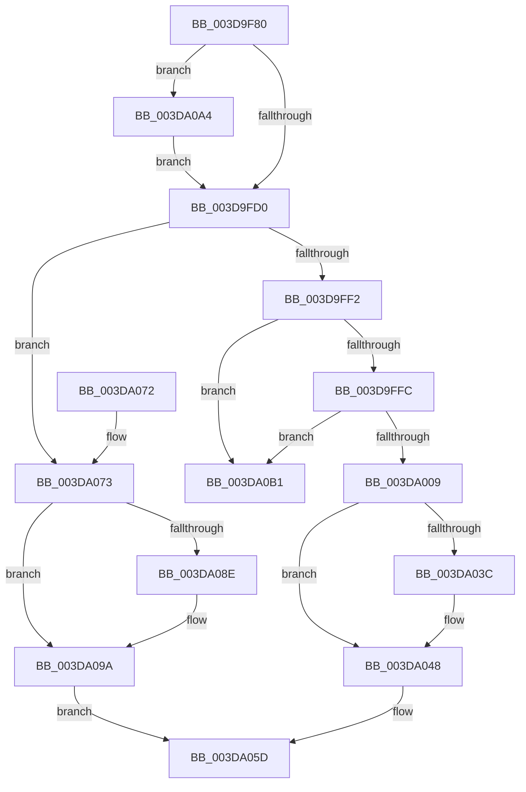

# HalpFreeDmaChannels

- RVA: `0x003D9F80`–`0x003DA0B8` (길이 `312` bytes)
- VA: `0x00000001403D9F80`
- 실행 섹션: `.text`
- PDB 이름 있음: `예`; PDB Function 태그: `아니요`
- unwind 정보 RVA: `0x00087C70`
- 디코드: `71`개 명령, `312/312` bytes 표시
- 미해석 바이트: `0` (있으면 어셈블리에 `.byte`로 보존)

> 이 문서는 커널 이미지의 기계어와 PDB 기호를 분석해 생성했습니다. 4번과 5번은 함수 원형과 자료형을 바이너리 사용 방식에서 추정한 C 해석이며 원본 소스 복구 결과는 아닙니다.

## 1. Dependencies

- 직접 호출 지점: **7**; 고유 호출 대상: **5**
- 직접 호출자로 확인된 함수: **1**
- RIP 상대 이미지 참조: **1**

### Outgoing calls
- `0x003D9FDA` → [KeAcquireSpinLockAtDpcLevel](../20/KeAcquireSpinLockAtDpcLevel_function_00208430.md) (function, `0x00208430`)
- `0x003DA02E` → [KxReleaseSpinLock](../20/KxReleaseSpinLock_function_00206670.md) (function, `0x00206670`)
- `0x003DA043` → [KiLowerIrqlProcessIrqlFlags](../4F/KiLowerIrqlProcessIrqlFlags_function_004F5698.md) (function, `0x004F5698`)
- `0x003DA058` → [HalpAllocateDmaResourcesInternal](HalpAllocateDmaResourcesInternal_function_003DA7C4.md) (function, `0x003DA7C4`)
- `0x003DA080` → [KxReleaseSpinLock](../20/KxReleaseSpinLock_function_00206670.md) (function, `0x00206670`)
- `0x003DA095` → [KiLowerIrqlProcessIrqlFlags](../4F/KiLowerIrqlProcessIrqlFlags_function_004F5698.md) (function, `0x004F5698`)
- `0x003DA0A7` → [KiRaiseIrqlProcessIrqlFlags](../4F/KiRaiseIrqlProcessIrqlFlags_function_004F56FC.md) (function, `0x004F56FC`)

### Direct callers
- [IoFreeAdapterChannelV3Internal](IoFreeAdapterChannelV3Internal_function_003DAA74.md) at `0x003DAAB8`

### Static image references
- `0x003D9FC3` → RVA `0x00FC6D20` (`ALMOSTRO`; read)

## 2. Other-region calls and transfers

- 다른 실행 섹션으로 향하는 call: **0**
- 별도 외부 분기/꼬리 이동을 확인하지 못했습니다.

## 3. Assembly (complete function range)

```asm
003D9F80  48 89 5C 24 08                  mov qword ptr [rsp + 8], rbx
003D9F85  48 89 6C 24 10                  mov qword ptr [rsp + 0x10], rbp
003D9F8A  48 89 74 24 18                  mov qword ptr [rsp + 0x18], rsi
003D9F8F  57                              push rdi
003D9F90  48 83 EC 20                     sub rsp, 0x20
003D9F94  48 8B A9 70 01 00 00            mov rbp, qword ptr [rcx + 0x170]
003D9F9B  8B 81 7C 01 00 00               mov eax, dword ptr [rcx + 0x17c]
003D9FA1  48 8D 1C 80                     lea rbx, [rax + rax*4]
003D9FA5  48 C1 E3 05                     shl rbx, 5
003D9FA9  48 03 5D 38                     add rbx, qword ptr [rbp + 0x38]
003D9FAD  83 A1 88 01 00 00 00            and dword ptr [rcx + 0x188], 0
003D9FB4  0F B6 95 B0 00 00 00            movzx edx, byte ptr [rbp + 0xb0]
003D9FBB  44 0F 20 C7                     mov rdi, cr8
003D9FBF  44 0F 22 C2                     mov cr8, rdx
003D9FC3  83 3D 56 CD BE 00 00            cmp dword ptr [rip + 0xbecd56], 0
003D9FCA  0F 85 D4 00 00 00               jne 0x1403da0a4
003D9FD0  48 81 C5 A8 00 00 00            add rbp, 0xa8
003D9FD7  48 8B CD                        mov rcx, rbp
003D9FDA  E8 51 E4 E2 FF                  call 0x140208430
003D9FDF  48 8D 93 90 00 00 00            lea rdx, [rbx + 0x90]
003D9FE6  48 8B 02                        mov rax, qword ptr [rdx]
003D9FE9  48 3B C2                        cmp rax, rdx
003D9FEC  0F 84 81 00 00 00               je 0x1403da073
003D9FF2  48 39 50 08                     cmp qword ptr [rax + 8], rdx
003D9FF6  0F 85 B5 00 00 00               jne 0x1403da0b1
003D9FFC  48 8B 08                        mov rcx, qword ptr [rax]
003D9FFF  48 39 41 08                     cmp qword ptr [rcx + 8], rax
003DA003  0F 85 A8 00 00 00               jne 0x1403da0b1
003DA009  48 89 0A                        mov qword ptr [rdx], rcx
003DA00C  48 8D B0 30 FF FF FF            lea rsi, [rax - 0xd0]
003DA013  48 89 51 08                     mov qword ptr [rcx + 8], rdx
003DA017  48 8B CD                        mov rcx, rbp
003DA01A  FF 86 70 02 00 00               inc dword ptr [rsi + 0x270]
003DA020  C7 86 88 01 00 00 01 00 00 00   mov dword ptr [rsi + 0x188], 1
003DA02A  48 89 73 18                     mov qword ptr [rbx + 0x18], rsi
003DA02E  E8 3D C6 E2 FF                  call 0x140206670
003DA033  83 3D E6 CC BE 00 00            cmp dword ptr [rip + 0xbecce6], 0
003DA03A  74 0C                           je 0x1403da048
003DA03C  44 0F 20 C1                     mov rcx, cr8
003DA040  40 8A D7                        mov dl, dil
003DA043  E8 50 B6 11 00                  call 0x1404f5698
003DA048  40 0F B6 C7                     movzx eax, dil
003DA04C  44 0F 22 C0                     mov cr8, rax
003DA050  45 33 C0                        xor r8d, r8d
003DA053  B2 01                           mov dl, 1
003DA055  48 8B CE                        mov rcx, rsi
003DA058  E8 67 07 00 00                  call 0x1403da7c4
003DA05D  48 8B 5C 24 30                  mov rbx, qword ptr [rsp + 0x30]
003DA062  48 8B 6C 24 38                  mov rbp, qword ptr [rsp + 0x38]
003DA067  48 8B 74 24 40                  mov rsi, qword ptr [rsp + 0x40]
003DA06C  48 83 C4 20                     add rsp, 0x20
003DA070  5F                              pop rdi
003DA071  C3                              ret
003DA072  CC                              int3
003DA073  66 83 63 05 00                  and word ptr [rbx + 5], 0
003DA078  48 8B CD                        mov rcx, rbp
003DA07B  48 83 63 18 00                  and qword ptr [rbx + 0x18], 0
003DA080  E8 EB C5 E2 FF                  call 0x140206670
003DA085  83 3D 94 CC BE 00 00            cmp dword ptr [rip + 0xbecc94], 0
003DA08C  74 0C                           je 0x1403da09a
003DA08E  44 0F 20 C1                     mov rcx, cr8
003DA092  40 8A D7                        mov dl, dil
003DA095  E8 FE B5 11 00                  call 0x1404f5698
003DA09A  40 0F B6 C7                     movzx eax, dil
003DA09E  44 0F 22 C0                     mov cr8, rax
003DA0A2  EB B9                           jmp 0x1403da05d
003DA0A4  40 8A CF                        mov cl, dil
003DA0A7  E8 50 B6 11 00                  call 0x1404f56fc
003DA0AC  E9 1F FF FF FF                  jmp 0x1403d9fd0
003DA0B1  B9 03 00 00 00                  mov ecx, 3
003DA0B6  CD 29                           int 0x29
```

## 4. C-style interpretation (structured pseudocode)

```c
__int64 __fastcall HalpFreeDmaChannels(__int64 a1, __int64 a2, int a3)
{
    __int64 result;
    __int64 v_rbp;
    __int64 v_rbx;
    __int64 v_rsp;
    unsigned __int64 v_stack_p10;
    unsigned __int64 v_stack_p18;
    unsigned __int64 v_stack_p8;

    v_stack_p8 = v_rbx;
    v_stack_p10 = v_rbp;
    v_stack_p18 = v_rsi;
    v_rsp = (v_rsp) - (32);
    v_rbx = ((unsigned int)(*(unsigned int *)(a1 + 380)) + (unsigned int)(*(unsigned int *)(a1 + 380)) * 4) << (5);
    v_rbx = (v_rbx) + (*(unsigned __int64 *)(*(unsigned __int64 *)(a1 + 368) + 56));
    if ((*(unsigned int *)(v_rip + 12504406)) != 0) goto loc_003DA0A4;
loc_003D9FD0:
    v_rbp = (*(unsigned __int64 *)(a1 + 368)) + (168);
    result = KeAcquireSpinLockAtDpcLevel(v_rbp, *(unsigned __int8 *)(*(unsigned __int64 *)(a1 + 368) + 176), a3, a4);
    if ((*(unsigned __int64 *)(v_rbx + 144)) == (v_rbx + 144)) goto loc_003DA073;
    if ((*(unsigned __int64 *)(*(unsigned __int64 *)(v_rbx + 144) + 8)) != (v_rbx + 144)) goto loc_003DA0B1;
    if ((*(unsigned __int64 *)(*(unsigned __int64 *)(*(unsigned __int64 *)(v_rbx + 144)) + 8)) != (*(unsigned __int64 *)(v_rbx + 144))) goto loc_003DA0B1;
    *(unsigned __int64 *)(v_rbx + 144) = *(unsigned __int64 *)(*(unsigned __int64 *)(v_rbx + 144));
    *(unsigned __int64 *)(*(unsigned __int64 *)(*(unsigned __int64 *)(v_rbx + 144)) + 8) = v_rbx + 144;
    *(unsigned int *)(*(unsigned __int64 *)(v_rbx + 144) - 208 + 392) = 1;
    *(unsigned __int64 *)(v_rbx + 24) = *(unsigned __int64 *)(v_rbx + 144) - 208;
    result = KxReleaseSpinLock(v_rbp, v_rbx + 144, a3, a4);
    if ((*(unsigned int *)(v_rip + 12504294)) != 0) {
        a1 = *(unsigned __int8 *)(*(unsigned __int64 *)(a1 + 368) + 176);
        a2 = (unsigned __int8)(v_cr8);
        result = KiLowerIrqlProcessIrqlFlags(a1, a2, a3, a4);
    }
    a3 = 0;
    result = HalpAllocateDmaResourcesInternal(*(unsigned __int64 *)(v_rbx + 144) - 208, 1, a3, a4);
loc_003DA05D:
    v_rsp = (v_rsp) + (32);
    return result;
loc_003DA073:
    result = KxReleaseSpinLock(v_stack_p10, 1, a3, a4);
    if ((*(unsigned int *)(v_rip + 12504212)) != 0) {
        a1 = (unsigned __int8)(v_cr8);
        a2 = (unsigned __int8)(v_cr8);
        result = KiLowerIrqlProcessIrqlFlags(a1, a2, a3, a4);
    }
    goto loc_003DA05D;
loc_003DA0A4:
    result = KiRaiseIrqlProcessIrqlFlags((unsigned __int8)(v_cr8), a2, a3, a4);
    goto loc_003D9FD0;
loc_003DA0B1:
    return result;
}
```

## 5. (Beta) C Style

```c
int64_t HalpFreeDmaChannels(void *Arg1, int64_t Arg2, int32_t Arg3)
{
    uint8_t *arg1 = (uint8_t *)Arg1;

    int64_t result;
    int64_t local_rbp;
    int64_t local_rbx;
    int64_t local_rsp;
    uint64_t v_stack_p10;
    uint64_t v_stack_p18;
    uint64_t v_stack_p8;

    v_stack_p8 = local_rbx;
    v_stack_p10 = local_rbp;
    v_stack_p18 = local_rsi;
    local_rsp = (local_rsp) - (32);
    local_rbx = ((uint32_t)(*(uint32_t *)(arg1 + 0x17C)) + (uint32_t)(*(uint32_t *)(arg1 + 0x17C)) * 4) << (5);
    local_rbx = (local_rbx) + (*(uint64_t *)(*(uint64_t *)(arg1 + 0x170) + 0x38));
    if ((*(uint32_t *)(v_rip + 0xBECD56)) != 0) goto loc_003DA0A4;
loc_003D9FD0:
    local_rbp = (*(uint64_t *)(arg1 + 0x170)) + (168);
    result = KeAcquireSpinLockAtDpcLevel(local_rbp, *(uint8_t *)(*(uint64_t *)(arg1 + 0x170) + 0xB0), Arg3, a4);
    if ((*(uint64_t *)(local_rbx + 0x90)) == (local_rbx + 144)) goto loc_003DA073;
    if ((*(uint64_t *)(*(uint64_t *)(local_rbx + 0x90) + 0x8)) != (local_rbx + 144)) goto loc_003DA0B1;
    if ((*(uint64_t *)(*(uint64_t *)(*(uint64_t *)(local_rbx + 0x90)) + 0x8)) != (*(uint64_t *)(local_rbx + 0x90))) goto loc_003DA0B1;
    *(uint64_t *)(local_rbx + 0x90) = *(uint64_t *)(*(uint64_t *)(local_rbx + 0x90));
    *(uint64_t *)(*(uint64_t *)(*(uint64_t *)(local_rbx + 0x90)) + 0x8) = local_rbx + 144;
    *(uint32_t *)(*(uint64_t *)(local_rbx + 0x90) - 0xD0 + 0x188) = 1;
    *(uint64_t *)(local_rbx + 0x18) = *(uint64_t *)(local_rbx + 0x90) - 208;
    result = KxReleaseSpinLock(local_rbp, local_rbx + 144, Arg3, a4);
    if ((*(uint32_t *)(v_rip + 0xBECCE6)) != 0) {
        Arg1 = *(uint8_t *)(*(uint64_t *)(arg1 + 0x170) + 0xB0);
        Arg2 = (uint8_t)(v_cr8);
        result = KiLowerIrqlProcessIrqlFlags(Arg1, Arg2, Arg3, a4);
    }
    Arg3 = 0;
    result = HalpAllocateDmaResourcesInternal(*(uint64_t *)(local_rbx + 0x90) - 208, 1, Arg3, a4);
loc_003DA05D:
    local_rsp = (local_rsp) + (32);
    return result;
loc_003DA073:
    result = KxReleaseSpinLock(v_stack_p10, 1, Arg3, a4);
    if ((*(uint32_t *)(v_rip + 0xBECC94)) != 0) {
        Arg1 = (uint8_t)(v_cr8);
        Arg2 = (uint8_t)(v_cr8);
        result = KiLowerIrqlProcessIrqlFlags(Arg1, Arg2, Arg3, a4);
    }
    goto loc_003DA05D;
loc_003DA0A4:
    result = KiRaiseIrqlProcessIrqlFlags((uint8_t)(v_cr8), Arg2, Arg3, a4);
    goto loc_003D9FD0;
loc_003DA0B1:
    return result;
}
```

### 관측된 메모리 오프셋

구조체 형식이 확인되지 않은 접근은 인자 기준의 오프셋으로만 기록했습니다.

| 기준 인자 | 오프셋 표현 | 폭 (bit) | 접근 |
|---|---:|---:|---|
| `Arg1` | `+ 0x170` | `64` | `R` |
| `Arg1` | `+ 0x17C` | `32` | `R` |
| `Arg1` | `+ 0x188` | `32` | `R/W` |

## 6. Execution-region graph

[열기: 2D/3D 그래프와 함수 탐색 컨트롤 패널](../../../control-panel.html?section=text&rva=0x003D9F80&view=graph)

- 2D 그래프는 위에서 아래로 흐르고, 3D 그래프는 빈 공간을 드래그해 회전합니다. Shift+드래그는 이동, 휠은 확대·축소, 함수 노드 선택은 대상 보고서 이동입니다.

### Static fallback


