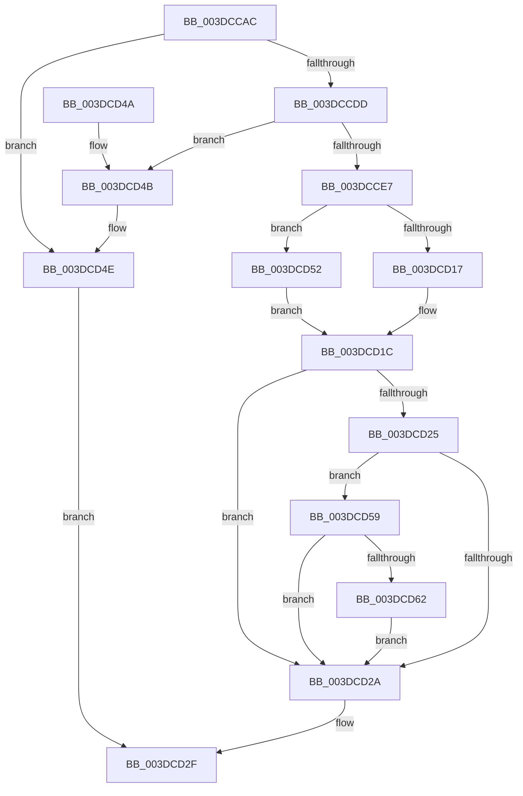

# HalpMapTransferV3

- RVA: `0x003DCCAC`–`0x003DCD78` (길이 `204` bytes)
- VA: `0x00000001403DCCAC`
- 실행 섹션: `.text`
- PDB 이름 있음: `예`; PDB Function 태그: `아니요`
- unwind 정보 RVA: `0x00094270`
- 디코드: `52`개 명령, `204/204` bytes 표시
- 미해석 바이트: `0` (있으면 어셈블리에 `.byte`로 보존)

> 이 문서는 커널 이미지의 기계어와 PDB 기호를 분석해 생성했습니다. 4번과 5번은 함수 원형과 자료형을 바이너리 사용 방식에서 추정한 C 해석이며 원본 소스 복구 결과는 아닙니다.

## 1. Dependencies

- 직접 호출 지점: **3**; 고유 호출 대상: **3**
- 직접 호출자로 확인된 함수: **3**
- RIP 상대 이미지 참조: **0**

### Outgoing calls
- `0x003DCD17` → [HalpDmaMapScatterTransferV3](../4A/HalpDmaMapScatterTransferV3_function_004A1EDC.md) (function, `0x004A1EDC`)
- `0x003DCD52` → [HalpDmaMapContiguousTransferV3](../4D/HalpDmaMapContiguousTransferV3_function_004D6C38.md) (function, `0x004D6C38`)
- `0x003DCD71` → [HalpDmaZeroMapBuffers](../55/HalpDmaZeroMapBuffers_function_005511EC.md) (function, `0x005511EC`)

### Direct callers
- [IoMapTransferInternal](IoMapTransferInternal_function_003DC910.md) at `0x003DCC5F`
- [IopMapTransfer](IopMapTransfer_function_003DCD80.md) at `0x003DD0B7`
- [sub_003DE181](Unknown_function_003DE181.md) at `0x003DE321`

### Static image references
- 디코드된 RIP-relative 메모리 참조가 없습니다.

## 2. Other-region calls and transfers

- 다른 실행 섹션으로 향하는 call: **0**
- 별도 외부 분기/꼬리 이동을 확인하지 못했습니다.

## 3. Assembly (complete function range)

```asm
003DCCAC  4C 8B DC                        mov r11, rsp
003DCCAF  49 89 6B 08                     mov qword ptr [r11 + 8], rbp
003DCCB3  49 89 73 10                     mov qword ptr [r11 + 0x10], rsi
003DCCB7  49 89 7B 18                     mov qword ptr [r11 + 0x18], rdi
003DCCBB  4D 89 73 20                     mov qword ptr [r11 + 0x20], r14
003DCCBF  41 57                           push r15
003DCCC1  48 83 EC 50                     sub rsp, 0x50
003DCCC5  48 8B B4 24 80 00 00 00         mov rsi, qword ptr [rsp + 0x80]
003DCCCD  49 8B E9                        mov rbp, r9
003DCCD0  49 83 63 E8 00                  and qword ptr [r11 - 0x18], 0
003DCCD5  48 8B F9                        mov rdi, rcx
003DCCD8  83 3E 00                        cmp dword ptr [rsi], 0
003DCCDB  74 71                           je 0x1403dcd4e
003DCCDD  48 83 B9 00 02 00 00 00         cmp qword ptr [rcx + 0x200], 0
003DCCE5  74 64                           je 0x1403dcd4b
003DCCE7  80 B9 BA 01 00 00 00            cmp byte ptr [rcx + 0x1ba], 0
003DCCEE  49 8D 43 E8                     lea rax, [r11 - 0x18]
003DCCF2  44 8A B4 24 88 00 00 00         mov r14b, byte ptr [rsp + 0x88]
003DCCFA  4D 8B 78 38                     mov r15, qword ptr [r8 + 0x38]
003DCCFE  49 89 43 E0                     mov qword ptr [r11 - 0x20], rax
003DCD02  8A 84 24 90 00 00 00            mov al, byte ptr [rsp + 0x90]
003DCD09  88 44 24 30                     mov byte ptr [rsp + 0x30], al
003DCD0D  45 88 73 D0                     mov byte ptr [r11 - 0x30], r14b
003DCD11  49 89 73 C8                     mov qword ptr [r11 - 0x38], rsi
003DCD15  74 3B                           je 0x1403dcd52
003DCD17  E8 C0 51 0C 00                  call 0x1404a1edc
003DCD1C  80 BF B9 01 00 00 00            cmp byte ptr [rdi + 0x1b9], 0
003DCD23  75 05                           jne 0x1403dcd2a
003DCD25  45 84 F6                        test r14b, r14b
003DCD28  74 2F                           je 0x1403dcd59
003DCD2A  48 8B 44 24 40                  mov rax, qword ptr [rsp + 0x40]
003DCD2F  48 8B 6C 24 60                  mov rbp, qword ptr [rsp + 0x60]
003DCD34  48 8B 74 24 68                  mov rsi, qword ptr [rsp + 0x68]
003DCD39  48 8B 7C 24 70                  mov rdi, qword ptr [rsp + 0x70]
003DCD3E  4C 8B 74 24 78                  mov r14, qword ptr [rsp + 0x78]
003DCD43  48 83 C4 50                     add rsp, 0x50
003DCD47  41 5F                           pop r15
003DCD49  C3                              ret
003DCD4A  CC                              int3
003DCD4B  83 26 00                        and dword ptr [rsi], 0
003DCD4E  33 C0                           xor eax, eax
003DCD50  EB DD                           jmp 0x1403dcd2f
003DCD52  E8 E1 9E 0F 00                  call 0x1404d6c38
003DCD57  EB C3                           jmp 0x1403dcd1c
003DCD59  80 BF BC 01 00 00 00            cmp byte ptr [rdi + 0x1bc], 0
003DCD60  74 C8                           je 0x1403dcd2a
003DCD62  44 8B 0E                        mov r9d, dword ptr [rsi]
003DCD65  81 E5 FF 0F 00 00               and ebp, 0xfff
003DCD6B  44 8B C5                        mov r8d, ebp
003DCD6E  49 8B D7                        mov rdx, r15
003DCD71  E8 76 44 17 00                  call 0x1405511ec
003DCD76  EB B2                           jmp 0x1403dcd2a
```

## 4. C-style interpretation (structured pseudocode)

```c
__int64 __fastcall HalpMapTransferV3(__int64 a1, __int64 a2, __int64 a3, __int64 a4, __int64 a5, unsigned __int8 a6, unsigned __int8 a7)
{
    __int64 result;
    __int64 v_rbp;
    __int64 v_rsp;
    unsigned __int64 v_stack_m18;
    unsigned __int8 v_stack_m28;
    unsigned __int64 v_stack_p10;
    unsigned __int64 v_stack_p18;
    unsigned __int64 v_stack_p20;
    unsigned __int64 v_stack_p8;

    *(unsigned __int64 *)(v_rsp + 8) = v_rbp;
    *(unsigned __int64 *)(v_rsp + 16) = v_rsi;
    *(unsigned __int64 *)(v_rsp + 24) = v_rdi;
    *(unsigned __int64 *)(v_rsp + 32) = v_r14;
    v_rsp = (v_rsp) - (80);
    if ((*(unsigned int *)(a5)) == 0) goto loc_003DCD4E;
    if ((*(unsigned __int64 *)(a1 + 512)) == 0) goto loc_003DCD4B;
    *(unsigned __int64 *)(v_rsp - 32) = v_rsp - 24;
    v_stack_m28 = a7;
    *(unsigned __int8 *)(v_rsp - 48) = a6;
    *(unsigned __int64 *)(v_rsp - 56) = a5;
    if ((*(unsigned __int8 *)(a1 + 442)) == 0) goto loc_003DCD52;
    result = HalpDmaMapScatterTransferV3(a1, a2, a3, a4);
loc_003DCD1C:
    if ((*(unsigned __int8 *)(a1 + 441)) != 0) goto loc_003DCD2A;
    if (a6 == 0) goto loc_003DCD59;
loc_003DCD2A:
loc_003DCD2F:
    v_rsp = (v_rsp) + (80);
    return v_stack_m18;
loc_003DCD4B:
loc_003DCD4E:
    result = 0;
    goto loc_003DCD2F;
loc_003DCD52:
    result = HalpDmaMapContiguousTransferV3(a1, a2, a3, a4);
    goto loc_003DCD1C;
loc_003DCD59:
    if ((*(unsigned __int8 *)(v_stack_p18 + 444)) == 0) goto loc_003DCD2A;
    v_rbp = (unsigned int)((v_stack_p8) & (0xFFFULL));
    result = HalpDmaZeroMapBuffers(a1, *(unsigned __int64 *)(a3 + 56), (unsigned int)((unsigned int)(v_rbp)), (unsigned int)(*(unsigned int *)(v_stack_p10)));
    goto loc_003DCD2A;
}
```

## 5. (Beta) C Style

```c
int64_t HalpMapTransferV3(void *Arg1, int64_t Arg2, void *Arg3, int64_t Arg4, void *Arg5, uint8_t Arg6, uint8_t Arg7)
{
    uint8_t *arg1 = (uint8_t *)Arg1;
    uint8_t *arg3 = (uint8_t *)Arg3;
    uint8_t *arg5 = (uint8_t *)Arg5;

    int64_t result;
    int64_t local_rbp;
    int64_t local_rsp;
    uint64_t v_stack_m18;
    uint8_t v_stack_m28;
    uint64_t v_stack_p10;
    uint64_t v_stack_p18;
    uint64_t v_stack_p20;
    uint64_t v_stack_p8;

    *(uint64_t *)(local_rsp + 0x8) = local_rbp;
    *(uint64_t *)(local_rsp + 0x10) = local_rsi;
    *(uint64_t *)(local_rsp + 0x18) = local_rdi;
    *(uint64_t *)(local_rsp + 0x20) = local_r14;
    local_rsp = (local_rsp) - (80);
    if ((*(uint32_t *)(arg5)) == 0) goto loc_003DCD4E;
    if ((*(uint64_t *)(arg1 + 0x200)) == 0) goto loc_003DCD4B;
    *(uint64_t *)(local_rsp - 0x20) = local_rsp - 24;
    v_stack_m28 = Arg7;
    *(uint8_t *)(local_rsp - 0x30) = Arg6;
    *(void **)(local_rsp - 0x38) = Arg5;
    if ((*(uint8_t *)(arg1 + 0x1BA)) == 0) goto loc_003DCD52;
    result = HalpDmaMapScatterTransferV3(Arg1, Arg2, Arg3, Arg4);
loc_003DCD1C:
    if ((*(uint8_t *)(arg1 + 0x1B9)) != 0) goto loc_003DCD2A;
    if (Arg6 == 0) goto loc_003DCD59;
loc_003DCD2A:
loc_003DCD2F:
    local_rsp = (local_rsp) + (80);
    return v_stack_m18;
loc_003DCD4B:
loc_003DCD4E:
    result = 0;
    goto loc_003DCD2F;
loc_003DCD52:
    result = HalpDmaMapContiguousTransferV3(Arg1, Arg2, Arg3, Arg4);
    goto loc_003DCD1C;
loc_003DCD59:
    if ((*(uint8_t *)(v_stack_p18 + 0x1BC)) == 0) goto loc_003DCD2A;
    local_rbp = (uint32_t)((v_stack_p8) & (0xFFFULL));
    result = HalpDmaZeroMapBuffers(Arg1, *(uint64_t *)(arg3 + 0x38), (uint32_t)((uint32_t)(local_rbp)), (uint32_t)(*(uint32_t *)(v_stack_p10)));
    goto loc_003DCD2A;
}
```

### 관측된 메모리 오프셋

구조체 형식이 확인되지 않은 접근은 인자 기준의 오프셋으로만 기록했습니다.

| 기준 인자 | 오프셋 표현 | 폭 (bit) | 접근 |
|---|---:|---:|---|
| `Arg1` | `+ 0x1B9` | `8` | `R` |
| `Arg1` | `+ 0x1BA` | `8` | `R` |
| `Arg1` | `+ 0x1BC` | `8` | `R` |
| `Arg1` | `+ 0x200` | `64` | `R` |
| `Arg3` | `+ 0x38` | `64` | `R` |
| `Arg5` | `+ 0x0` | `32` | `R` |
| `Arg5` | `+ 0x0` | `32` | `R/W` |

## 6. Execution-region graph

[열기: 2D/3D 그래프와 함수 탐색 컨트롤 패널](../../../control-panel.html?section=text&rva=0x003DCCAC&view=graph)

- 2D 그래프는 위에서 아래로 흐르고, 3D 그래프는 빈 공간을 드래그해 회전합니다. Shift+드래그는 이동, 휠은 확대·축소, 함수 노드 선택은 대상 보고서 이동입니다.

### Static fallback


