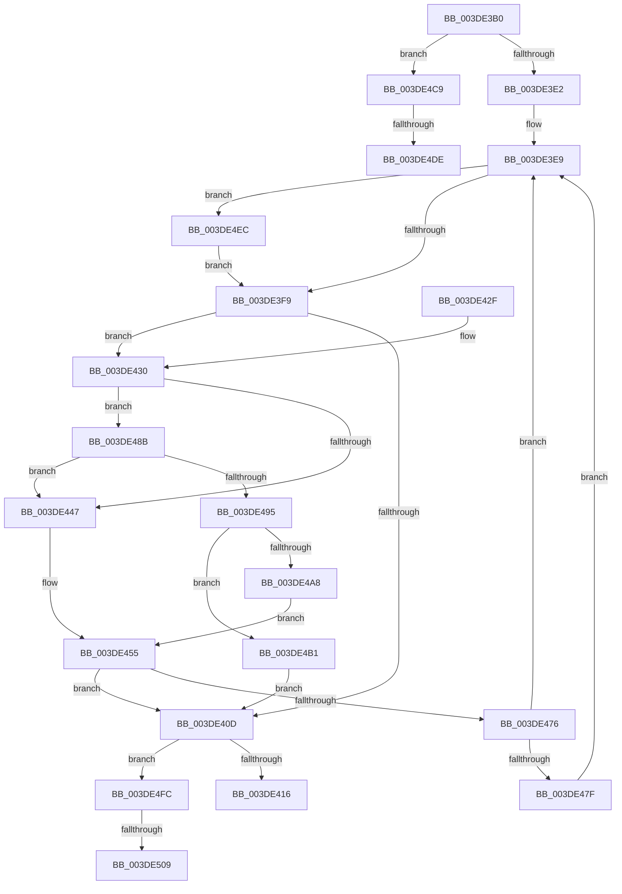

# IoFreeAdapterChannelV2

- RVA: `0x003DE3B0`–`0x003DE51B` (길이 `363` bytes)
- VA: `0x00000001403DE3B0`
- 실행 섹션: `.text`
- PDB 이름 있음: `예`; PDB Function 태그: `예`
- unwind 정보 RVA: `0x000944B4`
- 디코드: `90`개 명령, `363/363` bytes 표시
- 미해석 바이트: `0` (있으면 어셈블리에 `.byte`로 보존)

> 이 문서는 커널 이미지의 기계어와 PDB 기호를 분석해 생성했습니다. 4번과 5번은 함수 원형과 자료형을 바이너리 사용 방식에서 추정한 C 해석이며 원본 소스 복구 결과는 아닙니다.

## 1. Dependencies

- 직접 호출 지점: **8**; 고유 호출 대상: **8**
- 직접 호출자로 확인된 함수: **4**
- RIP 상대 이미지 참조: **1**

### Outgoing calls
- `0x003DE400` → [KeRemoveDeviceQueue](KeRemoveDeviceQueue_function_003DF890.md) (function, `0x003DF890`)
- `0x003DE46C` → [guard_dispatch_icall](../6B/guard_dispatch_icall_function_006BAAD0.md) (function, `0x006BAAD0`)
- `0x003DE498` → [HalpDmaAllocateMapRegisters](HalpDmaAllocateMapRegisters_function_003DDA0C.md) (function, `0x003DDA0C`)
- `0x003DE4B4` → [HalpDmaQueueAdapter](../4E/HalpDmaQueueAdapter_function_004E2B3C.md) (function, `0x004E2B3C`)
- `0x003DE4BF` → [HalpQueueMapBufferWorker](../4A/HalpQueueMapBufferWorker_function_004A7B38.md) (function, `0x004A7B38`)
- `0x003DE4E1` → [KiRaiseIrqlProcessIrqlFlags](../4F/KiRaiseIrqlProcessIrqlFlags_function_004F56FC.md) (function, `0x004F56FC`)
- `0x003DE4F2` → [IoFreeMapRegistersV2](IoFreeMapRegistersV2_function_003DF440.md) (function, `0x003DF440`)
- `0x003DE510` → [KiLowerIrqlProcessIrqlFlags](../4F/KiLowerIrqlProcessIrqlFlags_function_004F5698.md) (function, `0x004F5698`)

### Direct callers
- [HalAllocateAdapterChannelV2](HalAllocateAdapterChannelV2_function_003DC714.md) at `0x003DC80D`
- [HalAllocateAdapterChannelV2](HalAllocateAdapterChannelV2_function_003DC714.md) at `0x003DC88C`
- [sub_003DD362](Unknown_function_003DD362.md) at `0x003DD50E`
- [sub_003DD598](Unknown_function_003DD598.md) at `0x003DD666`
- [HalpDmaProcessMapRegisterQueueV2](HalpDmaProcessMapRegisterQueueV2_function_003DF50C.md) at `0x003DF5A3`

### Static image references
- `0x003DE4D1` → RVA `0x00FC6D20` (`ALMOSTRO`; read)

## 2. Other-region calls and transfers

- 다른 실행 섹션으로 향하는 call: **0**
- call이 아닌 외부 분기/꼬리 이동: **4**
  - `0x003DE4D8` → [sub_006EA4D2](../6E/Unknown_function_006EA4D2.md) (`tail-transfer`)
  - `0x003DE4E7` → [sub_006EA4D2](../6E/Unknown_function_006EA4D2.md) (`tail-transfer`)
  - `0x003DE503` → [sub_006EA4D2 + 0x8](../6E/Unknown_function_006EA4D2.md) (`tail-transfer`)
  - `0x003DE516` → [sub_006EA4D2 + 0x8](../6E/Unknown_function_006EA4D2.md) (`tail-transfer`)

## 3. Assembly (complete function range)

```asm
003DE3B0  48 89 5C 24 08                  mov qword ptr [rsp + 8], rbx
003DE3B5  48 89 6C 24 10                  mov qword ptr [rsp + 0x10], rbp
003DE3BA  48 89 74 24 18                  mov qword ptr [rsp + 0x18], rsi
003DE3BF  57                              push rdi
003DE3C0  41 56                           push r14
003DE3C2  41 57                           push r15
003DE3C4  48 83 EC 30                     sub rsp, 0x30
003DE3C8  45 32 F6                        xor r14b, r14b
003DE3CB  48 8B D9                        mov rbx, rcx
003DE3CE  40 32 ED                        xor bpl, bpl
003DE3D1  44 0F 20 C0                     mov rax, cr8
003DE3D5  BA 02 00 00 00                  mov edx, 2
003DE3DA  3A C2                           cmp al, dl
003DE3DC  0F 82 E7 00 00 00               jb 0x1403de4c9
003DE3E2  48 8D B3 F0 00 00 00            lea rsi, [rbx + 0xf0]
003DE3E9  44 8B 83 F8 00 00 00            mov r8d, dword ptr [rbx + 0xf8]
003DE3F0  45 85 C0                        test r8d, r8d
003DE3F3  0F 85 F3 00 00 00               jne 0x1403de4ec
003DE3F9  48 8D 8B B8 00 00 00            lea rcx, [rbx + 0xb8]
003DE400  E8 8B 14 00 00                  call 0x1403df890
003DE405  48 8B F8                        mov rdi, rax
003DE408  48 85 C0                        test rax, rax
003DE40B  75 23                           jne 0x1403de430
003DE40D  45 84 F6                        test r14b, r14b
003DE410  0F 85 E6 00 00 00               jne 0x1403de4fc
003DE416  48 8B 5C 24 50                  mov rbx, qword ptr [rsp + 0x50]
003DE41B  48 8B 6C 24 58                  mov rbp, qword ptr [rsp + 0x58]
003DE420  48 8B 74 24 60                  mov rsi, qword ptr [rsp + 0x60]
003DE425  48 83 C4 30                     add rsp, 0x30
003DE429  41 5F                           pop r15
003DE42B  41 5E                           pop r14
003DE42D  5F                              pop rdi
003DE42E  C3                              ret
003DE42F  CC                              int3
003DE430  48 89 BB 60 01 00 00            mov qword ptr [rbx + 0x160], rdi
003DE437  8B 48 28                        mov ecx, dword ptr [rax + 0x28]
003DE43A  89 8B F8 00 00 00               mov dword ptr [rbx + 0xf8], ecx
003DE440  8B 50 28                        mov edx, dword ptr [rax + 0x28]
003DE443  85 D2                           test edx, edx
003DE445  75 44                           jne 0x1403de48b
003DE447  48 83 26 00                     and qword ptr [rsi], 0
003DE44B  83 A3 F8 00 00 00 00            and dword ptr [rbx + 0xf8], 0
003DE452  45 33 C0                        xor r8d, r8d
003DE455  48 89 BB 60 01 00 00            mov qword ptr [rbx + 0x160], rdi
003DE45C  48 8B 47 18                     mov rax, qword ptr [rdi + 0x18]
003DE460  4C 8B 4F 20                     mov r9, qword ptr [rdi + 0x20]
003DE464  48 8B 57 38                     mov rdx, qword ptr [rdi + 0x38]
003DE468  48 8B 4F 30                     mov rcx, qword ptr [rdi + 0x30]
003DE46C  E8 5F C6 2D 00                  call 0x1406baad0
003DE471  83 F8 01                        cmp eax, 1
003DE474  74 97                           je 0x1403de40d
003DE476  83 F8 03                        cmp eax, 3
003DE479  0F 85 6A FF FF FF               jne 0x1403de3e9
003DE47F  83 A3 F8 00 00 00 00            and dword ptr [rbx + 0xf8], 0
003DE486  E9 5E FF FF FF                  jmp 0x1403de3e9
003DE48B  48 83 BB A0 00 00 00 00         cmp qword ptr [rbx + 0xa0], 0
003DE493  74 B2                           je 0x1403de447
003DE495  48 8B CB                        mov rcx, rbx
003DE498  E8 6F F5 FF FF                  call 0x1403dda0c
003DE49D  48 89 06                        mov qword ptr [rsi], rax
003DE4A0  4C 8B C0                        mov r8, rax
003DE4A3  48 85 C0                        test rax, rax
003DE4A6  74 09                           je 0x1403de4b1
003DE4A8  48 8D B3 F0 00 00 00            lea rsi, [rbx + 0xf0]
003DE4AF  EB A4                           jmp 0x1403de455
003DE4B1  48 8B CB                        mov rcx, rbx
003DE4B4  E8 83 46 10 00                  call 0x1404e2b3c
003DE4B9  8B 57 28                        mov edx, dword ptr [rdi + 0x28]
003DE4BC  48 8B CB                        mov rcx, rbx
003DE4BF  E8 74 96 0C 00                  call 0x1404a7b38
003DE4C4  E9 44 FF FF FF                  jmp 0x1403de40d
003DE4C9  44 0F 20 C5                     mov rbp, cr8
003DE4CD  44 0F 22 C2                     mov cr8, rdx
003DE4D1  83 3D 48 88 BE 00 00            cmp dword ptr [rip + 0xbe8848], 0
003DE4D8  0F 84 F4 BF 30 00               je 0x1406ea4d2
003DE4DE  40 8A CD                        mov cl, bpl
003DE4E1  E8 16 72 11 00                  call 0x1404f56fc
003DE4E6  90                              nop
003DE4E7  E9 E6 BF 30 00                  jmp 0x1406ea4d2
003DE4EC  48 8B 16                        mov rdx, qword ptr [rsi]
003DE4EF  48 8B CB                        mov rcx, rbx
003DE4F2  E8 49 0F 00 00                  call 0x1403df440
003DE4F7  E9 FD FE FF FF                  jmp 0x1403de3f9
003DE4FC  83 3D 1D 88 BE 00 00            cmp dword ptr [rip + 0xbe881d], 0
003DE503  0F 84 D1 BF 30 00               je 0x1406ea4da
003DE509  44 0F 20 C1                     mov rcx, cr8
003DE50D  40 8A D5                        mov dl, bpl
003DE510  E8 83 71 11 00                  call 0x1404f5698
003DE515  90                              nop
003DE516  E9 BF BF 30 00                  jmp 0x1406ea4da
```

## 4. C-style interpretation (structured pseudocode)

```c
__int64 __fastcall IoFreeAdapterChannelV2(__int64 a1)
{
    __int64 result;
    __int64 v_r14;
    __int64 v_rbp;
    __int64 v_rsp;
    unsigned __int64 v_stack_p10;
    unsigned __int64 v_stack_p18;
    unsigned __int64 v_stack_p8;

    v_stack_p8 = v_rbx;
    v_stack_p10 = v_rbp;
    v_stack_p18 = v_rsi;
    v_rsp = (v_rsp) - (48);
    v_r14 = 0;
    v_rbp = 0;
    if (((unsigned __int8)(v_cr8)) < 2) goto loc_003DE4C9;
loc_003DE3E9:
    if ((unsigned int)((unsigned int)(*(unsigned int *)(a1 + 248))) != 0) goto loc_003DE4EC;
loc_003DE3F9:
    result = KeRemoveDeviceQueue(a1 + 184, 2, (unsigned int)(*(unsigned int *)(a1 + 248)), a4);
    if (result != 0) goto loc_003DE430;
loc_003DE40D:
    if (0 != 0) goto loc_003DE4FC;
    v_rsp = (v_rsp) + (48);
    return result;
loc_003DE430:
    *(unsigned __int64 *)(v_stack_p8 + 352) = result;
    *(unsigned int *)(v_stack_p8 + 248) = (unsigned int)((unsigned int)(*(unsigned int *)(result + 40)));
    if ((unsigned int)((unsigned int)(*(unsigned int *)(result + 40))) != 0) goto loc_003DE48B;
loc_003DE447:
    a3 = 0;
loc_003DE455:
    *(unsigned __int64 *)(v_stack_p8 + 352) = result;
    result = guard_dispatch_icall(*(unsigned __int64 *)(result + 48), *(unsigned __int64 *)(result + 56), a3, *(unsigned __int64 *)(result + 32));
    if (((unsigned int)(result)) == 1) goto loc_003DE40D;
    if (((unsigned int)(result)) != 3) goto loc_003DE3E9;
    goto loc_003DE3E9;
loc_003DE48B:
    if ((*(unsigned __int64 *)(v_stack_p8 + 160)) == 0) goto loc_003DE447;
    result = HalpDmaAllocateMapRegisters(v_stack_p8, *(unsigned __int64 *)(result + 56), a3, *(unsigned __int64 *)(result + 32));
    *(unsigned __int64 *)(v_stack_p18) = result;
    if (result == 0) goto loc_003DE4B1;
    goto loc_003DE455;
loc_003DE4B1:
    result = HalpDmaQueueAdapter(v_stack_p8, *(unsigned __int64 *)(result + 56), result, *(unsigned __int64 *)(result + 32));
    result = HalpQueueMapBufferWorker(v_stack_p8, (unsigned int)(*(unsigned int *)(result + 40)), result, *(unsigned __int64 *)(result + 32));
    goto loc_003DE40D;
loc_003DE4C9:
    result = KiRaiseIrqlProcessIrqlFlags((unsigned __int8)(v_cr8), (unsigned int)(*(unsigned int *)(result + 40)), result, *(unsigned __int64 *)(result + 32));
loc_003DE4EC:
    result = IoFreeMapRegistersV2(v_stack_p8, *(unsigned __int64 *)(v_stack_p8 + 240), result, *(unsigned __int64 *)(result + 32));
    goto loc_003DE3F9;
loc_003DE4FC:
    result = KiLowerIrqlProcessIrqlFlags((unsigned int)(*(unsigned int *)(result + 40)), (unsigned __int8)(v_cr8), result, *(unsigned __int64 *)(result + 32));
}
```

## 5. (Beta) C Style

```c
int64_t IoFreeAdapterChannelV2(void *Arg1)
{
    uint8_t *arg1 = (uint8_t *)Arg1;

    int64_t result;
    int64_t local_r14;
    int64_t local_rbp;
    int64_t local_rsp;
    uint64_t v_stack_p10;
    uint64_t v_stack_p18;
    uint64_t v_stack_p8;

    v_stack_p8 = local_rbx;
    v_stack_p10 = local_rbp;
    v_stack_p18 = local_rsi;
    local_rsp = (local_rsp) - (48);
    local_r14 = 0;
    local_rbp = 0;
    if (((uint8_t)(v_cr8)) < 2) goto loc_003DE4C9;
loc_003DE3E9:
    if ((uint32_t)((uint32_t)(*(uint32_t *)(arg1 + 0xF8))) != 0) goto loc_003DE4EC;
loc_003DE3F9:
    result = KeRemoveDeviceQueue(Arg1 + 184, 2, (uint32_t)(*(uint32_t *)(arg1 + 0xF8)), a4);
    if (result != 0) goto loc_003DE430;
loc_003DE40D:
    if (0 != 0) goto loc_003DE4FC;
    local_rsp = (local_rsp) + (48);
    return result;
loc_003DE430:
    *(uint64_t *)(v_stack_p8 + 0x160) = result;
    *(uint32_t *)(v_stack_p8 + 0xF8) = (uint32_t)((uint32_t)(*(uint32_t *)(result + 0x28)));
    if ((uint32_t)((uint32_t)(*(uint32_t *)(result + 0x28))) != 0) goto loc_003DE48B;
loc_003DE447:
    a3 = 0;
loc_003DE455:
    *(uint64_t *)(v_stack_p8 + 0x160) = result;
    result = guard_dispatch_icall(*(uint64_t *)(result + 0x30), *(uint64_t *)(result + 0x38), a3, *(uint64_t *)(result + 0x20));
    if (((uint32_t)(result)) == 1) goto loc_003DE40D;
    if (((uint32_t)(result)) != 3) goto loc_003DE3E9;
    goto loc_003DE3E9;
loc_003DE48B:
    if ((*(uint64_t *)(v_stack_p8 + 0xA0)) == 0) goto loc_003DE447;
    result = HalpDmaAllocateMapRegisters(v_stack_p8, *(uint64_t *)(result + 0x38), a3, *(uint64_t *)(result + 0x20));
    *(uint64_t *)(v_stack_p18) = result;
    if (result == 0) goto loc_003DE4B1;
    goto loc_003DE455;
loc_003DE4B1:
    result = HalpDmaQueueAdapter(v_stack_p8, *(uint64_t *)(result + 0x38), result, *(uint64_t *)(result + 0x20));
    result = HalpQueueMapBufferWorker(v_stack_p8, (uint32_t)(*(uint32_t *)(result + 0x28)), result, *(uint64_t *)(result + 0x20));
    goto loc_003DE40D;
loc_003DE4C9:
    result = KiRaiseIrqlProcessIrqlFlags((uint8_t)(v_cr8), (uint32_t)(*(uint32_t *)(result + 0x28)), result, *(uint64_t *)(result + 0x20));
loc_003DE4EC:
    result = IoFreeMapRegistersV2(v_stack_p8, *(uint64_t *)(v_stack_p8 + 0xF0), result, *(uint64_t *)(result + 0x20));
    goto loc_003DE3F9;
loc_003DE4FC:
    result = KiLowerIrqlProcessIrqlFlags((uint32_t)(*(uint32_t *)(result + 0x28)), (uint8_t)(v_cr8), result, *(uint64_t *)(result + 0x20));
}
```

### 관측된 메모리 오프셋

구조체 형식이 확인되지 않은 접근은 인자 기준의 오프셋으로만 기록했습니다.

| 기준 인자 | 오프셋 표현 | 폭 (bit) | 접근 |
|---|---:|---:|---|
| `Arg1` | `+ 0x0` | `64` | `R` |
| `Arg1` | `+ 0x0` | `64` | `R/W` |
| `Arg1` | `+ 0x0` | `64` | `W` |
| `Arg1` | `+ 0xA0` | `64` | `R` |
| `Arg1` | `+ 0xB8` | `64` | `R` |
| `Arg1` | `+ 0xF0` | `64` | `R` |
| `Arg1` | `+ 0xF8` | `32` | `R` |
| `Arg1` | `+ 0xF8` | `32` | `R/W` |
| `Arg1` | `+ 0xF8` | `32` | `W` |
| `Arg1` | `+ 0x160` | `64` | `W` |

## 6. Execution-region graph

[열기: 2D/3D 그래프와 함수 탐색 컨트롤 패널](../../../control-panel.html?section=text&rva=0x003DE3B0&view=graph)

- 2D 그래프는 위에서 아래로 흐르고, 3D 그래프는 빈 공간을 드래그해 회전합니다. Shift+드래그는 이동, 휠은 확대·축소, 함수 노드 선택은 대상 보고서 이동입니다.

### Static fallback


