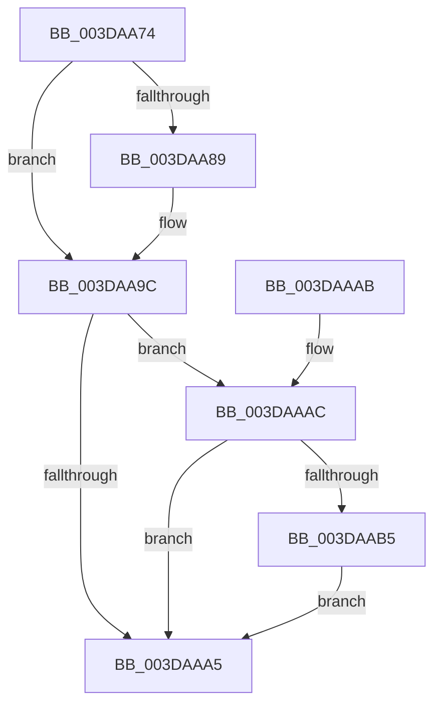

# IoFreeAdapterChannelV3Internal

- RVA: `0x003DAA74`–`0x003DAABF` (길이 `75` bytes)
- VA: `0x00000001403DAA74`
- 실행 섹션: `.text`
- PDB 이름 있음: `예`; PDB Function 태그: `아니요`
- unwind 정보 RVA: `0x0006EDB4`
- 디코드: `20`개 명령, `75/75` bytes 표시
- 미해석 바이트: `0` (있으면 어셈블리에 `.byte`로 보존)

> 이 문서는 커널 이미지의 기계어와 PDB 기호를 분석해 생성했습니다. 4번과 5번은 함수 원형과 자료형을 바이너리 사용 방식에서 추정한 C 해석이며 원본 소스 복구 결과는 아닙니다.

## 1. Dependencies

- 직접 호출 지점: **2**; 고유 호출 대상: **2**
- 직접 호출자로 확인된 함수: **2**
- RIP 상대 이미지 참조: **0**

### Outgoing calls
- `0x003DAA90` → [IoFreeMapRegistersV3](IoFreeMapRegistersV3_function_003DAAD0.md) (function, `0x003DAAD0`)
- `0x003DAAB8` → [HalpFreeDmaChannels](HalpFreeDmaChannels_function_003D9F80.md) (function, `0x003D9F80`)

### Direct callers
- [IoFreeAdapterChannelV3](IoFreeAdapterChannelV3_function_003DAA20.md) at `0x003DAA3A`
- [sub_006E9BFE](../6E/Unknown_function_006E9BFE.md) at `0x006E9C80`

### Static image references
- 디코드된 RIP-relative 메모리 참조가 없습니다.

## 2. Other-region calls and transfers

- 다른 실행 섹션으로 향하는 call: **0**
- 별도 외부 분기/꼬리 이동을 확인하지 못했습니다.

## 3. Assembly (complete function range)

```asm
003DAA74  40 53                           push rbx
003DAA76  48 83 EC 20                     sub rsp, 0x20
003DAA7A  44 8B 81 F8 00 00 00            mov r8d, dword ptr [rcx + 0xf8]
003DAA81  48 8B D9                        mov rbx, rcx
003DAA84  45 85 C0                        test r8d, r8d
003DAA87  74 13                           je 0x1403daa9c
003DAA89  48 8B 91 F0 00 00 00            mov rdx, qword ptr [rcx + 0xf0]
003DAA90  E8 3B 00 00 00                  call 0x1403daad0
003DAA95  83 A3 F8 00 00 00 00            and dword ptr [rbx + 0xf8], 0
003DAA9C  80 BB B9 01 00 00 00            cmp byte ptr [rbx + 0x1b9], 0
003DAAA3  74 07                           je 0x1403daaac
003DAAA5  48 83 C4 20                     add rsp, 0x20
003DAAA9  5B                              pop rbx
003DAAAA  C3                              ret
003DAAAB  CC                              int3
003DAAAC  83 BB 88 01 00 00 00            cmp dword ptr [rbx + 0x188], 0
003DAAB3  74 F0                           je 0x1403daaa5
003DAAB5  48 8B CB                        mov rcx, rbx
003DAAB8  E8 C3 F4 FF FF                  call 0x1403d9f80
003DAABD  EB E6                           jmp 0x1403daaa5
```

## 4. C-style interpretation (structured pseudocode)

```c
__int64 __fastcall IoFreeAdapterChannelV3Internal(__int64 a1)
{
    __int64 result;
    __int64 v_rsp;

    v_rsp = (v_rsp) - (32);
    if ((unsigned int)((unsigned int)(*(unsigned int *)(a1 + 248))) != 0) {
        a2 = *(unsigned __int64 *)(a1 + 240);
        result = IoFreeMapRegistersV3(a1, a2, (unsigned int)(*(unsigned int *)(a1 + 248)), a4);
    }
    if ((*(unsigned __int8 *)(a1 + 441)) == 0) goto loc_003DAAAC;
loc_003DAAA5:
    v_rsp = (v_rsp) + (32);
    return result;
loc_003DAAAC:
    if ((*(unsigned int *)(a1 + 392)) == 0) goto loc_003DAAA5;
    result = HalpFreeDmaChannels(a1, a2, (unsigned int)(*(unsigned int *)(a1 + 248)), a4);
    goto loc_003DAAA5;
}
```

## 5. (Beta) C Style

```c
int64_t IoFreeAdapterChannelV3Internal(void *Arg1)
{
    uint8_t *arg1 = (uint8_t *)Arg1;

    int64_t result;
    int64_t local_rsp;

    local_rsp = (local_rsp) - (32);
    if ((uint32_t)((uint32_t)(*(uint32_t *)(arg1 + 0xF8))) != 0) {
        a2 = *(uint64_t *)(arg1 + 0xF0);
        result = IoFreeMapRegistersV3(Arg1, a2, (uint32_t)(*(uint32_t *)(arg1 + 0xF8)), a4);
    }
    if ((*(uint8_t *)(arg1 + 0x1B9)) == 0) goto loc_003DAAAC;
loc_003DAAA5:
    local_rsp = (local_rsp) + (32);
    return result;
loc_003DAAAC:
    if ((*(uint32_t *)(arg1 + 0x188)) == 0) goto loc_003DAAA5;
    result = HalpFreeDmaChannels(Arg1, a2, (uint32_t)(*(uint32_t *)(arg1 + 0xF8)), a4);
    goto loc_003DAAA5;
}
```

### 관측된 메모리 오프셋

구조체 형식이 확인되지 않은 접근은 인자 기준의 오프셋으로만 기록했습니다.

| 기준 인자 | 오프셋 표현 | 폭 (bit) | 접근 |
|---|---:|---:|---|
| `Arg1` | `+ 0xF0` | `64` | `R` |
| `Arg1` | `+ 0xF8` | `32` | `R` |
| `Arg1` | `+ 0xF8` | `32` | `R/W` |
| `Arg1` | `+ 0x188` | `32` | `R` |
| `Arg1` | `+ 0x1B9` | `8` | `R` |

## 6. Execution-region graph

[열기: 2D/3D 그래프와 함수 탐색 컨트롤 패널](../../../control-panel.html?section=text&rva=0x003DAA74&view=graph)

- 2D 그래프는 위에서 아래로 흐르고, 3D 그래프는 빈 공간을 드래그해 회전합니다. Shift+드래그는 이동, 휠은 확대·축소, 함수 노드 선택은 대상 보고서 이동입니다.

### Static fallback


