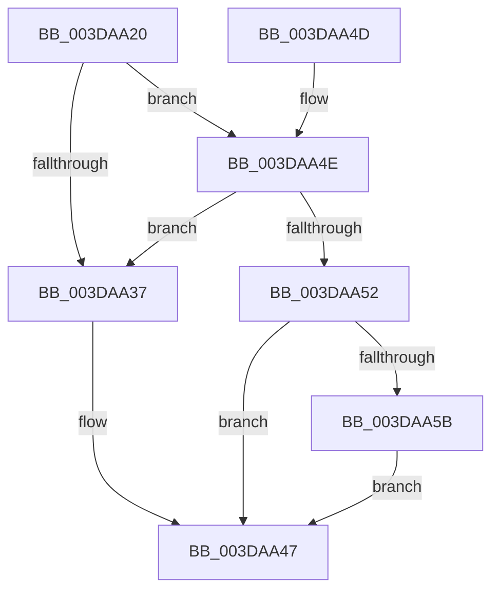

# IoFreeAdapterChannelV3

- RVA: `0x003DAA20`–`0x003DAA6B` (길이 `75` bytes)
- VA: `0x00000001403DAA20`
- 실행 섹션: `.text`
- PDB 이름 있음: `예`; PDB Function 태그: `아니요`
- unwind 정보 RVA: `0x0006084C`
- 디코드: `23`개 명령, `75/75` bytes 표시
- 미해석 바이트: `0` (있으면 어셈블리에 `.byte`로 보존)

> 이 문서는 커널 이미지의 기계어와 PDB 기호를 분석해 생성했습니다. 4번과 5번은 함수 원형과 자료형을 바이너리 사용 방식에서 추정한 C 해석이며 원본 소스 복구 결과는 아닙니다.

## 1. Dependencies

- 직접 호출 지점: **3**; 고유 호출 대상: **3**
- 직접 호출자로 확인된 함수: **6**
- RIP 상대 이미지 참조: **0**

### Outgoing calls
- `0x003DAA3A` → [IoFreeAdapterChannelV3Internal](IoFreeAdapterChannelV3Internal_function_003DAA74.md) (function, `0x003DAA74`)
- `0x003DAA42` → [HalpContinueProcessingWaitQueue](HalpContinueProcessingWaitQueue_function_003DAB9C.md) (function, `0x003DAB9C`)
- `0x003DAA64` → [ExQueueWorkItem](../2F/ExQueueWorkItem_function_002F9520.md) (function, `0x002F9520`)

### Direct callers
- [HalpAllocateDmaResourcesInternal](HalpAllocateDmaResourcesInternal_function_003DA7C4.md) at `0x003DA96C`
- [HalFreeAdapterObject](HalFreeAdapterObject_function_003DA9F0.md) at `0x003DAA05`
- [HalCancelAdapterChannel](../55/HalCancelAdapterChannel_function_005502A0.md) at `0x00550318`
- [IoFreeAdapterChannelV3Passive](../55/IoFreeAdapterChannelV3Passive_function_00550650.md) at `0x00550654`
- [HalCancelAdapterChannelDmarThin](../55/HalCancelAdapterChannelDmarThin_function_00552CD0.md) at `0x00552D7D`
- [sub_006F9BD4](../6F/Unknown_function_006F9BD4.md) at `0x006F9BDE`

### Static image references
- 디코드된 RIP-relative 메모리 참조가 없습니다.

## 2. Other-region calls and transfers

- 다른 실행 섹션으로 향하는 call: **0**
- 별도 외부 분기/꼬리 이동을 확인하지 못했습니다.

## 3. Assembly (complete function range)

```asm
003DAA20  40 53                           push rbx
003DAA22  48 83 EC 20                     sub rsp, 0x20
003DAA26  48 8B D9                        mov rbx, rcx
003DAA29  44 0F 20 C0                     mov rax, cr8
003DAA2D  8B 89 08 02 00 00               mov ecx, dword ptr [rcx + 0x208]
003DAA33  3C 02                           cmp al, 2
003DAA35  74 17                           je 0x1403daa4e
003DAA37  48 8B CB                        mov rcx, rbx
003DAA3A  E8 35 00 00 00                  call 0x1403daa74
003DAA3F  48 8B CB                        mov rcx, rbx
003DAA42  E8 55 01 00 00                  call 0x1403dab9c
003DAA47  48 83 C4 20                     add rsp, 0x20
003DAA4B  5B                              pop rbx
003DAA4C  C3                              ret
003DAA4D  CC                              int3
003DAA4E  85 C9                           test ecx, ecx
003DAA50  74 E5                           je 0x1403daa37
003DAA52  80 BB E0 00 00 00 00            cmp byte ptr [rbx + 0xe0], 0
003DAA59  74 EC                           je 0x1403daa47
003DAA5B  48 8D 8B E0 01 00 00            lea rcx, [rbx + 0x1e0]
003DAA62  33 D2                           xor edx, edx
003DAA64  E8 B7 EA F1 FF                  call 0x1402f9520
003DAA69  EB DC                           jmp 0x1403daa47
```

## 4. C-style interpretation (structured pseudocode)

```c
__int64 __fastcall IoFreeAdapterChannelV3(__int64 a1, int a2)
{
    __int64 result;
    __int64 v_rsp;

    v_rsp = (v_rsp) - (32);
    if (((unsigned __int8)(v_cr8)) == 2) goto loc_003DAA4E;
loc_003DAA37:
    result = IoFreeAdapterChannelV3Internal(a1, a2, a3, a4);
    result = HalpContinueProcessingWaitQueue(a1, a2, a3, a4);
loc_003DAA47:
    v_rsp = (v_rsp) + (32);
    return result;
loc_003DAA4E:
    if ((unsigned int)(a1) == 0) goto loc_003DAA37;
    if ((*(unsigned __int8 *)(a1 + 224)) == 0) goto loc_003DAA47;
    a2 = 0;
    result = ExQueueWorkItem(a1 + 480, a2, a3, a4);
    goto loc_003DAA47;
}
```

## 5. (Beta) C Style

```c
int64_t IoFreeAdapterChannelV3(void *Arg1, int32_t Arg2)
{
    uint8_t *arg1 = (uint8_t *)Arg1;

    int64_t result;
    int64_t local_rsp;

    local_rsp = (local_rsp) - (32);
    if (((uint8_t)(v_cr8)) == 2) goto loc_003DAA4E;
loc_003DAA37:
    result = IoFreeAdapterChannelV3Internal(Arg1, Arg2, a3, a4);
    result = HalpContinueProcessingWaitQueue(Arg1, Arg2, a3, a4);
loc_003DAA47:
    local_rsp = (local_rsp) + (32);
    return result;
loc_003DAA4E:
    if ((uint32_t)(Arg1) == 0) goto loc_003DAA37;
    if ((*(uint8_t *)(arg1 + 0xE0)) == 0) goto loc_003DAA47;
    Arg2 = 0;
    result = ExQueueWorkItem(Arg1 + 480, Arg2, a3, a4);
    goto loc_003DAA47;
}
```

### 관측된 메모리 오프셋

구조체 형식이 확인되지 않은 접근은 인자 기준의 오프셋으로만 기록했습니다.

| 기준 인자 | 오프셋 표현 | 폭 (bit) | 접근 |
|---|---:|---:|---|
| `Arg1` | `+ 0xE0` | `8` | `R` |
| `Arg1` | `+ 0x1E0` | `64` | `R` |
| `Arg1` | `+ 0x208` | `32` | `R` |

## 6. Execution-region graph

[열기: 2D/3D 그래프와 함수 탐색 컨트롤 패널](../../../control-panel.html?section=text&rva=0x003DAA20&view=graph)

- 2D 그래프는 위에서 아래로 흐르고, 3D 그래프는 빈 공간을 드래그해 회전합니다. Shift+드래그는 이동, 휠은 확대·축소, 함수 노드 선택은 대상 보고서 이동입니다.

### Static fallback


