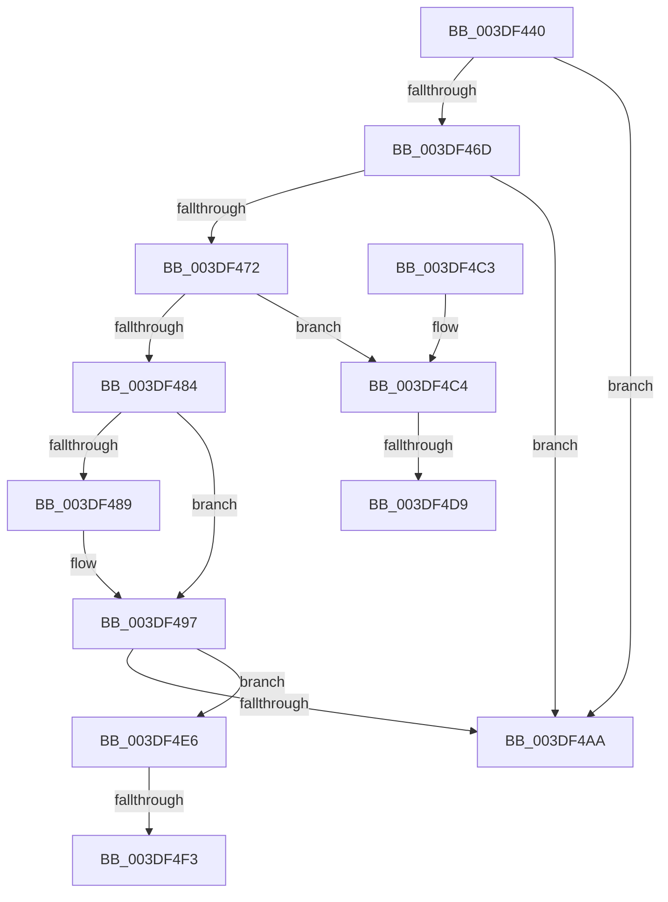

# IoFreeMapRegistersV2

- RVA: `0x003DF440`–`0x003DF504` (길이 `196` bytes)
- VA: `0x00000001403DF440`
- 실행 섹션: `.text`
- PDB 이름 있음: `예`; PDB Function 태그: `예`
- unwind 정보 RVA: `0x00093F4C`
- 디코드: `56`개 명령, `196/196` bytes 표시
- 미해석 바이트: `0` (있으면 어셈블리에 `.byte`로 보존)

> 이 문서는 커널 이미지의 기계어와 PDB 기호를 분석해 생성했습니다. 4번과 5번은 함수 원형과 자료형을 바이너리 사용 방식에서 추정한 C 해석이며 원본 소스 복구 결과는 아닙니다.

## 1. Dependencies

- 직접 호출 지점: **4**; 고유 호출 대상: **4**
- 직접 호출자로 확인된 함수: **3**
- RIP 상대 이미지 참조: **1**

### Outgoing calls
- `0x003DF492` → [HalpDmaFreeMapRegisters](HalpDmaFreeMapRegisters_function_003DF5F4.md) (function, `0x003DF5F4`)
- `0x003DF4A0` → [HalpDmaProcessMapRegisterQueueV2](HalpDmaProcessMapRegisterQueueV2_function_003DF50C.md) (function, `0x003DF50C`)
- `0x003DF4DB` → [KiRaiseIrqlProcessIrqlFlags](../4F/KiRaiseIrqlProcessIrqlFlags_function_004F56FC.md) (function, `0x004F56FC`)
- `0x003DF4F9` → [KiLowerIrqlProcessIrqlFlags](../4F/KiLowerIrqlProcessIrqlFlags_function_004F5698.md) (function, `0x004F5698`)

### Direct callers
- [IoFreeAdapterChannelV2](IoFreeAdapterChannelV2_function_003DE3B0.md) at `0x003DE4F2`
- [sub_003DE9F7](Unknown_function_003DE9F7.md) at `0x003DEA02`
- [IoFreeMapRegistersThunk](../53/IoFreeMapRegistersThunk_function_0053F550.md) at `0x0053F571`

### Static image references
- `0x003DF4CC` → RVA `0x00FC6D20` (`ALMOSTRO`; read)

## 2. Other-region calls and transfers

- 다른 실행 섹션으로 향하는 call: **0**
- call이 아닌 외부 분기/꼬리 이동: **4**
  - `0x003DF4D3` → [sub_006EA70A](../6E/Unknown_function_006EA70A.md) (`tail-transfer`)
  - `0x003DF4E1` → [sub_006EA70A](../6E/Unknown_function_006EA70A.md) (`tail-transfer`)
  - `0x003DF4ED` → [sub_006EA70A + 0x8](../6E/Unknown_function_006EA70A.md) (`tail-transfer`)
  - `0x003DF4FF` → [sub_006EA70A + 0x8](../6E/Unknown_function_006EA70A.md) (`tail-transfer`)

## 3. Assembly (complete function range)

```asm
003DF440  48 89 5C 24 08                  mov qword ptr [rsp + 8], rbx
003DF445  48 89 6C 24 10                  mov qword ptr [rsp + 0x10], rbp
003DF44A  48 89 74 24 18                  mov qword ptr [rsp + 0x18], rsi
003DF44F  57                              push rdi
003DF450  41 56                           push r14
003DF452  41 57                           push r15
003DF454  48 83 EC 20                     sub rsp, 0x20
003DF458  4C 8B B9 A0 00 00 00            mov r15, qword ptr [rcx + 0xa0]
003DF45F  45 8B F0                        mov r14d, r8d
003DF462  48 8B EA                        mov rbp, rdx
003DF465  48 8B F9                        mov rdi, rcx
003DF468  4D 85 FF                        test r15, r15
003DF46B  74 3D                           je 0x1403df4aa
003DF46D  48 85 D2                        test rdx, rdx
003DF470  74 38                           je 0x1403df4aa
003DF472  40 32 F6                        xor sil, sil
003DF475  32 DB                           xor bl, bl
003DF477  44 0F 20 C0                     mov rax, cr8
003DF47B  BA 02 00 00 00                  mov edx, 2
003DF480  3A C2                           cmp al, dl
003DF482  72 40                           jb 0x1403df4c4
003DF484  45 85 F6                        test r14d, r14d
003DF487  74 0E                           je 0x1403df497
003DF489  45 8B C6                        mov r8d, r14d
003DF48C  48 8B D5                        mov rdx, rbp
003DF48F  48 8B CF                        mov rcx, rdi
003DF492  E8 5D 01 00 00                  call 0x1403df5f4
003DF497  8A 97 BA 01 00 00               mov dl, byte ptr [rdi + 0x1ba]
003DF49D  49 8B CF                        mov rcx, r15
003DF4A0  E8 67 00 00 00                  call 0x1403df50c
003DF4A5  40 84 F6                        test sil, sil
003DF4A8  75 3C                           jne 0x1403df4e6
003DF4AA  48 8B 5C 24 40                  mov rbx, qword ptr [rsp + 0x40]
003DF4AF  48 8B 6C 24 48                  mov rbp, qword ptr [rsp + 0x48]
003DF4B4  48 8B 74 24 50                  mov rsi, qword ptr [rsp + 0x50]
003DF4B9  48 83 C4 20                     add rsp, 0x20
003DF4BD  41 5F                           pop r15
003DF4BF  41 5E                           pop r14
003DF4C1  5F                              pop rdi
003DF4C2  C3                              ret
003DF4C3  CC                              int3
003DF4C4  44 0F 20 C3                     mov rbx, cr8
003DF4C8  44 0F 22 C2                     mov cr8, rdx
003DF4CC  83 3D 4D 78 BE 00 00            cmp dword ptr [rip + 0xbe784d], 0
003DF4D3  0F 84 31 B2 30 00               je 0x1406ea70a
003DF4D9  8A CB                           mov cl, bl
003DF4DB  E8 1C 62 11 00                  call 0x1404f56fc
003DF4E0  90                              nop
003DF4E1  E9 24 B2 30 00                  jmp 0x1406ea70a
003DF4E6  83 3D 33 78 BE 00 00            cmp dword ptr [rip + 0xbe7833], 0
003DF4ED  0F 84 1F B2 30 00               je 0x1406ea712
003DF4F3  44 0F 20 C1                     mov rcx, cr8
003DF4F7  8A D3                           mov dl, bl
003DF4F9  E8 9A 61 11 00                  call 0x1404f5698
003DF4FE  90                              nop
003DF4FF  E9 0E B2 30 00                  jmp 0x1406ea712
```

## 4. C-style interpretation (structured pseudocode)

```c
__int64 __fastcall IoFreeMapRegistersV2(__int64 a1, __int64 a2, int a3)
{
    __int64 result;
    __int64 v_rbx;
    __int64 v_rsi;
    __int64 v_rsp;
    unsigned __int64 v_stack_p10;
    unsigned __int64 v_stack_p18;
    unsigned __int64 v_stack_p8;

    v_stack_p8 = v_rbx;
    v_stack_p10 = v_rbp;
    v_stack_p18 = v_rsi;
    v_rsp = (v_rsp) - (32);
    if (*(unsigned __int64 *)(a1 + 160) == 0) goto loc_003DF4AA;
    if (a2 == 0) goto loc_003DF4AA;
    v_rsi = 0;
    v_rbx = 0;
    if (((unsigned __int8)(v_cr8)) < 2) goto loc_003DF4C4;
    result = v_cr8;
    if ((unsigned int)((unsigned int)(a3)) != 0) {
        a3 = (unsigned int)((unsigned int)(a3));
        a2 = a2;
        a1 = a1;
        result = HalpDmaFreeMapRegisters(a1, a2, a3, a4);
    }
    result = HalpDmaProcessMapRegisterQueueV2(*(unsigned __int64 *)(a1 + 160), *(unsigned __int8 *)(a1 + 442), a3, a4);
    if (0 != 0) goto loc_003DF4E6;
loc_003DF4AA:
    v_rsp = (v_rsp) + (32);
    return result;
loc_003DF4C4:
    result = KiRaiseIrqlProcessIrqlFlags((unsigned __int8)(v_cr8), *(unsigned __int8 *)(a1 + 442), a3, a4);
loc_003DF4E6:
    result = KiLowerIrqlProcessIrqlFlags(*(unsigned __int8 *)(a1 + 442), (unsigned __int8)(v_cr8), a3, a4);
}
```

## 5. (Beta) C Style

```c
int64_t IoFreeMapRegistersV2(void *Arg1, int64_t Arg2, int32_t Arg3)
{
    uint8_t *arg1 = (uint8_t *)Arg1;

    int64_t result;
    int64_t local_rbx;
    int64_t local_rsi;
    int64_t local_rsp;
    uint64_t v_stack_p10;
    uint64_t v_stack_p18;
    uint64_t v_stack_p8;

    v_stack_p8 = local_rbx;
    v_stack_p10 = local_rbp;
    v_stack_p18 = local_rsi;
    local_rsp = (local_rsp) - (32);
    if (*(uint64_t *)(arg1 + 0xA0) == 0) goto loc_003DF4AA;
    if (Arg2 == 0) goto loc_003DF4AA;
    local_rsi = 0;
    local_rbx = 0;
    if (((uint8_t)(v_cr8)) < 2) goto loc_003DF4C4;
    result = v_cr8;
    if ((uint32_t)((uint32_t)(Arg3)) != 0) {
        Arg3 = (uint32_t)((uint32_t)(Arg3));
        Arg2 = Arg2;
        Arg1 = Arg1;
        result = HalpDmaFreeMapRegisters(Arg1, Arg2, Arg3, a4);
    }
    result = HalpDmaProcessMapRegisterQueueV2(*(uint64_t *)(arg1 + 0xA0), *(uint8_t *)(arg1 + 0x1BA), Arg3, a4);
    if (0 != 0) goto loc_003DF4E6;
loc_003DF4AA:
    local_rsp = (local_rsp) + (32);
    return result;
loc_003DF4C4:
    result = KiRaiseIrqlProcessIrqlFlags((uint8_t)(v_cr8), *(uint8_t *)(arg1 + 0x1BA), Arg3, a4);
loc_003DF4E6:
    result = KiLowerIrqlProcessIrqlFlags(*(uint8_t *)(arg1 + 0x1BA), (uint8_t)(v_cr8), Arg3, a4);
}
```

### 관측된 메모리 오프셋

구조체 형식이 확인되지 않은 접근은 인자 기준의 오프셋으로만 기록했습니다.

| 기준 인자 | 오프셋 표현 | 폭 (bit) | 접근 |
|---|---:|---:|---|
| `Arg1` | `+ 0xA0` | `64` | `R` |
| `Arg1` | `+ 0x1BA` | `8` | `R` |

## 6. Execution-region graph

[열기: 2D/3D 그래프와 함수 탐색 컨트롤 패널](../../../control-panel.html?section=text&rva=0x003DF440&view=graph)

- 2D 그래프는 위에서 아래로 흐르고, 3D 그래프는 빈 공간을 드래그해 회전합니다. Shift+드래그는 이동, 휠은 확대·축소, 함수 노드 선택은 대상 보고서 이동입니다.

### Static fallback


