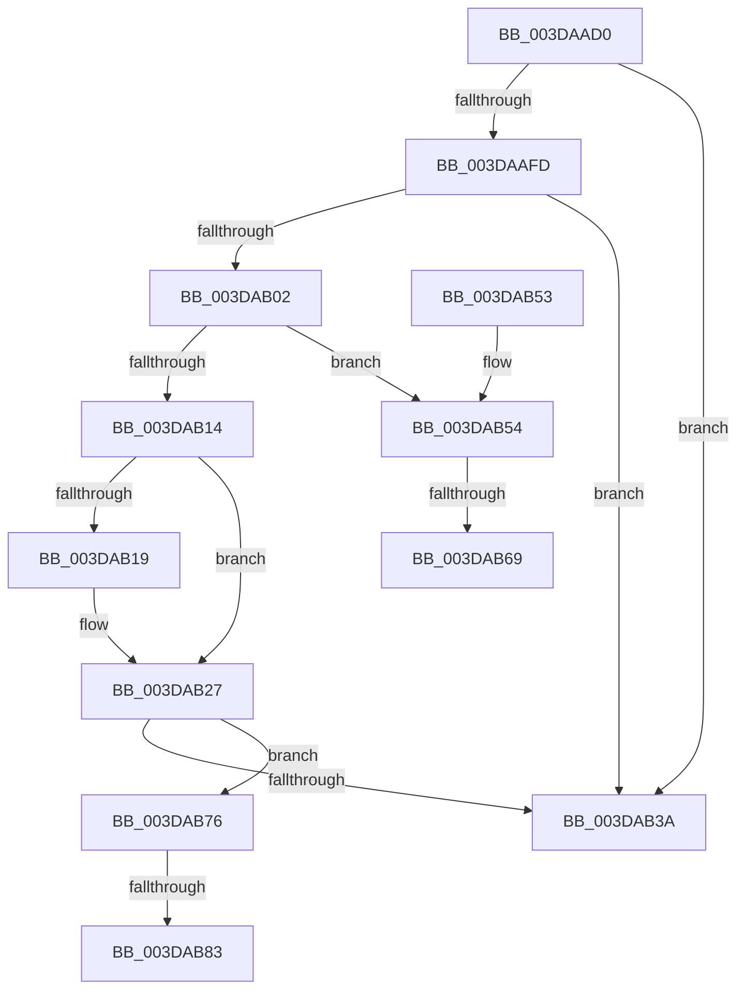

# IoFreeMapRegistersV3

- RVA: `0x003DAAD0`–`0x003DAB94` (길이 `196` bytes)
- VA: `0x00000001403DAAD0`
- 실행 섹션: `.text`
- PDB 이름 있음: `예`; PDB Function 태그: `예`
- unwind 정보 RVA: `0x00093F4C`
- 디코드: `56`개 명령, `196/196` bytes 표시
- 미해석 바이트: `0` (있으면 어셈블리에 `.byte`로 보존)

> 이 문서는 커널 이미지의 기계어와 PDB 기호를 분석해 생성했습니다. 4번과 5번은 함수 원형과 자료형을 바이너리 사용 방식에서 추정한 C 해석이며 원본 소스 복구 결과는 아닙니다.

## 1. Dependencies

- 직접 호출 지점: **4**; 고유 호출 대상: **4**
- 직접 호출자로 확인된 함수: **3**
- RIP 상대 이미지 참조: **1**

### Outgoing calls
- `0x003DAB22` → [HalpDmaFreeMapRegisters](HalpDmaFreeMapRegisters_function_003DF5F4.md) (function, `0x003DF5F4`)
- `0x003DAB30` → [HalpDmaProcessMapRegisterQueueV3](HalpDmaProcessMapRegisterQueueV3_function_003DA780.md) (function, `0x003DA780`)
- `0x003DAB6B` → [KiRaiseIrqlProcessIrqlFlags](../4F/KiRaiseIrqlProcessIrqlFlags_function_004F56FC.md) (function, `0x004F56FC`)
- `0x003DAB89` → [KiLowerIrqlProcessIrqlFlags](../4F/KiLowerIrqlProcessIrqlFlags_function_004F5698.md) (function, `0x004F5698`)

### Direct callers
- [IoFreeAdapterChannelV3Internal](IoFreeAdapterChannelV3Internal_function_003DAA74.md) at `0x003DAA90`
- [HalPutScatterGatherListV3](HalPutScatterGatherListV3_function_003DACA8.md) at `0x003DAD13`
- [IoFreeMapRegistersThunk](../53/IoFreeMapRegistersThunk_function_0053F550.md) at `0x0053F56A`

### Static image references
- `0x003DAB5C` → RVA `0x00FC6D20` (`ALMOSTRO`; read)

## 2. Other-region calls and transfers

- 다른 실행 섹션으로 향하는 call: **0**
- call이 아닌 외부 분기/꼬리 이동: **4**
  - `0x003DAB63` → [sub_006E9BEA](../6E/Unknown_function_006E9BEA.md) (`tail-transfer`)
  - `0x003DAB71` → [sub_006E9BEA](../6E/Unknown_function_006E9BEA.md) (`tail-transfer`)
  - `0x003DAB7D` → [sub_006E9BEA + 0x8](../6E/Unknown_function_006E9BEA.md) (`tail-transfer`)
  - `0x003DAB8F` → [sub_006E9BEA + 0x8](../6E/Unknown_function_006E9BEA.md) (`tail-transfer`)

## 3. Assembly (complete function range)

```asm
003DAAD0  48 89 5C 24 08                  mov qword ptr [rsp + 8], rbx
003DAAD5  48 89 6C 24 10                  mov qword ptr [rsp + 0x10], rbp
003DAADA  48 89 74 24 18                  mov qword ptr [rsp + 0x18], rsi
003DAADF  57                              push rdi
003DAAE0  41 56                           push r14
003DAAE2  41 57                           push r15
003DAAE4  48 83 EC 20                     sub rsp, 0x20
003DAAE8  4C 8B B9 A0 00 00 00            mov r15, qword ptr [rcx + 0xa0]
003DAAEF  45 8B F0                        mov r14d, r8d
003DAAF2  48 8B EA                        mov rbp, rdx
003DAAF5  48 8B F9                        mov rdi, rcx
003DAAF8  4D 85 FF                        test r15, r15
003DAAFB  74 3D                           je 0x1403dab3a
003DAAFD  48 85 D2                        test rdx, rdx
003DAB00  74 38                           je 0x1403dab3a
003DAB02  40 32 F6                        xor sil, sil
003DAB05  32 DB                           xor bl, bl
003DAB07  44 0F 20 C0                     mov rax, cr8
003DAB0B  BA 02 00 00 00                  mov edx, 2
003DAB10  3A C2                           cmp al, dl
003DAB12  72 40                           jb 0x1403dab54
003DAB14  45 85 F6                        test r14d, r14d
003DAB17  74 0E                           je 0x1403dab27
003DAB19  45 8B C6                        mov r8d, r14d
003DAB1C  48 8B D5                        mov rdx, rbp
003DAB1F  48 8B CF                        mov rcx, rdi
003DAB22  E8 CD 4A 00 00                  call 0x1403df5f4
003DAB27  8A 97 BA 01 00 00               mov dl, byte ptr [rdi + 0x1ba]
003DAB2D  49 8B CF                        mov rcx, r15
003DAB30  E8 4B FC FF FF                  call 0x1403da780
003DAB35  40 84 F6                        test sil, sil
003DAB38  75 3C                           jne 0x1403dab76
003DAB3A  48 8B 5C 24 40                  mov rbx, qword ptr [rsp + 0x40]
003DAB3F  48 8B 6C 24 48                  mov rbp, qword ptr [rsp + 0x48]
003DAB44  48 8B 74 24 50                  mov rsi, qword ptr [rsp + 0x50]
003DAB49  48 83 C4 20                     add rsp, 0x20
003DAB4D  41 5F                           pop r15
003DAB4F  41 5E                           pop r14
003DAB51  5F                              pop rdi
003DAB52  C3                              ret
003DAB53  CC                              int3
003DAB54  44 0F 20 C3                     mov rbx, cr8
003DAB58  44 0F 22 C2                     mov cr8, rdx
003DAB5C  83 3D BD C1 BE 00 00            cmp dword ptr [rip + 0xbec1bd], 0
003DAB63  0F 84 81 F0 30 00               je 0x1406e9bea
003DAB69  8A CB                           mov cl, bl
003DAB6B  E8 8C AB 11 00                  call 0x1404f56fc
003DAB70  90                              nop
003DAB71  E9 74 F0 30 00                  jmp 0x1406e9bea
003DAB76  83 3D A3 C1 BE 00 00            cmp dword ptr [rip + 0xbec1a3], 0
003DAB7D  0F 84 6F F0 30 00               je 0x1406e9bf2
003DAB83  44 0F 20 C1                     mov rcx, cr8
003DAB87  8A D3                           mov dl, bl
003DAB89  E8 0A AB 11 00                  call 0x1404f5698
003DAB8E  90                              nop
003DAB8F  E9 5E F0 30 00                  jmp 0x1406e9bf2
```

## 4. C-style interpretation (structured pseudocode)

```c
__int64 __fastcall IoFreeMapRegistersV3(__int64 a1, __int64 a2, int a3)
{
    __int64 result;
    __int64 v_rbx;
    __int64 v_rsi;
    __int64 v_rsp;
    unsigned __int64 v_stack_p10;
    unsigned __int64 v_stack_p18;
    unsigned __int64 v_stack_p8;

    v_stack_p8 = v_rbx;
    v_stack_p10 = v_rbp;
    v_stack_p18 = v_rsi;
    v_rsp = (v_rsp) - (32);
    if (*(unsigned __int64 *)(a1 + 160) == 0) goto loc_003DAB3A;
    if (a2 == 0) goto loc_003DAB3A;
    v_rsi = 0;
    v_rbx = 0;
    if (((unsigned __int8)(v_cr8)) < 2) goto loc_003DAB54;
    result = v_cr8;
    if ((unsigned int)((unsigned int)(a3)) != 0) {
        a3 = (unsigned int)((unsigned int)(a3));
        a2 = a2;
        a1 = a1;
        result = HalpDmaFreeMapRegisters(a1, a2, a3, a4);
    }
    result = HalpDmaProcessMapRegisterQueueV3(*(unsigned __int64 *)(a1 + 160), *(unsigned __int8 *)(a1 + 442), a3, a4);
    if (0 != 0) goto loc_003DAB76;
loc_003DAB3A:
    v_rsp = (v_rsp) + (32);
    return result;
loc_003DAB54:
    result = KiRaiseIrqlProcessIrqlFlags((unsigned __int8)(v_cr8), *(unsigned __int8 *)(a1 + 442), a3, a4);
loc_003DAB76:
    result = KiLowerIrqlProcessIrqlFlags(*(unsigned __int8 *)(a1 + 442), (unsigned __int8)(v_cr8), a3, a4);
}
```

## 5. (Beta) C Style

```c
int64_t IoFreeMapRegistersV3(void *Arg1, int64_t Arg2, int32_t Arg3)
{
    uint8_t *arg1 = (uint8_t *)Arg1;

    int64_t result;
    int64_t local_rbx;
    int64_t local_rsi;
    int64_t local_rsp;
    uint64_t v_stack_p10;
    uint64_t v_stack_p18;
    uint64_t v_stack_p8;

    v_stack_p8 = local_rbx;
    v_stack_p10 = local_rbp;
    v_stack_p18 = local_rsi;
    local_rsp = (local_rsp) - (32);
    if (*(uint64_t *)(arg1 + 0xA0) == 0) goto loc_003DAB3A;
    if (Arg2 == 0) goto loc_003DAB3A;
    local_rsi = 0;
    local_rbx = 0;
    if (((uint8_t)(v_cr8)) < 2) goto loc_003DAB54;
    result = v_cr8;
    if ((uint32_t)((uint32_t)(Arg3)) != 0) {
        Arg3 = (uint32_t)((uint32_t)(Arg3));
        Arg2 = Arg2;
        Arg1 = Arg1;
        result = HalpDmaFreeMapRegisters(Arg1, Arg2, Arg3, a4);
    }
    result = HalpDmaProcessMapRegisterQueueV3(*(uint64_t *)(arg1 + 0xA0), *(uint8_t *)(arg1 + 0x1BA), Arg3, a4);
    if (0 != 0) goto loc_003DAB76;
loc_003DAB3A:
    local_rsp = (local_rsp) + (32);
    return result;
loc_003DAB54:
    result = KiRaiseIrqlProcessIrqlFlags((uint8_t)(v_cr8), *(uint8_t *)(arg1 + 0x1BA), Arg3, a4);
loc_003DAB76:
    result = KiLowerIrqlProcessIrqlFlags(*(uint8_t *)(arg1 + 0x1BA), (uint8_t)(v_cr8), Arg3, a4);
}
```

### 관측된 메모리 오프셋

구조체 형식이 확인되지 않은 접근은 인자 기준의 오프셋으로만 기록했습니다.

| 기준 인자 | 오프셋 표현 | 폭 (bit) | 접근 |
|---|---:|---:|---|
| `Arg1` | `+ 0xA0` | `64` | `R` |
| `Arg1` | `+ 0x1BA` | `8` | `R` |

## 6. Execution-region graph

[열기: 2D/3D 그래프와 함수 탐색 컨트롤 패널](../../../control-panel.html?section=text&rva=0x003DAAD0&view=graph)

- 2D 그래프는 위에서 아래로 흐르고, 3D 그래프는 빈 공간을 드래그해 회전합니다. Shift+드래그는 이동, 휠은 확대·축소, 함수 노드 선택은 대상 보고서 이동입니다.

### Static fallback


