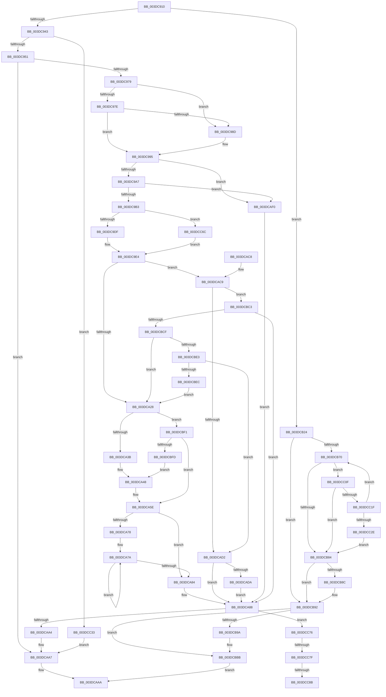

# IoMapTransferInternal

- RVA: `0x003DC910`–`0x003DCCA5` (길이 `917` bytes)
- VA: `0x00000001403DC910`
- 실행 섹션: `.text`
- PDB 이름 있음: `예`; PDB Function 태그: `예`
- unwind 정보 RVA: `0x00094240`
- 디코드: `223`개 명령, `917/917` bytes 표시
- 미해석 바이트: `0` (있으면 어셈블리에 `.byte`로 보존)

> 이 문서는 커널 이미지의 기계어와 PDB 기호를 분석해 생성했습니다. 4번과 5번은 함수 원형과 자료형을 바이너리 사용 방식에서 추정한 C 해석이며 원본 소스 복구 결과는 아닙니다.

## 1. Dependencies

- 직접 호출 지점: **11**; 고유 호출 대상: **9**
- 직접 호출자로 확인된 함수: **1**
- RIP 상대 이미지 참조: **0**

### Outgoing calls
- `0x003DC943` → [HalpDmaGetAdapterVersion](HalpDmaGetAdapterVersion_function_003DEC8C.md) (function, `0x003DEC8C`)
- `0x003DC9B6` → [HalpDmaGetAdapterVersion](HalpDmaGetAdapterVersion_function_003DEC8C.md) (function, `0x003DEC8C`)
- `0x003DC9DF` → [HalpDmaNextContiguousPieceV2](HalpDmaNextContiguousPieceV2_function_003DE530.md) (function, `0x003DE530`)
- `0x003DCA59` → [HalpDmaSyncMapBuffers](HalpDmaSyncMapBuffers_function_003DEFD0.md) (function, `0x003DEFD0`)
- `0x003DCAE9` → [HalpDmaFlushBuffer](HalpDmaFlushBuffer_function_003DC1DC.md) (function, `0x003DC1DC`)
- `0x003DCB15` → [HalpDmaMapContiguousTransferV2](HalpDmaMapContiguousTransferV2_function_003DFDF4.md) (function, `0x003DFDF4`)
- `0x003DCBB6` → [HalpDmaFlushBuffer](HalpDmaFlushBuffer_function_003DC1DC.md) (function, `0x003DC1DC`)
- `0x003DCBD2` → [HalpDmaGetAdapterCacheAlignment](HalpDmaGetAdapterCacheAlignment_function_003DC150.md) (function, `0x003DC150`)
- `0x003DCC5F` → [HalpMapTransferV3](HalpMapTransferV3_function_003DCCAC.md) (function, `0x003DCCAC`)
- `0x003DCC6C` → [HalpDmaNextContiguousPieceV3](HalpDmaNextContiguousPieceV3_function_003DECFC.md) (function, `0x003DECFC`)
- `0x003DCC9A` → [HalpDmaZeroMapBuffers](../55/HalpDmaZeroMapBuffers_function_005511EC.md) (function, `0x005511EC`)

### Direct callers
- [HalMapTransferEx](HalMapTransferEx_function_003DB450.md) at `0x003DB62D`

### Static image references
- 디코드된 RIP-relative 메모리 참조가 없습니다.

## 2. Other-region calls and transfers

- 다른 실행 섹션으로 향하는 call: **0**
- call이 아닌 외부 분기/꼬리 이동: **3**
  - `0x003DCC79` → [sub_006EA0C0](../6E/Unknown_function_006EA0C0.md) (`tail-transfer`)
  - `0x003DCC85` → [sub_006EA0C0](../6E/Unknown_function_006EA0C0.md) (`tail-transfer`)
  - `0x003DCCA0` → [sub_006EA0C0](../6E/Unknown_function_006EA0C0.md) (`tail-transfer`)

## 3. Assembly (complete function range)

```asm
003DC910  48 89 5C 24 08                  mov qword ptr [rsp + 8], rbx
003DC915  48 89 6C 24 10                  mov qword ptr [rsp + 0x10], rbp
003DC91A  48 89 74 24 20                  mov qword ptr [rsp + 0x20], rsi
003DC91F  57                              push rdi
003DC920  41 54                           push r12
003DC922  41 55                           push r13
003DC924  41 56                           push r14
003DC926  41 57                           push r15
003DC928  48 83 EC 70                     sub rsp, 0x70
003DC92C  33 DB                           xor ebx, ebx
003DC92E  49 8B E9                        mov rbp, r9
003DC931  4D 8B E8                        mov r13, r8
003DC934  4C 8B F2                        mov r14, rdx
003DC937  48 8B F1                        mov rsi, rcx
003DC93A  4D 85 C0                        test r8, r8
003DC93D  0F 84 E1 01 00 00               je 0x1403dcb24
003DC943  E8 44 23 00 00                  call 0x1403dec8c
003DC948  83 E8 02                        sub eax, 2
003DC94B  0F 85 E2 02 00 00               jne 0x1403dcc33
003DC951  48 8B BC 24 C0 00 00 00         mov rdi, qword ptr [rsp + 0xc0]
003DC959  33 C0                           xor eax, eax
003DC95B  0F 57 C0                        xorps xmm0, xmm0
003DC95E  48 89 5C 24 40                  mov qword ptr [rsp + 0x40], rbx
003DC963  0F 11 44 24 50                  movups xmmword ptr [rsp + 0x50], xmm0
003DC968  48 89 44 24 60                  mov qword ptr [rsp + 0x60], rax
003DC96D  44 8B 07                        mov r8d, dword ptr [rdi]
003DC970  45 85 C0                        test r8d, r8d
003DC973  0F 84 2E 01 00 00               je 0x1403dcaa7
003DC979  48 85 F6                        test rsi, rsi
003DC97C  74 0F                           je 0x1403dc98d
003DC97E  88 9C 24 B0 00 00 00            mov byte ptr [rsp + 0xb0], bl
003DC985  38 9E B9 01 00 00               cmp byte ptr [rsi + 0x1b9], bl
003DC98B  74 08                           je 0x1403dc995
003DC98D  C6 84 24 B0 00 00 00 01         mov byte ptr [rsp + 0xb0], 1
003DC995  49 8B 45 38                     mov rax, qword ptr [r13 + 0x38]
003DC999  48 89 44 24 48                  mov qword ptr [rsp + 0x48], rax
003DC99E  48 85 F6                        test rsi, rsi
003DC9A1  0F 84 49 01 00 00               je 0x1403dcaf0
003DC9A7  38 9E BA 01 00 00               cmp byte ptr [rsi + 0x1ba], bl
003DC9AD  0F 84 3D 01 00 00               je 0x1403dcaf0
003DC9B3  48 8B CE                        mov rcx, rsi
003DC9B6  E8 D1 22 00 00                  call 0x1403dec8c
003DC9BB  44 8A BC 24 C8 00 00 00         mov r15b, byte ptr [rsp + 0xc8]
003DC9C3  49 8B D6                        mov rdx, r14
003DC9C6  44 89 44 24 28                  mov dword ptr [rsp + 0x28], r8d
003DC9CB  48 8B CE                        mov rcx, rsi
003DC9CE  44 88 7C 24 20                  mov byte ptr [rsp + 0x20], r15b
003DC9D3  4D 8B C5                        mov r8, r13
003DC9D6  83 E8 02                        sub eax, 2
003DC9D9  0F 85 8D 02 00 00               jne 0x1403dcc6c
003DC9DF  E8 4C 1B 00 00                  call 0x1403de530
003DC9E4  89 07                           mov dword ptr [rdi], eax
003DC9E6  4C 8B E5                        mov r12, rbp
003DC9E9  41 81 E4 FF 0F 00 00            and r12d, 0xfff
003DC9F0  44 8B C8                        mov r9d, eax
003DC9F3  8B C0                           mov eax, eax
003DC9F5  48 8B FD                        mov rdi, rbp
003DC9F8  49 2B 7E 20                     sub rdi, qword ptr [r14 + 0x20]
003DC9FC  48 C1 EF 0C                     shr rdi, 0xc
003DCA00  8B FF                           mov edi, edi
003DCA02  48 89 44 24 40                  mov qword ptr [rsp + 0x40], rax
003DCA07  49 8B 7C FE 30                  mov rdi, qword ptr [r14 + rdi*8 + 0x30]
003DCA0C  48 C1 E7 0C                     shl rdi, 0xc
003DCA10  49 03 FC                        add rdi, r12
003DCA13  4C 8D 04 38                     lea r8, [rax + rdi]
003DCA17  49 8D 40 FF                     lea rax, [r8 - 1]
003DCA1B  48 39 86 90 00 00 00            cmp qword ptr [rsi + 0x90], rax
003DCA22  0F 83 A1 00 00 00               jae 0x1403dcac9
003DCA28  49 8B 4D 38                     mov rcx, qword ptr [r13 + 0x38]
003DCA2C  48 8B 39                        mov rdi, qword ptr [rcx]
003DCA2F  49 03 FC                        add rdi, r12
003DCA32  45 84 FF                        test r15b, r15b
003DCA35  0F 84 B6 01 00 00               je 0x1403dcbf1
003DCA3B  88 5C 24 38                     mov byte ptr [rsp + 0x38], bl
003DCA3F  88 5C 24 30                     mov byte ptr [rsp + 0x30], bl
003DCA43  44 88 7C 24 28                  mov byte ptr [rsp + 0x28], r15b
003DCA48  44 89 4C 24 20                  mov dword ptr [rsp + 0x20], r9d
003DCA4D  4C 8B C5                        mov r8, rbp
003DCA50  4C 8B C9                        mov r9, rcx
003DCA53  49 8B D6                        mov rdx, r14
003DCA56  48 8B CE                        mov rcx, rsi
003DCA59  E8 72 25 00 00                  call 0x1403defd0
003DCA5E  48 8B 44 24 40                  mov rax, qword ptr [rsp + 0x40]
003DCA63  49 8B 4D 38                     mov rcx, qword ptr [r13 + 0x38]
003DCA67  48 05 FF 0F 00 00               add rax, 0xfff
003DCA6D  49 03 C4                        add rax, r12
003DCA70  48 C1 E8 0C                     shr rax, 0xc
003DCA74  85 C0                           test eax, eax
003DCA76  74 0C                           je 0x1403dca84
003DCA78  8B D0                           mov edx, eax
003DCA7A  48 8B 49 08                     mov rcx, qword ptr [rcx + 8]
003DCA7E  48 83 EA 01                     sub rdx, 1
003DCA82  75 F6                           jne 0x1403dca7a
003DCA84  49 89 4D 38                     mov qword ptr [r13 + 0x38], rcx
003DCA88  4C 8B C5                        mov r8, rbp
003DCA8B  4C 8B A4 24 C0 00 00 00         mov r12, qword ptr [rsp + 0xc0]
003DCA93  45 8B 24 24                     mov r12d, dword ptr [r12]
003DCA97  38 9C 24 B0 00 00 00            cmp byte ptr [rsp + 0xb0], bl
003DCA9E  0F 84 D2 01 00 00               je 0x1403dcc76
003DCAA4  48 8B DF                        mov rbx, rdi
003DCAA7  48 8B C3                        mov rax, rbx
003DCAAA  4C 8D 5C 24 70                  lea r11, [rsp + 0x70]
003DCAAF  49 8B 5B 30                     mov rbx, qword ptr [r11 + 0x30]
003DCAB3  49 8B 6B 38                     mov rbp, qword ptr [r11 + 0x38]
003DCAB7  49 8B 73 48                     mov rsi, qword ptr [r11 + 0x48]
003DCABB  49 8B E3                        mov rsp, r11
003DCABE  41 5F                           pop r15
003DCAC0  41 5E                           pop r14
003DCAC2  41 5D                           pop r13
003DCAC4  41 5C                           pop r12
003DCAC6  5F                              pop rdi
003DCAC7  C3                              ret
003DCAC8  CC                              int3
003DCAC9  45 84 FF                        test r15b, r15b
003DCACC  0F 84 F1 00 00 00               je 0x1403dcbc3
003DCAD2  38 9E BD 01 00 00               cmp byte ptr [rsi + 0x1bd], bl
003DCAD8  75 AE                           jne 0x1403dca88
003DCADA  88 5C 24 28                     mov byte ptr [rsp + 0x28], bl
003DCADE  4C 8B C5                        mov r8, rbp
003DCAE1  49 8B D6                        mov rdx, r14
003DCAE4  44 88 7C 24 20                  mov byte ptr [rsp + 0x20], r15b
003DCAE9  E8 EE F6 FF FF                  call 0x1403dc1dc
003DCAEE  EB 98                           jmp 0x1403dca88
003DCAF0  44 8A BC 24 C8 00 00 00         mov r15b, byte ptr [rsp + 0xc8]
003DCAF8  48 8D 44 24 40                  lea rax, [rsp + 0x40]
003DCAFD  48 89 44 24 30                  mov qword ptr [rsp + 0x30], rax
003DCB02  4D 8B C5                        mov r8, r13
003DCB05  44 88 7C 24 28                  mov byte ptr [rsp + 0x28], r15b
003DCB0A  49 8B D6                        mov rdx, r14
003DCB0D  48 8B CE                        mov rcx, rsi
003DCB10  48 89 7C 24 20                  mov qword ptr [rsp + 0x20], rdi
003DCB15  E8 DA 32 00 00                  call 0x1403dfdf4
003DCB1A  48 8B 7C 24 40                  mov rdi, qword ptr [rsp + 0x40]
003DCB1F  E9 64 FF FF FF                  jmp 0x1403dca88
003DCB24  4C 8B 9C 24 C0 00 00 00         mov r11, qword ptr [rsp + 0xc0]
003DCB2C  48 8B C5                        mov rax, rbp
003DCB2F  48 2B 42 20                     sub rax, qword ptr [rdx + 0x20]
003DCB33  44 8B C5                        mov r8d, ebp
003DCB36  41 81 E0 FF 0F 00 00            and r8d, 0xfff
003DCB3D  48 C1 E8 0C                     shr rax, 0xc
003DCB41  48 83 C2 30                     add rdx, 0x30
003DCB45  41 BF 00 10 00 00               mov r15d, 0x1000
003DCB4B  41 8B CF                        mov ecx, r15d
003DCB4E  41 2B C8                        sub ecx, r8d
003DCB51  4C 8D 14 C2                     lea r10, [rdx + rax*8]
003DCB55  41 8B C0                        mov eax, r8d
003DCB58  45 8B 03                        mov r8d, dword ptr [r11]
003DCB5B  45 8B C8                        mov r9d, r8d
003DCB5E  49 8B 12                        mov rdx, qword ptr [r10]
003DCB61  48 8B FA                        mov rdi, rdx
003DCB64  48 C1 E7 0C                     shl rdi, 0xc
003DCB68  48 03 F8                        add rdi, rax
003DCB6B  41 3B C8                        cmp ecx, r8d
003DCB6E  73 22                           jae 0x1403dcb92
003DCB70  4D 8D 52 08                     lea r10, [r10 + 8]
003DCB74  4D 8B 0A                        mov r9, qword ptr [r10]
003DCB77  48 8D 42 01                     lea rax, [rdx + 1]
003DCB7B  49 3B C1                        cmp rax, r9
003DCB7E  0F 84 8B 00 00 00               je 0x1403dcc0f
003DCB84  45 8B C8                        mov r9d, r8d
003DCB87  41 3B C8                        cmp ecx, r8d
003DCB8A  73 06                           jae 0x1403dcb92
003DCB8C  41 89 0B                        mov dword ptr [r11], ecx
003DCB8F  44 8B C9                        mov r9d, ecx
003DCB92  38 9E BD 01 00 00               cmp byte ptr [rsi + 0x1bd], bl
003DCB98  75 21                           jne 0x1403dcbbb
003DCB9A  8A 84 24 D0 00 00 00            mov al, byte ptr [rsp + 0xd0]
003DCBA1  4C 8B C5                        mov r8, rbp
003DCBA4  88 44 24 28                     mov byte ptr [rsp + 0x28], al
003DCBA8  49 8B D6                        mov rdx, r14
003DCBAB  8A 84 24 C8 00 00 00            mov al, byte ptr [rsp + 0xc8]
003DCBB2  88 44 24 20                     mov byte ptr [rsp + 0x20], al
003DCBB6  E8 21 F6 FF FF                  call 0x1403dc1dc
003DCBBB  48 8B C7                        mov rax, rdi
003DCBBE  E9 E7 FE FF FF                  jmp 0x1403dcaaa
003DCBC3  38 9E BD 01 00 00               cmp byte ptr [rsi + 0x1bd], bl
003DCBC9  0F 85 B9 FE FF FF               jne 0x1403dca88
003DCBCF  48 8B CE                        mov rcx, rsi
003DCBD2  E8 79 F5 FF FF                  call 0x1403dc150
003DCBD7  8D 48 FF                        lea ecx, [rax - 1]
003DCBDA  48 85 CF                        test rdi, rcx
003DCBDD  0F 85 45 FE FF FF               jne 0x1403dca28
003DCBE3  49 85 C8                        test r8, rcx
003DCBE6  0F 84 E6 FE FF FF               je 0x1403dcad2
003DCBEC  E9 37 FE FF FF                  jmp 0x1403dca28
003DCBF1  38 9E BD 01 00 00               cmp byte ptr [rsi + 0x1bd], bl
003DCBF7  0F 85 61 FE FF FF               jne 0x1403dca5e
003DCBFD  88 5C 24 38                     mov byte ptr [rsp + 0x38], bl
003DCC01  C6 44 24 30 01                  mov byte ptr [rsp + 0x30], 1
003DCC06  88 5C 24 28                     mov byte ptr [rsp + 0x28], bl
003DCC0A  E9 39 FE FF FF                  jmp 0x1403dca48
003DCC0F  49 33 D1                        xor rdx, r9
003DCC12  48 F7 C2 00 00 F0 FF            test rdx, -0x100000
003DCC19  0F 85 65 FF FF FF               jne 0x1403dcb84
003DCC1F  41 03 CF                        add ecx, r15d
003DCC22  49 8B D1                        mov rdx, r9
003DCC25  41 3B C8                        cmp ecx, r8d
003DCC28  0F 82 42 FF FF FF               jb 0x1403dcb70
003DCC2E  E9 51 FF FF FF                  jmp 0x1403dcb84
003DCC33  83 F8 01                        cmp eax, 1
003DCC36  49 8B D6                        mov rdx, r14
003DCC39  8A 84 24 D0 00 00 00            mov al, byte ptr [rsp + 0xd0]
003DCC40  48 8B CE                        mov rcx, rsi
003DCC43  88 44 24 30                     mov byte ptr [rsp + 0x30], al
003DCC47  8A 84 24 C8 00 00 00            mov al, byte ptr [rsp + 0xc8]
003DCC4E  88 44 24 28                     mov byte ptr [rsp + 0x28], al
003DCC52  48 8B 84 24 C0 00 00 00         mov rax, qword ptr [rsp + 0xc0]
003DCC5A  48 89 44 24 20                  mov qword ptr [rsp + 0x20], rax
003DCC5F  E8 48 00 00 00                  call 0x1403dccac
003DCC64  48 8B D8                        mov rbx, rax
003DCC67  E9 3B FE FF FF                  jmp 0x1403dcaa7
003DCC6C  E8 8B 20 00 00                  call 0x1403decfc
003DCC71  E9 6E FD FF FF                  jmp 0x1403dc9e4
003DCC76  45 84 FF                        test r15b, r15b
003DCC79  0F 85 41 D4 30 00               jne 0x1406ea0c0
003DCC7F  38 9E BC 01 00 00               cmp byte ptr [rsi + 0x1bc], bl
003DCC85  0F 84 35 D4 30 00               je 0x1406ea0c0
003DCC8B  48 8B 54 24 48                  mov rdx, qword ptr [rsp + 0x48]
003DCC90  41 81 E0 FF 0F 00 00            and r8d, 0xfff
003DCC97  45 8B CC                        mov r9d, r12d
003DCC9A  E8 4D 45 17 00                  call 0x1405511ec
003DCC9F  90                              nop
003DCCA0  E9 1B D4 30 00                  jmp 0x1406ea0c0
```

## 4. C-style interpretation (structured pseudocode)

```c
__int64 __fastcall IoMapTransferInternal(__int64 a1, __int64 a2, __int64 a3, __int64 a4, __int64 a5, unsigned __int8 a6, unsigned __int8 a7)
{
    __int64 result;
    __int64 v_r12;
    __int64 v_rbx;
    __int64 v_rdi;
    __int64 v_rsp;
    unsigned __int64 v_stack_m28;
    unsigned __int64 v_stack_m30;
    unsigned __int64 v_stack_m38;
    unsigned __int64 v_stack_m40;
    unsigned __int64 v_stack_m48;
    unsigned __int64 v_stack_m50;
    unsigned __int64 v_stack_m58;
    unsigned __int8 v_stack_m60;
    unsigned __int8 v_stack_m68;
    unsigned int v_stack_m70;
    unsigned __int8 v_stack_m78;
    unsigned __int64 v_stack_p10;
    unsigned __int8 v_stack_p18;
    unsigned __int64 v_stack_p20;
    unsigned __int64 v_stack_p8;

    v_stack_p8 = v_rbx;
    v_stack_p10 = v_rbp;
    v_stack_p20 = v_rsi;
    v_rsp = (v_rsp) - (112);
    v_rbx = 0;
    if (a3 == 0) goto loc_003DCB24;
    result = HalpDmaGetAdapterVersion(a1, a2, a3, a4);
    result = (unsigned int)((result) - (2));
    if (condition_is_not_equal) goto loc_003DCC33;
    result = 0;
    v_stack_m58 = 0;
    v_stack_m48 = v_xmm0;
    v_stack_m38 = 0;
    if ((unsigned int)((unsigned int)(*(unsigned int *)(a5))) == 0) goto loc_003DCAA7;
    if (a1 == 0) goto loc_003DC98D;
    v_stack_p18 = 0;
    if ((*(unsigned __int8 *)(a1 + 441)) != 0) {
        v_stack_p18 = 1;
    }
    v_stack_m50 = *(unsigned __int64 *)(a3 + 56);
    if (a1 == 0) goto loc_003DCAF0;
    if ((*(unsigned __int8 *)(a1 + 442)) == 0) goto loc_003DCAF0;
    result = HalpDmaGetAdapterVersion(a1, a2, (unsigned int)(*(unsigned int *)(a5)), a4);
    v_stack_m70 = (unsigned int)((unsigned int)(*(unsigned int *)(a5)));
    v_stack_m78 = a6;
    result = (unsigned int)((result) - (2));
    if (condition_is_not_equal) goto loc_003DCC6C;
    result = HalpDmaNextContiguousPieceV2(a1, a2, a3, a4);
loc_003DC9E4:
    *(unsigned int *)(a5) = (unsigned int)(result);
    v_r12 = (unsigned int)((a4) & (0xFFFULL));
    v_rdi = (a4) - (*(unsigned __int64 *)(a2 + 32));
    v_rdi = (v_rdi) >> (12);
    v_stack_m58 = (unsigned int)((unsigned int)(result));
    v_rdi = (*(unsigned __int64 *)(a2 + (unsigned int)((unsigned int)(v_rdi)) * 8 + 48)) << (12);
    v_rdi = (v_rdi) + (v_r12);
    if ((*(unsigned __int64 *)(a1 + 144)) >= ((unsigned int)((unsigned int)(result)) + v_rdi * 1 - 1)) goto loc_003DCAC9;
loc_003DCA28:
    v_rdi = (*(unsigned __int64 *)(*(unsigned __int64 *)(a3 + 56))) + (v_r12);
    if (a6 == 0) goto loc_003DCBF1;
    v_stack_m60 = 0;
    v_stack_m68 = 0;
    v_stack_m70 = a6;
loc_003DCA48:
    v_stack_m78 = (unsigned int)((unsigned int)((unsigned int)(result)));
    result = HalpDmaSyncMapBuffers(a1, a2, a4, *(unsigned __int64 *)(a3 + 56));
loc_003DCA5E:
    result = (v_stack_m58) + (0xFFFULL);
    result = (result) + (v_r12);
    result = (result) >> (12);
    if ((unsigned int)(result) == 0) goto loc_003DCA84;
loc_003DCA7A:
    a2 = ((unsigned int)((unsigned int)(result))) - (1);
    if (condition_is_not_equal) goto loc_003DCA7A;
loc_003DCA84:
    *(unsigned __int64 *)(a3 + 56) = *(unsigned __int64 *)(*(unsigned __int64 *)(a3 + 56) + 8);
loc_003DCA88:
    if (v_stack_p18 == 0) goto loc_003DCC76;
loc_003DCAA7:
loc_003DCAAA:
    return v_rdi;
loc_003DCAC9:
    if (a6 == 0) goto loc_003DCBC3;
loc_003DCAD2:
    if ((*(unsigned __int8 *)(*(unsigned __int64 *)(v_stack_m28 + 72) + 445)) != ((unsigned __int8)(*(unsigned __int64 *)(v_stack_m28 + 48)))) goto loc_003DCA88;
    v_stack_m48 = (unsigned __int8)(*(unsigned __int64 *)(v_stack_m28 + 48));
    v_stack_m50 = a6;
    result = HalpDmaFlushBuffer(*(unsigned __int64 *)(*(unsigned __int64 *)(a3 + 56) + 8), a2, *(unsigned __int64 *)(v_stack_m28 + 56), *(unsigned __int64 *)(a3 + 56));
    goto loc_003DCA88;
loc_003DCAF0:
    v_stack_m40 = v_stack_m30;
    v_stack_m48 = a6;
    v_stack_m50 = v_rdi;
    result = HalpDmaMapContiguousTransferV2(*(unsigned __int64 *)(v_stack_m28 + 72), a2, a3, *(unsigned __int64 *)(a3 + 56));
    goto loc_003DCA88;
loc_003DCB24:
    result = (*(unsigned __int64 *)(v_stack_m28 + 56)) - (*(unsigned __int64 *)(a2 + 32));
    a3 = (unsigned int)(((unsigned int)((unsigned int)(*(unsigned __int64 *)(v_stack_m28 + 56)))) & (0xFFFULL));
    result = (result) >> (12);
    a2 = (a2) + (48);
    a1 = (unsigned int)(((unsigned int)((unsigned int)((unsigned int)(0x1000ULL)))) - ((unsigned int)(a3)));
    v_rdi = (*(unsigned __int64 *)(a2 + result * 8)) << (12);
    v_rdi = (v_rdi) + ((unsigned int)((unsigned int)(a3)));
    if (((unsigned int)(a1)) >= ((unsigned int)((unsigned int)(*(unsigned int *)(a5))))) goto loc_003DCB92;
loc_003DCB70:
    if ((*(unsigned __int64 *)(a2 + result * 8) + 1) == (*(unsigned __int64 *)(a2 + result * 8 + 8))) goto loc_003DCC0F;
loc_003DCB84:
    if (((unsigned int)(a1)) < ((unsigned int)((unsigned int)(*(unsigned int *)(a5))))) {
        *(unsigned int *)(a5) = (unsigned int)(a1);
        a4 = (unsigned int)(a1);
    }
    result = *(unsigned __int64 *)(a2 + result * 8) + 1;
    if ((*(unsigned __int8 *)(*(unsigned __int64 *)(v_stack_m28 + 72) + 445)) == ((unsigned __int8)(*(unsigned __int64 *)(v_stack_m28 + 48)))) {
        result = a7;
        a3 = *(unsigned __int64 *)(v_stack_m28 + 56);
        v_stack_m48 = (unsigned __int8)(result);
        a2 = a2;
        result = a6;
        v_stack_m50 = (unsigned __int8)(result);
        result = HalpDmaFlushBuffer(a1, a2, a3, a4);
    }
    goto loc_003DCAAA;
loc_003DCBC3:
    if ((*(unsigned __int8 *)(*(unsigned __int64 *)(v_stack_m28 + 72) + 445)) != ((unsigned __int8)(*(unsigned __int64 *)(v_stack_m28 + 48)))) goto loc_003DCA88;
    result = HalpDmaGetAdapterCacheAlignment(*(unsigned __int64 *)(v_stack_m28 + 72), a2, a3, a4);
    if (((v_rdi) & (result - 1)) != 0) goto loc_003DCA28;
    if (((a3) & (result - 1)) == 0) goto loc_003DCAD2;
    goto loc_003DCA28;
loc_003DCBF1:
    if ((*(unsigned __int8 *)(*(unsigned __int64 *)(v_stack_m28 + 72) + 445)) != ((unsigned __int8)(*(unsigned __int64 *)(v_stack_m28 + 48)))) goto loc_003DCA5E;
    v_stack_m38 = (unsigned __int8)(*(unsigned __int64 *)(v_stack_m28 + 48));
    v_stack_m40 = 1;
    v_stack_m48 = (unsigned __int8)(*(unsigned __int64 *)(v_stack_m28 + 48));
    goto loc_003DCA48;
loc_003DCC0F:
    a2 = (a2) ^ (a4);
    if (((a2) & (0xFFFFFFFFFFF00000ULL)) != 0) goto loc_003DCB84;
    a1 = (unsigned int)((result - 1) + ((unsigned int)((unsigned int)(0x1000ULL))));
    if (((unsigned int)(a1)) < ((unsigned int)(a3))) goto loc_003DCB70;
    goto loc_003DCB84;
loc_003DCC33:
    v_stack_m40 = a7;
    v_stack_m48 = a6;
    v_stack_m50 = a5;
    result = HalpMapTransferV3(*(unsigned __int64 *)(v_stack_m28 + 72), a2, a3, a4);
    goto loc_003DCAA7;
loc_003DCC6C:
    result = HalpDmaNextContiguousPieceV3(*(unsigned __int64 *)(v_stack_m28 + 72), a2, a3, a4);
    goto loc_003DC9E4;
loc_003DCC76:
    a3 = (unsigned int)((a3) & (0xFFFULL));
    result = HalpDmaZeroMapBuffers(*(unsigned __int64 *)(v_stack_m28 + 72), v_stack_m28, a3, (unsigned int)((unsigned int)((unsigned int)(*(unsigned int *)(a5)))));
}
```

## 5. (Beta) C Style

```c
int64_t IoMapTransferInternal(void *Arg1, void *Arg2, void *Arg3, int64_t Arg4, void *Arg5, uint8_t Arg6, uint8_t Arg7)
{
    uint8_t *arg1 = (uint8_t *)Arg1;
    uint8_t *arg2 = (uint8_t *)Arg2;
    uint8_t *arg3 = (uint8_t *)Arg3;
    uint8_t *arg5 = (uint8_t *)Arg5;

    int64_t result;
    int64_t local_r12;
    int64_t local_rbx;
    int64_t local_rdi;
    int64_t local_rsp;
    uint64_t v_stack_m28;
    uint64_t v_stack_m30;
    uint64_t v_stack_m38;
    uint64_t v_stack_m40;
    uint64_t v_stack_m48;
    uint64_t v_stack_m50;
    uint64_t v_stack_m58;
    uint8_t v_stack_m60;
    uint8_t v_stack_m68;
    uint32_t v_stack_m70;
    uint8_t v_stack_m78;
    uint64_t v_stack_p10;
    uint8_t v_stack_p18;
    uint64_t v_stack_p20;
    uint64_t v_stack_p8;

    v_stack_p8 = local_rbx;
    v_stack_p10 = local_rbp;
    v_stack_p20 = local_rsi;
    local_rsp = (local_rsp) - (112);
    local_rbx = 0;
    if (Arg3 == NULL) goto loc_003DCB24;
    result = HalpDmaGetAdapterVersion(Arg1, Arg2, Arg3, Arg4);
    result = (uint32_t)((result) - (2));
    if (condition_is_not_equal) goto loc_003DCC33;
    result = 0;
    v_stack_m58 = 0;
    v_stack_m48 = v_xmm0;
    v_stack_m38 = 0;
    if ((uint32_t)((uint32_t)(*(uint32_t *)(arg5))) == 0) goto loc_003DCAA7;
    if (Arg1 == NULL) goto loc_003DC98D;
    v_stack_p18 = 0;
    if ((*(uint8_t *)(arg1 + 0x1B9)) != 0) {
        v_stack_p18 = 1;
    }
    v_stack_m50 = *(uint64_t *)(arg3 + 0x38);
    if (Arg1 == NULL) goto loc_003DCAF0;
    if ((*(uint8_t *)(arg1 + 0x1BA)) == 0) goto loc_003DCAF0;
    result = HalpDmaGetAdapterVersion(Arg1, Arg2, (uint32_t)(*(uint32_t *)(arg5)), Arg4);
    v_stack_m70 = (uint32_t)((uint32_t)(*(uint32_t *)(arg5)));
    v_stack_m78 = Arg6;
    result = (uint32_t)((result) - (2));
    if (condition_is_not_equal) goto loc_003DCC6C;
    result = HalpDmaNextContiguousPieceV2(Arg1, Arg2, Arg3, Arg4);
loc_003DC9E4:
    *(uint32_t *)(arg5) = (uint32_t)(result);
    local_r12 = (uint32_t)((Arg4) & (0xFFFULL));
    local_rdi = (Arg4) - (*(uint64_t *)(arg2 + 0x20));
    local_rdi = (local_rdi) >> (12);
    v_stack_m58 = (uint32_t)((uint32_t)(result));
    local_rdi = (*(uint64_t *)(arg2 + (uint32_t)((uint32_t)(local_rdi)) * 8 + 0x30)) << (12);
    local_rdi = (local_rdi) + (local_r12);
    if ((*(uint64_t *)(arg1 + 0x90)) >= ((uint32_t)((uint32_t)(result)) + local_rdi * 1 - 1)) goto loc_003DCAC9;
loc_003DCA28:
    local_rdi = (*(uint64_t *)(*(uint64_t *)(arg3 + 0x38))) + (local_r12);
    if (Arg6 == 0) goto loc_003DCBF1;
    v_stack_m60 = 0;
    v_stack_m68 = 0;
    v_stack_m70 = Arg6;
loc_003DCA48:
    v_stack_m78 = (uint32_t)((uint32_t)((uint32_t)(result)));
    result = HalpDmaSyncMapBuffers(Arg1, Arg2, Arg4, *(uint64_t *)(arg3 + 0x38));
loc_003DCA5E:
    result = (v_stack_m58) + (0xFFFULL);
    result = (result) + (local_r12);
    result = (result) >> (12);
    if ((uint32_t)(result) == 0) goto loc_003DCA84;
loc_003DCA7A:
    Arg2 = ((uint32_t)((uint32_t)(result))) - (1);
    if (condition_is_not_equal) goto loc_003DCA7A;
loc_003DCA84:
    *(uint64_t *)(arg3 + 0x38) = *(uint64_t *)(*(uint64_t *)(arg3 + 0x38) + 0x8);
loc_003DCA88:
    if (v_stack_p18 == 0) goto loc_003DCC76;
loc_003DCAA7:
loc_003DCAAA:
    return local_rdi;
loc_003DCAC9:
    if (Arg6 == 0) goto loc_003DCBC3;
loc_003DCAD2:
    if ((*(uint8_t *)(*(uint64_t *)(v_stack_m28 + 0x48) + 0x1BD)) != ((uint8_t)(*(uint64_t *)(v_stack_m28 + 0x30)))) goto loc_003DCA88;
    v_stack_m48 = (uint8_t)(*(uint64_t *)(v_stack_m28 + 0x30));
    v_stack_m50 = Arg6;
    result = HalpDmaFlushBuffer(*(uint64_t *)(*(uint64_t *)(arg3 + 0x38) + 0x8), Arg2, *(uint64_t *)(v_stack_m28 + 0x38), *(uint64_t *)(arg3 + 0x38));
    goto loc_003DCA88;
loc_003DCAF0:
    v_stack_m40 = v_stack_m30;
    v_stack_m48 = Arg6;
    v_stack_m50 = local_rdi;
    result = HalpDmaMapContiguousTransferV2(*(uint64_t *)(v_stack_m28 + 0x48), Arg2, Arg3, *(uint64_t *)(arg3 + 0x38));
    goto loc_003DCA88;
loc_003DCB24:
    result = (*(uint64_t *)(v_stack_m28 + 0x38)) - (*(uint64_t *)(arg2 + 0x20));
    Arg3 = (uint32_t)(((uint32_t)((uint32_t)(*(uint64_t *)(v_stack_m28 + 0x38)))) & (0xFFFULL));
    result = (result) >> (12);
    Arg2 = (Arg2) + (48);
    Arg1 = (uint32_t)(((uint32_t)((uint32_t)((uint32_t)(0x1000ULL)))) - ((uint32_t)(Arg3)));
    local_rdi = (*(uint64_t *)(arg2 + result * 8)) << (12);
    local_rdi = (local_rdi) + ((uint32_t)((uint32_t)(Arg3)));
    if (((uint32_t)(Arg1)) >= ((uint32_t)((uint32_t)(*(uint32_t *)(arg5))))) goto loc_003DCB92;
loc_003DCB70:
    if ((*(uint64_t *)(arg2 + result * 8) + 1) == (*(uint64_t *)(arg2 + result * 8 + 0x8))) goto loc_003DCC0F;
loc_003DCB84:
    if (((uint32_t)(Arg1)) < ((uint32_t)((uint32_t)(*(uint32_t *)(arg5))))) {
        *(uint32_t *)(arg5) = (uint32_t)(Arg1);
        Arg4 = (uint32_t)(Arg1);
    }
    result = *(uint64_t *)(arg2 + result * 8) + 1;
    if ((*(uint8_t *)(*(uint64_t *)(v_stack_m28 + 0x48) + 0x1BD)) == ((uint8_t)(*(uint64_t *)(v_stack_m28 + 0x30)))) {
        result = Arg7;
        Arg3 = *(uint64_t *)(v_stack_m28 + 0x38);
        v_stack_m48 = (uint8_t)(result);
        Arg2 = Arg2;
        result = Arg6;
        v_stack_m50 = (uint8_t)(result);
        result = HalpDmaFlushBuffer(Arg1, Arg2, Arg3, Arg4);
    }
    goto loc_003DCAAA;
loc_003DCBC3:
    if ((*(uint8_t *)(*(uint64_t *)(v_stack_m28 + 0x48) + 0x1BD)) != ((uint8_t)(*(uint64_t *)(v_stack_m28 + 0x30)))) goto loc_003DCA88;
    result = HalpDmaGetAdapterCacheAlignment(*(uint64_t *)(v_stack_m28 + 0x48), Arg2, Arg3, Arg4);
    if (((local_rdi) & (result - 1)) != 0) goto loc_003DCA28;
    if (((Arg3) & (result - 1)) == 0) goto loc_003DCAD2;
    goto loc_003DCA28;
loc_003DCBF1:
    if ((*(uint8_t *)(*(uint64_t *)(v_stack_m28 + 0x48) + 0x1BD)) != ((uint8_t)(*(uint64_t *)(v_stack_m28 + 0x30)))) goto loc_003DCA5E;
    v_stack_m38 = (uint8_t)(*(uint64_t *)(v_stack_m28 + 0x30));
    v_stack_m40 = 1;
    v_stack_m48 = (uint8_t)(*(uint64_t *)(v_stack_m28 + 0x30));
    goto loc_003DCA48;
loc_003DCC0F:
    Arg2 = (Arg2) ^ (Arg4);
    if (((Arg2) & (0xFFFFFFFFFFF00000ULL)) != 0) goto loc_003DCB84;
    Arg1 = (uint32_t)((result - 1) + ((uint32_t)((uint32_t)(0x1000ULL))));
    if (((uint32_t)(Arg1)) < ((uint32_t)(Arg3))) goto loc_003DCB70;
    goto loc_003DCB84;
loc_003DCC33:
    v_stack_m40 = Arg7;
    v_stack_m48 = Arg6;
    v_stack_m50 = Arg5;
    result = HalpMapTransferV3(*(uint64_t *)(v_stack_m28 + 0x48), Arg2, Arg3, Arg4);
    goto loc_003DCAA7;
loc_003DCC6C:
    result = HalpDmaNextContiguousPieceV3(*(uint64_t *)(v_stack_m28 + 0x48), Arg2, Arg3, Arg4);
    goto loc_003DC9E4;
loc_003DCC76:
    Arg3 = (uint32_t)((Arg3) & (0xFFFULL));
    result = HalpDmaZeroMapBuffers(*(uint64_t *)(v_stack_m28 + 0x48), v_stack_m28, Arg3, (uint32_t)((uint32_t)((uint32_t)(*(uint32_t *)(arg5)))));
}
```

### 관측된 메모리 오프셋

구조체 형식이 확인되지 않은 접근은 인자 기준의 오프셋으로만 기록했습니다.

| 기준 인자 | 오프셋 표현 | 폭 (bit) | 접근 |
|---|---:|---:|---|
| `Arg1` | `+ 0x1BD` | `8` | `R` |
| `Arg2` | `+ 0x0` | `64` | `R` |
| `Arg2` | `+ 0x0 + rax*8` | `64` | `R` |
| `Arg2` | `+ 0x8` | `64` | `R` |
| `Arg2` | `+ 0x20` | `64` | `R` |
| `Arg2` | `+ 0x30 + rdi*8` | `64` | `R` |
| `Arg3` | `+ 0x38` | `64` | `R` |
| `Arg3` | `+ 0x38` | `64` | `W` |
| `Arg5` | `+ 0x0` | `32` | `R` |
| `Arg5` | `+ 0x0` | `32` | `W` |

## 6. Execution-region graph

[열기: 2D/3D 그래프와 함수 탐색 컨트롤 패널](../../../control-panel.html?section=text&rva=0x003DC910&view=graph)

- 2D 그래프는 위에서 아래로 흐르고, 3D 그래프는 빈 공간을 드래그해 회전합니다. Shift+드래그는 이동, 휠은 확대·축소, 함수 노드 선택은 대상 보고서 이동입니다.

### Static fallback


