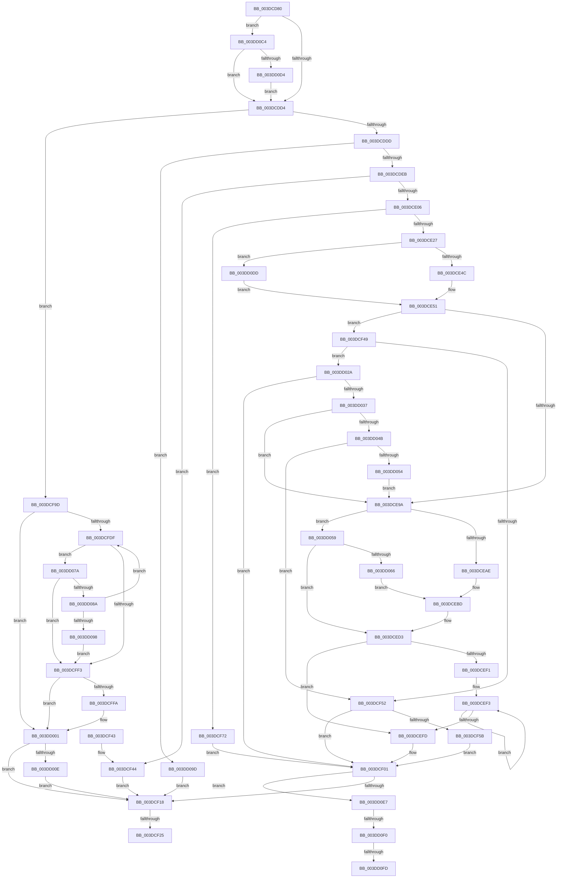

# IopMapTransfer

- RVA: `0x003DCD80`–`0x003DD116` (길이 `918` bytes)
- VA: `0x00000001403DCD80`
- 실행 섹션: `.text`
- PDB 이름 있음: `예`; PDB Function 태그: `예`
- unwind 정보 RVA: `0x0009428C`
- 디코드: `229`개 명령, `918/918` bytes 표시
- 미해석 바이트: `0` (있으면 어셈블리에 `.byte`로 보존)

> 이 문서는 커널 이미지의 기계어와 PDB 기호를 분석해 생성했습니다. 4번과 5번은 함수 원형과 자료형을 바이너리 사용 방식에서 추정한 C 해석이며 원본 소스 복구 결과는 아닙니다.

## 1. Dependencies

- 직접 호출 지점: **11**; 고유 호출 대상: **9**
- 직접 호출자로 확인된 함수: **0**
- RIP 상대 이미지 참조: **0**

### Outgoing calls
- `0x003DCDDD` → [HalpDmaGetAdapterVersion](HalpDmaGetAdapterVersion_function_003DEC8C.md) (function, `0x003DEC8C`)
- `0x003DCE27` → [HalpDmaGetAdapterVersion](HalpDmaGetAdapterVersion_function_003DEC8C.md) (function, `0x003DEC8C`)
- `0x003DCE4C` → [HalpDmaNextContiguousPieceV2](HalpDmaNextContiguousPieceV2_function_003DE530.md) (function, `0x003DE530`)
- `0x003DCECE` → [HalpDmaSyncMapBuffers](HalpDmaSyncMapBuffers_function_003DEFD0.md) (function, `0x003DEFD0`)
- `0x003DCF6B` → [HalpDmaFlushBuffer](HalpDmaFlushBuffer_function_003DC1DC.md) (function, `0x003DC1DC`)
- `0x003DCF8F` → [HalpDmaMapContiguousTransferV2](HalpDmaMapContiguousTransferV2_function_003DFDF4.md) (function, `0x003DFDF4`)
- `0x003DD020` → [HalpDmaFlushBuffer](HalpDmaFlushBuffer_function_003DC1DC.md) (function, `0x003DC1DC`)
- `0x003DD03A` → [HalpDmaGetAdapterCacheAlignment](HalpDmaGetAdapterCacheAlignment_function_003DC150.md) (function, `0x003DC150`)
- `0x003DD0B7` → [HalpMapTransferV3](HalpMapTransferV3_function_003DCCAC.md) (function, `0x003DCCAC`)
- `0x003DD0DD` → [HalpDmaNextContiguousPieceV3](HalpDmaNextContiguousPieceV3_function_003DECFC.md) (function, `0x003DECFC`)
- `0x003DD10B` → [HalpDmaZeroMapBuffers](../55/HalpDmaZeroMapBuffers_function_005511EC.md) (function, `0x005511EC`)

### Direct callers
- 이 함수 시작 RVA로 연결되는 직접 call은 확인되지 않았습니다. 간접 호출은 완전히 역산할 수 없습니다.

### Static image references
- 디코드된 RIP-relative 메모리 참조가 없습니다.

## 2. Other-region calls and transfers

- 다른 실행 섹션으로 향하는 call: **0**
- call이 아닌 외부 분기/꼬리 이동: **4**
  - `0x003DCF1F` → [sub_006EA110 + 0x4F](../6E/Unknown_function_006EA110.md) (`tail-transfer`)
  - `0x003DD0EA` → [sub_006EA110](../6E/Unknown_function_006EA110.md) (`tail-transfer`)
  - `0x003DD0F7` → [sub_006EA110](../6E/Unknown_function_006EA110.md) (`tail-transfer`)
  - `0x003DD111` → [sub_006EA110](../6E/Unknown_function_006EA110.md) (`tail-transfer`)

## 3. Assembly (complete function range)

```asm
003DCD80  48 89 5C 24 10                  mov qword ptr [rsp + 0x10], rbx
003DCD85  55                              push rbp
003DCD86  56                              push rsi
003DCD87  57                              push rdi
003DCD88  41 54                           push r12
003DCD8A  41 55                           push r13
003DCD8C  41 56                           push r14
003DCD8E  41 57                           push r15
003DCD90  48 8D 6C 24 E9                  lea rbp, [rsp - 0x17]
003DCD95  48 81 EC A0 00 00 00            sub rsp, 0xa0
003DCD9C  4C 8B 6D 77                     mov r13, qword ptr [rbp + 0x77]
003DCDA0  33 C0                           xor eax, eax
003DCDA2  45 33 DB                        xor r11d, r11d
003DCDA5  48 89 45 EF                     mov qword ptr [rbp - 0x11], rax
003DCDA9  83 B9 08 02 00 00 03            cmp dword ptr [rcx + 0x208], 3
003DCDB0  0F 57 C0                        xorps xmm0, xmm0
003DCDB3  4D 8B F1                        mov r14, r9
003DCDB6  44 89 5D CB                     mov dword ptr [rbp - 0x35], r11d
003DCDBA  49 8B F0                        mov rsi, r8
003DCDBD  C6 81 0C 02 00 00 01            mov byte ptr [rcx + 0x20c], 1
003DCDC4  4C 8B E2                        mov r12, rdx
003DCDC7  48 8B F9                        mov rdi, rcx
003DCDCA  0F 11 45 DF                     movups xmmword ptr [rbp - 0x21], xmm0
003DCDCE  0F 84 F0 02 00 00               je 0x1403dd0c4
003DCDD4  48 85 F6                        test rsi, rsi
003DCDD7  0F 84 C0 01 00 00               je 0x1403dcf9d
003DCDDD  E8 AA 1E 00 00                  call 0x1403dec8c
003DCDE2  83 E8 02                        sub eax, 2
003DCDE5  0F 85 B2 02 00 00               jne 0x1403dd09d
003DCDEB  45 8B 45 00                     mov r8d, dword ptr [r13]
003DCDEF  33 C0                           xor eax, eax
003DCDF1  4C 89 5D 67                     mov qword ptr [rbp + 0x67], r11
003DCDF5  48 89 45 07                     mov qword ptr [rbp + 7], rax
003DCDF9  0F 11 45 F7                     movups xmmword ptr [rbp - 9], xmm0
003DCDFD  45 85 C0                        test r8d, r8d
003DCE00  0F 84 3E 01 00 00               je 0x1403dcf44
003DCE06  48 8B CF                        mov rcx, rdi
003DCE09  8A 87 B9 01 00 00               mov al, byte ptr [rdi + 0x1b9]
003DCE0F  88 45 57                        mov byte ptr [rbp + 0x57], al
003DCE12  48 8B 46 38                     mov rax, qword ptr [rsi + 0x38]
003DCE16  48 89 45 BF                     mov qword ptr [rbp - 0x41], rax
003DCE1A  44 38 9F BA 01 00 00            cmp byte ptr [rdi + 0x1ba], r11b
003DCE21  0F 84 4B 01 00 00               je 0x1403dcf72
003DCE27  E8 60 1E 00 00                  call 0x1403dec8c
003DCE2C  44 8A 7D 7F                     mov r15b, byte ptr [rbp + 0x7f]
003DCE30  49 8B D4                        mov rdx, r12
003DCE33  44 89 44 24 28                  mov dword ptr [rsp + 0x28], r8d
003DCE38  48 8B CF                        mov rcx, rdi
003DCE3B  44 88 7C 24 20                  mov byte ptr [rsp + 0x20], r15b
003DCE40  4C 8B C6                        mov r8, rsi
003DCE43  83 E8 02                        sub eax, 2
003DCE46  0F 85 91 02 00 00               jne 0x1403dd0dd
003DCE4C  E8 DF 16 00 00                  call 0x1403de530
003DCE51  41 89 45 00                     mov dword ptr [r13], eax
003DCE55  49 8B CE                        mov rcx, r14
003DCE58  81 E1 FF 0F 00 00               and ecx, 0xfff
003DCE5E  44 8B C8                        mov r9d, eax
003DCE61  8B C0                           mov eax, eax
003DCE63  49 8B DE                        mov rbx, r14
003DCE66  49 2B 5C 24 20                  sub rbx, qword ptr [r12 + 0x20]
003DCE6B  48 C1 EB 0C                     shr rbx, 0xc
003DCE6F  8B DB                           mov ebx, ebx
003DCE71  48 89 45 B7                     mov qword ptr [rbp - 0x49], rax
003DCE75  48 89 4D 67                     mov qword ptr [rbp + 0x67], rcx
003DCE79  49 8B 5C DC 30                  mov rbx, qword ptr [r12 + rbx*8 + 0x30]
003DCE7E  48 C1 E3 0C                     shl rbx, 0xc
003DCE82  48 03 D9                        add rbx, rcx
003DCE85  4C 8D 04 18                     lea r8, [rax + rbx]
003DCE89  49 8D 40 FF                     lea rax, [r8 - 1]
003DCE8D  48 39 87 90 00 00 00            cmp qword ptr [rdi + 0x90], rax
003DCE94  0F 83 AF 00 00 00               jae 0x1403dcf49
003DCE9A  48 8B 4E 38                     mov rcx, qword ptr [rsi + 0x38]
003DCE9E  48 8B 5D 67                     mov rbx, qword ptr [rbp + 0x67]
003DCEA2  48 03 19                        add rbx, qword ptr [rcx]
003DCEA5  45 84 FF                        test r15b, r15b
003DCEA8  0F 84 AB 01 00 00               je 0x1403dd059
003DCEAE  C6 44 24 38 00                  mov byte ptr [rsp + 0x38], 0
003DCEB3  C6 44 24 30 00                  mov byte ptr [rsp + 0x30], 0
003DCEB8  44 88 7C 24 28                  mov byte ptr [rsp + 0x28], r15b
003DCEBD  44 89 4C 24 20                  mov dword ptr [rsp + 0x20], r9d
003DCEC2  4D 8B C6                        mov r8, r14
003DCEC5  4C 8B C9                        mov r9, rcx
003DCEC8  49 8B D4                        mov rdx, r12
003DCECB  48 8B CF                        mov rcx, rdi
003DCECE  E8 FD 20 00 00                  call 0x1403defd0
003DCED3  48 8B 4D B7                     mov rcx, qword ptr [rbp - 0x49]
003DCED7  48 8B 45 67                     mov rax, qword ptr [rbp + 0x67]
003DCEDB  48 81 C1 FF 0F 00 00            add rcx, 0xfff
003DCEE2  48 03 C1                        add rax, rcx
003DCEE5  48 8B 4E 38                     mov rcx, qword ptr [rsi + 0x38]
003DCEE9  48 C1 E8 0C                     shr rax, 0xc
003DCEED  85 C0                           test eax, eax
003DCEEF  74 0C                           je 0x1403dcefd
003DCEF1  8B D0                           mov edx, eax
003DCEF3  48 8B 49 08                     mov rcx, qword ptr [rcx + 8]
003DCEF7  48 83 EA 01                     sub rdx, 1
003DCEFB  75 F6                           jne 0x1403dcef3
003DCEFD  48 89 4E 38                     mov qword ptr [rsi + 0x38], rcx
003DCF01  41 8B 45 00                     mov eax, dword ptr [r13]
003DCF05  45 33 DB                        xor r11d, r11d
003DCF08  4D 8B C6                        mov r8, r14
003DCF0B  89 45 67                        mov dword ptr [rbp + 0x67], eax
003DCF0E  44 38 5D 57                     cmp byte ptr [rbp + 0x57], r11b
003DCF12  0F 84 CF 01 00 00               je 0x1403dd0e7
003DCF18  83 BF 08 02 00 00 03            cmp dword ptr [rdi + 0x208], 3
003DCF1F  0F 84 3A D2 30 00               je 0x1406ea15f
003DCF25  48 8B C3                        mov rax, rbx
003DCF28  48 8B 9C 24 E8 00 00 00         mov rbx, qword ptr [rsp + 0xe8]
003DCF30  48 81 C4 A0 00 00 00            add rsp, 0xa0
003DCF37  41 5F                           pop r15
003DCF39  41 5E                           pop r14
003DCF3B  41 5D                           pop r13
003DCF3D  41 5C                           pop r12
003DCF3F  5F                              pop rdi
003DCF40  5E                              pop rsi
003DCF41  5D                              pop rbp
003DCF42  C3                              ret
003DCF43  CC                              int3
003DCF44  49 8B DB                        mov rbx, r11
003DCF47  EB CF                           jmp 0x1403dcf18
003DCF49  45 84 FF                        test r15b, r15b
003DCF4C  0F 84 D8 00 00 00               je 0x1403dd02a
003DCF52  80 BF BD 01 00 00 00            cmp byte ptr [rdi + 0x1bd], 0
003DCF59  75 A6                           jne 0x1403dcf01
003DCF5B  C6 44 24 28 00                  mov byte ptr [rsp + 0x28], 0
003DCF60  4D 8B C6                        mov r8, r14
003DCF63  49 8B D4                        mov rdx, r12
003DCF66  44 88 7C 24 20                  mov byte ptr [rsp + 0x20], r15b
003DCF6B  E8 6C F2 FF FF                  call 0x1403dc1dc
003DCF70  EB 8F                           jmp 0x1403dcf01
003DCF72  44 8A 7D 7F                     mov r15b, byte ptr [rbp + 0x7f]
003DCF76  48 8D 45 67                     lea rax, [rbp + 0x67]
003DCF7A  48 89 44 24 30                  mov qword ptr [rsp + 0x30], rax
003DCF7F  4C 8B C6                        mov r8, rsi
003DCF82  44 88 7C 24 28                  mov byte ptr [rsp + 0x28], r15b
003DCF87  49 8B D4                        mov rdx, r12
003DCF8A  4C 89 6C 24 20                  mov qword ptr [rsp + 0x20], r13
003DCF8F  E8 60 2E 00 00                  call 0x1403dfdf4
003DCF94  48 8B 5D 67                     mov rbx, qword ptr [rbp + 0x67]
003DCF98  E9 64 FF FF FF                  jmp 0x1403dcf01
003DCF9D  49 8B C6                        mov rax, r14
003DCFA0  41 8B CE                        mov ecx, r14d
003DCFA3  49 2B 44 24 20                  sub rax, qword ptr [r12 + 0x20]
003DCFA8  81 E1 FF 0F 00 00               and ecx, 0xfff
003DCFAE  48 C1 E8 0C                     shr rax, 0xc
003DCFB2  41 BF 00 10 00 00               mov r15d, 0x1000
003DCFB8  48 83 C0 06                     add rax, 6
003DCFBC  41 8B D7                        mov edx, r15d
003DCFBF  2B D1                           sub edx, ecx
003DCFC1  4D 8D 14 C4                     lea r10, [r12 + rax*8]
003DCFC5  8B C1                           mov eax, ecx
003DCFC7  41 8B 4D 00                     mov ecx, dword ptr [r13]
003DCFCB  44 8B C9                        mov r9d, ecx
003DCFCE  4D 8B 02                        mov r8, qword ptr [r10]
003DCFD1  49 8B D8                        mov rbx, r8
003DCFD4  48 C1 E3 0C                     shl rbx, 0xc
003DCFD8  48 03 D8                        add rbx, rax
003DCFDB  3B D1                           cmp edx, ecx
003DCFDD  73 22                           jae 0x1403dd001
003DCFDF  4D 8D 52 08                     lea r10, [r10 + 8]
003DCFE3  4D 8B 0A                        mov r9, qword ptr [r10]
003DCFE6  49 8D 40 01                     lea rax, [r8 + 1]
003DCFEA  49 3B C1                        cmp rax, r9
003DCFED  0F 84 87 00 00 00               je 0x1403dd07a
003DCFF3  44 8B C9                        mov r9d, ecx
003DCFF6  3B D1                           cmp edx, ecx
003DCFF8  73 07                           jae 0x1403dd001
003DCFFA  41 89 55 00                     mov dword ptr [r13], edx
003DCFFE  44 8B CA                        mov r9d, edx
003DD001  44 38 9F BD 01 00 00            cmp byte ptr [rdi + 0x1bd], r11b
003DD008  0F 85 0A FF FF FF               jne 0x1403dcf18
003DD00E  8A 45 7F                        mov al, byte ptr [rbp + 0x7f]
003DD011  4D 8B C6                        mov r8, r14
003DD014  44 88 5C 24 28                  mov byte ptr [rsp + 0x28], r11b
003DD019  49 8B D4                        mov rdx, r12
003DD01C  88 44 24 20                     mov byte ptr [rsp + 0x20], al
003DD020  E8 B7 F1 FF FF                  call 0x1403dc1dc
003DD025  E9 EE FE FF FF                  jmp 0x1403dcf18
003DD02A  80 BF BD 01 00 00 00            cmp byte ptr [rdi + 0x1bd], 0
003DD031  0F 85 CA FE FF FF               jne 0x1403dcf01
003DD037  48 8B CF                        mov rcx, rdi
003DD03A  E8 11 F1 FF FF                  call 0x1403dc150
003DD03F  8D 48 FF                        lea ecx, [rax - 1]
003DD042  48 85 CB                        test rbx, rcx
003DD045  0F 85 4F FE FF FF               jne 0x1403dce9a
003DD04B  49 85 C8                        test r8, rcx
003DD04E  0F 84 FE FE FF FF               je 0x1403dcf52
003DD054  E9 41 FE FF FF                  jmp 0x1403dce9a
003DD059  80 BF BD 01 00 00 00            cmp byte ptr [rdi + 0x1bd], 0
003DD060  0F 85 6D FE FF FF               jne 0x1403dced3
003DD066  C6 44 24 38 00                  mov byte ptr [rsp + 0x38], 0
003DD06B  C6 44 24 30 01                  mov byte ptr [rsp + 0x30], 1
003DD070  C6 44 24 28 00                  mov byte ptr [rsp + 0x28], 0
003DD075  E9 43 FE FF FF                  jmp 0x1403dcebd
003DD07A  4D 33 C1                        xor r8, r9
003DD07D  49 F7 C0 00 00 F0 FF            test r8, -0x100000
003DD084  0F 85 69 FF FF FF               jne 0x1403dcff3
003DD08A  41 03 D7                        add edx, r15d
003DD08D  4D 8B C1                        mov r8, r9
003DD090  3B D1                           cmp edx, ecx
003DD092  0F 82 47 FF FF FF               jb 0x1403dcfdf
003DD098  E9 56 FF FF FF                  jmp 0x1403dcff3
003DD09D  44 88 5C 24 30                  mov byte ptr [rsp + 0x30], r11b
003DD0A2  83 F8 01                        cmp eax, 1
003DD0A5  8A 45 7F                        mov al, byte ptr [rbp + 0x7f]
003DD0A8  49 8B D4                        mov rdx, r12
003DD0AB  88 44 24 28                     mov byte ptr [rsp + 0x28], al
003DD0AF  48 8B CF                        mov rcx, rdi
003DD0B2  4C 89 6C 24 20                  mov qword ptr [rsp + 0x20], r13
003DD0B7  E8 F0 FB FF FF                  call 0x1403dccac
003DD0BC  48 8B D8                        mov rbx, rax
003DD0BF  E9 54 FE FF FF                  jmp 0x1403dcf18
003DD0C4  8B 81 FC 00 00 00               mov eax, dword ptr [rcx + 0xfc]
003DD0CA  41 39 45 00                     cmp dword ptr [r13], eax
003DD0CE  0F 86 00 FD FF FF               jbe 0x1403dcdd4
003DD0D4  41 89 45 00                     mov dword ptr [r13], eax
003DD0D8  E9 F7 FC FF FF                  jmp 0x1403dcdd4
003DD0DD  E8 1A 1C 00 00                  call 0x1403decfc
003DD0E2  E9 6A FD FF FF                  jmp 0x1403dce51
003DD0E7  45 84 FF                        test r15b, r15b
003DD0EA  0F 85 20 D0 30 00               jne 0x1406ea110
003DD0F0  44 38 9F BC 01 00 00            cmp byte ptr [rdi + 0x1bc], r11b
003DD0F7  0F 84 13 D0 30 00               je 0x1406ea110
003DD0FD  48 8B 55 BF                     mov rdx, qword ptr [rbp - 0x41]
003DD101  41 81 E0 FF 0F 00 00            and r8d, 0xfff
003DD108  44 8B C8                        mov r9d, eax
003DD10B  E8 DC 40 17 00                  call 0x1405511ec
003DD110  90                              nop
003DD111  E9 FA CF 30 00                  jmp 0x1406ea110
```

## 4. C-style interpretation (structured pseudocode)

```c
__int64 __fastcall IopMapTransfer(__int64 a1, __int64 a2, __int64 a3, __int64 a4, __int64 a5, unsigned __int8 a6)
{
    __int64 result;
    __int64 v_r11;
    __int64 v_rbx;
    __int64 v_rsp;
    unsigned __int64 v_stack_m48;
    unsigned __int64 v_stack_m4F;
    unsigned __int64 v_stack_m58;
    unsigned __int64 v_stack_m60;
    unsigned __int64 v_stack_m70;
    unsigned int v_stack_m84;
    unsigned __int64 v_stack_m90;
    unsigned __int64 v_stack_m98;
    unsigned __int8 v_stack_mA0;
    unsigned __int8 v_stack_mA8;
    unsigned int v_stack_mB0;
    unsigned __int8 v_stack_mB8;
    unsigned __int64 v_stack_p10;
    unsigned __int64 v_stack_p18;
    unsigned __int8 v_stack_p20;
    unsigned __int8 v_stack_p28;
    unsigned __int64 v_stack_p30;
    unsigned __int8 v_stack_p38;
    unsigned __int8 v_stack_p8;

    v_stack_p10 = v_rbx;
    v_rsp = (v_rsp) - (160);
    result = 0;
    v_r11 = 0;
    v_stack_m60 = 0;
    v_stack_m84 = 0;
    *(unsigned __int8 *)(a1 + 524) = 1;
    v_stack_m70 = v_xmm0;
    if ((*(unsigned int *)(a1 + 520)) == 3) goto loc_003DD0C4;
loc_003DCDD4:
    if (a3 == 0) goto loc_003DCF9D;
    result = HalpDmaGetAdapterVersion(a1, a2, a3, a4);
    result = (unsigned int)((result) - (2));
    if (condition_is_not_equal) goto loc_003DD09D;
    result = 0;
    v_stack_p18 = 0;
    v_stack_m48 = 0;
    v_stack_m58 = v_xmm0;
    if ((unsigned int)((unsigned int)(*(unsigned int *)(a5))) == 0) goto loc_003DCF44;
    v_stack_p8 = (unsigned __int8)(*(unsigned __int8 *)(a1 + 441));
    v_stack_m90 = *(unsigned __int64 *)(a3 + 56);
    if ((*(unsigned __int8 *)(a1 + 442)) == 0) goto loc_003DCF72;
    result = HalpDmaGetAdapterVersion(a1, a2, (unsigned int)(*(unsigned int *)(a5)), a4);
    v_stack_mB0 = (unsigned int)((unsigned int)(*(unsigned int *)(a5)));
    v_stack_mB8 = a6;
    result = (unsigned int)((result) - (2));
    if (condition_is_not_equal) goto loc_003DD0DD;
    result = HalpDmaNextContiguousPieceV2(a1, a2, a3, a4);
loc_003DCE51:
    *(unsigned int *)(a5) = (unsigned int)(result);
    a1 = (unsigned int)((a4) & (0xFFFULL));
    v_rbx = (a4) - (*(unsigned __int64 *)(a2 + 32));
    v_rbx = (v_rbx) >> (12);
    v_stack_m98 = (unsigned int)((unsigned int)(result));
    v_stack_p18 = a1;
    v_rbx = (*(unsigned __int64 *)(a2 + (unsigned int)((unsigned int)(v_rbx)) * 8 + 48)) << (12);
    v_rbx = (v_rbx) + (a1);
    if ((*(unsigned __int64 *)(a1 + 144)) >= ((unsigned int)((unsigned int)(result)) + v_rbx * 1 - 1)) goto loc_003DCF49;
loc_003DCE9A:
    v_rbx = (v_stack_p18) + (*(unsigned __int64 *)(*(unsigned __int64 *)(a3 + 56)));
    if (a6 == 0) goto loc_003DD059;
    v_stack_mA0 = 0;
    v_stack_mA8 = 0;
    v_stack_mB0 = a6;
loc_003DCEBD:
    v_stack_mB8 = (unsigned int)((unsigned int)((unsigned int)(result)));
    result = HalpDmaSyncMapBuffers(a1, a2, a4, *(unsigned __int64 *)(a3 + 56));
loc_003DCED3:
    a1 = (v_stack_m98) + (0xFFFULL);
    result = (v_stack_p18) + (a1);
    result = (result) >> (12);
    if ((unsigned int)(result) == 0) goto loc_003DCEFD;
loc_003DCEF3:
    a2 = ((unsigned int)((unsigned int)(result))) - (1);
    if (condition_is_not_equal) goto loc_003DCEF3;
loc_003DCEFD:
    *(unsigned __int64 *)(a3 + 56) = *(unsigned __int64 *)(*(unsigned __int64 *)(a3 + 56) + 8);
loc_003DCF01:
    v_r11 = 0;
    v_stack_p18 = (unsigned int)((unsigned int)(*(unsigned int *)(a5)));
    if (v_stack_p8 == 0) goto loc_003DD0E7;
loc_003DCF18:
    v_rsp = (v_rsp) + (160);
    return v_rbx;
loc_003DCF44:
    goto loc_003DCF18;
loc_003DCF49:
    if (a6 == 0) goto loc_003DD02A;
loc_003DCF52:
    if ((*(unsigned __int8 *)(a1 + 445)) != 0) goto loc_003DCF01;
    v_stack_p28 = 0;
    v_stack_p20 = a6;
    result = HalpDmaFlushBuffer(*(unsigned __int64 *)(*(unsigned __int64 *)(a3 + 56) + 8), a2, a4, *(unsigned __int64 *)(a3 + 56));
    goto loc_003DCF01;
loc_003DCF72:
    v_stack_p30 = v_stack_p18;
    v_stack_p28 = a6;
    v_stack_p20 = a5;
    result = HalpDmaMapContiguousTransferV2(*(unsigned __int64 *)(*(unsigned __int64 *)(a3 + 56) + 8), a2, a3, *(unsigned __int64 *)(a3 + 56));
    goto loc_003DCF01;
loc_003DCF9D:
    result = (a4) - (*(unsigned __int64 *)(a2 + 32));
    a1 = (unsigned int)(((unsigned int)((unsigned int)(a4))) & (0xFFFULL));
    result = (result) >> (12);
    result = (result) + (6);
    a2 = (unsigned int)(((unsigned int)((unsigned int)((unsigned int)(0x1000ULL)))) - ((unsigned int)(a1)));
    v_rbx = (*(unsigned __int64 *)(a2 + result * 8)) << (12);
    v_rbx = (v_rbx) + ((unsigned int)((unsigned int)(a1)));
    if (((unsigned int)(a2)) >= ((unsigned int)((unsigned int)(*(unsigned int *)(a5))))) goto loc_003DD001;
loc_003DCFDF:
    if ((*(unsigned __int64 *)(a2 + result * 8) + 1) == (*(unsigned __int64 *)(a2 + result * 8 + 8))) goto loc_003DD07A;
loc_003DCFF3:
    if (((unsigned int)(a2)) < ((unsigned int)((unsigned int)(*(unsigned int *)(a5))))) {
        *(unsigned int *)(a5) = (unsigned int)(a2);
        a4 = (unsigned int)(a2);
    }
    if ((*(unsigned __int8 *)(a1 + 445)) != 0) goto loc_003DCF18;
    v_stack_p28 = 0;
    v_stack_p20 = a6;
    result = HalpDmaFlushBuffer((unsigned int)(*(unsigned int *)(a5)), a2, a4, a4);
    goto loc_003DCF18;
loc_003DD02A:
    if ((*(unsigned __int8 *)(a1 + 445)) != 0) goto loc_003DCF01;
    result = HalpDmaGetAdapterCacheAlignment(a1, a2, a4, a4);
    if (((v_rbx) & (result - 1)) != 0) goto loc_003DCE9A;
    if (((a4) & (result - 1)) == 0) goto loc_003DCF52;
    goto loc_003DCE9A;
loc_003DD059:
    if ((*(unsigned __int8 *)(a1 + 445)) != 0) goto loc_003DCED3;
    v_stack_p38 = 0;
    v_stack_p30 = 1;
    v_stack_p28 = 0;
    goto loc_003DCEBD;
loc_003DD07A:
    a3 = (a4) ^ (a4);
    if (((a3) & (0xFFFFFFFFFFF00000ULL)) != 0) goto loc_003DCFF3;
    a2 = (unsigned int)((a2) + ((unsigned int)((unsigned int)(0x1000ULL))));
    if (((unsigned int)(a2)) < ((unsigned int)(result - 1))) goto loc_003DCFDF;
    goto loc_003DCFF3;
loc_003DD09D:
    v_stack_p30 = 0;
    v_stack_p28 = a6;
    v_stack_p20 = a5;
    result = HalpMapTransferV3(a1, a2, a4, a4);
    goto loc_003DCF18;
loc_003DD0C4:
    if ((*(unsigned int *)(a5)) <= ((unsigned int)((unsigned int)(*(unsigned int *)(a1 + 252))))) goto loc_003DCDD4;
    *(unsigned int *)(a5) = (unsigned int)((unsigned int)(*(unsigned int *)(a1 + 252)));
    goto loc_003DCDD4;
loc_003DD0DD:
    result = HalpDmaNextContiguousPieceV3(a1, a2, a4, a4);
    goto loc_003DCE51;
loc_003DD0E7:
    a3 = (unsigned int)((a4) & (0xFFFULL));
    result = HalpDmaZeroMapBuffers(a1, v_stack_m90, a3, (unsigned int)((unsigned int)(result)));
}
```

## 5. (Beta) C Style

```c
int64_t IopMapTransfer(void *Arg1, void *Arg2, int64_t Arg3, int64_t Arg4, void *Arg5, uint8_t Arg6)
{
    uint8_t *arg1 = (uint8_t *)Arg1;
    uint8_t *arg2 = (uint8_t *)Arg2;
    uint8_t *arg5 = (uint8_t *)Arg5;

    int64_t result;
    int64_t local_r11;
    int64_t local_rbx;
    int64_t local_rsp;
    uint64_t v_stack_m48;
    uint64_t v_stack_m4F;
    uint64_t v_stack_m58;
    uint64_t v_stack_m60;
    uint64_t v_stack_m70;
    uint32_t v_stack_m84;
    uint64_t v_stack_m90;
    uint64_t v_stack_m98;
    uint8_t v_stack_mA0;
    uint8_t v_stack_mA8;
    uint32_t v_stack_mB0;
    uint8_t v_stack_mB8;
    uint64_t v_stack_p10;
    uint64_t v_stack_p18;
    uint8_t v_stack_p20;
    uint8_t v_stack_p28;
    uint64_t v_stack_p30;
    uint8_t v_stack_p38;
    uint8_t v_stack_p8;

    v_stack_p10 = local_rbx;
    local_rsp = (local_rsp) - (160);
    result = 0;
    local_r11 = 0;
    v_stack_m60 = 0;
    v_stack_m84 = 0;
    *(uint8_t *)(arg1 + 0x20C) = 1;
    v_stack_m70 = v_xmm0;
    if ((*(uint32_t *)(arg1 + 0x208)) == 3) goto loc_003DD0C4;
loc_003DCDD4:
    if (Arg3 == 0) goto loc_003DCF9D;
    result = HalpDmaGetAdapterVersion(Arg1, Arg2, Arg3, Arg4);
    result = (uint32_t)((result) - (2));
    if (condition_is_not_equal) goto loc_003DD09D;
    result = 0;
    v_stack_p18 = 0;
    v_stack_m48 = 0;
    v_stack_m58 = v_xmm0;
    if ((uint32_t)((uint32_t)(*(uint32_t *)(arg5))) == 0) goto loc_003DCF44;
    v_stack_p8 = (uint8_t)(*(uint8_t *)(arg1 + 0x1B9));
    v_stack_m90 = *(uint64_t *)(Arg3 + 0x38);
    if ((*(uint8_t *)(arg1 + 0x1BA)) == 0) goto loc_003DCF72;
    result = HalpDmaGetAdapterVersion(Arg1, Arg2, (uint32_t)(*(uint32_t *)(arg5)), Arg4);
    v_stack_mB0 = (uint32_t)((uint32_t)(*(uint32_t *)(arg5)));
    v_stack_mB8 = Arg6;
    result = (uint32_t)((result) - (2));
    if (condition_is_not_equal) goto loc_003DD0DD;
    result = HalpDmaNextContiguousPieceV2(Arg1, Arg2, Arg3, Arg4);
loc_003DCE51:
    *(uint32_t *)(arg5) = (uint32_t)(result);
    Arg1 = (uint32_t)((Arg4) & (0xFFFULL));
    local_rbx = (Arg4) - (*(uint64_t *)(arg2 + 0x20));
    local_rbx = (local_rbx) >> (12);
    v_stack_m98 = (uint32_t)((uint32_t)(result));
    v_stack_p18 = Arg1;
    local_rbx = (*(uint64_t *)(arg2 + (uint32_t)((uint32_t)(local_rbx)) * 8 + 0x30)) << (12);
    local_rbx = (local_rbx) + (Arg1);
    if ((*(uint64_t *)(arg1 + 0x90)) >= ((uint32_t)((uint32_t)(result)) + local_rbx * 1 - 1)) goto loc_003DCF49;
loc_003DCE9A:
    local_rbx = (v_stack_p18) + (*(uint64_t *)(*(uint64_t *)(Arg3 + 0x38)));
    if (Arg6 == 0) goto loc_003DD059;
    v_stack_mA0 = 0;
    v_stack_mA8 = 0;
    v_stack_mB0 = Arg6;
loc_003DCEBD:
    v_stack_mB8 = (uint32_t)((uint32_t)((uint32_t)(result)));
    result = HalpDmaSyncMapBuffers(Arg1, Arg2, Arg4, *(uint64_t *)(Arg3 + 0x38));
loc_003DCED3:
    Arg1 = (v_stack_m98) + (0xFFFULL);
    result = (v_stack_p18) + (Arg1);
    result = (result) >> (12);
    if ((uint32_t)(result) == 0) goto loc_003DCEFD;
loc_003DCEF3:
    Arg2 = ((uint32_t)((uint32_t)(result))) - (1);
    if (condition_is_not_equal) goto loc_003DCEF3;
loc_003DCEFD:
    *(uint64_t *)(Arg3 + 0x38) = *(uint64_t *)(*(uint64_t *)(Arg3 + 0x38) + 0x8);
loc_003DCF01:
    local_r11 = 0;
    v_stack_p18 = (uint32_t)((uint32_t)(*(uint32_t *)(arg5)));
    if (v_stack_p8 == 0) goto loc_003DD0E7;
loc_003DCF18:
    local_rsp = (local_rsp) + (160);
    return local_rbx;
loc_003DCF44:
    goto loc_003DCF18;
loc_003DCF49:
    if (Arg6 == 0) goto loc_003DD02A;
loc_003DCF52:
    if ((*(uint8_t *)(arg1 + 0x1BD)) != 0) goto loc_003DCF01;
    v_stack_p28 = 0;
    v_stack_p20 = Arg6;
    result = HalpDmaFlushBuffer(*(uint64_t *)(*(uint64_t *)(Arg3 + 0x38) + 0x8), Arg2, Arg4, *(uint64_t *)(Arg3 + 0x38));
    goto loc_003DCF01;
loc_003DCF72:
    v_stack_p30 = v_stack_p18;
    v_stack_p28 = Arg6;
    v_stack_p20 = Arg5;
    result = HalpDmaMapContiguousTransferV2(*(uint64_t *)(*(uint64_t *)(Arg3 + 0x38) + 0x8), Arg2, Arg3, *(uint64_t *)(Arg3 + 0x38));
    goto loc_003DCF01;
loc_003DCF9D:
    result = (Arg4) - (*(uint64_t *)(arg2 + 0x20));
    Arg1 = (uint32_t)(((uint32_t)((uint32_t)(Arg4))) & (0xFFFULL));
    result = (result) >> (12);
    result = (result) + (6);
    Arg2 = (uint32_t)(((uint32_t)((uint32_t)((uint32_t)(0x1000ULL)))) - ((uint32_t)(Arg1)));
    local_rbx = (*(uint64_t *)(arg2 + result * 8)) << (12);
    local_rbx = (local_rbx) + ((uint32_t)((uint32_t)(Arg1)));
    if (((uint32_t)(Arg2)) >= ((uint32_t)((uint32_t)(*(uint32_t *)(arg5))))) goto loc_003DD001;
loc_003DCFDF:
    if ((*(uint64_t *)(arg2 + result * 8) + 1) == (*(uint64_t *)(arg2 + result * 8 + 0x8))) goto loc_003DD07A;
loc_003DCFF3:
    if (((uint32_t)(Arg2)) < ((uint32_t)((uint32_t)(*(uint32_t *)(arg5))))) {
        *(uint32_t *)(arg5) = (uint32_t)(Arg2);
        Arg4 = (uint32_t)(Arg2);
    }
    if ((*(uint8_t *)(arg1 + 0x1BD)) != 0) goto loc_003DCF18;
    v_stack_p28 = 0;
    v_stack_p20 = Arg6;
    result = HalpDmaFlushBuffer((uint32_t)(*(uint32_t *)(arg5)), Arg2, Arg4, Arg4);
    goto loc_003DCF18;
loc_003DD02A:
    if ((*(uint8_t *)(arg1 + 0x1BD)) != 0) goto loc_003DCF01;
    result = HalpDmaGetAdapterCacheAlignment(Arg1, Arg2, Arg4, Arg4);
    if (((local_rbx) & (result - 1)) != 0) goto loc_003DCE9A;
    if (((Arg4) & (result - 1)) == 0) goto loc_003DCF52;
    goto loc_003DCE9A;
loc_003DD059:
    if ((*(uint8_t *)(arg1 + 0x1BD)) != 0) goto loc_003DCED3;
    v_stack_p38 = 0;
    v_stack_p30 = 1;
    v_stack_p28 = 0;
    goto loc_003DCEBD;
loc_003DD07A:
    Arg3 = (Arg4) ^ (Arg4);
    if (((Arg3) & (0xFFFFFFFFFFF00000ULL)) != 0) goto loc_003DCFF3;
    Arg2 = (uint32_t)((Arg2) + ((uint32_t)((uint32_t)(0x1000ULL))));
    if (((uint32_t)(Arg2)) < ((uint32_t)(result - 1))) goto loc_003DCFDF;
    goto loc_003DCFF3;
loc_003DD09D:
    v_stack_p30 = 0;
    v_stack_p28 = Arg6;
    v_stack_p20 = Arg5;
    result = HalpMapTransferV3(Arg1, Arg2, Arg4, Arg4);
    goto loc_003DCF18;
loc_003DD0C4:
    if ((*(uint32_t *)(arg5)) <= ((uint32_t)((uint32_t)(*(uint32_t *)(arg1 + 0xFC))))) goto loc_003DCDD4;
    *(uint32_t *)(arg5) = (uint32_t)((uint32_t)(*(uint32_t *)(arg1 + 0xFC)));
    goto loc_003DCDD4;
loc_003DD0DD:
    result = HalpDmaNextContiguousPieceV3(Arg1, Arg2, Arg4, Arg4);
    goto loc_003DCE51;
loc_003DD0E7:
    Arg3 = (uint32_t)((Arg4) & (0xFFFULL));
    result = HalpDmaZeroMapBuffers(Arg1, v_stack_m90, Arg3, (uint32_t)((uint32_t)(result)));
}
```

### 관측된 메모리 오프셋

구조체 형식이 확인되지 않은 접근은 인자 기준의 오프셋으로만 기록했습니다.

| 기준 인자 | 오프셋 표현 | 폭 (bit) | 접근 |
|---|---:|---:|---|
| `Arg1` | `+ 0x90` | `64` | `R` |
| `Arg1` | `+ 0xFC` | `32` | `R` |
| `Arg1` | `+ 0x1B9` | `8` | `R` |
| `Arg1` | `+ 0x1BA` | `8` | `R` |
| `Arg1` | `+ 0x1BC` | `8` | `R` |
| `Arg1` | `+ 0x1BD` | `8` | `R` |
| `Arg1` | `+ 0x208` | `32` | `R` |
| `Arg1` | `+ 0x20C` | `8` | `W` |
| `Arg2` | `+ 0x0` | `64` | `R` |
| `Arg2` | `+ 0x0 + rax*8` | `64` | `R` |
| `Arg2` | `+ 0x8` | `64` | `R` |
| `Arg2` | `+ 0x20` | `64` | `R` |
| `Arg2` | `+ 0x30 + rbx*8` | `64` | `R` |
| `Arg5` | `+ 0x0` | `32` | `R` |
| `Arg5` | `+ 0x0` | `32` | `W` |

## 6. Execution-region graph

[열기: 2D/3D 그래프와 함수 탐색 컨트롤 패널](../../../control-panel.html?section=text&rva=0x003DCD80&view=graph)

- 2D 그래프는 위에서 아래로 흐르고, 3D 그래프는 빈 공간을 드래그해 회전합니다. Shift+드래그는 이동, 휠은 확대·축소, 함수 노드 선택은 대상 보고서 이동입니다.

### Static fallback


