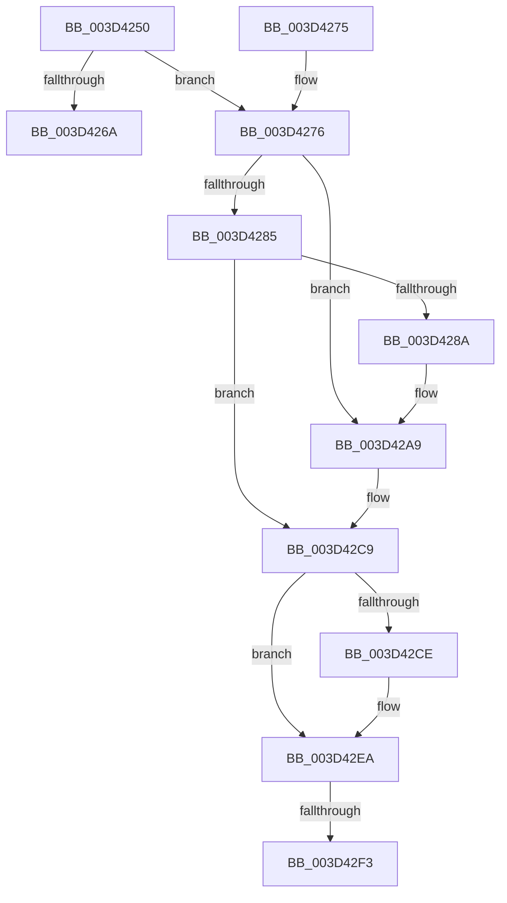

# KasanMarkAddressRedZone

- RVA: `0x003D4250`–`0x003D430F` (길이 `191` bytes)
- VA: `0x00000001403D4250`
- 실행 섹션: `.text`
- PDB 이름 있음: `예`; PDB Function 태그: `아니요`
- unwind 정보 RVA: `0x00092408`
- 디코드: `50`개 명령, `191/191` bytes 표시
- 미해석 바이트: `0` (있으면 어셈블리에 `.byte`로 보존)

> 이 문서는 커널 이미지의 기계어와 PDB 기호를 분석해 생성했습니다. 4번과 5번은 함수 원형과 자료형을 바이너리 사용 방식에서 추정한 C 해석이며 원본 소스 복구 결과는 아닙니다.

## 1. Dependencies

- 직접 호출 지점: **4**; 고유 호출 대상: **1**
- 직접 호출자로 확인된 함수: **0**
- RIP 상대 이미지 참조: **1**

### Outgoing calls
- `0x003D42A3` → [KeBugCheckEx](../4F/KeBugCheckEx_function_004FD660.md) (function, `0x004FD660`)
- `0x003D42C3` → [KeBugCheckEx](../4F/KeBugCheckEx_function_004FD660.md) (function, `0x004FD660`)
- `0x003D42E4` → [KeBugCheckEx](../4F/KeBugCheckEx_function_004FD660.md) (function, `0x004FD660`)
- `0x003D4309` → [KeBugCheckEx](../4F/KeBugCheckEx_function_004FD660.md) (function, `0x004FD660`)

### Direct callers
- 이 함수 시작 RVA로 연결되는 직접 call은 확인되지 않았습니다. 간접 호출은 완전히 역산할 수 없습니다.

### Static image references
- `0x003D425A` → RVA `0x00FCEC68` (`ALMOSTRO`; read)

## 2. Other-region calls and transfers

- 다른 실행 섹션으로 향하는 call: **0**
- call이 아닌 외부 분기/꼬리 이동: **1**
  - `0x003D42F1` → [sub_003D430F](Unknown_function_003D430F.md) (`tail-transfer`)

## 3. Assembly (complete function range)

```asm
003D4250  48 89 5C 24 20                  mov qword ptr [rsp + 0x20], rbx
003D4255  57                              push rdi
003D4256  48 83 EC 30                     sub rsp, 0x30
003D425A  80 3D 07 AA BF 00 00            cmp byte ptr [rip + 0xbfaa07], 0
003D4261  41 0F B6 F9                     movzx edi, r9b
003D4265  48 8B DA                        mov rbx, rdx
003D4268  75 0C                           jne 0x1403d4276
003D426A  48 8B 5C 24 58                  mov rbx, qword ptr [rsp + 0x58]
003D426F  48 83 C4 30                     add rsp, 0x30
003D4273  5F                              pop rdi
003D4274  C3                              ret
003D4275  CC                              int3
003D4276  48 B8 00 00 00 00 00 80 FF FF   movabs rax, 0xffff800000000000
003D4280  48 3B C8                        cmp rcx, rax
003D4283  72 24                           jb 0x1403d42a9
003D4285  F6 C1 07                        test cl, 7
003D4288  74 3F                           je 0x1403d42c9
003D428A  BA 02 00 00 00                  mov edx, 2
003D428F  48 C7 44 24 20 08 00 00 00      mov qword ptr [rsp + 0x20], 8
003D4298  4C 8B C9                        mov r9, rcx
003D429B  44 8B C2                        mov r8d, edx
003D429E  B9 F1 01 00 00                  mov ecx, 0x1f1
003D42A3  E8 B8 93 12 00                  call 0x1404fd660
003D42A8  CC                              int3
003D42A9  BA 02 00 00 00                  mov edx, 2
003D42AE  48 C7 44 24 20 00 00 00 00      mov qword ptr [rsp + 0x20], 0
003D42B7  4C 8B C9                        mov r9, rcx
003D42BA  B9 F1 01 00 00                  mov ecx, 0x1f1
003D42BF  44 8D 42 FF                     lea r8d, [rdx - 1]
003D42C3  E8 98 93 12 00                  call 0x1404fd660
003D42C8  CC                              int3
003D42C9  49 3B D8                        cmp rbx, r8
003D42CC  76 1C                           jbe 0x1403d42ea
003D42CE  BA 02 00 00 00                  mov edx, 2
003D42D3  4C 89 44 24 20                  mov qword ptr [rsp + 0x20], r8
003D42D8  4C 8B CB                        mov r9, rbx
003D42DB  B9 F1 01 00 00                  mov ecx, 0x1f1
003D42E0  44 8D 42 01                     lea r8d, [rdx + 1]
003D42E4  E8 77 93 12 00                  call 0x1404fd660
003D42E9  CC                              int3
003D42EA  4A 8D 04 01                     lea rax, [rcx + r8]
003D42EE  48 3B C1                        cmp rax, rcx
003D42F1  73 1C                           jae 0x1403d430f
003D42F3  BA 02 00 00 00                  mov edx, 2
003D42F8  4C 89 44 24 20                  mov qword ptr [rsp + 0x20], r8
003D42FD  4C 8B C9                        mov r9, rcx
003D4300  B9 F1 01 00 00                  mov ecx, 0x1f1
003D4305  44 8D 42 01                     lea r8d, [rdx + 1]
003D4309  E8 52 93 12 00                  call 0x1404fd660
003D430E  CC                              int3
```

## 4. C-style interpretation (structured pseudocode)

```c
__int64 __fastcall KasanMarkAddressRedZone(__int64 a1, __int64 a2, __int64 a3, unsigned __int8 a4)
{
    __int64 result;
    __int64 v_rsp;
    unsigned __int64 v_stack_p20;

    v_stack_p20 = v_rbx;
    v_rsp = (v_rsp) - (48);
    if ((*(unsigned __int8 *)(v_rip + 12560903)) != 0) goto loc_003D4276;
    v_rsp = (v_rsp) + (48);
    return result;
loc_003D4276:
    if (a1 < result) goto loc_003D42A9;
    if ((((unsigned __int8)(a1)) & (7)) == 0) goto loc_003D42C9;
    v_stack_p20 = 8;
    result = KeBugCheckEx(497, 2, 2, a1);
loc_003D42A9:
    v_stack_p20 = 0;
    result = KeBugCheckEx(497, 2, 2 - 1, 497);
loc_003D42C9:
    if (v_stack_p20 >= = (2 - 1)) {
        a2 = 2;
        v_stack_p20 = 2 - 1;
        a4 = v_stack_p20;
        a1 = 497;
        a3 = a2 + 1;
        result = KeBugCheckEx(a1, a2, a3, a4);
    }
    v_stack_p20 = a3;
    result = KeBugCheckEx(497, 2, 2 + 1, a1);
    return result;
}
```

## 5. (Beta) C Style

```c
int64_t KasanMarkAddressRedZone(int64_t Arg1, int64_t Arg2, int64_t Arg3, uint8_t Arg4)
{
    int64_t result;
    int64_t local_rsp;
    uint64_t v_stack_p20;

    v_stack_p20 = local_rbx;
    local_rsp = (local_rsp) - (48);
    if ((*(uint8_t *)(v_rip + 0xBFAA07)) != 0) goto loc_003D4276;
    local_rsp = (local_rsp) + (48);
    return result;
loc_003D4276:
    if (Arg1 < result) goto loc_003D42A9;
    if ((((uint8_t)(Arg1)) & (7)) == 0) goto loc_003D42C9;
    v_stack_p20 = 8;
    result = KeBugCheckEx(497, 2, 2, Arg1);
loc_003D42A9:
    v_stack_p20 = 0;
    result = KeBugCheckEx(497, 2, 2 - 1, 497);
loc_003D42C9:
    if (v_stack_p20 >= = (2 - 1)) {
        Arg2 = 2;
        v_stack_p20 = 2 - 1;
        Arg4 = v_stack_p20;
        Arg1 = 497;
        Arg3 = Arg2 + 1;
        result = KeBugCheckEx(Arg1, Arg2, Arg3, Arg4);
    }
    v_stack_p20 = Arg3;
    result = KeBugCheckEx(497, 2, 2 + 1, Arg1);
    return result;
}
```

## 6. Execution-region graph

[열기: 2D/3D 그래프와 함수 탐색 컨트롤 패널](../../../control-panel.html?section=text&rva=0x003D4250&view=graph)

- 2D 그래프는 위에서 아래로 흐르고, 3D 그래프는 빈 공간을 드래그해 회전합니다. Shift+드래그는 이동, 휠은 확대·축소, 함수 노드 선택은 대상 보고서 이동입니다.

### Static fallback


