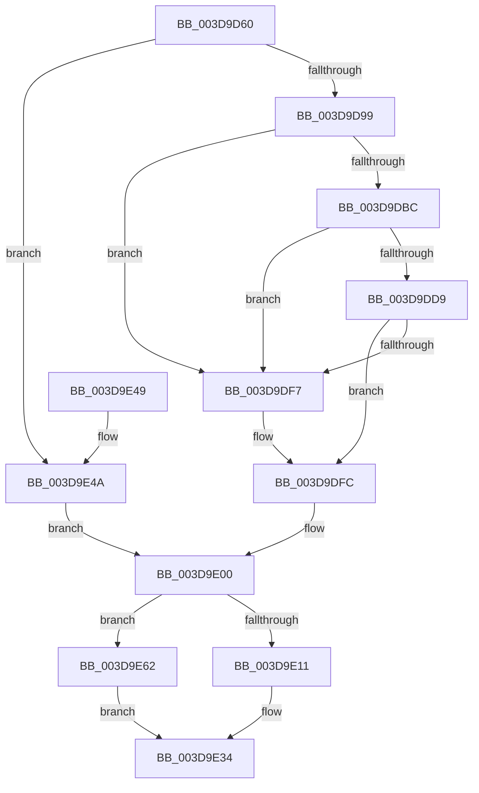

# KeAllocateXStateContext

- RVA: `0x003D9D60`–`0x003D9E69` (길이 `265` bytes)
- VA: `0x00000001403D9D60`
- 실행 섹션: `.text`
- PDB 이름 있음: `예`; PDB Function 태그: `아니요`
- unwind 정보 RVA: `0x00093238`
- 디코드: `70`개 명령, `265/265` bytes 표시
- 미해석 바이트: `0` (있으면 어셈블리에 `.byte`로 보존)

> 이 문서는 커널 이미지의 기계어와 PDB 기호를 분석해 생성했습니다. 4번과 5번은 함수 원형과 자료형을 바이너리 사용 방식에서 추정한 C 해석이며 원본 소스 복구 결과는 아닙니다.

## 1. Dependencies

- 직접 호출 지점: **5**; 고유 호출 대상: **4**
- 직접 호출자로 확인된 함수: **2**
- RIP 상대 이미지 참조: **0**

### Outgoing calls
- `0x003D9DAF` → [ExpInterlockedPopEntrySList](../6B/ExpInterlockedPopEntrySList_function_006BA570.md) (function, `0x006BA570`)
- `0x003D9DCC` → [ExpInterlockedPopEntrySList](../6B/ExpInterlockedPopEntrySList_function_006BA570.md) (function, `0x006BA570`)
- `0x003D9DEA` → [guard_dispatch_icall](../6B/guard_dispatch_icall_function_006BAAD0.md) (function, `0x006BAAD0`)
- `0x003D9E2D` → [memset](../6C/memset_function_006C6C40.md) (function, `0x006C6C40`)
- `0x003D9E58` → [ExAllocatePool2](../../poolcode/B8/ExAllocatePool2_function_00B820F0.md) (function, `0x00B820F0`)

### Direct callers
- [KiSaveExtendedAndSupervisorState](KiSaveExtendedAndSupervisorState_function_003D9A1C.md) at `0x003D9BC6`
- [VfCtxInit](../../pagevrfy/BB/VfCtxInit_function_00BB1D74.md) at `0x00BB1DD6`
- [VfCtxInit](../../pagevrfy/BB/VfCtxInit_function_00BB1D74.md) at `0x00BB1DEA`

### Static image references
- 디코드된 RIP-relative 메모리 참조가 없습니다.

## 2. Other-region calls and transfers

- 다른 실행 섹션으로 향하는 call: **1**
  - `0x003D9E58` → [ExAllocatePool2](../../poolcode/B8/ExAllocatePool2_function_00B820F0.md) (`.text` → `POOLCODE`)
- 별도 외부 분기/꼬리 이동을 확인하지 못했습니다.

## 3. Assembly (complete function range)

```asm
003D9D60  48 89 5C 24 08                  mov qword ptr [rsp + 8], rbx
003D9D65  48 89 6C 24 10                  mov qword ptr [rsp + 0x10], rbp
003D9D6A  48 89 74 24 18                  mov qword ptr [rsp + 0x18], rsi
003D9D6F  57                              push rdi
003D9D70  48 83 EC 20                     sub rsp, 0x20
003D9D74  BE 40 02 00 00                  mov esi, 0x240
003D9D79  C6 41 0C 00                     mov byte ptr [rcx + 0xc], 0
003D9D7D  44 3B C6                        cmp r8d, esi
003D9D80  48 B8 E8 03 00 00 80 F7 FF FF   movabs rax, 0xfffff780000003e8
003D9D8A  48 8B D9                        mov rbx, rcx
003D9D8D  41 0F 43 F0                     cmovae esi, r8d
003D9D91  3B 30                           cmp esi, dword ptr [rax]
003D9D93  0F 85 B1 00 00 00               jne 0x1403d9e4a
003D9D99  65 48 8B 2C 25 20 00 00 00      mov rbp, qword ptr gs:[0x20]
003D9DA2  48 8B BD 90 08 00 00            mov rdi, qword ptr [rbp + 0x890]
003D9DA9  48 8B CF                        mov rcx, rdi
003D9DAC  FF 47 14                        inc dword ptr [rdi + 0x14]
003D9DAF  E8 BC 07 2E 00                  call 0x1406ba570
003D9DB4  48 8B C8                        mov rcx, rax
003D9DB7  48 85 C0                        test rax, rax
003D9DBA  75 3B                           jne 0x1403d9df7
003D9DBC  FF 47 18                        inc dword ptr [rdi + 0x18]
003D9DBF  48 8B BD 98 08 00 00            mov rdi, qword ptr [rbp + 0x898]
003D9DC6  48 8B CF                        mov rcx, rdi
003D9DC9  FF 47 14                        inc dword ptr [rdi + 0x14]
003D9DCC  E8 9F 07 2E 00                  call 0x1406ba570
003D9DD1  48 8B C8                        mov rcx, rax
003D9DD4  48 85 C0                        test rax, rax
003D9DD7  75 1E                           jne 0x1403d9df7
003D9DD9  8B 57 2C                        mov edx, dword ptr [rdi + 0x2c]
003D9DDC  48 8B 47 30                     mov rax, qword ptr [rdi + 0x30]
003D9DE0  44 8B 47 28                     mov r8d, dword ptr [rdi + 0x28]
003D9DE4  8B 4F 24                        mov ecx, dword ptr [rdi + 0x24]
003D9DE7  FF 47 18                        inc dword ptr [rdi + 0x18]
003D9DEA  E8 E1 0C 2E 00                  call 0x1406baad0
003D9DEF  48 8B C8                        mov rcx, rax
003D9DF2  48 85 C0                        test rax, rax
003D9DF5  74 05                           je 0x1403d9dfc
003D9DF7  8B 45 24                        mov eax, dword ptr [rbp + 0x24]
003D9DFA  89 01                           mov dword ptr [rcx], eax
003D9DFC  80 4B 0C 01                     or byte ptr [rbx + 0xc], 1
003D9E00  B8 18 00 00 00                  mov eax, 0x18
003D9E05  48 8B D3                        mov rdx, rbx
003D9E08  48 89 0C 03                     mov qword ptr [rbx + rax], rcx
003D9E0C  48 85 C9                        test rcx, rcx
003D9E0F  74 51                           je 0x1403d9e62
003D9E11  48 83 C1 3F                     add rcx, 0x3f
003D9E15  89 73 08                        mov dword ptr [rbx + 8], esi
003D9E18  48 83 E1 C0                     and rcx, 0xffffffffffffffc0
003D9E1C  44 8D 40 28                     lea r8d, [rax + 0x28]
003D9E20  48 89 4B 10                     mov qword ptr [rbx + 0x10], rcx
003D9E24  33 D2                           xor edx, edx
003D9E26  48 81 C1 00 02 00 00            add rcx, 0x200
003D9E2D  E8 0E CE 2E 00                  call 0x1406c6c40
003D9E32  33 C0                           xor eax, eax
003D9E34  48 8B 5C 24 30                  mov rbx, qword ptr [rsp + 0x30]
003D9E39  48 8B 6C 24 38                  mov rbp, qword ptr [rsp + 0x38]
003D9E3E  48 8B 74 24 40                  mov rsi, qword ptr [rsp + 0x40]
003D9E43  48 83 C4 20                     add rsp, 0x20
003D9E47  5F                              pop rdi
003D9E48  C3                              ret
003D9E49  CC                              int3
003D9E4A  8D 56 3F                        lea edx, [rsi + 0x3f]
003D9E4D  B9 42 00 00 00                  mov ecx, 0x42
003D9E52  41 B8 58 53 61 76               mov r8d, 0x76615358
003D9E58  E8 93 82 7A 00                  call 0x140b820f0
003D9E5D  48 8B C8                        mov rcx, rax
003D9E60  EB 9E                           jmp 0x1403d9e00
003D9E62  B8 17 00 00 C0                  mov eax, 0xc0000017
003D9E67  EB CB                           jmp 0x1403d9e34
```

## 4. C-style interpretation (structured pseudocode)

```c
__int64 __fastcall KeAllocateXStateContext(__int64 a1, __int64 a2, int a3)
{
    __int64 result;
    __int64 v_rsi;
    __int64 v_rsp;
    unsigned __int64 v_stack_p10;
    unsigned __int64 v_stack_p18;
    unsigned __int64 v_stack_p8;

    v_stack_p8 = v_rbx;
    v_stack_p10 = v_rbp;
    v_stack_p18 = v_rsi;
    v_rsp = (v_rsp) - (32);
    *(unsigned __int8 *)(a1 + 12) = 0;
    v_rsi = 576;
    if (a3 >= 576) { v_rsi = a3; }
    if (((unsigned int)(v_rsi)) != (*(unsigned int *)(result))) goto loc_003D9E4A;
    result = ExpInterlockedPopEntrySList(*(unsigned __int64 *)(*(unsigned __int64 *)(gs_base + (0 + 32)) + 2192), a2, a3, a4);
    if (result != 0) goto loc_003D9DF7;
    result = ExpInterlockedPopEntrySList(*(unsigned __int64 *)(*(unsigned __int64 *)(gs_base + (0 + 32)) + 2200), a2, a3, a4);
    if (result != 0) goto loc_003D9DF7;
    result = guard_dispatch_icall((unsigned int)(*(unsigned int *)(*(unsigned __int64 *)(*(unsigned __int64 *)(gs_base + (0 + 32)) + 2200) + 36)), (unsigned int)(*(unsigned int *)(*(unsigned __int64 *)(*(unsigned __int64 *)(gs_base + (0 + 32)) + 2200) + 44)), (unsigned int)(*(unsigned int *)(*(unsigned __int64 *)(*(unsigned __int64 *)(gs_base + (0 + 32)) + 2200) + 40)), a4);
    if (result != 0) {
        result = *(unsigned int *)(*(unsigned __int64 *)(gs_base + (0 + 32)) + 36);
        *(unsigned int *)(result) = (unsigned int)(result);
    }
loc_003D9E00:
    *(unsigned __int64 *)(a1 + 24 * 1) = result;
    if (result == 0) goto loc_003D9E62;
    a1 = (result) + (63);
    *(unsigned int *)(a1 + 8) = (unsigned int)(v_rsi);
    a1 = (a1) & (-64);
    *(unsigned __int64 *)(a1 + 16) = a1;
    a2 = 0;
    a1 = (a1) + (512);
    result = memset(a1, a2, 24 + 40, a4);
    result = 0;
loc_003D9E34:
    v_rsp = (v_rsp) + (32);
    return result;
loc_003D9E4A:
    result = ExAllocatePool2(66, v_stack_p18 + 63, (unsigned int)(0x76615358ULL), a4);
    goto loc_003D9E00;
loc_003D9E62:
    goto loc_003D9E34;
}
```

## 5. (Beta) C Style

```c
int64_t KeAllocateXStateContext(void *Arg1, int64_t Arg2, int32_t Arg3)
{
    uint8_t *arg1 = (uint8_t *)Arg1;

    int64_t result;
    int64_t local_rsi;
    int64_t local_rsp;
    uint64_t v_stack_p10;
    uint64_t v_stack_p18;
    uint64_t v_stack_p8;

    v_stack_p8 = local_rbx;
    v_stack_p10 = local_rbp;
    v_stack_p18 = local_rsi;
    local_rsp = (local_rsp) - (32);
    *(uint8_t *)(arg1 + 0xC) = 0;
    local_rsi = 576;
    if (Arg3 >= 576) { local_rsi = Arg3; }
    if (((uint32_t)(local_rsi)) != (*(uint32_t *)(result))) goto loc_003D9E4A;
    result = ExpInterlockedPopEntrySList(*(uint64_t *)(*(uint64_t *)(gs_base + (0 + 0x20)) + 0x890), Arg2, Arg3, a4);
    if (result != 0) goto loc_003D9DF7;
    result = ExpInterlockedPopEntrySList(*(uint64_t *)(*(uint64_t *)(gs_base + (0 + 0x20)) + 0x898), Arg2, Arg3, a4);
    if (result != 0) goto loc_003D9DF7;
    result = guard_dispatch_icall((uint32_t)(*(uint32_t *)(*(uint64_t *)(*(uint64_t *)(gs_base + (0 + 0x20)) + 0x898) + 0x24)), (uint32_t)(*(uint32_t *)(*(uint64_t *)(*(uint64_t *)(gs_base + (0 + 0x20)) + 0x898) + 0x2C)), (uint32_t)(*(uint32_t *)(*(uint64_t *)(*(uint64_t *)(gs_base + (0 + 0x20)) + 0x898) + 0x28)), a4);
    if (result != 0) {
        result = *(uint32_t *)(*(uint64_t *)(gs_base + (0 + 0x20)) + 0x24);
        *(uint32_t *)(result) = (uint32_t)(result);
    }
loc_003D9E00:
    *(uint64_t *)(arg1 + 0x18 * 1) = result;
    if (result == 0) goto loc_003D9E62;
    Arg1 = (result) + (63);
    *(uint32_t *)(arg1 + 0x8) = (uint32_t)(local_rsi);
    Arg1 = (Arg1) & (-64);
    *(void **)(arg1 + 0x10) = Arg1;
    Arg2 = 0;
    Arg1 = (Arg1) + (512);
    result = memset(Arg1, Arg2, 24 + 40, a4);
    result = 0;
loc_003D9E34:
    local_rsp = (local_rsp) + (32);
    return result;
loc_003D9E4A:
    result = ExAllocatePool2(66, v_stack_p18 + 63, (uint32_t)(0x76615358ULL), a4);
    goto loc_003D9E00;
loc_003D9E62:
    goto loc_003D9E34;
}
```

### 관측된 메모리 오프셋

구조체 형식이 확인되지 않은 접근은 인자 기준의 오프셋으로만 기록했습니다.

| 기준 인자 | 오프셋 표현 | 폭 (bit) | 접근 |
|---|---:|---:|---|
| `Arg1` | `+ 0x0 + rax*1` | `64` | `W` |
| `Arg1` | `+ 0x8` | `32` | `W` |
| `Arg1` | `+ 0xC` | `8` | `R/W` |
| `Arg1` | `+ 0xC` | `8` | `W` |
| `Arg1` | `+ 0x10` | `64` | `W` |

## 6. Execution-region graph

[열기: 2D/3D 그래프와 함수 탐색 컨트롤 패널](../../../control-panel.html?section=text&rva=0x003D9D60&view=graph)

- 2D 그래프는 위에서 아래로 흐르고, 3D 그래프는 빈 공간을 드래그해 회전합니다. Shift+드래그는 이동, 휠은 확대·축소, 함수 노드 선택은 대상 보고서 이동입니다.

### Static fallback


