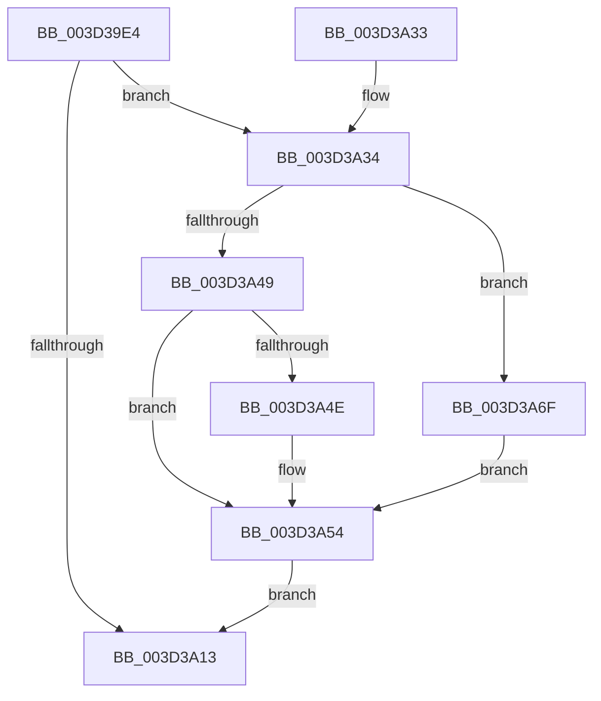

# KeCancelTimerInternal

- RVA: `0x003D39E4`–`0x003D3A77` (길이 `147` bytes)
- VA: `0x00000001403D39E4`
- 실행 섹션: `.text`
- PDB 이름 있음: `예`; PDB Function 태그: `아니요`
- unwind 정보 RVA: `0x000918EC`
- 디코드: `42`개 명령, `147/147` bytes 표시
- 미해석 바이트: `0` (있으면 어셈블리에 `.byte`로 보존)

> 이 문서는 커널 이미지의 기계어와 PDB 기호를 분석해 생성했습니다. 4번과 5번은 함수 원형과 자료형을 바이너리 사용 방식에서 추정한 C 해석이며 원본 소스 복구 결과는 아닙니다.

## 1. Dependencies

- 직접 호출 지점: **2**; 고유 호출 대상: **2**
- 직접 호출자로 확인된 함수: **1**
- RIP 상대 이미지 참조: **0**

### Outgoing calls
- `0x003D3A07` → [KiCancelTimer](KiCancelTimer_function_003D3A80.md) (function, `0x003D3A80`)
- `0x003D3A57` → [KiDecodeTolerableDelayValue](KiDecodeTolerableDelayValue_function_003D3F10.md) (function, `0x003D3F10`)

### Direct callers
- [ExpTimerAdjust](../65/ExpTimerAdjust_function_006593CC.md) at `0x0065941D`

### Static image references
- 디코드된 RIP-relative 메모리 참조가 없습니다.

## 2. Other-region calls and transfers

- 다른 실행 섹션으로 향하는 call: **0**
- 별도 외부 분기/꼬리 이동을 확인하지 못했습니다.

## 3. Assembly (complete function range)

```asm
003D39E4  48 89 5C 24 08                  mov qword ptr [rsp + 8], rbx
003D39E9  48 89 74 24 10                  mov qword ptr [rsp + 0x10], rsi
003D39EE  48 89 7C 24 18                  mov qword ptr [rsp + 0x18], rdi
003D39F3  41 56                           push r14
003D39F5  48 83 EC 20                     sub rsp, 0x20
003D39F9  48 8B F2                        mov rsi, rdx
003D39FC  4D 8B F1                        mov r14, r9
003D39FF  33 D2                           xor edx, edx
003D3A01  49 8B F8                        mov rdi, r8
003D3A04  48 8B D9                        mov rbx, rcx
003D3A07  E8 74 00 00 00                  call 0x1403d3a80
003D3A0C  44 8A D8                        mov r11b, al
003D3A0F  84 C0                           test al, al
003D3A11  75 21                           jne 0x1403d3a34
003D3A13  F0 81 23 7F FF FF FF            lock and dword ptr [rbx], 0xffffff7f
003D3A1A  48 8B 5C 24 30                  mov rbx, qword ptr [rsp + 0x30]
003D3A1F  41 8A C3                        mov al, r11b
003D3A22  48 8B 74 24 38                  mov rsi, qword ptr [rsp + 0x38]
003D3A27  48 8B 7C 24 40                  mov rdi, qword ptr [rsp + 0x40]
003D3A2C  48 83 C4 20                     add rsp, 0x20
003D3A30  41 5E                           pop r14
003D3A32  C3                              ret
003D3A33  CC                              int3
003D3A34  8A 4B 01                        mov cl, byte ptr [rbx + 1]
003D3A37  4C 8B 53 18                     mov r10, qword ptr [rbx + 0x18]
003D3A3B  4C 89 16                        mov qword ptr [rsi], r10
003D3A3E  C7 07 02 00 00 00               mov dword ptr [rdi], 2
003D3A44  F6 C1 01                        test cl, 1
003D3A47  75 26                           jne 0x1403d3a6f
003D3A49  F6 C1 02                        test cl, 2
003D3A4C  74 06                           je 0x1403d3a54
003D3A4E  C7 07 03 00 00 00               mov dword ptr [rdi], 3
003D3A54  C0 E9 02                        shr cl, 2
003D3A57  E8 B4 04 00 00                  call 0x1403d3f10
003D3A5C  44 8B D0                        mov r10d, eax
003D3A5F  B8 59 17 B7 D1                  mov eax, 0xd1b71759
003D3A64  41 F7 E2                        mul r10d
003D3A67  C1 EA 0D                        shr edx, 0xd
003D3A6A  41 89 16                        mov dword ptr [r14], edx
003D3A6D  EB A4                           jmp 0x1403d3a13
003D3A6F  C7 07 01 00 00 00               mov dword ptr [rdi], 1
003D3A75  EB DD                           jmp 0x1403d3a54
```

## 4. C-style interpretation (structured pseudocode)

```c
__int64 __fastcall KeCancelTimerInternal(__int64 a1, __int64 a2, __int64 a3, __int64 a4)
{
    __int64 result;
    __int64 v_rsp;
    unsigned __int64 v_stack_p10;
    unsigned __int64 v_stack_p18;
    unsigned __int64 v_stack_p8;

    v_stack_p8 = v_rbx;
    v_stack_p10 = v_rsi;
    v_stack_p18 = v_rdi;
    v_rsp = (v_rsp) - (32);
    a2 = 0;
    result = KiCancelTimer(a1, a2, a3, a4);
    if ((unsigned __int8)(result) != 0) goto loc_003D3A34;
loc_003D3A13:
    v_rsp = (v_rsp) + (32);
    return (unsigned __int8)((unsigned __int8)(result));
loc_003D3A34:
    *(unsigned __int64 *)(v_stack_p10) = *(unsigned __int64 *)(v_stack_p8 + 24);
    *(unsigned int *)(v_stack_p18) = 2;
    if ((((unsigned __int8)(*(unsigned __int8 *)(v_stack_p8 + 1))) & (1)) != 0) goto loc_003D3A6F;
    if ((((unsigned __int8)(*(unsigned __int8 *)(v_stack_p8 + 1))) & (2)) != 0) {
        *(unsigned int *)(v_stack_p18) = 3;
    }
    a1 = (unsigned __int8)((*(unsigned __int8 *)(v_stack_p8 + 1)) >> (2));
    result = KiDecodeTolerableDelayValue(a1, a2, a3, a4);
    a2 = (unsigned int)((a2) >> (13));
    *(unsigned int *)(a4) = (unsigned int)(a2);
    goto loc_003D3A13;
loc_003D3A6F:
    *(unsigned int *)(v_stack_p18) = 1;
    goto loc_003D3A54;
}
```

## 5. (Beta) C Style

```c
int64_t KeCancelTimerInternal(void *Arg1, void *Arg2, void *Arg3, void *Arg4)
{
    uint8_t *arg1 = (uint8_t *)Arg1;
    uint8_t *arg2 = (uint8_t *)Arg2;
    uint8_t *arg3 = (uint8_t *)Arg3;
    uint8_t *arg4 = (uint8_t *)Arg4;

    int64_t result;
    int64_t local_rsp;
    uint64_t v_stack_p10;
    uint64_t v_stack_p18;
    uint64_t v_stack_p8;

    v_stack_p8 = local_rbx;
    v_stack_p10 = local_rsi;
    v_stack_p18 = local_rdi;
    local_rsp = (local_rsp) - (32);
    Arg2 = 0;
    result = KiCancelTimer(Arg1, Arg2, Arg3, Arg4);
    if ((uint8_t)(result) != 0) goto loc_003D3A34;
loc_003D3A13:
    local_rsp = (local_rsp) + (32);
    return (uint8_t)((uint8_t)(result));
loc_003D3A34:
    *(uint64_t *)(v_stack_p10) = *(uint64_t *)(v_stack_p8 + 0x18);
    *(uint32_t *)(v_stack_p18) = 2;
    if ((((uint8_t)(*(uint8_t *)(v_stack_p8 + 0x1))) & (1)) != 0) goto loc_003D3A6F;
    if ((((uint8_t)(*(uint8_t *)(v_stack_p8 + 0x1))) & (2)) != 0) {
        *(uint32_t *)(v_stack_p18) = 3;
    }
    Arg1 = (uint8_t)((*(uint8_t *)(v_stack_p8 + 0x1)) >> (2));
    result = KiDecodeTolerableDelayValue(Arg1, Arg2, Arg3, Arg4);
    Arg2 = (uint32_t)((Arg2) >> (13));
    *(uint32_t *)(arg4) = (uint32_t)(Arg2);
    goto loc_003D3A13;
loc_003D3A6F:
    *(uint32_t *)(v_stack_p18) = 1;
    goto loc_003D3A54;
}
```

### 관측된 메모리 오프셋

구조체 형식이 확인되지 않은 접근은 인자 기준의 오프셋으로만 기록했습니다.

| 기준 인자 | 오프셋 표현 | 폭 (bit) | 접근 |
|---|---:|---:|---|
| `Arg1` | `+ 0x0` | `32` | `R/W` |
| `Arg1` | `+ 0x1` | `8` | `R` |
| `Arg1` | `+ 0x18` | `64` | `R` |
| `Arg2` | `+ 0x0` | `64` | `W` |
| `Arg3` | `+ 0x0` | `32` | `W` |
| `Arg4` | `+ 0x0` | `32` | `W` |

## 6. Execution-region graph

[열기: 2D/3D 그래프와 함수 탐색 컨트롤 패널](../../../control-panel.html?section=text&rva=0x003D39E4&view=graph)

- 2D 그래프는 위에서 아래로 흐르고, 3D 그래프는 빈 공간을 드래그해 회전합니다. Shift+드래그는 이동, 휠은 확대·축소, 함수 노드 선택은 대상 보고서 이동입니다.

### Static fallback


