# KeContextFromKframes

- RVA: `0x003D9380`–`0x003D9956` (길이 `1,494` bytes)
- VA: `0x00000001403D9380`
- 실행 섹션: `.text`
- PDB 이름 있음: `예`; PDB Function 태그: `아니요`
- unwind 정보 RVA: `0x00093DE0`
- 디코드: `290`개 명령, `1,494/1,494` bytes 표시
- 미해석 바이트: `0` (있으면 어셈블리에 `.byte`로 보존)

> 이 문서는 커널 이미지의 기계어와 PDB 기호를 분석해 생성했습니다. 4번과 5번은 함수 원형과 자료형을 바이너리 사용 방식에서 추정한 C 해석이며 원본 소스 복구 결과는 아닙니다.

## 1. Dependencies

- 직접 호출 지점: **4**; 고유 호출 대상: **4**
- 직접 호출자로 확인된 함수: **3**
- RIP 상대 이미지 참조: **1**

### Outgoing calls
- `0x003D975B` → [KiLowerIrqlProcessIrqlFlags](../4F/KiLowerIrqlProcessIrqlFlags_function_004F5698.md) (function, `0x004F5698`)
- `0x003D9787` → [KiRaiseIrqlProcessIrqlFlags](../4F/KiRaiseIrqlProcessIrqlFlags_function_004F56FC.md) (function, `0x004F56FC`)
- `0x003D98D8` → [RtlXSave](RtlXSave_function_003D9D10.md) (function, `0x003D9D10`)
- `0x003D991C` → [RtlCopyXStateArea](RtlCopyXStateArea_function_003D5850.md) (function, `0x003D5850`)

### Direct callers
- [KiDispatchException](KiDispatchException_function_003D7650.md) at `0x003D778D`
- [KiInitializeUserApc](KiInitializeUserApc_function_003D8D38.md) at `0x003D8F33`
- [KiSaveProcessorState](../5C/KiSaveProcessorState_function_005CB940.md) at `0x005CBA14`

### Static image references
- `0x003D93BA` → RVA `0x00FC6D20` (`ALMOSTRO`; read)

## 2. Other-region calls and transfers

- 다른 실행 섹션으로 향하는 call: **0**
- 별도 외부 분기/꼬리 이동을 확인하지 못했습니다.

## 3. Assembly (complete function range)

```asm
003D9380  48 89 5C 24 08                  mov qword ptr [rsp + 8], rbx
003D9385  48 89 6C 24 10                  mov qword ptr [rsp + 0x10], rbp
003D938A  48 89 74 24 18                  mov qword ptr [rsp + 0x18], rsi
003D938F  48 89 7C 24 20                  mov qword ptr [rsp + 0x20], rdi
003D9394  41 56                           push r14
003D9396  48 83 EC 20                     sub rsp, 0x20
003D939A  49 8B D8                        mov rbx, r8
003D939D  48 8B EA                        mov rbp, rdx
003D93A0  48 8B F9                        mov rdi, rcx
003D93A3  45 0F 20 C6                     mov r14, cr8
003D93A7  41 80 FE 01                     cmp r14b, 1
003D93AB  73 1A                           jae 0x1403d93c7
003D93AD  44 0F 20 C1                     mov rcx, cr8
003D93B1  B8 01 00 00 00                  mov eax, 1
003D93B6  44 0F 22 C0                     mov cr8, rax
003D93BA  83 3D 5F D9 BE 00 00            cmp dword ptr [rip + 0xbed95f], 0
003D93C1  0F 85 BD 03 00 00               jne 0x1403d9784
003D93C7  8B 73 30                        mov esi, dword ptr [rbx + 0x30]
003D93CA  4C 8D 87 70 01 00 00            lea r8, [rdi + 0x170]
003D93D1  8B C6                           mov eax, esi
003D93D3  25 01 00 10 00                  and eax, 0x100001
003D93D8  3D 01 00 10 00                  cmp eax, 0x100001
003D93DD  75 38                           jne 0x1403d9417
003D93DF  48 8B 87 68 01 00 00            mov rax, qword ptr [rdi + 0x168]
003D93E6  48 89 83 F8 00 00 00            mov qword ptr [rbx + 0xf8], rax
003D93ED  41 0F B7 00                     movzx eax, word ptr [r8]
003D93F1  66 89 43 38                     mov word ptr [rbx + 0x38], ax
003D93F5  0F B7 87 88 01 00 00            movzx eax, word ptr [rdi + 0x188]
003D93FC  66 89 43 42                     mov word ptr [rbx + 0x42], ax
003D9400  48 8B 87 80 01 00 00            mov rax, qword ptr [rdi + 0x180]
003D9407  48 89 83 98 00 00 00            mov qword ptr [rbx + 0x98], rax
003D940E  8B 87 78 01 00 00               mov eax, dword ptr [rdi + 0x178]
003D9414  89 43 44                        mov dword ptr [rbx + 0x44], eax
003D9417  8B C6                           mov eax, esi
003D9419  25 04 00 10 00                  and eax, 0x100004
003D941E  3D 04 00 10 00                  cmp eax, 0x100004
003D9423  75 0E                           jne 0x1403d9433
003D9425  C7 43 3A 2B 00 2B 00            mov dword ptr [rbx + 0x3a], 0x2b002b
003D942C  C7 43 3E 53 00 2B 00            mov dword ptr [rbx + 0x3e], 0x2b0053
003D9433  8B C6                           mov eax, esi
003D9435  25 02 00 10 00                  and eax, 0x100002
003D943A  3D 02 00 10 00                  cmp eax, 0x100002
003D943F  0F 85 C1 00 00 00               jne 0x1403d9506
003D9445  48 8B 47 30                     mov rax, qword ptr [rdi + 0x30]
003D9449  4C 8D 87 70 01 00 00            lea r8, [rdi + 0x170]
003D9450  48 89 43 78                     mov qword ptr [rbx + 0x78], rax
003D9454  48 8B 47 38                     mov rax, qword ptr [rdi + 0x38]
003D9458  48 89 83 80 00 00 00            mov qword ptr [rbx + 0x80], rax
003D945F  48 8B 47 40                     mov rax, qword ptr [rdi + 0x40]
003D9463  48 89 83 88 00 00 00            mov qword ptr [rbx + 0x88], rax
003D946A  48 8B 47 48                     mov rax, qword ptr [rdi + 0x48]
003D946E  48 89 83 B8 00 00 00            mov qword ptr [rbx + 0xb8], rax
003D9475  48 8B 47 50                     mov rax, qword ptr [rdi + 0x50]
003D9479  48 89 83 C0 00 00 00            mov qword ptr [rbx + 0xc0], rax
003D9480  48 8B 47 58                     mov rax, qword ptr [rdi + 0x58]
003D9484  48 89 83 C8 00 00 00            mov qword ptr [rbx + 0xc8], rax
003D948B  48 8B 47 60                     mov rax, qword ptr [rdi + 0x60]
003D948F  48 89 83 D0 00 00 00            mov qword ptr [rbx + 0xd0], rax
003D9496  48 8B 87 58 01 00 00            mov rax, qword ptr [rdi + 0x158]
003D949D  48 89 83 A0 00 00 00            mov qword ptr [rbx + 0xa0], rax
003D94A4  48 8B 85 00 01 00 00            mov rax, qword ptr [rbp + 0x100]
003D94AB  48 89 83 90 00 00 00            mov qword ptr [rbx + 0x90], rax
003D94B2  48 8B 85 08 01 00 00            mov rax, qword ptr [rbp + 0x108]
003D94B9  48 89 83 B0 00 00 00            mov qword ptr [rbx + 0xb0], rax
003D94C0  48 8B 85 10 01 00 00            mov rax, qword ptr [rbp + 0x110]
003D94C7  48 89 83 A8 00 00 00            mov qword ptr [rbx + 0xa8], rax
003D94CE  48 8B 85 18 01 00 00            mov rax, qword ptr [rbp + 0x118]
003D94D5  48 89 83 D8 00 00 00            mov qword ptr [rbx + 0xd8], rax
003D94DC  48 8B 85 20 01 00 00            mov rax, qword ptr [rbp + 0x120]
003D94E3  48 89 83 E0 00 00 00            mov qword ptr [rbx + 0xe0], rax
003D94EA  48 8B 85 28 01 00 00            mov rax, qword ptr [rbp + 0x128]
003D94F1  48 89 83 E8 00 00 00            mov qword ptr [rbx + 0xe8], rax
003D94F8  48 8B 85 30 01 00 00            mov rax, qword ptr [rbp + 0x130]
003D94FF  48 89 83 F0 00 00 00            mov qword ptr [rbx + 0xf0], rax
003D9506  8B C6                           mov eax, esi
003D9508  25 40 00 10 00                  and eax, 0x100040
003D950D  3D 40 00 10 00                  cmp eax, 0x100040
003D9512  0F 85 A7 00 00 00               jne 0x1403d95bf
003D9518  41 F6 00 01                     test byte ptr [r8], 1
003D951C  0F 84 87 00 00 00               je 0x1403d95a9
003D9522  65 48 8B 04 25 88 01 00 00      mov rax, qword ptr gs:[0x188]
003D952B  4C 63 8B E0 04 00 00            movsxd r9, dword ptr [rbx + 0x4e0]
003D9532  49 81 C1 D0 02 00 00            add r9, 0x2d0
003D9539  4C 03 CB                        add r9, rbx
003D953C  48 8B 88 98 01 00 00            mov rcx, qword ptr [rax + 0x198]
003D9543  48 85 C9                        test rcx, rcx
003D9546  0F 85 96 03 00 00               jne 0x1403d98e2
003D954C  48 B8 D8 03 00 00 80 F7 FF FF   movabs rax, 0xfffff780000003d8
003D9556  48 B9 08 07 00 00 80 F7 FF FF   movabs rcx, 0xfffff78000000708
003D9560  48 8B 09                        mov rcx, qword ptr [rcx]
003D9563  48 0B 08                        or rcx, qword ptr [rax]
003D9566  A1 EC 03 00 00 80 F7 FF FF      movabs eax, dword ptr [0xfffff780000003ec]
003D956F  48 83 E1 FC                     and rcx, 0xfffffffffffffffc
003D9573  A8 02                           test al, 2
003D9575  0F 84 57 03 00 00               je 0x1403d98d2
003D957B  48 BA 00 00 00 00 00 00 00 80   movabs rdx, 0x8000000000000000
003D9585  33 C0                           xor eax, eax
003D9587  49 09 91 08 02 00 00            or qword ptr [r9 + 0x208], rdx
003D958E  33 D2                           xor edx, edx
003D9590  41 0F C7 19                     xrstors ptr [r9]
003D9594  49 8B 91 08 02 00 00            mov rdx, qword ptr [r9 + 0x208]
003D959B  48 23 D1                        and rdx, rcx
003D959E  48 8B C2                        mov rax, rdx
003D95A1  48 C1 EA 20                     shr rdx, 0x20
003D95A5  41 0F C7 29                     xsaves ptr [r9]
003D95A9  8B 47 2C                        mov eax, dword ptr [rdi + 0x2c]
003D95AC  4C 8D 87 70 01 00 00            lea r8, [rdi + 0x170]
003D95B3  89 43 34                        mov dword ptr [rbx + 0x34], eax
003D95B6  8B 47 2C                        mov eax, dword ptr [rdi + 0x2c]
003D95B9  89 83 18 01 00 00               mov dword ptr [rbx + 0x118], eax
003D95BF  8B C6                           mov eax, esi
003D95C1  45 33 C9                        xor r9d, r9d
003D95C4  25 80 00 10 00                  and eax, 0x100080
003D95C9  49 8B D0                        mov rdx, r8
003D95CC  3D 80 00 10 00                  cmp eax, 0x100080
003D95D1  0F 84 A4 02 00 00               je 0x1403d987b
003D95D7  8B C6                           mov eax, esi
003D95D9  25 08 00 10 00                  and eax, 0x100008
003D95DE  3D 08 00 10 00                  cmp eax, 0x100008
003D95E3  0F 85 F1 00 00 00               jne 0x1403d96da
003D95E9  41 F6 00 01                     test byte ptr [r8], 1
003D95ED  74 0E                           je 0x1403d95fd
003D95EF  0F AE 83 00 01 00 00            fxsave [rbx + 0x100]
003D95F6  48 8D 97 70 01 00 00            lea rdx, [rdi + 0x170]
003D95FD  0F 10 47 70                     movups xmm0, xmmword ptr [rdi + 0x70]
003D9601  0F 11 83 A0 01 00 00            movups xmmword ptr [rbx + 0x1a0], xmm0
003D9608  0F 10 87 80 00 00 00            movups xmm0, xmmword ptr [rdi + 0x80]
003D960F  0F 11 83 B0 01 00 00            movups xmmword ptr [rbx + 0x1b0], xmm0
003D9616  0F 10 87 90 00 00 00            movups xmm0, xmmword ptr [rdi + 0x90]
003D961D  0F 11 83 C0 01 00 00            movups xmmword ptr [rbx + 0x1c0], xmm0
003D9624  0F 10 87 A0 00 00 00            movups xmm0, xmmword ptr [rdi + 0xa0]
003D962B  0F 11 83 D0 01 00 00            movups xmmword ptr [rbx + 0x1d0], xmm0
003D9632  0F 10 87 B0 00 00 00            movups xmm0, xmmword ptr [rdi + 0xb0]
003D9639  0F 11 83 E0 01 00 00            movups xmmword ptr [rbx + 0x1e0], xmm0
003D9640  0F 10 87 C0 00 00 00            movups xmm0, xmmword ptr [rdi + 0xc0]
003D9647  0F 11 83 F0 01 00 00            movups xmmword ptr [rbx + 0x1f0], xmm0
003D964E  0F 10 45 30                     movups xmm0, xmmword ptr [rbp + 0x30]
003D9652  0F 11 83 00 02 00 00            movups xmmword ptr [rbx + 0x200], xmm0
003D9659  0F 10 45 40                     movups xmm0, xmmword ptr [rbp + 0x40]
003D965D  0F 11 83 10 02 00 00            movups xmmword ptr [rbx + 0x210], xmm0
003D9664  0F 10 45 50                     movups xmm0, xmmword ptr [rbp + 0x50]
003D9668  0F 11 83 20 02 00 00            movups xmmword ptr [rbx + 0x220], xmm0
003D966F  0F 10 45 60                     movups xmm0, xmmword ptr [rbp + 0x60]
003D9673  0F 11 83 30 02 00 00            movups xmmword ptr [rbx + 0x230], xmm0
003D967A  0F 10 45 70                     movups xmm0, xmmword ptr [rbp + 0x70]
003D967E  0F 11 83 40 02 00 00            movups xmmword ptr [rbx + 0x240], xmm0
003D9685  0F 10 85 80 00 00 00            movups xmm0, xmmword ptr [rbp + 0x80]
003D968C  0F 11 83 50 02 00 00            movups xmmword ptr [rbx + 0x250], xmm0
003D9693  0F 10 85 90 00 00 00            movups xmm0, xmmword ptr [rbp + 0x90]
003D969A  0F 11 83 60 02 00 00            movups xmmword ptr [rbx + 0x260], xmm0
003D96A1  0F 10 85 A0 00 00 00            movups xmm0, xmmword ptr [rbp + 0xa0]
003D96A8  0F 11 83 70 02 00 00            movups xmmword ptr [rbx + 0x270], xmm0
003D96AF  0F 10 85 B0 00 00 00            movups xmm0, xmmword ptr [rbp + 0xb0]
003D96B6  0F 11 83 80 02 00 00            movups xmmword ptr [rbx + 0x280], xmm0
003D96BD  0F 10 85 C0 00 00 00            movups xmm0, xmmword ptr [rbp + 0xc0]
003D96C4  0F 11 83 90 02 00 00            movups xmmword ptr [rbx + 0x290], xmm0
003D96CB  8B 47 2C                        mov eax, dword ptr [rdi + 0x2c]
003D96CE  89 43 34                        mov dword ptr [rbx + 0x34], eax
003D96D1  8B 47 2C                        mov eax, dword ptr [rdi + 0x2c]
003D96D4  89 83 18 01 00 00               mov dword ptr [rbx + 0x118], eax
003D96DA  81 E6 10 00 10 00               and esi, 0x100010
003D96E0  81 FE 10 00 10 00               cmp esi, 0x100010
003D96E6  75 5C                           jne 0x1403d9744
003D96E8  8B 87 00 01 00 00               mov eax, dword ptr [rdi + 0x100]
003D96EE  4C 8B C3                        mov r8, rbx
003D96F1  48 A9 55 03 00 00               test rax, 0x355
003D96F7  0F 85 3B 01 00 00               jne 0x1403d9838
003D96FD  4C 89 4B 48                     mov qword ptr [rbx + 0x48], r9
003D9701  49 8B C9                        mov rcx, r9
003D9704  4C 89 4B 50                     mov qword ptr [rbx + 0x50], r9
003D9708  4C 89 4B 58                     mov qword ptr [rbx + 0x58], r9
003D970C  4C 89 4B 60                     mov qword ptr [rbx + 0x60], r9
003D9710  4C 89 4B 68                     mov qword ptr [rbx + 0x68], r9
003D9714  B8 70 00 00 00                  mov eax, 0x70
003D9719  49 89 0C 00                     mov qword ptr [r8 + rax], rcx
003D971D  F6 02 01                        test byte ptr [rdx], 1
003D9720  74 6F                           je 0x1403d9791
003D9722  8B 87 00 01 00 00               mov eax, dword ptr [rdi + 0x100]
003D9728  48 0F BA E0 08                  bt rax, 8
003D972D  0F 82 F3 01 00 00               jb 0x1403d9926
003D9733  0F 57 C0                        xorps xmm0, xmm0
003D9736  0F 11 83 B0 04 00 00            movups xmmword ptr [rbx + 0x4b0], xmm0
003D973D  0F 11 83 C0 04 00 00            movups xmmword ptr [rbx + 0x4c0], xmm0
003D9744  41 80 FE 01                     cmp r14b, 1
003D9748  73 1E                           jae 0x1403d9768
003D974A  44 39 0D CF D5 BE 00            cmp dword ptr [rip + 0xbed5cf], r9d
003D9751  74 0D                           je 0x1403d9760
003D9753  44 0F 20 C1                     mov rcx, cr8
003D9757  41 0F B6 D6                     movzx edx, r14b
003D975B  E8 38 BF 11 00                  call 0x1404f5698
003D9760  41 0F B6 C6                     movzx eax, r14b
003D9764  44 0F 22 C0                     mov cr8, rax
003D9768  48 8B 5C 24 30                  mov rbx, qword ptr [rsp + 0x30]
003D976D  48 8B 6C 24 38                  mov rbp, qword ptr [rsp + 0x38]
003D9772  48 8B 74 24 40                  mov rsi, qword ptr [rsp + 0x40]
003D9777  48 8B 7C 24 48                  mov rdi, qword ptr [rsp + 0x48]
003D977C  48 83 C4 20                     add rsp, 0x20
003D9780  41 5E                           pop r14
003D9782  C3                              ret
003D9783  CC                              int3
003D9784  0F B6 D0                        movzx edx, al
003D9787  E8 70 BF 11 00                  call 0x1404f56fc
003D978C  E9 36 FC FF FF                  jmp 0x1403d93c7
003D9791  65 48 8B 04 25 20 00 00 00      mov rax, qword ptr gs:[0x20]
003D979A  8B 88 48 01 00 00               mov ecx, dword ptr [rax + 0x148]
003D97A0  48 0F BA E1 08                  bt rcx, 8
003D97A5  73 8C                           jae 0x1403d9733
003D97A7  0F 10 87 10 01 00 00            movups xmm0, xmmword ptr [rdi + 0x110]
003D97AE  0F 11 83 B0 04 00 00            movups xmmword ptr [rbx + 0x4b0], xmm0
003D97B5  0F 10 8F 20 01 00 00            movups xmm1, xmmword ptr [rdi + 0x120]
003D97BC  0F 11 8B C0 04 00 00            movups xmmword ptr [rbx + 0x4c0], xmm1
003D97C3  F6 02 01                        test byte ptr [rdx], 1
003D97C6  0F 84 78 FF FF FF               je 0x1403d9744
003D97CC  48 8B 83 B0 04 00 00            mov rax, qword ptr [rbx + 0x4b0]
003D97D3  48 B9 FF FF FF FF FF FF FF 7F   movabs rcx, 0x7fffffffffffffff
003D97DD  48 23 C1                        and rax, rcx
003D97E0  48 BA FF FF FE FF FF 7F 00 00   movabs rdx, 0x7ffffffeffff
003D97EA  48 3B C2                        cmp rax, rdx
003D97ED  0F 87 3F 01 00 00               ja 0x1403d9932
003D97F3  48 8B 83 B8 04 00 00            mov rax, qword ptr [rbx + 0x4b8]
003D97FA  48 23 C1                        and rax, rcx
003D97FD  48 3B C2                        cmp rax, rdx
003D9800  0F 87 38 01 00 00               ja 0x1403d993e
003D9806  48 8B 83 C0 04 00 00            mov rax, qword ptr [rbx + 0x4c0]
003D980D  48 23 C1                        and rax, rcx
003D9810  48 3B C2                        cmp rax, rdx
003D9813  0F 87 31 01 00 00               ja 0x1403d994a
003D9819  48 8B 83 C8 04 00 00            mov rax, qword ptr [rbx + 0x4c8]
003D9820  48 23 C1                        and rax, rcx
003D9823  48 3B C2                        cmp rax, rdx
003D9826  0F 86 18 FF FF FF               jbe 0x1403d9744
003D982C  4C 89 8B C8 04 00 00            mov qword ptr [rbx + 0x4c8], r9
003D9833  E9 0C FF FF FF                  jmp 0x1403d9744
003D9838  48 8B 87 D8 00 00 00            mov rax, qword ptr [rdi + 0xd8]
003D983F  48 89 43 48                     mov qword ptr [rbx + 0x48], rax
003D9843  48 8B 87 E0 00 00 00            mov rax, qword ptr [rdi + 0xe0]
003D984A  48 89 43 50                     mov qword ptr [rbx + 0x50], rax
003D984E  48 8B 87 E8 00 00 00            mov rax, qword ptr [rdi + 0xe8]
003D9855  48 89 43 58                     mov qword ptr [rbx + 0x58], rax
003D9859  48 8B 87 F0 00 00 00            mov rax, qword ptr [rdi + 0xf0]
003D9860  48 89 43 60                     mov qword ptr [rbx + 0x60], rax
003D9864  48 8B 87 F8 00 00 00            mov rax, qword ptr [rdi + 0xf8]
003D986B  48 89 43 68                     mov qword ptr [rbx + 0x68], rax
003D986F  48 8B 8F 00 01 00 00            mov rcx, qword ptr [rdi + 0x100]
003D9876  E9 99 FE FF FF                  jmp 0x1403d9714
003D987B  41 F6 00 01                     test byte ptr [r8], 1
003D987F  0F 85 52 FD FF FF               jne 0x1403d95d7
003D9885  48 8B 8F D8 00 00 00            mov rcx, qword ptr [rdi + 0xd8]
003D988C  48 63 93 E8 04 00 00            movsxd rdx, dword ptr [rbx + 0x4e8]
003D9893  48 03 D3                        add rdx, rbx
003D9896  48 8B 01                        mov rax, qword ptr [rcx]
003D9899  48 89 82 D0 04 00 00            mov qword ptr [rdx + 0x4d0], rax
003D98A0  48 8B 41 08                     mov rax, qword ptr [rcx + 8]
003D98A4  48 89 82 D8 04 00 00            mov qword ptr [rdx + 0x4d8], rax
003D98AB  0F B7 41 10                     movzx eax, word ptr [rcx + 0x10]
003D98AF  66 89 82 E0 04 00 00            mov word ptr [rdx + 0x4e0], ax
003D98B6  33 C0                           xor eax, eax
003D98B8  66 44 89 8A E2 04 00 00         mov word ptr [rdx + 0x4e2], r9w
003D98C0  89 82 E4 04 00 00               mov dword ptr [rdx + 0x4e4], eax
003D98C6  48 8D 97 70 01 00 00            lea rdx, [rdi + 0x170]
003D98CD  E9 05 FD FF FF                  jmp 0x1403d95d7
003D98D2  48 8B D1                        mov rdx, rcx
003D98D5  49 8B C9                        mov rcx, r9
003D98D8  E8 33 04 00 00                  call 0x1403d9d10
003D98DD  E9 C7 FC FF FF                  jmp 0x1403d95a9
003D98E2  48 8B 01                        mov rax, qword ptr [rcx]
003D98E5  48 85 C0                        test rax, rax
003D98E8  74 11                           je 0x1403d98fb
003D98EA  66 0F 1F 44 00 00               nop word ptr [rax + rax]
003D98F0  48 8B C8                        mov rcx, rax
003D98F3  48 8B 00                        mov rax, qword ptr [rax]
003D98F6  48 85 C0                        test rax, rax
003D98F9  75 F5                           jne 0x1403d98f0
003D98FB  4C 8B 41 28                     mov r8, qword ptr [rcx + 0x28]
003D98FF  4D 85 C0                        test r8, r8
003D9902  0F 84 44 FC FF FF               je 0x1403d954c
003D9908  48 A1 D8 03 00 00 80 F7 FF FF   movabs rax, qword ptr [0xfffff780000003d8]
003D9912  49 8B C9                        mov rcx, r9
003D9915  48 83 E0 FC                     and rax, 0xfffffffffffffffc
003D9919  48 8B D0                        mov rdx, rax
003D991C  E8 2F BF FF FF                  call 0x1403d5850
003D9921  E9 83 FC FF FF                  jmp 0x1403d95a9
003D9926  48 8D 97 70 01 00 00            lea rdx, [rdi + 0x170]
003D992D  E9 75 FE FF FF                  jmp 0x1403d97a7
003D9932  4C 89 8B B0 04 00 00            mov qword ptr [rbx + 0x4b0], r9
003D9939  E9 B5 FE FF FF                  jmp 0x1403d97f3
003D993E  4C 89 8B B8 04 00 00            mov qword ptr [rbx + 0x4b8], r9
003D9945  E9 BC FE FF FF                  jmp 0x1403d9806
003D994A  4C 89 8B C0 04 00 00            mov qword ptr [rbx + 0x4c0], r9
003D9951  E9 C3 FE FF FF                  jmp 0x1403d9819
```

## 4. C-style interpretation (structured pseudocode)

```c
__int64 __fastcall KeContextFromKframes(__int64 a1, __int64 a2, __int64 a3)
{
    __int64 result;
    __int64 v_rsi;
    __int64 v_rsp;
    unsigned __int64 v_stack_p10;
    unsigned __int64 v_stack_p18;
    unsigned __int64 v_stack_p20;
    unsigned __int64 v_stack_p8;

    v_stack_p8 = v_rbx;
    v_stack_p10 = v_rbp;
    v_stack_p18 = v_rsi;
    v_stack_p20 = v_rdi;
    v_rsp = (v_rsp) - (32);
    if (((unsigned __int8)(v_cr8)) >= 1) goto loc_003D93C7;
    if ((*(unsigned int *)(v_rip + 12507487)) != 0) goto loc_003D9784;
loc_003D93C7:
    result = (unsigned int)(((unsigned int)((unsigned int)((unsigned int)(*(unsigned int *)(a3 + 48))))) & (0x100001ULL));
    if (((unsigned int)(result)) == 0x100001ULL) {
        result = *(unsigned __int64 *)(a1 + 360);
        *(unsigned __int64 *)(a3 + 248) = result;
        result = *(unsigned __int16 *)(a1 + 368);
        *(unsigned __int16 *)(a3 + 56) = (unsigned __int16)(result);
        result = *(unsigned __int16 *)(a1 + 392);
        *(unsigned __int16 *)(a3 + 66) = (unsigned __int16)(result);
        result = *(unsigned __int64 *)(a1 + 384);
        *(unsigned __int64 *)(a3 + 152) = result;
        result = *(unsigned int *)(a1 + 376);
        *(unsigned int *)(a3 + 68) = (unsigned int)(result);
    }
    result = (unsigned int)(((unsigned int)((unsigned int)((unsigned int)(*(unsigned int *)(a3 + 48))))) & (0x100004ULL));
    if (((unsigned int)(result)) == 0x100004ULL) {
        *(unsigned int *)(a3 + 58) = 0x2B002BULL;
        *(unsigned int *)(a3 + 62) = 0x2B0053ULL;
    }
    result = (unsigned int)(((unsigned int)((unsigned int)((unsigned int)(*(unsigned int *)(a3 + 48))))) & (0x100002ULL));
    if (((unsigned int)(result)) == 0x100002ULL) {
        result = *(unsigned __int64 *)(a1 + 48);
        a3 = a1 + 368;
        *(unsigned __int64 *)(a3 + 120) = result;
        result = *(unsigned __int64 *)(a1 + 56);
        *(unsigned __int64 *)(a3 + 128) = result;
        result = *(unsigned __int64 *)(a1 + 64);
        *(unsigned __int64 *)(a3 + 136) = result;
        result = *(unsigned __int64 *)(a1 + 72);
        *(unsigned __int64 *)(a3 + 184) = result;
        result = *(unsigned __int64 *)(a1 + 80);
        *(unsigned __int64 *)(a3 + 192) = result;
        result = *(unsigned __int64 *)(a1 + 88);
        *(unsigned __int64 *)(a3 + 200) = result;
        result = *(unsigned __int64 *)(a1 + 96);
        *(unsigned __int64 *)(a3 + 208) = result;
        result = *(unsigned __int64 *)(a1 + 344);
        *(unsigned __int64 *)(a3 + 160) = result;
        result = *(unsigned __int64 *)(a2 + 256);
        *(unsigned __int64 *)(a3 + 144) = result;
        result = *(unsigned __int64 *)(a2 + 264);
        *(unsigned __int64 *)(a3 + 176) = result;
        result = *(unsigned __int64 *)(a2 + 272);
        *(unsigned __int64 *)(a3 + 168) = result;
        result = *(unsigned __int64 *)(a2 + 280);
        *(unsigned __int64 *)(a3 + 216) = result;
        result = *(unsigned __int64 *)(a2 + 288);
        *(unsigned __int64 *)(a3 + 224) = result;
        result = *(unsigned __int64 *)(a2 + 296);
        *(unsigned __int64 *)(a3 + 232) = result;
        result = *(unsigned __int64 *)(a2 + 304);
        *(unsigned __int64 *)(a3 + 240) = result;
    }
    result = (unsigned int)(((unsigned int)((unsigned int)((unsigned int)(*(unsigned int *)(a3 + 48))))) & (0x100040ULL));
    if (((unsigned int)(result)) != 0x100040ULL) goto loc_003D95BF;
    if (((*(unsigned __int8 *)(a3)) & (1)) == 0) goto loc_003D95A9;
    a4 = ((int)(*(unsigned int *)(a3 + 1248))) + (720);
    a4 = (a4) + (a3);
    if (*(unsigned __int64 *)(*(unsigned __int64 *)(gs_base + (0 + 392)) + 408) != 0) goto loc_003D98E2;
loc_003D954C:
    a1 = (*(unsigned __int64 *)(*(unsigned __int64 *)(*(unsigned __int64 *)(gs_base + (0 + 392)) + 408))) | (*(unsigned __int64 *)(*(unsigned __int64 *)(gs_base + (0 + 392))));
    a1 = (a1) & (-4);
    if ((((unsigned __int8)(*(unsigned __int64 *)(gs_base + (0 + 392)))) & (2)) == 0) goto loc_003D98D2;
    result = 0;
    a2 = 0;
    a2 = (*(unsigned __int64 *)(a4 + 520)) & (a1);
    a2 = (a2) >> (32);
loc_003D95A9:
    *(unsigned int *)(a3 + 52) = (unsigned int)((unsigned int)(*(unsigned int *)(a1 + 44)));
    *(unsigned int *)(a3 + 280) = (unsigned int)((unsigned int)(*(unsigned int *)(a1 + 44)));
loc_003D95BF:
    a4 = 0;
    result = (unsigned int)(((unsigned int)((unsigned int)((unsigned int)(*(unsigned int *)(a3 + 48))))) & (0x100080ULL));
    if (((unsigned int)(result)) == 0x100080ULL) goto loc_003D987B;
loc_003D95D7:
    result = (unsigned int)(((unsigned int)((unsigned int)((unsigned int)(*(unsigned int *)(a3 + 48))))) & (0x100008ULL));
    if (((unsigned int)(result)) != 0x100008ULL) goto loc_003D96DA;
    if (((*(unsigned __int8 *)(a1 + 368)) & (1)) != 0) {
        a2 = a1 + 368;
    }
    *(unsigned __int64 *)(a3 + 416) = v_xmm0;
    *(unsigned __int64 *)(a3 + 432) = v_xmm0;
    *(unsigned __int64 *)(a3 + 448) = v_xmm0;
    *(unsigned __int64 *)(a3 + 464) = v_xmm0;
    *(unsigned __int64 *)(a3 + 480) = v_xmm0;
    *(unsigned __int64 *)(a3 + 496) = v_xmm0;
    *(unsigned __int64 *)(a3 + 512) = v_xmm0;
    *(unsigned __int64 *)(a3 + 528) = v_xmm0;
    *(unsigned __int64 *)(a3 + 544) = v_xmm0;
    *(unsigned __int64 *)(a3 + 560) = v_xmm0;
    *(unsigned __int64 *)(a3 + 576) = v_xmm0;
    *(unsigned __int64 *)(a3 + 592) = v_xmm0;
    *(unsigned __int64 *)(a3 + 608) = v_xmm0;
    *(unsigned __int64 *)(a3 + 624) = v_xmm0;
    *(unsigned __int64 *)(a3 + 640) = v_xmm0;
    *(unsigned __int64 *)(a3 + 656) = v_xmm0;
    *(unsigned int *)(a3 + 52) = (unsigned int)((unsigned int)(*(unsigned int *)(a1 + 44)));
    *(unsigned int *)(a3 + 280) = (unsigned int)((unsigned int)(*(unsigned int *)(a1 + 44)));
loc_003D96DA:
    v_rsi = (unsigned int)(((unsigned int)(*(unsigned int *)(a3 + 48))) & (0x100010ULL));
    if (((unsigned int)(v_rsi)) != 0x100010ULL) goto loc_003D9744;
    if ((((unsigned int)(*(unsigned int *)(a1 + 256))) & (853)) != 0) goto loc_003D9838;
    *(unsigned __int64 *)(a3 + 72) = 0;
    *(unsigned __int64 *)(a3 + 80) = 0;
    *(unsigned __int64 *)(a3 + 88) = 0;
    *(unsigned __int64 *)(a3 + 96) = 0;
    *(unsigned __int64 *)(a3 + 104) = 0;
loc_003D9714:
    *(unsigned __int64 *)(a3 + 112 * 1) = 0;
    if (((*(unsigned __int8 *)(a2)) & (1)) == 0) goto loc_003D9791;
    if (condition_is_below) goto loc_003D9926;
loc_003D9733:
    *(unsigned __int64 *)(a3 + 1200) = v_xmm0;
    *(unsigned __int64 *)(a3 + 1216) = v_xmm0;
loc_003D9744:
    if (((unsigned __int8)(v_cr8)) >= 1) goto loc_003D9768;
    result = (unsigned int)(*(unsigned int *)(a1 + 256));
    if ((*(unsigned int *)(v_rip + 12506575)) != 0) {
        a1 = 1;
        a2 = (unsigned __int8)(v_cr8);
        result = KiLowerIrqlProcessIrqlFlags(a1, a2, a3, a4);
    }
loc_003D9768:
    v_rsp = (v_rsp) + (32);
    return (unsigned __int8)(v_cr8);
loc_003D9784:
    result = KiRaiseIrqlProcessIrqlFlags(a1, (unsigned __int8)((unsigned __int8)(v_cr8)), a3, a4);
    goto loc_003D93C7;
loc_003D9791:
    if (condition_is_above_or_equal) goto loc_003D9733;
loc_003D97A7:
    *(unsigned __int64 *)(v_stack_p8 + 1200) = v_xmm0;
    *(unsigned __int64 *)(v_stack_p8 + 1216) = v_xmm1;
    if (((*(unsigned __int8 *)((unsigned __int8)((unsigned __int8)(v_cr8)))) & (1)) == 0) goto loc_003D9744;
    result = (*(unsigned __int64 *)(v_stack_p8 + 1200)) & ((unsigned int)(*(unsigned int *)(*(unsigned __int64 *)(gs_base + (0 + 32)) + 328)));
    if (result > ((unsigned __int8)((unsigned __int8)(v_cr8)))) goto loc_003D9932;
loc_003D97F3:
    result = (*(unsigned __int64 *)(v_stack_p8 + 1208)) & ((unsigned int)(*(unsigned int *)(*(unsigned __int64 *)(gs_base + (0 + 32)) + 328)));
    if (result > ((unsigned __int8)((unsigned __int8)(v_cr8)))) goto loc_003D993E;
loc_003D9806:
    result = (*(unsigned __int64 *)(v_stack_p8 + 1216)) & ((unsigned int)(*(unsigned int *)(*(unsigned __int64 *)(gs_base + (0 + 32)) + 328)));
    if (result > ((unsigned __int8)((unsigned __int8)(v_cr8)))) goto loc_003D994A;
loc_003D9819:
    result = (*(unsigned __int64 *)(v_stack_p8 + 1224)) & ((unsigned int)(*(unsigned int *)(*(unsigned __int64 *)(gs_base + (0 + 32)) + 328)));
    if (result <= ((unsigned __int8)((unsigned __int8)(v_cr8)))) goto loc_003D9744;
    *(unsigned __int64 *)(v_stack_p8 + 1224) = 0;
    goto loc_003D9744;
loc_003D9838:
    *(unsigned __int64 *)(v_stack_p8 + 72) = *(unsigned __int64 *)(v_stack_p20 + 216);
    *(unsigned __int64 *)(v_stack_p8 + 80) = *(unsigned __int64 *)(v_stack_p20 + 224);
    *(unsigned __int64 *)(v_stack_p8 + 88) = *(unsigned __int64 *)(v_stack_p20 + 232);
    *(unsigned __int64 *)(v_stack_p8 + 96) = *(unsigned __int64 *)(v_stack_p20 + 240);
    *(unsigned __int64 *)(v_stack_p8 + 104) = *(unsigned __int64 *)(v_stack_p20 + 248);
    goto loc_003D9714;
loc_003D987B:
    if (((*(unsigned __int8 *)(a3)) & (1)) != 0) goto loc_003D95D7;
    a2 = ((int)(*(unsigned int *)(v_stack_p8 + 1256))) + (v_stack_p8);
    *(unsigned __int64 *)(a2 + 1232) = *(unsigned __int64 *)(*(unsigned __int64 *)(v_stack_p20 + 216));
    *(unsigned __int64 *)(a2 + 1240) = *(unsigned __int64 *)(*(unsigned __int64 *)(v_stack_p20 + 216) + 8);
    *(unsigned __int16 *)(a2 + 1248) = (unsigned __int16)(*(unsigned __int16 *)(*(unsigned __int64 *)(v_stack_p20 + 216) + 16));
    result = 0;
    *(unsigned __int16 *)(a2 + 1250) = 0;
    *(unsigned int *)(a2 + 1252) = 0;
    goto loc_003D95D7;
loc_003D98D2:
    result = RtlXSave(0, *(unsigned __int64 *)(v_stack_p20 + 216), a3, a4);
    goto loc_003D95A9;
loc_003D98E2:
    if (*(unsigned __int64 *)(0) == 0) goto loc_003D98FB;
loc_003D98F0:
    if (*(unsigned __int64 *)(*(unsigned __int64 *)(0)) != 0) goto loc_003D98F0;
loc_003D98FB:
    if (*(unsigned __int64 *)(*(unsigned __int64 *)(0) + 40) == 0) goto loc_003D954C;
    result = (*(unsigned __int64 *)(*(unsigned __int64 *)(0))) & (-4);
    result = RtlCopyXStateArea(0, result, *(unsigned __int64 *)(*(unsigned __int64 *)(0) + 40), a4);
    goto loc_003D95A9;
loc_003D9926:
    goto loc_003D97A7;
loc_003D9932:
    *(unsigned __int64 *)(v_stack_p8 + 1200) = 0;
    goto loc_003D97F3;
loc_003D993E:
    *(unsigned __int64 *)(v_stack_p8 + 1208) = 0;
    goto loc_003D9806;
loc_003D994A:
    *(unsigned __int64 *)(v_stack_p8 + 1216) = 0;
    goto loc_003D9819;
}
```

## 5. (Beta) C Style

```c
int64_t KeContextFromKframes(void *Arg1, void *Arg2, void *Arg3)
{
    uint8_t *arg1 = (uint8_t *)Arg1;
    uint8_t *arg2 = (uint8_t *)Arg2;
    uint8_t *arg3 = (uint8_t *)Arg3;

    int64_t result;
    int64_t local_rsi;
    int64_t local_rsp;
    uint64_t v_stack_p10;
    uint64_t v_stack_p18;
    uint64_t v_stack_p20;
    uint64_t v_stack_p8;

    v_stack_p8 = local_rbx;
    v_stack_p10 = local_rbp;
    v_stack_p18 = local_rsi;
    v_stack_p20 = local_rdi;
    local_rsp = (local_rsp) - (32);
    if (((uint8_t)(v_cr8)) >= 1) goto loc_003D93C7;
    if ((*(uint32_t *)(v_rip + 0xBED95F)) != 0) goto loc_003D9784;
loc_003D93C7:
    result = (uint32_t)(((uint32_t)((uint32_t)((uint32_t)(*(uint32_t *)(arg3 + 0x30))))) & (0x100001ULL));
    if (((uint32_t)(result)) == 0x100001ULL) {
        result = *(uint64_t *)(arg1 + 0x168);
        *(uint64_t *)(arg3 + 0xF8) = result;
        result = *(uint16_t *)(arg1 + 0x170);
        *(uint16_t *)(arg3 + 0x38) = (uint16_t)(result);
        result = *(uint16_t *)(arg1 + 0x188);
        *(uint16_t *)(arg3 + 0x42) = (uint16_t)(result);
        result = *(uint64_t *)(arg1 + 0x180);
        *(uint64_t *)(arg3 + 0x98) = result;
        result = *(uint32_t *)(arg1 + 0x178);
        *(uint32_t *)(arg3 + 0x44) = (uint32_t)(result);
    }
    result = (uint32_t)(((uint32_t)((uint32_t)((uint32_t)(*(uint32_t *)(arg3 + 0x30))))) & (0x100004ULL));
    if (((uint32_t)(result)) == 0x100004ULL) {
        *(uint32_t *)(arg3 + 0x3A) = 0x2B002BULL;
        *(uint32_t *)(arg3 + 0x3E) = 0x2B0053ULL;
    }
    result = (uint32_t)(((uint32_t)((uint32_t)((uint32_t)(*(uint32_t *)(arg3 + 0x30))))) & (0x100002ULL));
    if (((uint32_t)(result)) == 0x100002ULL) {
        result = *(uint64_t *)(arg1 + 0x30);
        Arg3 = Arg1 + 368;
        *(uint64_t *)(arg3 + 0x78) = result;
        result = *(uint64_t *)(arg1 + 0x38);
        *(uint64_t *)(arg3 + 0x80) = result;
        result = *(uint64_t *)(arg1 + 0x40);
        *(uint64_t *)(arg3 + 0x88) = result;
        result = *(uint64_t *)(arg1 + 0x48);
        *(uint64_t *)(arg3 + 0xB8) = result;
        result = *(uint64_t *)(arg1 + 0x50);
        *(uint64_t *)(arg3 + 0xC0) = result;
        result = *(uint64_t *)(arg1 + 0x58);
        *(uint64_t *)(arg3 + 0xC8) = result;
        result = *(uint64_t *)(arg1 + 0x60);
        *(uint64_t *)(arg3 + 0xD0) = result;
        result = *(uint64_t *)(arg1 + 0x158);
        *(uint64_t *)(arg3 + 0xA0) = result;
        result = *(uint64_t *)(arg2 + 0x100);
        *(uint64_t *)(arg3 + 0x90) = result;
        result = *(uint64_t *)(arg2 + 0x108);
        *(uint64_t *)(arg3 + 0xB0) = result;
        result = *(uint64_t *)(arg2 + 0x110);
        *(uint64_t *)(arg3 + 0xA8) = result;
        result = *(uint64_t *)(arg2 + 0x118);
        *(uint64_t *)(arg3 + 0xD8) = result;
        result = *(uint64_t *)(arg2 + 0x120);
        *(uint64_t *)(arg3 + 0xE0) = result;
        result = *(uint64_t *)(arg2 + 0x128);
        *(uint64_t *)(arg3 + 0xE8) = result;
        result = *(uint64_t *)(arg2 + 0x130);
        *(uint64_t *)(arg3 + 0xF0) = result;
    }
    result = (uint32_t)(((uint32_t)((uint32_t)((uint32_t)(*(uint32_t *)(arg3 + 0x30))))) & (0x100040ULL));
    if (((uint32_t)(result)) != 0x100040ULL) goto loc_003D95BF;
    if (((*(uint8_t *)(arg3)) & (1)) == 0) goto loc_003D95A9;
    a4 = ((int32_t)(*(uint32_t *)(arg3 + 0x4E0))) + (720);
    a4 = (a4) + (Arg3);
    if (*(uint64_t *)(*(uint64_t *)(gs_base + (0 + 0x188)) + 0x198) != 0) goto loc_003D98E2;
loc_003D954C:
    Arg1 = (*(uint64_t *)(*(uint64_t *)(*(uint64_t *)(gs_base + (0 + 0x188)) + 0x198))) | (*(uint64_t *)(*(uint64_t *)(gs_base + (0 + 0x188))));
    Arg1 = (Arg1) & (-4);
    if ((((uint8_t)(*(uint64_t *)(gs_base + (0 + 0x188)))) & (2)) == 0) goto loc_003D98D2;
    result = 0;
    Arg2 = 0;
    Arg2 = (*(uint64_t *)(a4 + 0x208)) & (Arg1);
    Arg2 = (Arg2) >> (32);
loc_003D95A9:
    *(uint32_t *)(arg3 + 0x34) = (uint32_t)((uint32_t)(*(uint32_t *)(arg1 + 0x2C)));
    *(uint32_t *)(arg3 + 0x118) = (uint32_t)((uint32_t)(*(uint32_t *)(arg1 + 0x2C)));
loc_003D95BF:
    a4 = 0;
    result = (uint32_t)(((uint32_t)((uint32_t)((uint32_t)(*(uint32_t *)(arg3 + 0x30))))) & (0x100080ULL));
    if (((uint32_t)(result)) == 0x100080ULL) goto loc_003D987B;
loc_003D95D7:
    result = (uint32_t)(((uint32_t)((uint32_t)((uint32_t)(*(uint32_t *)(arg3 + 0x30))))) & (0x100008ULL));
    if (((uint32_t)(result)) != 0x100008ULL) goto loc_003D96DA;
    if (((*(uint8_t *)(arg1 + 0x170)) & (1)) != 0) {
        Arg2 = Arg1 + 368;
    }
    *(uint64_t *)(arg3 + 0x1A0) = v_xmm0;
    *(uint64_t *)(arg3 + 0x1B0) = v_xmm0;
    *(uint64_t *)(arg3 + 0x1C0) = v_xmm0;
    *(uint64_t *)(arg3 + 0x1D0) = v_xmm0;
    *(uint64_t *)(arg3 + 0x1E0) = v_xmm0;
    *(uint64_t *)(arg3 + 0x1F0) = v_xmm0;
    *(uint64_t *)(arg3 + 0x200) = v_xmm0;
    *(uint64_t *)(arg3 + 0x210) = v_xmm0;
    *(uint64_t *)(arg3 + 0x220) = v_xmm0;
    *(uint64_t *)(arg3 + 0x230) = v_xmm0;
    *(uint64_t *)(arg3 + 0x240) = v_xmm0;
    *(uint64_t *)(arg3 + 0x250) = v_xmm0;
    *(uint64_t *)(arg3 + 0x260) = v_xmm0;
    *(uint64_t *)(arg3 + 0x270) = v_xmm0;
    *(uint64_t *)(arg3 + 0x280) = v_xmm0;
    *(uint64_t *)(arg3 + 0x290) = v_xmm0;
    *(uint32_t *)(arg3 + 0x34) = (uint32_t)((uint32_t)(*(uint32_t *)(arg1 + 0x2C)));
    *(uint32_t *)(arg3 + 0x118) = (uint32_t)((uint32_t)(*(uint32_t *)(arg1 + 0x2C)));
loc_003D96DA:
    local_rsi = (uint32_t)(((uint32_t)(*(uint32_t *)(arg3 + 0x30))) & (0x100010ULL));
    if (((uint32_t)(local_rsi)) != 0x100010ULL) goto loc_003D9744;
    if ((((uint32_t)(*(uint32_t *)(arg1 + 0x100))) & (853)) != 0) goto loc_003D9838;
    *(uint64_t *)(arg3 + 0x48) = 0;
    *(uint64_t *)(arg3 + 0x50) = 0;
    *(uint64_t *)(arg3 + 0x58) = 0;
    *(uint64_t *)(arg3 + 0x60) = 0;
    *(uint64_t *)(arg3 + 0x68) = 0;
loc_003D9714:
    *(uint64_t *)(arg3 + 0x70 * 1) = 0;
    if (((*(uint8_t *)(arg2)) & (1)) == 0) goto loc_003D9791;
    if (condition_is_below) goto loc_003D9926;
loc_003D9733:
    *(uint64_t *)(arg3 + 0x4B0) = v_xmm0;
    *(uint64_t *)(arg3 + 0x4C0) = v_xmm0;
loc_003D9744:
    if (((uint8_t)(v_cr8)) >= 1) goto loc_003D9768;
    result = (uint32_t)(*(uint32_t *)(arg1 + 0x100));
    if ((*(uint32_t *)(v_rip + 0xBED5CF)) != 0) {
        Arg1 = 1;
        Arg2 = (uint8_t)(v_cr8);
        result = KiLowerIrqlProcessIrqlFlags(Arg1, Arg2, Arg3, a4);
    }
loc_003D9768:
    local_rsp = (local_rsp) + (32);
    return (uint8_t)(v_cr8);
loc_003D9784:
    result = KiRaiseIrqlProcessIrqlFlags(Arg1, (uint8_t)((uint8_t)(v_cr8)), Arg3, a4);
    goto loc_003D93C7;
loc_003D9791:
    if (condition_is_above_or_equal) goto loc_003D9733;
loc_003D97A7:
    *(uint64_t *)(v_stack_p8 + 0x4B0) = v_xmm0;
    *(uint64_t *)(v_stack_p8 + 0x4C0) = v_xmm1;
    if (((*(uint8_t *)((uint8_t)((uint8_t)(v_cr8)))) & (1)) == 0) goto loc_003D9744;
    result = (*(uint64_t *)(v_stack_p8 + 0x4B0)) & ((uint32_t)(*(uint32_t *)(*(uint64_t *)(gs_base + (0 + 0x20)) + 0x148)));
    if (result > ((uint8_t)((uint8_t)(v_cr8)))) goto loc_003D9932;
loc_003D97F3:
    result = (*(uint64_t *)(v_stack_p8 + 0x4B8)) & ((uint32_t)(*(uint32_t *)(*(uint64_t *)(gs_base + (0 + 0x20)) + 0x148)));
    if (result > ((uint8_t)((uint8_t)(v_cr8)))) goto loc_003D993E;
loc_003D9806:
    result = (*(uint64_t *)(v_stack_p8 + 0x4C0)) & ((uint32_t)(*(uint32_t *)(*(uint64_t *)(gs_base + (0 + 0x20)) + 0x148)));
    if (result > ((uint8_t)((uint8_t)(v_cr8)))) goto loc_003D994A;
loc_003D9819:
    result = (*(uint64_t *)(v_stack_p8 + 0x4C8)) & ((uint32_t)(*(uint32_t *)(*(uint64_t *)(gs_base + (0 + 0x20)) + 0x148)));
    if (result <= ((uint8_t)((uint8_t)(v_cr8)))) goto loc_003D9744;
    *(uint64_t *)(v_stack_p8 + 0x4C8) = 0;
    goto loc_003D9744;
loc_003D9838:
    *(uint64_t *)(v_stack_p8 + 0x48) = *(uint64_t *)(v_stack_p20 + 0xD8);
    *(uint64_t *)(v_stack_p8 + 0x50) = *(uint64_t *)(v_stack_p20 + 0xE0);
    *(uint64_t *)(v_stack_p8 + 0x58) = *(uint64_t *)(v_stack_p20 + 0xE8);
    *(uint64_t *)(v_stack_p8 + 0x60) = *(uint64_t *)(v_stack_p20 + 0xF0);
    *(uint64_t *)(v_stack_p8 + 0x68) = *(uint64_t *)(v_stack_p20 + 0xF8);
    goto loc_003D9714;
loc_003D987B:
    if (((*(uint8_t *)(arg3)) & (1)) != 0) goto loc_003D95D7;
    Arg2 = ((int32_t)(*(uint32_t *)(v_stack_p8 + 0x4E8))) + (v_stack_p8);
    *(uint64_t *)(arg2 + 0x4D0) = *(uint64_t *)(*(uint64_t *)(v_stack_p20 + 0xD8));
    *(uint64_t *)(arg2 + 0x4D8) = *(uint64_t *)(*(uint64_t *)(v_stack_p20 + 0xD8) + 0x8);
    *(uint16_t *)(arg2 + 0x4E0) = (uint16_t)(*(uint16_t *)(*(uint64_t *)(v_stack_p20 + 0xD8) + 0x10));
    result = 0;
    *(uint16_t *)(arg2 + 0x4E2) = 0;
    *(uint32_t *)(arg2 + 0x4E4) = 0;
    goto loc_003D95D7;
loc_003D98D2:
    result = RtlXSave(0, *(uint64_t *)(v_stack_p20 + 0xD8), Arg3, a4);
    goto loc_003D95A9;
loc_003D98E2:
    if (*(uint64_t *)(0) == 0) goto loc_003D98FB;
loc_003D98F0:
    if (*(uint64_t *)(*(uint64_t *)(0)) != 0) goto loc_003D98F0;
loc_003D98FB:
    if (*(uint64_t *)(*(uint64_t *)(0) + 0x28) == 0) goto loc_003D954C;
    result = (*(uint64_t *)(*(uint64_t *)(0))) & (-4);
    result = RtlCopyXStateArea(0, result, *(uint64_t *)(*(uint64_t *)(0) + 0x28), a4);
    goto loc_003D95A9;
loc_003D9926:
    goto loc_003D97A7;
loc_003D9932:
    *(uint64_t *)(v_stack_p8 + 0x4B0) = 0;
    goto loc_003D97F3;
loc_003D993E:
    *(uint64_t *)(v_stack_p8 + 0x4B8) = 0;
    goto loc_003D9806;
loc_003D994A:
    *(uint64_t *)(v_stack_p8 + 0x4C0) = 0;
    goto loc_003D9819;
}
```

### 관측된 메모리 오프셋

구조체 형식이 확인되지 않은 접근은 인자 기준의 오프셋으로만 기록했습니다.

| 기준 인자 | 오프셋 표현 | 폭 (bit) | 접근 |
|---|---:|---:|---|
| `Arg1` | `+ 0x0` | `8` | `R` |
| `Arg1` | `+ 0x0` | `16` | `R` |
| `Arg1` | `+ 0x2C` | `32` | `R` |
| `Arg1` | `+ 0x30` | `64` | `R` |
| `Arg1` | `+ 0x38` | `64` | `R` |
| `Arg1` | `+ 0x40` | `64` | `R` |
| `Arg1` | `+ 0x48` | `64` | `R` |
| `Arg1` | `+ 0x50` | `64` | `R` |
| `Arg1` | `+ 0x58` | `64` | `R` |
| `Arg1` | `+ 0x60` | `64` | `R` |
| `Arg1` | `+ 0x70` | `128` | `R` |
| `Arg1` | `+ 0x80` | `128` | `R` |
| `Arg1` | `+ 0x90` | `128` | `R` |
| `Arg1` | `+ 0xA0` | `128` | `R` |
| `Arg1` | `+ 0xB0` | `128` | `R` |
| `Arg1` | `+ 0xC0` | `128` | `R` |
| `Arg1` | `+ 0xD8` | `64` | `R` |
| `Arg1` | `+ 0xE0` | `64` | `R` |
| `Arg1` | `+ 0xE8` | `64` | `R` |
| `Arg1` | `+ 0xF0` | `64` | `R` |
| `Arg1` | `+ 0xF8` | `64` | `R` |
| `Arg1` | `+ 0x100` | `32` | `R` |
| `Arg1` | `+ 0x100` | `64` | `R` |
| `Arg1` | `+ 0x110` | `128` | `R` |
| `Arg1` | `+ 0x120` | `128` | `R` |
| `Arg1` | `+ 0x158` | `64` | `R` |
| `Arg1` | `+ 0x168` | `64` | `R` |
| `Arg1` | `+ 0x170` | `64` | `R` |
| `Arg1` | `+ 0x178` | `32` | `R` |
| `Arg1` | `+ 0x180` | `64` | `R` |
| `Arg1` | `+ 0x188` | `16` | `R` |
| `Arg2` | `+ 0x30` | `128` | `R` |

추가 오프셋 76개는 표에서 생략했습니다.

## 6. Execution-region graph

[열기: 2D/3D 그래프와 함수 탐색 컨트롤 패널](../../../control-panel.html?section=text&rva=0x003D9380&view=graph)

- 2D 그래프는 위에서 아래로 흐르고, 3D 그래프는 빈 공간을 드래그해 회전합니다. Shift+드래그는 이동, 휠은 확대·축소, 함수 노드 선택은 대상 보고서 이동입니다.

### Static fallback

```mermaid
flowchart TD
  bb_003D9380[BB_003D9380]
  bb_003D93AD[BB_003D93AD]
  bb_003D93C7[BB_003D93C7]
  bb_003D93DF[BB_003D93DF]
  bb_003D9417[BB_003D9417]
  bb_003D9425[BB_003D9425]
  bb_003D9433[BB_003D9433]
  bb_003D9445[BB_003D9445]
  bb_003D9506[BB_003D9506]
  bb_003D9518[BB_003D9518]
  bb_003D9522[BB_003D9522]
  bb_003D954C[BB_003D954C]
  bb_003D957B[BB_003D957B]
  bb_003D95A9[BB_003D95A9]
  bb_003D95BF[BB_003D95BF]
  bb_003D95D7[BB_003D95D7]
  bb_003D95E9[BB_003D95E9]
  bb_003D95EF[BB_003D95EF]
  bb_003D95FD[BB_003D95FD]
  bb_003D96DA[BB_003D96DA]
  bb_003D96E8[BB_003D96E8]
  bb_003D96FD[BB_003D96FD]
  bb_003D9714[BB_003D9714]
  bb_003D9722[BB_003D9722]
  bb_003D9733[BB_003D9733]
  bb_003D9744[BB_003D9744]
  bb_003D974A[BB_003D974A]
  bb_003D9753[BB_003D9753]
  bb_003D9760[BB_003D9760]
  bb_003D9768[BB_003D9768]
  bb_003D9783[BB_003D9783]
  bb_003D9784[BB_003D9784]
  bb_003D9791[BB_003D9791]
  bb_003D97A7[BB_003D97A7]
  bb_003D97CC[BB_003D97CC]
  bb_003D97F3[BB_003D97F3]
  bb_003D9806[BB_003D9806]
  bb_003D9819[BB_003D9819]
  bb_003D982C[BB_003D982C]
  bb_003D9838[BB_003D9838]
  bb_003D987B[BB_003D987B]
  bb_003D9885[BB_003D9885]
  bb_003D98D2[BB_003D98D2]
  bb_003D98E2[BB_003D98E2]
  bb_003D98EA[BB_003D98EA]
  bb_003D98F0[BB_003D98F0]
  bb_003D98FB[BB_003D98FB]
  bb_003D9908[BB_003D9908]
  bb_003D9926[BB_003D9926]
  bb_003D9932[BB_003D9932]
  bb_003D993E[BB_003D993E]
  bb_003D994A[BB_003D994A]
  bb_003D9380 -->|branch| bb_003D93C7
  bb_003D9380 -->|fallthrough| bb_003D93AD
  bb_003D93AD -->|branch| bb_003D9784
  bb_003D93AD -->|fallthrough| bb_003D93C7
  bb_003D93C7 -->|branch| bb_003D9417
  bb_003D93C7 -->|fallthrough| bb_003D93DF
  bb_003D93DF -->|flow| bb_003D9417
  bb_003D9417 -->|branch| bb_003D9433
  bb_003D9417 -->|fallthrough| bb_003D9425
  bb_003D9425 -->|flow| bb_003D9433
  bb_003D9433 -->|branch| bb_003D9506
  bb_003D9433 -->|fallthrough| bb_003D9445
  bb_003D9445 -->|flow| bb_003D9506
  bb_003D9506 -->|branch| bb_003D95BF
  bb_003D9506 -->|fallthrough| bb_003D9518
  bb_003D9518 -->|branch| bb_003D95A9
  bb_003D9518 -->|fallthrough| bb_003D9522
  bb_003D9522 -->|branch| bb_003D98E2
  bb_003D9522 -->|fallthrough| bb_003D954C
  bb_003D954C -->|branch| bb_003D98D2
  bb_003D954C -->|fallthrough| bb_003D957B
  bb_003D957B -->|flow| bb_003D95A9
  bb_003D95A9 -->|flow| bb_003D95BF
  bb_003D95BF -->|branch| bb_003D987B
  bb_003D95BF -->|fallthrough| bb_003D95D7
  bb_003D95D7 -->|branch| bb_003D96DA
  bb_003D95D7 -->|fallthrough| bb_003D95E9
  bb_003D95E9 -->|branch| bb_003D95FD
  bb_003D95E9 -->|fallthrough| bb_003D95EF
  bb_003D95EF -->|flow| bb_003D95FD
  bb_003D95FD -->|flow| bb_003D96DA
  bb_003D96DA -->|branch| bb_003D9744
  bb_003D96DA -->|fallthrough| bb_003D96E8
  bb_003D96E8 -->|branch| bb_003D9838
  bb_003D96E8 -->|fallthrough| bb_003D96FD
  bb_003D96FD -->|flow| bb_003D9714
  bb_003D9714 -->|branch| bb_003D9791
  bb_003D9714 -->|fallthrough| bb_003D9722
  bb_003D9722 -->|branch| bb_003D9926
  bb_003D9722 -->|fallthrough| bb_003D9733
  bb_003D9733 -->|flow| bb_003D9744
  bb_003D9744 -->|branch| bb_003D9768
  bb_003D9744 -->|fallthrough| bb_003D974A
  bb_003D974A -->|branch| bb_003D9760
  bb_003D974A -->|fallthrough| bb_003D9753
  bb_003D9753 -->|flow| bb_003D9760
  bb_003D9760 -->|flow| bb_003D9768
  bb_003D9783 -->|flow| bb_003D9784
  bb_003D9784 -->|branch| bb_003D93C7
  bb_003D9791 -->|branch| bb_003D9733
  bb_003D9791 -->|fallthrough| bb_003D97A7
  bb_003D97A7 -->|branch| bb_003D9744
  bb_003D97A7 -->|fallthrough| bb_003D97CC
  bb_003D97CC -->|branch| bb_003D9932
  bb_003D97CC -->|fallthrough| bb_003D97F3
  bb_003D97F3 -->|branch| bb_003D993E
  bb_003D97F3 -->|fallthrough| bb_003D9806
  bb_003D9806 -->|branch| bb_003D994A
  bb_003D9806 -->|fallthrough| bb_003D9819
  bb_003D9819 -->|branch| bb_003D9744
  bb_003D9819 -->|fallthrough| bb_003D982C
  bb_003D982C -->|branch| bb_003D9744
  bb_003D9838 -->|branch| bb_003D9714
  bb_003D987B -->|branch| bb_003D95D7
  bb_003D987B -->|fallthrough| bb_003D9885
  bb_003D9885 -->|branch| bb_003D95D7
  bb_003D98D2 -->|branch| bb_003D95A9
  bb_003D98E2 -->|branch| bb_003D98FB
  bb_003D98E2 -->|fallthrough| bb_003D98EA
  bb_003D98EA -->|flow| bb_003D98F0
  bb_003D98F0 -->|branch| bb_003D98F0
  bb_003D98F0 -->|fallthrough| bb_003D98FB
  bb_003D98FB -->|branch| bb_003D954C
  bb_003D98FB -->|fallthrough| bb_003D9908
  bb_003D9908 -->|branch| bb_003D95A9
  bb_003D9926 -->|branch| bb_003D97A7
  bb_003D9932 -->|branch| bb_003D97F3
  bb_003D993E -->|branch| bb_003D9806
  bb_003D994A -->|branch| bb_003D9819
```


