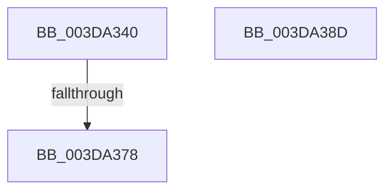

# KeFlushIoBuffers

- RVA: `0x003DA340`–`0x003DA38E` (길이 `78` bytes)
- VA: `0x00000001403DA340`
- 실행 섹션: `.text`
- PDB 이름 있음: `예`; PDB Function 태그: `예`
- unwind 정보 RVA: `0x00093E60`
- 디코드: `25`개 명령, `78/78` bytes 표시
- 미해석 바이트: `0` (있으면 어셈블리에 `.byte`로 보존)

> 이 문서는 커널 이미지의 기계어와 PDB 기호를 분석해 생성했습니다. 4번과 5번은 함수 원형과 자료형을 바이너리 사용 방식에서 추정한 C 해석이며 원본 소스 복구 결과는 아닙니다.

## 1. Dependencies

- 직접 호출 지점: **1**; 고유 호출 대상: **1**
- 직접 호출자로 확인된 함수: **7**
- RIP 상대 이미지 참조: **2**

### Outgoing calls
- `0x003DA380` → [_security_check_cookie](../6A/_security_check_cookie_function_006AC640.md) (function, `0x006AC640`)

### Direct callers
- [HalpDmaFlushBuffer](HalpDmaFlushBuffer_function_003DC1DC.md) at `0x003DC2D5`
- [HalFlushDmaBuffer](../45/HalFlushDmaBuffer_function_00458580.md) at `0x004585C4`
- [HalpDmaFlushBufferWithEmergencyResources](../4D/HalpDmaFlushBufferWithEmergencyResources_function_004D8024.md) at `0x004D812A`
- [HalpDmaSyncMapBuffersWithEmergencyResources](../4D/HalpDmaSyncMapBuffersWithEmergencyResources_function_004DE714.md) at `0x004DE922`
- [HalpDmaFlushDriverMdl](../53/HalpDmaFlushDriverMdl_function_0053E178.md) at `0x0053E196`
- [HalpFlushMapBuffers](../55/HalpFlushMapBuffers_function_00551358.md) at `0x005514E1`
- [HalpFlushMapBuffers](../55/HalpFlushMapBuffers_function_00551358.md) at `0x005515E2`
- [ViMapDoubleBuffer](../../pagevrfy/B9/ViMapDoubleBuffer_function_00B99640.md) at `0x00B999FA`

### Static image references
- `0x003DA348` → RVA `0x00E0A740` (`.data`; read)
- `0x003DA357` → RVA `0x00E0B0E4` (`.data`; read)

## 2. Other-region calls and transfers

- 다른 실행 섹션으로 향하는 call: **0**
- call이 아닌 외부 분기/꼬리 이동: **1**
  - `0x003DA376` → [sub_003DA38E](Unknown_function_003DA38E.md) (`tail-transfer`)

## 3. Assembly (complete function range)

```asm
003DA340  40 53                           push rbx
003DA342  56                              push rsi
003DA343  57                              push rdi
003DA344  48 83 EC 70                     sub rsp, 0x70
003DA348  48 8B 05 F1 03 A3 00            mov rax, qword ptr [rip + 0xa303f1]
003DA34F  48 33 C4                        xor rax, rsp
003DA352  48 89 44 24 50                  mov qword ptr [rsp + 0x50], rax
003DA357  8B 05 87 0D A3 00               mov eax, dword ptr [rip + 0xa30d87]
003DA35D  0F 57 C0                        xorps xmm0, xmm0
003DA360  41 0F B6 F8                     movzx edi, r8b
003DA364  0F B6 F2                        movzx esi, dl
003DA367  48 8B D9                        mov rbx, rcx
003DA36A  0F 11 44 24 30                  movups xmmword ptr [rsp + 0x30], xmm0
003DA36F  0F 11 44 24 40                  movups xmmword ptr [rsp + 0x40], xmm0
003DA374  85 C0                           test eax, eax
003DA376  74 16                           je 0x1403da38e
003DA378  48 8B 4C 24 50                  mov rcx, qword ptr [rsp + 0x50]
003DA37D  48 33 CC                        xor rcx, rsp
003DA380  E8 BB 22 2D 00                  call 0x1406ac640
003DA385  48 83 C4 70                     add rsp, 0x70
003DA389  5F                              pop rdi
003DA38A  5E                              pop rsi
003DA38B  5B                              pop rbx
003DA38C  C3                              ret
003DA38D  CC                              int3
```

## 4. C-style interpretation (structured pseudocode)

```c
__int64 __fastcall KeFlushIoBuffers(__int64 a1, unsigned __int8 a2, unsigned __int8 a3)
{
    __int64 result;
    __int64 v_rsp;
    unsigned __int64 v_stack_m38;
    unsigned __int64 v_stack_m48;
    unsigned __int64 v_stack_m58;

    v_rsp = (v_rsp) - (112);
    result = (*(unsigned __int64 *)(v_rip + 10683377)) ^ (v_rsp);
    v_stack_m38 = result;
    v_stack_m58 = v_xmm0;
    v_stack_m48 = v_xmm0;
    a1 = (v_stack_m38) ^ (v_rsp);
    result = _security_check_cookie(a1, a2, a3, a4);
    v_rsp = (v_rsp) + (112);
    return result;
}
```

## 5. (Beta) C Style

```c
int64_t KeFlushIoBuffers(int64_t Arg1, uint8_t Arg2, uint8_t Arg3)
{
    int64_t result;
    int64_t local_rsp;
    uint64_t v_stack_m38;
    uint64_t v_stack_m48;
    uint64_t v_stack_m58;

    local_rsp = (local_rsp) - (112);
    result = (*(uint64_t *)(v_rip + 0xA303F1)) ^ (local_rsp);
    v_stack_m38 = result;
    v_stack_m58 = v_xmm0;
    v_stack_m48 = v_xmm0;
    Arg1 = (v_stack_m38) ^ (local_rsp);
    result = _security_check_cookie(Arg1, Arg2, Arg3, a4);
    local_rsp = (local_rsp) + (112);
    return result;
}
```

## 6. Execution-region graph

[열기: 2D/3D 그래프와 함수 탐색 컨트롤 패널](../../../control-panel.html?section=text&rva=0x003DA340&view=graph)

- 2D 그래프는 위에서 아래로 흐르고, 3D 그래프는 빈 공간을 드래그해 회전합니다. Shift+드래그는 이동, 휠은 확대·축소, 함수 노드 선택은 대상 보고서 이동입니다.

### Static fallback


