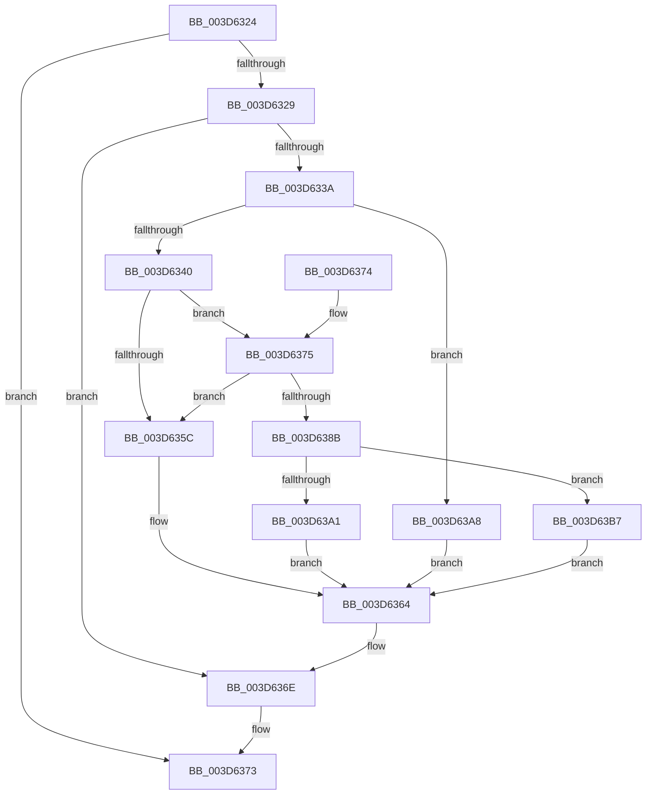

# KeFreeXStateContext

- RVA: `0x003D6324`–`0x003D63BE` (길이 `154` bytes)
- VA: `0x00000001403D6324`
- 실행 섹션: `.text`
- PDB 이름 있음: `예`; PDB Function 태그: `아니요`
- unwind 정보 RVA: `0x00093B24`
- 디코드: `45`개 명령, `154/154` bytes 표시
- 미해석 바이트: `0` (있으면 어셈블리에 `.byte`로 보존)

> 이 문서는 커널 이미지의 기계어와 PDB 기호를 분석해 생성했습니다. 4번과 5번은 함수 원형과 자료형을 바이너리 사용 방식에서 추정한 C 해석이며 원본 소스 복구 결과는 아닙니다.

## 1. Dependencies

- 직접 호출 지점: **4**; 고유 호출 대상: **4**
- 직접 호출자로 확인된 함수: **2**
- RIP 상대 이미지 참조: **1**

### Outgoing calls
- `0x003D635F` → [ExpInterlockedPushEntrySList](../6B/ExpInterlockedPushEntrySList_function_006BA5B0.md) (function, `0x006BA5B0`)
- `0x003D63A1` → [ExFreePool](../../poolcode/B8/ExFreePool_function_00B82850.md) (function, `0x00B82850`)
- `0x003D63B0` → [ExFreePoolWithTag](../../poolcode/B8/ExFreePoolWithTag_function_00B82870.md) (function, `0x00B82870`)
- `0x003D63B7` → [guard_dispatch_icall](../6B/guard_dispatch_icall_function_006BAAD0.md) (function, `0x006BAAD0`)

### Direct callers
- [KeRestoreExtendedAndSupervisorState](KeRestoreExtendedAndSupervisorState_function_003D60D0.md) at `0x003D619C`
- [VfCtxInit](../../pagevrfy/BB/VfCtxInit_function_00BB1D74.md) at `0x00BB1DF6`

### Static image references
- `0x003D6392` → RVA `0x00B82850` (`ExFreePool`; read)

## 2. Other-region calls and transfers

- 다른 실행 섹션으로 향하는 call: **2**
  - `0x003D63A1` → [ExFreePool](../../poolcode/B8/ExFreePool_function_00B82850.md) (`.text` → `POOLCODE`)
  - `0x003D63B0` → [ExFreePoolWithTag](../../poolcode/B8/ExFreePoolWithTag_function_00B82870.md) (`.text` → `POOLCODE`)
- 별도 외부 분기/꼬리 이동을 확인하지 못했습니다.

## 3. Assembly (complete function range)

```asm
003D6324  48 85 C9                        test rcx, rcx
003D6327  74 4A                           je 0x1403d6373
003D6329  53                              push rbx
003D632A  48 83 EC 20                     sub rsp, 0x20
003D632E  4C 8B 41 18                     mov r8, qword ptr [rcx + 0x18]
003D6332  48 8B D9                        mov rbx, rcx
003D6335  4D 85 C0                        test r8, r8
003D6338  74 34                           je 0x1403d636e
003D633A  F6 41 0C 01                     test byte ptr [rcx + 0xc], 1
003D633E  74 68                           je 0x1403d63a8
003D6340  65 48 8B 14 25 20 00 00 00      mov rdx, qword ptr gs:[0x20]
003D6349  48 8B 8A 90 08 00 00            mov rcx, qword ptr [rdx + 0x890]
003D6350  FF 41 1C                        inc dword ptr [rcx + 0x1c]
003D6353  0F B7 41 10                     movzx eax, word ptr [rcx + 0x10]
003D6357  66 39 01                        cmp word ptr [rcx], ax
003D635A  73 19                           jae 0x1403d6375
003D635C  49 8B D0                        mov rdx, r8
003D635F  E8 4C 42 2E 00                  call 0x1406ba5b0
003D6364  0F 57 C0                        xorps xmm0, xmm0
003D6367  0F 11 03                        movups xmmword ptr [rbx], xmm0
003D636A  0F 11 43 10                     movups xmmword ptr [rbx + 0x10], xmm0
003D636E  48 83 C4 20                     add rsp, 0x20
003D6372  5B                              pop rbx
003D6373  C3                              ret
003D6374  CC                              int3
003D6375  FF 41 20                        inc dword ptr [rcx + 0x20]
003D6378  48 8B 8A 98 08 00 00            mov rcx, qword ptr [rdx + 0x898]
003D637F  FF 41 1C                        inc dword ptr [rcx + 0x1c]
003D6382  0F B7 41 10                     movzx eax, word ptr [rcx + 0x10]
003D6386  66 39 01                        cmp word ptr [rcx], ax
003D6389  72 D1                           jb 0x1403d635c
003D638B  FF 41 20                        inc dword ptr [rcx + 0x20]
003D638E  48 8B 41 38                     mov rax, qword ptr [rcx + 0x38]
003D6392  48 8D 0D B7 C4 7A 00            lea rcx, [rip + 0x7ac4b7]
003D6399  48 3B C1                        cmp rax, rcx
003D639C  49 8B C8                        mov rcx, r8
003D639F  75 16                           jne 0x1403d63b7
003D63A1  E8 AA C4 7A 00                  call 0x140b82850
003D63A6  EB BC                           jmp 0x1403d6364
003D63A8  BA 58 53 61 76                  mov edx, 0x76615358
003D63AD  49 8B C8                        mov rcx, r8
003D63B0  E8 BB C4 7A 00                  call 0x140b82870
003D63B5  EB AD                           jmp 0x1403d6364
003D63B7  E8 14 47 2E 00                  call 0x1406baad0
003D63BC  EB A6                           jmp 0x1403d6364
```

## 4. C-style interpretation (structured pseudocode)

```c
__int64 __fastcall KeFreeXStateContext(__int64 a1)
{
    __int64 result;
    __int64 v_rsp;

    if (a1 == 0) goto loc_003D6373;
    v_rsp = (v_rsp) - (32);
    if (*(unsigned __int64 *)(a1 + 24) == 0) goto loc_003D636E;
    if (((*(unsigned __int8 *)(a1 + 12)) & (1)) == 0) goto loc_003D63A8;
    if ((*(unsigned __int16 *)(*(unsigned __int64 *)(*(unsigned __int64 *)(gs_base + (0 + 32)) + 2192))) >= ((unsigned __int16)(*(unsigned __int16 *)(*(unsigned __int64 *)(*(unsigned __int64 *)(gs_base + (0 + 32)) + 2192) + 16)))) goto loc_003D6375;
loc_003D635C:
    result = ExpInterlockedPushEntrySList(*(unsigned __int64 *)(*(unsigned __int64 *)(gs_base + (0 + 32)) + 2192), *(unsigned __int64 *)(a1 + 24), *(unsigned __int64 *)(a1 + 24), a4);
loc_003D6364:
    *(unsigned __int64 *)(a1) = v_xmm0;
    *(unsigned __int64 *)(a1 + 16) = v_xmm0;
loc_003D636E:
    v_rsp = (v_rsp) + (32);
loc_003D6373:
    return result;
loc_003D6375:
    if ((*(unsigned __int16 *)(*(unsigned __int64 *)(*(unsigned __int64 *)(a1 + 24) + 2200))) < ((unsigned __int16)(*(unsigned __int16 *)(*(unsigned __int64 *)(*(unsigned __int64 *)(a1 + 24) + 2200) + 16)))) goto loc_003D635C;
    if ((*(unsigned __int64 *)(*(unsigned __int64 *)(*(unsigned __int64 *)(a1 + 24) + 2200) + 56)) != (v_rip + 8045751)) goto loc_003D63B7;
    result = ExFreePool(*(unsigned __int64 *)(a1 + 24), *(unsigned __int64 *)(a1 + 24), *(unsigned __int64 *)(a1 + 24), a4);
    goto loc_003D6364;
loc_003D63A8:
    result = ExFreePoolWithTag(*(unsigned __int64 *)(a1 + 24), (unsigned int)(0x76615358ULL), *(unsigned __int64 *)(a1 + 24), a4);
    goto loc_003D6364;
loc_003D63B7:
    result = guard_dispatch_icall(*(unsigned __int64 *)(a1 + 24), (unsigned int)(0x76615358ULL), *(unsigned __int64 *)(a1 + 24), a4);
    goto loc_003D6364;
}
```

## 5. (Beta) C Style

```c
int64_t KeFreeXStateContext(int64_t Arg1)
{
    int64_t result;
    int64_t local_rsp;

    if (Arg1 == 0) goto loc_003D6373;
    local_rsp = (local_rsp) - (32);
    if (*(uint64_t *)(Arg1 + 0x18) == 0) goto loc_003D636E;
    if (((*(uint8_t *)(Arg1 + 0xC)) & (1)) == 0) goto loc_003D63A8;
    if ((*(uint16_t *)(*(uint64_t *)(*(uint64_t *)(gs_base + (0 + 0x20)) + 0x890))) >= ((uint16_t)(*(uint16_t *)(*(uint64_t *)(*(uint64_t *)(gs_base + (0 + 0x20)) + 0x890) + 0x10)))) goto loc_003D6375;
loc_003D635C:
    result = ExpInterlockedPushEntrySList(*(uint64_t *)(*(uint64_t *)(gs_base + (0 + 0x20)) + 0x890), *(uint64_t *)(Arg1 + 0x18), *(uint64_t *)(Arg1 + 0x18), a4);
loc_003D6364:
    *(uint64_t *)(Arg1) = v_xmm0;
    *(uint64_t *)(Arg1 + 0x10) = v_xmm0;
loc_003D636E:
    local_rsp = (local_rsp) + (32);
loc_003D6373:
    return result;
loc_003D6375:
    if ((*(uint16_t *)(*(uint64_t *)(*(uint64_t *)(Arg1 + 0x18) + 0x898))) < ((uint16_t)(*(uint16_t *)(*(uint64_t *)(*(uint64_t *)(Arg1 + 0x18) + 0x898) + 0x10)))) goto loc_003D635C;
    if ((*(uint64_t *)(*(uint64_t *)(*(uint64_t *)(Arg1 + 0x18) + 0x898) + 0x38)) != (v_rip + 8045751)) goto loc_003D63B7;
    result = ExFreePool(*(uint64_t *)(Arg1 + 0x18), *(uint64_t *)(Arg1 + 0x18), *(uint64_t *)(Arg1 + 0x18), a4);
    goto loc_003D6364;
loc_003D63A8:
    result = ExFreePoolWithTag(*(uint64_t *)(Arg1 + 0x18), (uint32_t)(0x76615358ULL), *(uint64_t *)(Arg1 + 0x18), a4);
    goto loc_003D6364;
loc_003D63B7:
    result = guard_dispatch_icall(*(uint64_t *)(Arg1 + 0x18), (uint32_t)(0x76615358ULL), *(uint64_t *)(Arg1 + 0x18), a4);
    goto loc_003D6364;
}
```

## 6. Execution-region graph

[열기: 2D/3D 그래프와 함수 탐색 컨트롤 패널](../../../control-panel.html?section=text&rva=0x003D6324&view=graph)

- 2D 그래프는 위에서 아래로 흐르고, 3D 그래프는 빈 공간을 드래그해 회전합니다. Shift+드래그는 이동, 휠은 확대·축소, 함수 노드 선택은 대상 보고서 이동입니다.

### Static fallback


