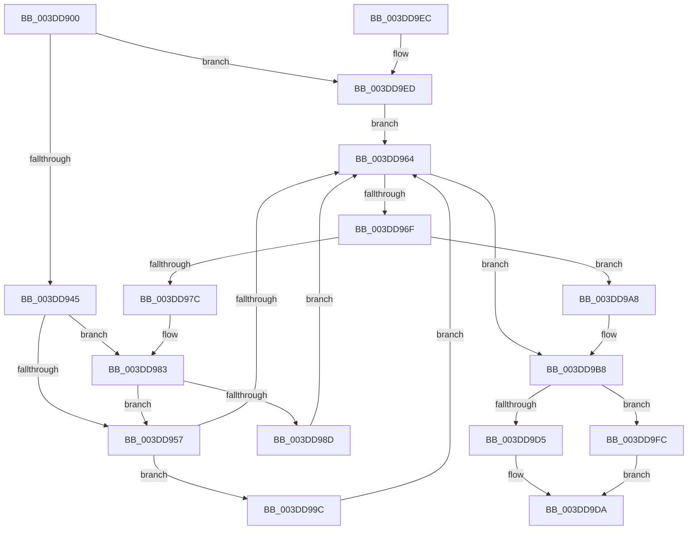

# KeInsertDeviceQueue

- RVA: `0x003DD900`–`0x003DDA03` (길이 `259` bytes)
- VA: `0x00000001403DD900`
- 실행 섹션: `.text`
- PDB 이름 있음: `예`; PDB Function 태그: `아니요`
- unwind 정보 RVA: `0x00094400`
- 디코드: `70`개 명령, `259/259` bytes 표시
- 미해석 바이트: `0` (있으면 어셈블리에 `.byte`로 보존)

> 이 문서는 커널 이미지의 기계어와 PDB 기호를 분석해 생성했습니다. 4번과 5번은 함수 원형과 자료형을 바이너리 사용 방식에서 추정한 C 해석이며 원본 소스 복구 결과는 아닙니다.

## 1. Dependencies

- 직접 호출 지점: **5**; 고유 호출 대상: **5**
- 직접 호출자로 확인된 함수: **5**
- RIP 상대 이미지 참조: **2**

### Outgoing calls
- `0x003DD995` → [KiAcquireQueuedSpinLockInstrumented](../27/KiAcquireQueuedSpinLockInstrumented_function_00275850.md) (function, `0x00275850`)
- `0x003DD9A1` → [KxWaitForLockOwnerShip](../25/KxWaitForLockOwnerShip_function_00257EB0.md) (function, `0x00257EB0`)
- `0x003DD9D5` → [KeReleaseInStackQueuedSpinLockFromDpcLevel](../21/KeReleaseInStackQueuedSpinLockFromDpcLevel_function_002171B0.md) (function, `0x002171B0`)
- `0x003DD9F2` → [KeAcquireInStackQueuedSpinLock](../27/KeAcquireInStackQueuedSpinLock_function_002757A0.md) (function, `0x002757A0`)
- `0x003DD9FC` → [KeReleaseInStackQueuedSpinLock](../34/KeReleaseInStackQueuedSpinLock_function_00342CE0.md) (function, `0x00342CE0`)

### Direct callers
- [HalAllocateAdapterChannelV2](HalAllocateAdapterChannelV2_function_003DC714.md) at `0x003DC76D`
- [sub_003DD362](Unknown_function_003DD362.md) at `0x003DD46F`
- [IoStartPacket](../45/IoStartPacket_function_0045FC30.md) at `0x0045FD5B`
- [IoAllocateController](../4C/IoAllocateController_function_004C9C50.md) at `0x004C9C80`
- [DifKeInsertDeviceQueueWrapper](../63/DifKeInsertDeviceQueueWrapper_function_00630280.md) at `0x00630354`

### Static image references
- `0x003DD94E` → RVA `0x00FC6B06` (`ALMOSTRO`; read)
- `0x003DD983` → RVA `0x00F0DE58` (`.data`; read)

## 2. Other-region calls and transfers

- 다른 실행 섹션으로 향하는 call: **0**
- 별도 외부 분기/꼬리 이동을 확인하지 못했습니다.

## 3. Assembly (complete function range)

```asm
003DD900  4C 8B DC                        mov r11, rsp
003DD903  49 89 5B 08                     mov qword ptr [r11 + 8], rbx
003DD907  49 89 73 10                     mov qword ptr [r11 + 0x10], rsi
003DD90B  57                              push rdi
003DD90C  48 83 EC 40                     sub rsp, 0x40
003DD910  33 C0                           xor eax, eax
003DD912  0F 57 C0                        xorps xmm0, xmm0
003DD915  0F 11 44 24 20                  movups xmmword ptr [rsp + 0x20], xmm0
003DD91A  49 89 43 E8                     mov qword ptr [r11 - 0x18], rax
003DD91E  48 8B F1                        mov rsi, rcx
003DD921  65 48 8B 04 25 20 00 00 00      mov rax, qword ptr gs:[0x20]
003DD92A  33 DB                           xor ebx, ebx
003DD92C  48 83 C1 18                     add rcx, 0x18
003DD930  48 8B FA                        mov rdi, rdx
003DD933  44 8B 80 BC 38 00 00            mov r8d, dword ptr [rax + 0x38bc]
003DD93A  41 0F BA E0 10                  bt r8d, 0x10
003DD93F  0F 82 A8 00 00 00               jb 0x1403dd9ed
003DD945  49 89 4B E0                     mov qword ptr [r11 - 0x20], rcx
003DD949  49 89 5B D8                     mov qword ptr [r11 - 0x28], rbx
003DD94D  90                              nop
003DD94E  F6 05 B1 91 BE 00 21            test byte ptr [rip + 0xbe91b1], 0x21
003DD955  75 2C                           jne 0x1403dd983
003DD957  48 8D 54 24 20                  lea rdx, [rsp + 0x20]
003DD95C  48 87 11                        xchg qword ptr [rcx], rdx
003DD95F  48 85 D2                        test rdx, rdx
003DD962  75 38                           jne 0x1403dd99c
003DD964  8A 46 20                        mov al, byte ptr [rsi + 0x20]
003DD967  C6 46 20 01                     mov byte ptr [rsi + 0x20], 1
003DD96B  3C 01                           cmp al, 1
003DD96D  75 49                           jne 0x1403dd9b8
003DD96F  48 8D 46 08                     lea rax, [rsi + 8]
003DD973  48 8B 48 08                     mov rcx, qword ptr [rax + 8]
003DD977  48 39 01                        cmp qword ptr [rcx], rax
003DD97A  74 2C                           je 0x1403dd9a8
003DD97C  B9 03 00 00 00                  mov ecx, 3
003DD981  CD 29                           int 0x29
003DD983  8B 05 CF 04 B3 00               mov eax, dword ptr [rip + 0xb304cf]
003DD989  85 C0                           test eax, eax
003DD98B  75 CA                           jne 0x1403dd957
003DD98D  48 8B D1                        mov rdx, rcx
003DD990  48 8D 4C 24 20                  lea rcx, [rsp + 0x20]
003DD995  E8 B6 7E E9 FF                  call 0x140275850
003DD99A  EB C8                           jmp 0x1403dd964
003DD99C  48 8D 4C 24 20                  lea rcx, [rsp + 0x20]
003DD9A1  E8 0A A5 E7 FF                  call 0x140257eb0
003DD9A6  EB BC                           jmp 0x1403dd964
003DD9A8  48 89 07                        mov qword ptr [rdi], rax
003DD9AB  B3 01                           mov bl, 1
003DD9AD  48 89 4F 08                     mov qword ptr [rdi + 8], rcx
003DD9B1  48 89 39                        mov qword ptr [rcx], rdi
003DD9B4  48 89 78 08                     mov qword ptr [rax + 8], rdi
003DD9B8  88 5F 14                        mov byte ptr [rdi + 0x14], bl
003DD9BB  65 48 8B 04 25 20 00 00 00      mov rax, qword ptr gs:[0x20]
003DD9C4  8B 88 BC 38 00 00               mov ecx, dword ptr [rax + 0x38bc]
003DD9CA  0F BA E1 10                     bt ecx, 0x10
003DD9CE  48 8D 4C 24 20                  lea rcx, [rsp + 0x20]
003DD9D3  72 27                           jb 0x1403dd9fc
003DD9D5  E8 D6 97 E3 FF                  call 0x1402171b0
003DD9DA  48 8B 74 24 58                  mov rsi, qword ptr [rsp + 0x58]
003DD9DF  8A C3                           mov al, bl
003DD9E1  48 8B 5C 24 50                  mov rbx, qword ptr [rsp + 0x50]
003DD9E6  48 83 C4 40                     add rsp, 0x40
003DD9EA  5F                              pop rdi
003DD9EB  C3                              ret
003DD9EC  CC                              int3
003DD9ED  48 8D 54 24 20                  lea rdx, [rsp + 0x20]
003DD9F2  E8 A9 7D E9 FF                  call 0x1402757a0
003DD9F7  E9 68 FF FF FF                  jmp 0x1403dd964
003DD9FC  E8 DF 52 F6 FF                  call 0x140342ce0
003DDA01  EB D7                           jmp 0x1403dd9da
```

## 4. C-style interpretation (structured pseudocode)

```c
__int64 __fastcall KeInsertDeviceQueue(__int64 a1, __int64 a2)
{
    __int64 result;
    __int64 v_rbx;
    __int64 v_rsp;
    unsigned __int64 v_stack_m28;
    unsigned __int64 v_stack_p10;
    unsigned __int64 v_stack_p20;
    unsigned __int64 v_stack_p8;

    *(unsigned __int64 *)(v_rsp + 8) = v_rbx;
    *(unsigned __int64 *)(v_rsp + 16) = v_rsi;
    v_rsp = (v_rsp) - (64);
    result = 0;
    v_stack_m28 = v_xmm0;
    *(unsigned __int64 *)(v_rsp - 24) = 0;
    v_rbx = 0;
    a1 = (a1) + (24);
    if (condition_is_below) goto loc_003DD9ED;
    *(unsigned __int64 *)(v_rsp - 32) = a1;
    *(unsigned __int64 *)(v_rsp - 40) = 0;
    if (((*(unsigned __int8 *)(v_rip + 12489137)) & (33)) != 0) goto loc_003DD983;
loc_003DD957:
    if (v_stack_m28 != 0) goto loc_003DD99C;
loc_003DD964:
    *(unsigned __int8 *)(a1 + 32) = 1;
    if (((unsigned __int8)(*(unsigned __int8 *)(a1 + 32))) != 1) goto loc_003DD9B8;
    if ((*(unsigned __int64 *)(*(unsigned __int64 *)(a1 + 8 + 8))) == (a1 + 8)) goto loc_003DD9A8;
loc_003DD983:
    if ((unsigned int)((unsigned int)(*(unsigned int *)(v_rip + 11732175))) != 0) goto loc_003DD957;
    result = KiAcquireQueuedSpinLockInstrumented(v_stack_m28, 3, (unsigned int)(*(unsigned int *)(*(unsigned __int64 *)(gs_base + (0 + 32)) + 14524)), a4);
    goto loc_003DD964;
loc_003DD99C:
    result = KxWaitForLockOwnerShip(v_stack_m28, 3, (unsigned int)(*(unsigned int *)(*(unsigned __int64 *)(gs_base + (0 + 32)) + 14524)), a4);
    goto loc_003DD964;
loc_003DD9A8:
    *(unsigned __int64 *)(a2) = result;
    *(unsigned __int64 *)(a2 + 8) = v_stack_m28;
    *(unsigned __int64 *)(v_stack_m28) = a2;
    *(unsigned __int64 *)(result + 8) = a2;
loc_003DD9B8:
    *(unsigned __int8 *)(a2 + 20) = 1;
    if (condition_is_below) goto loc_003DD9FC;
    result = KeReleaseInStackQueuedSpinLockFromDpcLevel(v_stack_m28, 3, (unsigned int)(*(unsigned int *)(*(unsigned __int64 *)(gs_base + (0 + 32)) + 14524)), a4);
loc_003DD9DA:
    v_rsp = (v_rsp) + (64);
    return 1;
loc_003DD9ED:
    result = KeAcquireInStackQueuedSpinLock(v_stack_m28, v_stack_p20, (unsigned int)(*(unsigned int *)(*(unsigned __int64 *)(gs_base + (0 + 32)) + 14524)), a4);
    goto loc_003DD964;
loc_003DD9FC:
    result = KeReleaseInStackQueuedSpinLock(v_stack_m28, v_stack_p20, (unsigned int)(*(unsigned int *)(*(unsigned __int64 *)(gs_base + (0 + 32)) + 14524)), a4);
    goto loc_003DD9DA;
}
```

## 5. (Beta) C Style

```c
int64_t KeInsertDeviceQueue(void *Arg1, void *Arg2)
{
    uint8_t *arg1 = (uint8_t *)Arg1;
    uint8_t *arg2 = (uint8_t *)Arg2;

    int64_t result;
    int64_t local_rbx;
    int64_t local_rsp;
    uint64_t v_stack_m28;
    uint64_t v_stack_p10;
    uint64_t v_stack_p20;
    uint64_t v_stack_p8;

    *(uint64_t *)(local_rsp + 0x8) = local_rbx;
    *(uint64_t *)(local_rsp + 0x10) = local_rsi;
    local_rsp = (local_rsp) - (64);
    result = 0;
    v_stack_m28 = v_xmm0;
    *(uint64_t *)(local_rsp - 0x18) = 0;
    local_rbx = 0;
    Arg1 = (Arg1) + (24);
    if (condition_is_below) goto loc_003DD9ED;
    *(void **)(local_rsp - 0x20) = Arg1;
    *(uint64_t *)(local_rsp - 0x28) = 0;
    if (((*(uint8_t *)(v_rip + 0xBE91B1)) & (33)) != 0) goto loc_003DD983;
loc_003DD957:
    if (v_stack_m28 != 0) goto loc_003DD99C;
loc_003DD964:
    *(uint8_t *)(arg1 + 0x20) = 1;
    if (((uint8_t)(*(uint8_t *)(arg1 + 0x20))) != 1) goto loc_003DD9B8;
    if ((*(uint64_t *)(*(uint64_t *)(arg1 + 0x8 + 0x8))) == (Arg1 + 8)) goto loc_003DD9A8;
loc_003DD983:
    if ((uint32_t)((uint32_t)(*(uint32_t *)(v_rip + 0xB304CF))) != 0) goto loc_003DD957;
    result = KiAcquireQueuedSpinLockInstrumented(v_stack_m28, 3, (uint32_t)(*(uint32_t *)(*(uint64_t *)(gs_base + (0 + 0x20)) + 0x38BC)), a4);
    goto loc_003DD964;
loc_003DD99C:
    result = KxWaitForLockOwnerShip(v_stack_m28, 3, (uint32_t)(*(uint32_t *)(*(uint64_t *)(gs_base + (0 + 0x20)) + 0x38BC)), a4);
    goto loc_003DD964;
loc_003DD9A8:
    *(uint64_t *)(arg2) = result;
    *(uint64_t *)(arg2 + 0x8) = v_stack_m28;
    *(void **)(v_stack_m28) = Arg2;
    *(void **)(result + 0x8) = Arg2;
loc_003DD9B8:
    *(uint8_t *)(arg2 + 0x14) = 1;
    if (condition_is_below) goto loc_003DD9FC;
    result = KeReleaseInStackQueuedSpinLockFromDpcLevel(v_stack_m28, 3, (uint32_t)(*(uint32_t *)(*(uint64_t *)(gs_base + (0 + 0x20)) + 0x38BC)), a4);
loc_003DD9DA:
    local_rsp = (local_rsp) + (64);
    return 1;
loc_003DD9ED:
    result = KeAcquireInStackQueuedSpinLock(v_stack_m28, v_stack_p20, (uint32_t)(*(uint32_t *)(*(uint64_t *)(gs_base + (0 + 0x20)) + 0x38BC)), a4);
    goto loc_003DD964;
loc_003DD9FC:
    result = KeReleaseInStackQueuedSpinLock(v_stack_m28, v_stack_p20, (uint32_t)(*(uint32_t *)(*(uint64_t *)(gs_base + (0 + 0x20)) + 0x38BC)), a4);
    goto loc_003DD9DA;
}
```

### 관측된 메모리 오프셋

구조체 형식이 확인되지 않은 접근은 인자 기준의 오프셋으로만 기록했습니다.

| 기준 인자 | 오프셋 표현 | 폭 (bit) | 접근 |
|---|---:|---:|---|
| `Arg1` | `+ 0x8` | `64` | `R` |
| `Arg1` | `+ 0x8` | `64` | `W` |
| `Arg1` | `+ 0x20` | `8` | `R` |
| `Arg1` | `+ 0x20` | `8` | `W` |
| `Arg2` | `+ 0x0` | `64` | `W` |
| `Arg2` | `+ 0x8` | `64` | `W` |
| `Arg2` | `+ 0x14` | `8` | `W` |

## 6. Execution-region graph

[열기: 2D/3D 그래프와 함수 탐색 컨트롤 패널](../../../control-panel.html?section=text&rva=0x003DD900&view=graph)

- 2D 그래프는 위에서 아래로 흐르고, 3D 그래프는 빈 공간을 드래그해 회전합니다. Shift+드래그는 이동, 휠은 확대·축소, 함수 노드 선택은 대상 보고서 이동입니다.

### Static fallback


