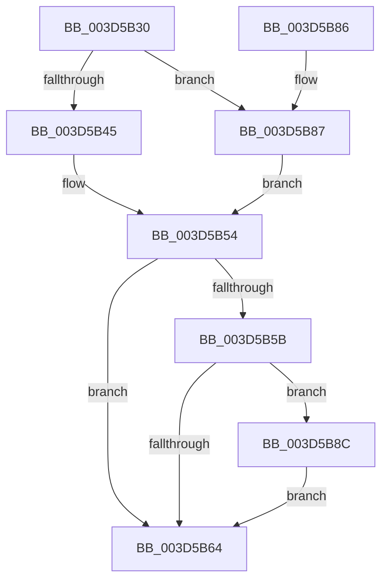

# KeKernelShadowStackRestoreContext

- RVA: `0x003D5B30`–`0x003D5B93` (길이 `99` bytes)
- VA: `0x00000001403D5B30`
- 실행 섹션: `.text`
- PDB 이름 있음: `예`; PDB Function 태그: `아니요`
- unwind 정보 RVA: `0x00093A44`
- 디코드: `27`개 명령, `99/99` bytes 표시
- 미해석 바이트: `0` (있으면 어셈블리에 `.byte`로 보존)

> 이 문서는 커널 이미지의 기계어와 PDB 기호를 분석해 생성했습니다. 4번과 5번은 함수 원형과 자료형을 바이너리 사용 방식에서 추정한 C 해석이며 원본 소스 복구 결과는 아닙니다.

## 1. Dependencies

- 직접 호출 지점: **1**; 고유 호출 대상: **1**
- 직접 호출자로 확인된 함수: **2**
- RIP 상대 이미지 참조: **0**

### Outgoing calls
- `0x003D5B7C` → [VslKernelShadowStackAssist](VslKernelShadowStackAssist_function_003D5BA0.md) (function, `0x003D5BA0`)

### Direct callers
- [RtlRestoreContext](../4F/RtlRestoreContext_function_004FE870.md) at `0x004FEA86`
- [RcConsolidateFrames](../4F/RcConsolidateFrames_function_004FEBC0.md) at `0x004FEC99`

### Static image references
- 디코드된 RIP-relative 메모리 참조가 없습니다.

## 2. Other-region calls and transfers

- 다른 실행 섹션으로 향하는 call: **0**
- 별도 외부 분기/꼬리 이동을 확인하지 못했습니다.

## 3. Assembly (complete function range)

```asm
003D5B30  48 83 EC 38                     sub rsp, 0x38
003D5B34  8B 41 30                        mov eax, dword ptr [rcx + 0x30]
003D5B37  41 B9 80 00 10 00               mov r9d, 0x100080
003D5B3D  41 23 C1                        and eax, r9d
003D5B40  41 3B C1                        cmp eax, r9d
003D5B43  75 42                           jne 0x1403d5b87
003D5B45  48 63 81 E8 04 00 00            movsxd rax, dword ptr [rcx + 0x4e8]
003D5B4C  4C 8B 8C 08 D0 04 00 00         mov r9, qword ptr [rax + rcx + 0x4d0]
003D5B54  33 C0                           xor eax, eax
003D5B56  4D 85 C0                        test r8, r8
003D5B59  74 09                           je 0x1403d5b64
003D5B5B  41 81 38 26 00 00 80            cmp dword ptr [r8], 0x80000026
003D5B62  74 28                           je 0x1403d5b8c
003D5B64  89 44 24 28                     mov dword ptr [rsp + 0x28], eax
003D5B68  4C 8B C2                        mov r8, rdx
003D5B6B  48 8B 81 F8 00 00 00            mov rax, qword ptr [rcx + 0xf8]
003D5B72  33 D2                           xor edx, edx
003D5B74  48 89 44 24 20                  mov qword ptr [rsp + 0x20], rax
003D5B79  8D 4A 01                        lea ecx, [rdx + 1]
003D5B7C  E8 1F 00 00 00                  call 0x1403d5ba0
003D5B81  48 83 C4 38                     add rsp, 0x38
003D5B85  C3                              ret
003D5B86  CC                              int3
003D5B87  4C 8B CA                        mov r9, rdx
003D5B8A  EB C8                           jmp 0x1403d5b54
003D5B8C  B8 02 00 00 00                  mov eax, 2
003D5B91  EB D1                           jmp 0x1403d5b64
```

## 4. C-style interpretation (structured pseudocode)

```c
__int64 __fastcall KeKernelShadowStackRestoreContext(__int64 a1, __int64 a2, __int64 a3)
{
    __int64 result;
    __int64 v_rsp;
    unsigned int v_stack_m10;
    unsigned __int64 v_stack_m18;

    v_rsp = (v_rsp) - (56);
    result = (unsigned int)(((unsigned int)(*(unsigned int *)(a1 + 48))) & ((unsigned int)((unsigned int)(0x100080ULL))));
    if (((unsigned int)(result)) != ((unsigned int)((unsigned int)(0x100080ULL)))) goto loc_003D5B87;
loc_003D5B54:
    result = 0;
    if (a3 == 0) goto loc_003D5B64;
    if ((*(unsigned int *)(a3)) == 0x80000026ULL) goto loc_003D5B8C;
loc_003D5B64:
    v_stack_m10 = 0;
    a2 = 0;
    v_stack_m18 = *(unsigned __int64 *)(a1 + 248);
    result = VslKernelShadowStackAssist(a2 + 1, a2, a2, *(unsigned __int64 *)((int)(*(unsigned int *)(a1 + 1256)) + a1 * 1 + 1232));
    v_rsp = (v_rsp) + (56);
    return result;
loc_003D5B87:
    goto loc_003D5B54;
loc_003D5B8C:
    goto loc_003D5B64;
}
```

## 5. (Beta) C Style

```c
int64_t KeKernelShadowStackRestoreContext(void *Arg1, int64_t Arg2, int64_t Arg3)
{
    uint8_t *arg1 = (uint8_t *)Arg1;

    int64_t result;
    int64_t local_rsp;
    uint32_t v_stack_m10;
    uint64_t v_stack_m18;

    local_rsp = (local_rsp) - (56);
    result = (uint32_t)(((uint32_t)(*(uint32_t *)(arg1 + 0x30))) & ((uint32_t)((uint32_t)(0x100080ULL))));
    if (((uint32_t)(result)) != ((uint32_t)((uint32_t)(0x100080ULL)))) goto loc_003D5B87;
loc_003D5B54:
    result = 0;
    if (Arg3 == 0) goto loc_003D5B64;
    if ((*(uint32_t *)(Arg3)) == 0x80000026ULL) goto loc_003D5B8C;
loc_003D5B64:
    v_stack_m10 = 0;
    Arg2 = 0;
    v_stack_m18 = *(uint64_t *)(arg1 + 0xF8);
    result = VslKernelShadowStackAssist(Arg2 + 1, Arg2, Arg2, *(uint64_t *)((int32_t)(*(uint32_t *)(arg1 + 0x4E8)) + arg1 * 1 + 0x4D0));
    local_rsp = (local_rsp) + (56);
    return result;
loc_003D5B87:
    goto loc_003D5B54;
loc_003D5B8C:
    goto loc_003D5B64;
}
```

### 관측된 메모리 오프셋

구조체 형식이 확인되지 않은 접근은 인자 기준의 오프셋으로만 기록했습니다.

| 기준 인자 | 오프셋 표현 | 폭 (bit) | 접근 |
|---|---:|---:|---|
| `Arg1` | `+ 0x30` | `32` | `R` |
| `Arg1` | `+ 0xF8` | `64` | `R` |
| `Arg1` | `+ 0x4E8` | `32` | `R` |

## 6. Execution-region graph

[열기: 2D/3D 그래프와 함수 탐색 컨트롤 패널](../../../control-panel.html?section=text&rva=0x003D5B30&view=graph)

- 2D 그래프는 위에서 아래로 흐르고, 3D 그래프는 빈 공간을 드래그해 회전합니다. Shift+드래그는 이동, 휠은 확대·축소, 함수 노드 선택은 대상 보고서 이동입니다.

### Static fallback


