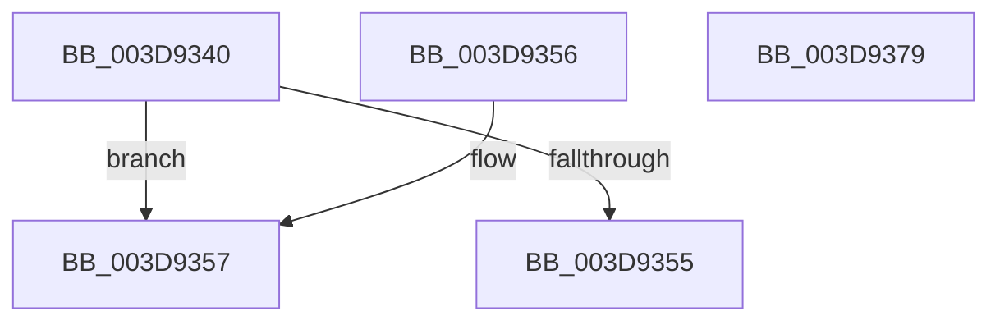

# KePopulateContinuationContext

- RVA: `0x003D9340`–`0x003D937A` (길이 `58` bytes)
- VA: `0x00000001403D9340`
- 실행 섹션: `.text`
- PDB 이름 있음: `예`; PDB Function 태그: `아니요`
- unwind 정보 RVA: `0x000DB714`
- 디코드: `17`개 명령, `58/58` bytes 표시
- 미해석 바이트: `0` (있으면 어셈블리에 `.byte`로 보존)

> 이 문서는 커널 이미지의 기계어와 PDB 기호를 분석해 생성했습니다. 4번과 5번은 함수 원형과 자료형을 바이너리 사용 방식에서 추정한 C 해석이며 원본 소스 복구 결과는 아닙니다.

## 1. Dependencies

- 직접 호출 지점: **0**; 고유 호출 대상: **0**
- 직접 호출자로 확인된 함수: **3**
- RIP 상대 이미지 참조: **0**

### Outgoing calls
- 직접 디코드된 call 명령이 없습니다.

### Direct callers
- [KiDispatchException](KiDispatchException_function_003D7650.md) at `0x003D7BBC`
- [KiInitializeUserApc](KiInitializeUserApc_function_003D8D38.md) at `0x003D8F55`
- [PspInitializeThunkContext](../../page/8D/PspInitializeThunkContext_function_008D5418.md) at `0x008D56AD`

### Static image references
- 디코드된 RIP-relative 메모리 참조가 없습니다.

## 2. Other-region calls and transfers

- 다른 실행 섹션으로 향하는 call: **0**
- 별도 외부 분기/꼬리 이동을 확인하지 못했습니다.

## 3. Assembly (complete function range)

```asm
003D9340  65 48 8B 04 25 88 01 00 00      mov rax, qword ptr gs:[0x188]
003D9349  4C 8B C1                        mov r8, rcx
003D934C  F7 40 74 00 00 10 00            test dword ptr [rax + 0x74], 0x100000
003D9353  75 02                           jne 0x1403d9357
003D9355  C3                              ret
003D9356  CC                              int3
003D9357  B9 A7 06 00 00                  mov ecx, 0x6a7
003D935C  0F 32                           rdmsr
003D935E  48 C1 E2 20                     shl rdx, 0x20
003D9362  48 0B C2                        or rax, rdx
003D9365  48 83 E8 08                     sub rax, 8
003D9369  48 8B D0                        mov rdx, rax
003D936C  48 C1 EA 20                     shr rdx, 0x20
003D9370  66 4C 0F 38 F5 00               wrussq qword ptr [rax], r8
003D9376  0F 30                           wrmsr
003D9378  C3                              ret
003D9379  CC                              int3
```

## 4. C-style interpretation (structured pseudocode)

```c
__int64 __fastcall KePopulateContinuationContext(__int64 a1, __int64 a2)
{
    __int64 result;

    if (((*(unsigned int *)(*(unsigned __int64 *)(gs_base + (0 + 392)) + 116)) & (0x100000ULL)) != 0) goto loc_003D9357;
    return *(unsigned __int64 *)(gs_base + (0 + 392));
loc_003D9357:
    a2 = (a2) << (32);
    result = (*(unsigned __int64 *)(gs_base + (0 + 392))) | (a2);
    result = (result) - (8);
    a2 = (result) >> (32);
    return result;
}
```

## 5. (Beta) C Style

```c
int64_t KePopulateContinuationContext(int64_t Arg1, int64_t Arg2)
{
    int64_t result;

    if (((*(uint32_t *)(*(uint64_t *)(gs_base + (0 + 0x188)) + 0x74)) & (0x100000ULL)) != 0) goto loc_003D9357;
    return *(uint64_t *)(gs_base + (0 + 0x188));
loc_003D9357:
    Arg2 = (Arg2) << (32);
    result = (*(uint64_t *)(gs_base + (0 + 0x188))) | (Arg2);
    result = (result) - (8);
    Arg2 = (result) >> (32);
    return result;
}
```

## 6. Execution-region graph

[열기: 2D/3D 그래프와 함수 탐색 컨트롤 패널](../../../control-panel.html?section=text&rva=0x003D9340&view=graph)

- 2D 그래프는 위에서 아래로 흐르고, 3D 그래프는 빈 공간을 드래그해 회전합니다. Shift+드래그는 이동, 휠은 확대·축소, 함수 노드 선택은 대상 보고서 이동입니다.

### Static fallback


