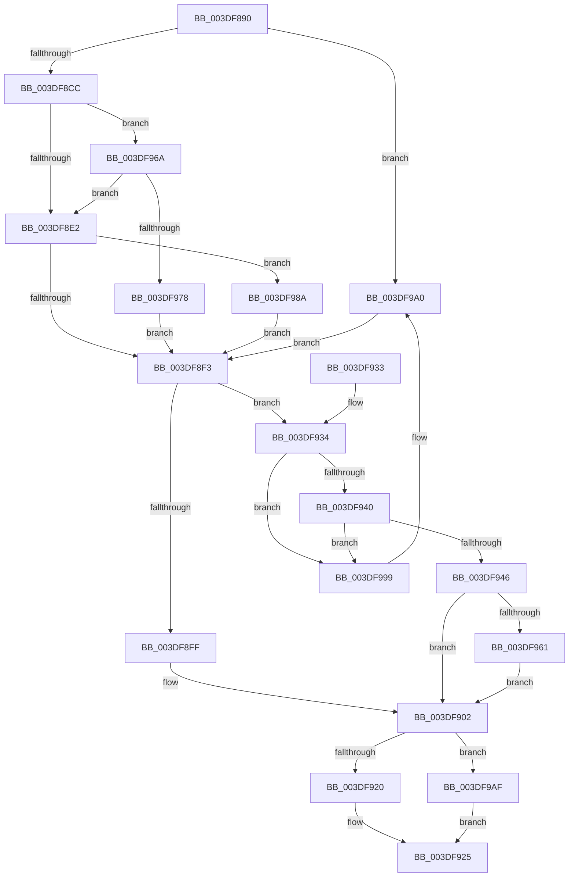

# KeRemoveDeviceQueue

- RVA: `0x003DF890`–`0x003DF9B9` (길이 `297` bytes)
- VA: `0x00000001403DF890`
- 실행 섹션: `.text`
- PDB 이름 있음: `예`; PDB Function 태그: `아니요`
- unwind 정보 RVA: `0x00094870`
- 디코드: `75`개 명령, `297/297` bytes 표시
- 미해석 바이트: `0` (있으면 어셈블리에 `.byte`로 보존)

> 이 문서는 커널 이미지의 기계어와 PDB 기호를 분석해 생성했습니다. 4번과 5번은 함수 원형과 자료형을 바이너리 사용 방식에서 추정한 C 해석이며 원본 소스 복구 결과는 아닙니다.

## 1. Dependencies

- 직접 호출 지점: **5**; 고유 호출 대상: **5**
- 직접 호출자로 확인된 함수: **4**
- RIP 상대 이미지 참조: **2**

### Outgoing calls
- `0x003DF920` → [KeReleaseInStackQueuedSpinLockFromDpcLevel](../21/KeReleaseInStackQueuedSpinLockFromDpcLevel_function_002171B0.md) (function, `0x002171B0`)
- `0x003DF980` → [KiAcquireQueuedSpinLockInstrumented](../27/KiAcquireQueuedSpinLockInstrumented_function_00275850.md) (function, `0x00275850`)
- `0x003DF98F` → [KxWaitForLockOwnerShip](../25/KxWaitForLockOwnerShip_function_00257EB0.md) (function, `0x00257EB0`)
- `0x003DF9A5` → [KeAcquireInStackQueuedSpinLock](../27/KeAcquireInStackQueuedSpinLock_function_002757A0.md) (function, `0x002757A0`)
- `0x003DF9AF` → [KeReleaseInStackQueuedSpinLock](../34/KeReleaseInStackQueuedSpinLock_function_00342CE0.md) (function, `0x00342CE0`)

### Direct callers
- [IoFreeAdapterChannelV2](IoFreeAdapterChannelV2_function_003DE3B0.md) at `0x003DE400`
- [IopStartNextPacket](../45/IopStartNextPacket_function_0045F9A4.md) at `0x0045F9E6`
- [IoFreeController](../59/IoFreeController_function_005979F0.md) at `0x005979FD`
- [DifKeRemoveDeviceQueueWrapper](../63/DifKeRemoveDeviceQueueWrapper_function_00632090.md) at `0x0063215D`

### Static image references
- `0x003DF8D5` → RVA `0x00FC6B06` (`ALMOSTRO`; read)
- `0x003DF96A` → RVA `0x00F0DE58` (`.data`; read)

## 2. Other-region calls and transfers

- 다른 실행 섹션으로 향하는 call: **0**
- 별도 외부 분기/꼬리 이동을 확인하지 못했습니다.

## 3. Assembly (complete function range)

```asm
003DF890  4C 8B DC                        mov r11, rsp
003DF893  49 89 5B 08                     mov qword ptr [r11 + 8], rbx
003DF897  57                              push rdi
003DF898  48 83 EC 40                     sub rsp, 0x40
003DF89C  33 C0                           xor eax, eax
003DF89E  0F 57 C0                        xorps xmm0, xmm0
003DF8A1  0F 11 44 24 20                  movups xmmword ptr [rsp + 0x20], xmm0
003DF8A6  49 89 43 E8                     mov qword ptr [r11 - 0x18], rax
003DF8AA  48 8B F9                        mov rdi, rcx
003DF8AD  65 48 8B 04 25 20 00 00 00      mov rax, qword ptr gs:[0x20]
003DF8B6  33 DB                           xor ebx, ebx
003DF8B8  48 83 C1 18                     add rcx, 0x18
003DF8BC  8B 90 BC 38 00 00               mov edx, dword ptr [rax + 0x38bc]
003DF8C2  0F BA E2 10                     bt edx, 0x10
003DF8C6  0F 82 D4 00 00 00               jb 0x1403df9a0
003DF8CC  49 21 5B D8                     and qword ptr [r11 - 0x28], rbx
003DF8D0  49 89 4B E0                     mov qword ptr [r11 - 0x20], rcx
003DF8D4  90                              nop
003DF8D5  F6 05 2A 72 BE 00 21            test byte ptr [rip + 0xbe722a], 0x21
003DF8DC  0F 85 88 00 00 00               jne 0x1403df96a
003DF8E2  48 8D 54 24 20                  lea rdx, [rsp + 0x20]
003DF8E7  48 87 11                        xchg qword ptr [rcx], rdx
003DF8EA  48 85 D2                        test rdx, rdx
003DF8ED  0F 85 97 00 00 00               jne 0x1403df98a
003DF8F3  48 8D 47 08                     lea rax, [rdi + 8]
003DF8F7  48 8B 08                        mov rcx, qword ptr [rax]
003DF8FA  48 3B C8                        cmp rcx, rax
003DF8FD  75 35                           jne 0x1403df934
003DF8FF  88 5F 20                        mov byte ptr [rdi + 0x20], bl
003DF902  65 48 8B 04 25 20 00 00 00      mov rax, qword ptr gs:[0x20]
003DF90B  8B 88 BC 38 00 00               mov ecx, dword ptr [rax + 0x38bc]
003DF911  0F BA E1 10                     bt ecx, 0x10
003DF915  48 8D 4C 24 20                  lea rcx, [rsp + 0x20]
003DF91A  0F 82 8F 00 00 00               jb 0x1403df9af
003DF920  E8 8B 78 E3 FF                  call 0x1402171b0
003DF925  48 8B C3                        mov rax, rbx
003DF928  48 8B 5C 24 50                  mov rbx, qword ptr [rsp + 0x50]
003DF92D  48 83 C4 40                     add rsp, 0x40
003DF931  5F                              pop rdi
003DF932  C3                              ret
003DF933  CC                              int3
003DF934  48 8B D9                        mov rbx, rcx
003DF937  48 8B 09                        mov rcx, qword ptr [rcx]
003DF93A  48 39 43 08                     cmp qword ptr [rbx + 8], rax
003DF93E  75 59                           jne 0x1403df999
003DF940  48 39 59 08                     cmp qword ptr [rcx + 8], rbx
003DF944  75 53                           jne 0x1403df999
003DF946  48 89 08                        mov qword ptr [rax], rcx
003DF949  48 89 41 08                     mov qword ptr [rcx + 8], rax
003DF94D  C6 43 14 00                     mov byte ptr [rbx + 0x14], 0
003DF951  48 8B 4F 20                     mov rcx, qword ptr [rdi + 0x20]
003DF955  48 8B C1                        mov rax, rcx
003DF958  48 C1 F8 08                     sar rax, 8
003DF95C  48 3B D8                        cmp rbx, rax
003DF95F  75 A1                           jne 0x1403df902
003DF961  0F B6 C1                        movzx eax, cl
003DF964  48 89 47 20                     mov qword ptr [rdi + 0x20], rax
003DF968  EB 98                           jmp 0x1403df902
003DF96A  8B 05 E8 E4 B2 00               mov eax, dword ptr [rip + 0xb2e4e8]
003DF970  85 C0                           test eax, eax
003DF972  0F 85 6A FF FF FF               jne 0x1403df8e2
003DF978  48 8B D1                        mov rdx, rcx
003DF97B  48 8D 4C 24 20                  lea rcx, [rsp + 0x20]
003DF980  E8 CB 5E E9 FF                  call 0x140275850
003DF985  E9 69 FF FF FF                  jmp 0x1403df8f3
003DF98A  48 8D 4C 24 20                  lea rcx, [rsp + 0x20]
003DF98F  E8 1C 85 E7 FF                  call 0x140257eb0
003DF994  E9 5A FF FF FF                  jmp 0x1403df8f3
003DF999  B9 03 00 00 00                  mov ecx, 3
003DF99E  CD 29                           int 0x29
003DF9A0  48 8D 54 24 20                  lea rdx, [rsp + 0x20]
003DF9A5  E8 F6 5D E9 FF                  call 0x1402757a0
003DF9AA  E9 44 FF FF FF                  jmp 0x1403df8f3
003DF9AF  E8 2C 33 F6 FF                  call 0x140342ce0
003DF9B4  E9 6C FF FF FF                  jmp 0x1403df925
```

## 4. C-style interpretation (structured pseudocode)

```c
__int64 __fastcall KeRemoveDeviceQueue(__int64 a1)
{
    __int64 result;
    __int64 v_rbx;
    __int64 v_rsp;
    unsigned __int64 v_stack_m28;
    unsigned __int64 v_stack_p20;
    unsigned __int64 v_stack_p8;

    *(unsigned __int64 *)(v_rsp + 8) = v_rbx;
    v_rsp = (v_rsp) - (64);
    result = 0;
    v_stack_m28 = v_xmm0;
    *(unsigned __int64 *)(v_rsp - 24) = 0;
    v_rbx = 0;
    a1 = (a1) + (24);
    if (condition_is_below) goto loc_003DF9A0;
    *(unsigned __int64 *)(v_rsp - 32) = a1;
    if (((*(unsigned __int8 *)(v_rip + 12481066)) & (33)) != 0) goto loc_003DF96A;
loc_003DF8E2:
    if (v_stack_m28 != 0) goto loc_003DF98A;
loc_003DF8F3:
    if ((*(unsigned __int64 *)(a1 + 8)) != (a1 + 8)) goto loc_003DF934;
    *(unsigned __int8 *)(a1 + 32) = 0;
loc_003DF902:
    if ((*(unsigned __int64 *)(a1 + 8)) < (a1 + 8)) goto loc_003DF9AF;
    result = KeReleaseInStackQueuedSpinLockFromDpcLevel(v_stack_m28, v_stack_m28, a3, a4);
loc_003DF925:
    v_rsp = (v_rsp) + (64);
    return 0;
loc_003DF934:
    if ((*(unsigned __int64 *)(v_stack_m28 + 8)) != 0) goto loc_003DF999;
    if ((*(unsigned __int64 *)(*(unsigned __int64 *)(v_stack_m28) + 8)) != v_stack_m28) goto loc_003DF999;
    *(unsigned __int64 *)(0) = *(unsigned __int64 *)(v_stack_m28);
    *(unsigned __int64 *)(*(unsigned __int64 *)(v_stack_m28) + 8) = 0;
    *(unsigned __int8 *)(v_stack_m28 + 20) = 0;
    result = (*(unsigned __int64 *)(a1 + 32)) >> (8);
    if (v_stack_m28 != result) goto loc_003DF902;
    *(unsigned __int64 *)(a1 + 32) = (unsigned __int8)(*(unsigned __int64 *)(a1 + 32));
    goto loc_003DF902;
loc_003DF96A:
    if ((unsigned int)((unsigned int)(*(unsigned int *)(v_rip + 11724008))) != 0) goto loc_003DF8E2;
    result = KiAcquireQueuedSpinLockInstrumented(v_stack_p20, *(unsigned __int64 *)(a1 + 32), a3, a4);
    goto loc_003DF8F3;
loc_003DF98A:
    result = KxWaitForLockOwnerShip(v_stack_p20, *(unsigned __int64 *)(a1 + 32), a3, a4);
    goto loc_003DF8F3;
loc_003DF999:
loc_003DF9A0:
    result = KeAcquireInStackQueuedSpinLock(3, v_stack_p20, a3, a4);
    goto loc_003DF8F3;
loc_003DF9AF:
    result = KeReleaseInStackQueuedSpinLock(3, v_stack_p20, a3, a4);
    goto loc_003DF925;
}
```

## 5. (Beta) C Style

```c
int64_t KeRemoveDeviceQueue(void *Arg1)
{
    uint8_t *arg1 = (uint8_t *)Arg1;

    int64_t result;
    int64_t local_rbx;
    int64_t local_rsp;
    uint64_t v_stack_m28;
    uint64_t v_stack_p20;
    uint64_t v_stack_p8;

    *(uint64_t *)(local_rsp + 0x8) = local_rbx;
    local_rsp = (local_rsp) - (64);
    result = 0;
    v_stack_m28 = v_xmm0;
    *(uint64_t *)(local_rsp - 0x18) = 0;
    local_rbx = 0;
    Arg1 = (Arg1) + (24);
    if (condition_is_below) goto loc_003DF9A0;
    *(void **)(local_rsp - 0x20) = Arg1;
    if (((*(uint8_t *)(v_rip + 0xBE722A)) & (33)) != 0) goto loc_003DF96A;
loc_003DF8E2:
    if (v_stack_m28 != 0) goto loc_003DF98A;
loc_003DF8F3:
    if ((*(uint64_t *)(arg1 + 0x8)) != (Arg1 + 8)) goto loc_003DF934;
    *(uint8_t *)(arg1 + 0x20) = 0;
loc_003DF902:
    if ((*(uint64_t *)(arg1 + 0x8)) < (Arg1 + 8)) goto loc_003DF9AF;
    result = KeReleaseInStackQueuedSpinLockFromDpcLevel(v_stack_m28, v_stack_m28, a3, a4);
loc_003DF925:
    local_rsp = (local_rsp) + (64);
    return 0;
loc_003DF934:
    if ((*(uint64_t *)(v_stack_m28 + 0x8)) != 0) goto loc_003DF999;
    if ((*(uint64_t *)(*(uint64_t *)(v_stack_m28) + 0x8)) != v_stack_m28) goto loc_003DF999;
    *(uint64_t *)(0) = *(uint64_t *)(v_stack_m28);
    *(uint64_t *)(*(uint64_t *)(v_stack_m28) + 0x8) = 0;
    *(uint8_t *)(v_stack_m28 + 0x14) = 0;
    result = (*(uint64_t *)(arg1 + 0x20)) >> (8);
    if (v_stack_m28 != result) goto loc_003DF902;
    *(uint64_t *)(arg1 + 0x20) = (uint8_t)(*(uint64_t *)(arg1 + 0x20));
    goto loc_003DF902;
loc_003DF96A:
    if ((uint32_t)((uint32_t)(*(uint32_t *)(v_rip + 0xB2E4E8))) != 0) goto loc_003DF8E2;
    result = KiAcquireQueuedSpinLockInstrumented(v_stack_p20, *(uint64_t *)(arg1 + 0x20), a3, a4);
    goto loc_003DF8F3;
loc_003DF98A:
    result = KxWaitForLockOwnerShip(v_stack_p20, *(uint64_t *)(arg1 + 0x20), a3, a4);
    goto loc_003DF8F3;
loc_003DF999:
loc_003DF9A0:
    result = KeAcquireInStackQueuedSpinLock(3, v_stack_p20, a3, a4);
    goto loc_003DF8F3;
loc_003DF9AF:
    result = KeReleaseInStackQueuedSpinLock(3, v_stack_p20, a3, a4);
    goto loc_003DF925;
}
```

### 관측된 메모리 오프셋

구조체 형식이 확인되지 않은 접근은 인자 기준의 오프셋으로만 기록했습니다.

| 기준 인자 | 오프셋 표현 | 폭 (bit) | 접근 |
|---|---:|---:|---|
| `Arg1` | `+ 0x0` | `64` | `R` |
| `Arg1` | `+ 0x0` | `64` | `R/W` |
| `Arg1` | `+ 0x0` | `64` | `W` |
| `Arg1` | `+ 0x8` | `64` | `R` |
| `Arg1` | `+ 0x20` | `8` | `W` |
| `Arg1` | `+ 0x20` | `64` | `R` |
| `Arg1` | `+ 0x20` | `64` | `W` |

## 6. Execution-region graph

[열기: 2D/3D 그래프와 함수 탐색 컨트롤 패널](../../../control-panel.html?section=text&rva=0x003DF890&view=graph)

- 2D 그래프는 위에서 아래로 흐르고, 3D 그래프는 빈 공간을 드래그해 회전합니다. Shift+드래그는 이동, 휠은 확대·축소, 함수 노드 선택은 대상 보고서 이동입니다.

### Static fallback


